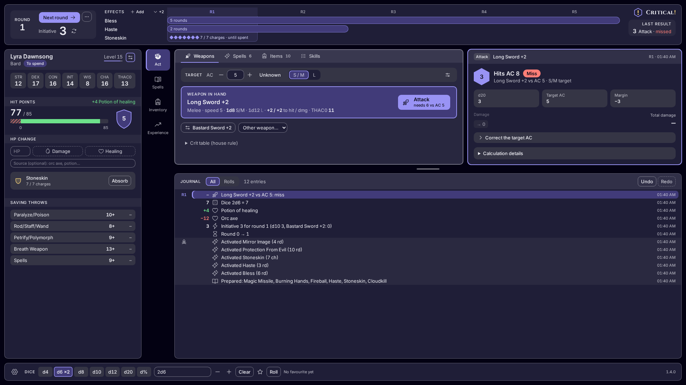
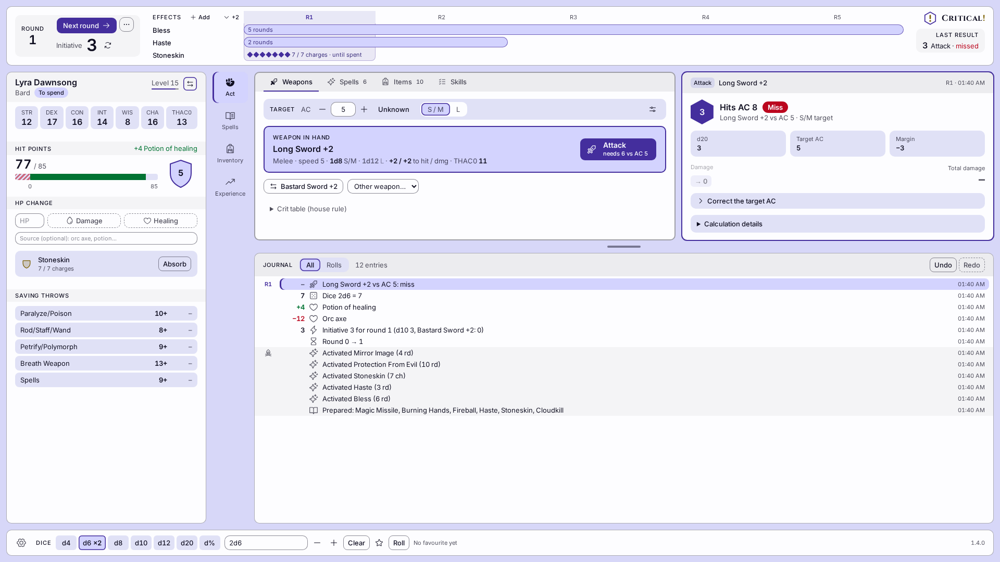
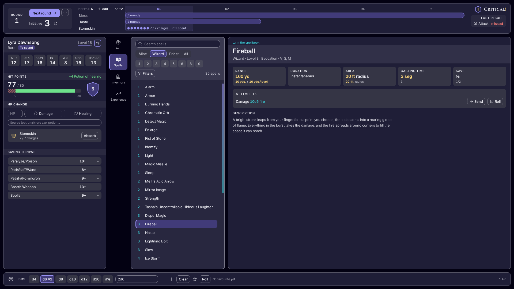
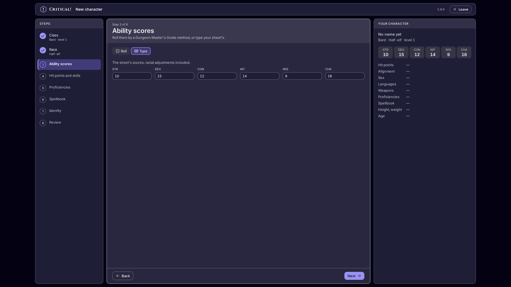
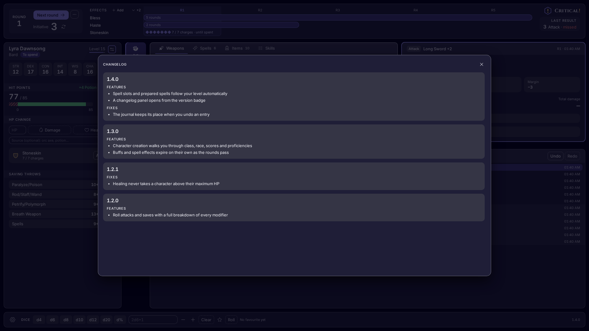

  <picture>
    <source media="(prefers-color-scheme: dark)" srcset="docs/images/banner-dark.svg">
    <source media="(prefers-color-scheme: light)" srcset="docs/images/banner-light.svg">
    
  </picture>

<strong>Your AD&amp;D 2nd edition character sheet, with the dice and the maths done for you.</strong>

  
  
  
  

## What it is

Critical! is a table companion for Advanced Dungeons & Dragons, 2nd edition. You keep your character
in it, tell it what you want to do (attack, cast a spell, check a skill) and it rolls the dice and
**shows its work**: every result comes with the full breakdown, so you and the table can see where
each number came from.

## Features

- **Hit points as a ledger.** Damage and healing are entries you can read back; undo the last one if
  you slipped.
- **Attacks and damage** with the complete breakdown: to-hit, bonuses, critical hits and damage.
- **Spells and spellbook.** Learn spells, prepare them for the day within your class limits, cast
  them and watch the effects and rounds tick by.
- **Proficiencies and skills**, rolled for you with the working shown.
- **Equipment.** Weapons, armour, ammunition and charged items, with your armour class worked out
  from what you wear.
- **Level-up.** Gain experience and roll your new level.
- **Themes.** Light, dark or follow your system, with several colour ambiances.
- **English and French.**

## Screenshots

The names and figures in the screenshots are sample data.

## Getting access

Critical! is **invitation only**. There is no public demo: everything sits behind a Google login, and
only invited players can sign in. If you play at the table, ask the table's admin to invite you.

## About

Critical! is built for one gaming group that plays AD&D 2nd edition and was tired of recomputing the
same modifiers by hand mid-fight. It is a game tool for a single table, not a service for the
public. Today it is made for players; the Dungeon Master's role and a table shared between
players are planned.

## Roadmap

- More classes (the bard is the first one fully supported).
- A Dungeon Master's role.
- A shared table where players and the DM see the same fight.

## For developers

Want to build, run or contribute? See [CONTRIBUTING.md](CONTRIBUTING.md).

## License

Released under the [MIT License](LICENSE).

## Disclaimer

Critical! is an unofficial fan project. It is not affiliated with or endorsed by the owners of
Advanced Dungeons & Dragons, which is a trademark of its owner. The rulebooks' text is not part of
this repository.
