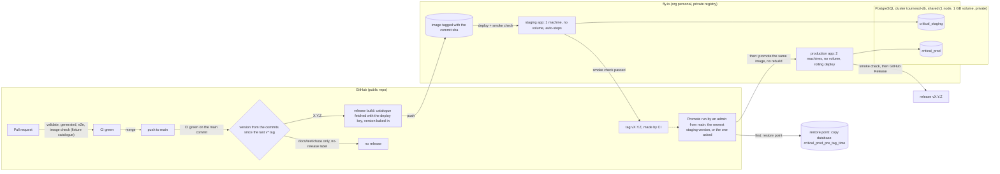

# ADR 0024: Deployment on fly.io: environments, release flow, image and data

**Status**: proposed, 2026-10-16. Step 8 and the defaults still listed as open under "Proposed
defaults awaiting the user" are proposals: each one becomes accepted when the user confirms it or
picks another option, and the answer is recorded here with its date. Amended 2026-10-16 by
[ADR 0025](0025-postgresql-storage.md) (see "Amendment (PostgreSQL on one fly cluster, 2026-10-16)"):
step 5 is answered (option (b), PostgreSQL first), steps 2, 4.2, 5, 6.1, 7 and 9 are rewritten for
volume-less apps on one fly PostgreSQL cluster, and the region, production data and PostgreSQL
defaults are answered. Amended again 2026-10-16 (see "Amendment (shared cluster tournesol-db,
2026-10-16)"): the cluster is the user's existing `tournesol-db`, shared, instead of a new
`critical-db`. Amended again 2026-10-16 (see "Amendment (restore point: a copy database,
2026-10-16)"): the pre-promotion restore point is a copy database on the same cluster, and production's
no-public-IP check has no bypass. Amended again 2026-10-17, **accepted, user OK 2026-10-17** (see
"Amendment (staging versions from the conventional commits, 2026-10-17)"): every staging release gets a
version computed from the commits, baked into the image and tagged by CI once staging passed (steps 1.4, 3,
4, 10.2 and the "release name" consequence). Amended again 2026-10-17, **accepted, user OK 2026-10-17**
(see "Amendment (promotion on demand, 2026-10-17)"): the promotion runs from main on demand, promotes the
newest version that passed staging or the one asked, and only a repository admin may run it (steps 4 and
10.2). Amended again 2026-10-17, **accepted, user OK 2026-10-17** (see "Amendment (a manual major,
2026-10-17)"): `just major` makes the next staging release the next major version (step 3).
Amended again 2026-10-20 (see "Amendment (a production record and the promote picker, 2026-10-20)"): a
promotion records the version production runs, and `just promote` offers the versions between production's and
staging's (step 4).
Amended again 2026-10-17 (see "Amendment (one tag ruleset, 2026-10-17)"): GitHub refuses the Actions-app
bypass on a personal repository, so only the `release tags` ruleset (step 10.2) remains.
Amended again 2026-10-17, **accepted, user decision 2026-10-17** (see "Amendment (restore point: a backup
file, 2026-10-17)"): the restore point is a `pg_dump` kept encrypted as an artifact of the Promote run, no
longer a copy database on the cluster (steps 4.2, 7, 9.2 and 9.3).
Amended again 2026-10-18 (see "Amendment (real login, 2026-10-18)"): step 8 chooses option (c), the login
of [ADR 0029](0029-users-login-and-access.md); public IPs are allowed once the gate is live, the
no-public-IP check becomes a gate check, and the apps are named `critical-hit` and `critical-hit-staging`.

## Context

User, 2026-10-12: hosting moves from the Proxmox + Tailscale plan (never built) to fly.io.

User, 2026-10-16: _"I'll be able to host freely on fly.io, i still have 10 vm available so we can have
a staging environment, a 2-machines for prod, a pgsql instance and room to spare. devise the plan for
automatic deployment to staging area when merging to main and promotion to prod on version tagging.
or you can propose a better deploy scheme if you see."_ Same day, as a hard rule: nothing reachable
from the public internet may serve the catalogue (book text) or the app without access control.

Today nothing is deployed. CI runs `just validate`, the generated-code check and the e2e suite on
every PR. The only packaging is docker-compose: the API image plus nginx serving a host-built
`web/dist`, with `seeds/` and `.catalogue/` bind-mounted. Two facts shape the design:

- **The catalogue is private book data** ([ADR 0021](0021-spell-catalogue.md) steps 4 and 7). It
  lives in the private `critical-rulebooks` repo; the deployment fetches it with a read-only deploy
  key. Any database built from it holds catalogue rows, so a database copy is private too.
- **Storage is SQLite** ([ADR 0021](0021-spell-catalogue.md) step 6). On fly a volume belongs to one
  machine, so a SQLite database cannot be shared by two machines. The move to PostgreSQL is a
  separate design (the multi-user model), not started.
  _Amended 2026-10-16: the user's free allowance cannot hold a 1 GB volume per app, so storage moves
  to PostgreSQL before the first deployment ([ADR 0025](0025-postgresql-storage.md)); the multi-user
  model stays a separate design._

The requested shape (staging from main, production from version tags) is kept. The one change to it
is that production runs one machine until storage moves to PostgreSQL (step 5). _Amended 2026-10-16:
no change remains; production runs two machines from the first deployment (step 5)._

## Decision

1. **One image per commit, built once.**
   1. A single container image serves everything: the Go binary serves `/api/*` and the built web
      app. Every non-`/api` path is a static file of the web build, or `index.html` when no such
      file exists (SPA fallback). Unknown `/api/*` paths keep the JSON 404. No nginx in production.
   2. The web directory is a configuration value; when it is unset (as in `just dev`), the server
      serves nothing outside `/api`.
   3. The image carries the campaign `seeds/` and the catalogue artifact, at the paths the server's
      configuration points to. The build takes the catalogue only as an explicit input and fails
      with a clear message when it is missing.
   4. `/api/health` reports the build identity: the commit the image was built from and the release
      version it was built as (`X.Y.Z`, step 3.1), both baked in at build time, each `unknown` when not
      set (as in `just dev`), next to `status`. _Amended 2026-10-17 (staging versions); was: the commit
      only._
   5. A main commit is built once; every later deployment of that commit (staging, production,
      rollback) runs that image, identified by its digest.

   Tests: `TestWeb_Step1_1_` (router: files, SPA fallback, JSON 404 under `/api`, no escape from the
   web dir, a dir without `index.html` refused), `TestWeb_Step1_2_NoWebDirServesNothingOutsideAPI`,
   `TestHealth_Step1_4_ReportsTheBuildCommit`, `TestHealth_Step1_4_ReportsTheBuildVersion`,
   `TestHealth_Step1_4_UnknownWithoutABuildIdentity`. Step 1.3 is checked by the CI `image` job
   (`scripts/image-smoke.sh`); the image and its inputs are described in `docs/backend.md`,
   "Production image".

2. **Environments.** _Amended 2026-10-16 ([ADR 0025](0025-postgresql-storage.md)); was: each app
   has its own volume holding its own SQLite database, and production keeps one machine._ Two fly
   apps in one fly org: **staging** and **production**. Neither app has a volume: their data lives in
   one fly legacy PostgreSQL cluster, the user's existing `tournesol-db`, which also holds the
   databases of the user's other app. _Amended 2026-10-16 (shared cluster); was: a new cluster
   `critical-db`, created for this app alone._ They share the image and the cluster, nothing else.
   1. Staging is disposable: its data may be wiped at any time. It runs one machine, which stops
      when idle and starts on the next request.
   2. Production runs two machines, always running (no auto-stop), updated by a rolling deploy.
   3. The cluster: one node, the smallest shared VM, one 1 GB volume, region `yyz`, no public IP.
      It holds two databases for this app, `critical_staging` and `critical_prod`, each owned by its
      own login user; a critical user can connect to its own database only, neither to the other's
      nor to any other database of the cluster. The other databases keep CONNECT for the login users
      they have when the provisioning runs and lose it for PUBLIC.
   4. Each app's DSN (its own user, its own database, the cluster's private address) is the fly
      secret `CRITICAL_DSN`; it is never in the fly config, the repo or a log.
   5. Nothing is paid without the user: if fly refuses a legacy cluster, or asks for payment or a
      card, the provisioning stops and reports.

3. **Staging on main.** On a push to main, once the CI jobs for that commit are green:
   1. the release computes the **version** of the commit first, from the conventional-commit titles of
      all main commits since the last `v*` version (one whose run was replaced in the queue, or that made
      no release, included); the highest level wins: `feat` a minor; `fix`, `refactor`, `perf`, any other
      type and a title not in the conventional format a patch; `docs`, `test`, `chore` nothing. A breaking
      change (`!`, `BREAKING CHANGE`) is a minor, with a notice that a major may be due: a major is made by
      hand. When no commit of the range has a level outside the PRs labelled `no-release`, there is **no
      release**: nothing is built, deployed or tagged, and the run stays green with a notice saying why;
   2. otherwise the release build fetches the catalogue with the read-only deploy key, builds the image
      of step 1 with that version baked in (step 1.4) and pushes it to the fly registry, tagged with the
      commit sha and the version;
   3. that image is deployed to staging;
   4. a smoke check verifies that `/api/health` answers 200 and reports that commit and that version. A
      failed smoke check fails the run;
   5. only then CI creates the annotated tag `vX.Y.Z` on the commit, and the staging deployment record
      carries the version. A failed staging run takes no version: the next release computes it again,
      so that number may go to a different image, which, unlike the failed one, gets the tag.

   _Amended 2026-10-17 (staging versions); was: the image is pushed tagged with the commit sha only, and
   a version exists only when a human pushes a tag._ The release, from the version to the tag, is one
   serialized run: a newer main commit replaces a queued older one, a started one is never cancelled, and
   two runs never compute a version at once. A manual run with no version releases main's head even when
   the rules make no release (at least a patch); with a version, it redeploys that version's image.

4. **Production on demand, from a version.** The promotion is run by hand by a repository admin, from main:
   with no version it promotes the **newest** version `vMAJOR.MINOR.PATCH` (by number) whose commit is on
   main and passed staging as that version; with a version (`X.Y.Z` or `vX.Y.Z`) it promotes that one. It
   runs main's workflow and scripts; the image and the migrations it embeds are the version's. No tag push
   starts it. _Amended 2026-10-17 (staging versions); was: pushing the tag promotes. Amended again
   2026-10-17 (promotion on demand); was: the promotion runs by hand from the version's tag, with that tag's
   workflow and scripts._
   1. the promotion refuses, before anything else is written, a version that is malformed, has no tag, whose
      commit is not on main, or whose image did not pass the staging smoke check of step 3 as that version;
      it says which version it promotes, its commit and digest, and what production runs. With no version,
      a failed read stops it (never a fallback to an older version), and a newest version older than
      production's is refused (a rollback names its version);
   2. it takes the restore point of step 9.2, a `pg_dump` of `critical_prod` kept encrypted as an artifact
      of its run, and waits for it to be kept; no restore point kept, no deploy. _Amended 2026-10-16
      ([ADR 0025](0025-postgresql-storage.md)); was: an on-demand snapshot of the production volume. Amended
      again 2026-10-16 (restore point); was: a `pg_dump` kept where step 9.2 would say. Amended again
      2026-10-17 (restore point: a backup file); was: a verified copy database of `critical_prod`._ It is
      private data (step 7);
   3. it deploys **the same image** (same digest as staging, no rebuild) to production;
   4. it runs the smoke check of step 3.3 against production;
   5. it creates a GitHub Release for the tag.

   Rollback is running the promotion for an older version (step 6 says when that is not enough).
   A promotion whose image is older than the production schema (`critical_prod` records a migration
   the tag's commit does not hold) is refused before the restore point is written: that rollback is
   the runbook's restore of step 9.3, then the promotion of the older tag. Production deployments never
   run concurrently and are never cancelled midway.

5. **Storage: PostgreSQL first, two production machines** (_accepted 2026-10-16, option (b); was
   the proposed default (a), SQLite on a volume with one machine per environment_). User,
   2026-10-16: _"can't request 1gb"_; _"if we need a volume, we can't go with fly.io. unless it's
   just a legacy postgres db"_. Options as proposed:
   - (a) ship on SQLite now, one machine per environment, PostgreSQL with the storage move:
     **not taken** (it needs a 1 GB volume per app);
   - **(b) PostgreSQL first: taken.** No deployment until the storage port of
     [ADR 0025](0025-postgresql-storage.md) is done;
   - (c) LiteFS replication of SQLite: rejected (pre-1.0, its cloud backup service is gone, and
     write forwarding adds moving parts to a single-user tool).

   1. The apps are stateless: no volume, no file the app writes outside the database.
   2. Production runs two machines from the first deployment and is deployed with fly's rolling
      strategy, one machine at a time, so a deploy has no planned downtime.
   3. Staging runs one machine with auto-stop and auto-start.

   Check: the fly config test (no `[[mounts]]`, no DSN in `[env]`, two production machines with
   the rolling strategy and no auto-stop, staging auto-stop).

6. **Migrations run at boot**, as today, before the server listens.
   1. An older binary does not undo a newer schema. Rolling back across a migration means
      redeploying the older tag **and** restoring `critical_prod` from the pre-promotion dump of
      step 4.2 (step 9.3). Data written since that dump is lost; the runbook says so before the
      restore. _Amended 2026-10-16 ([ADR 0025](0025-postgresql-storage.md)); was: restoring the
      pre-promotion volume snapshot._
   2. The server refuses to start when the database records a migration that its binary does not
      embed, so a rollback across a migration without the restore fails its smoke check instead of
      running on a schema it does not know. Tests:
      `TestMigrate_Step6_2_RefusesMigrationsTheBinaryDoesNotEmbed`,
      `TestMigrate_Step6_2_AcceptsADatabaseItsBinaryMigrated`,
      `TestBuild_AFailingStepRefusesTheStartAndClosesTheStore` (composition: the migrate step's refusal
      stops the start and closes the store).

7. **Private book data stays private.** The catalogue, and any database copy (it holds catalogue
   rows), never enters the public repo, a PR build, a workflow artifact, a shared build cache or a
   log. It lives only in the private fly registry image and in the fly PostgreSQL cluster with its
   volume snapshots (and on the operator's machine for a downloaded dump, step 9.4). _Amended
   2026-10-16 ([ADR 0025](0025-postgresql-storage.md)); was: on the fly volumes._ One exception, _amended
   2026-10-17 (restore point: a backup file)_: the promotion's restore point (step 9.2) is a workflow
   artifact, **encrypted only** (the repository is public, and so are its artifacts); the clear dump never
   leaves the runner and never reaches the log.
   1. PR builds and the CI image check use the fixture catalogue `api/testdata/catalogue.json`.
   2. The release build never echoes the catalogue, the deploy key or a token (no shell tracing), and
      does not export the layer that holds the catalogue to a build cache that other workflows can
      read.

8. **Access control: real login.** _Amended 2026-10-18 ([ADR 0029](0029-users-login-and-access.md)); was:
   private by default, with the options below awaiting the user._
   1. **Hard rule** (user, 2026-10-16): nothing reachable from the public internet serves the
      catalogue or the app without access control. Since 2026-10-17 (user: _"no content visible without
      authentication and authorization"_) the access control is option (c), the Google login with
      invites and server-side sessions of ADR 0029; only the login page, `/api/auth/*` and `/api/health`
      are public.
   2. Until the release being deployed carries the gate (ADR 0029 steps 3, 4 and 6), both apps stay
      **private**: no public IP, the first deploy uses `--no-public-ips` and allocates a private Flycast
      IPv6 only, and operators reach an app with `fly proxy` or fly WireGuard. **Once the gate is live**
      the apps may have **public IPs** and a public hostname.
   3. Every deploy job (staging and production) runs a check before and after deploying. While the
      release has no gate: it fails if the app has a public IP (_amended 2026-10-16 (user): for
      production with no bypass; only staging's honoured the `PUBLIC_ACCESS_OPTION` variable, since superseded: see the next paragraph_). With the
      gate: the **gate check** replaces the no-public-IP check, a request without a session to the
      catalogue and to a data route must answer 401 and only the public paths of ADR 0029 step 6.1 may
      answer 200; any other answer fails the deploy. The check reaches the app as in step 10.5.
      _Built 2026-10-18 (see "Amendment (going public, 2026-10-18)")._ The release **reports** the gate:
      `/api/health` carries `"login":"google"` when the Google login is configured (`"dev"` is the local dev
      login, which a hosted app refuses to start with). A public IP is allowed only on an app whose gate check
      passes (`scripts/gate-check.sh` on the public URL), for staging and production alike, before and after
      the deploy; there is no bypass and the `PUBLIC_ACCESS_OPTION` variable is gone.
   4. Options considered, (c) chosen: (a) shared-secret HTTP basic auth, (b) stay private behind
      WireGuard / Tailscale, **(c) real login** (ADR 0029). (a) and (b) are not built.
   5. App names: `critical-hit` (production) and `critical-hit-staging` (user, 2026-10-17:
      _"critical-hit and critical-hit-staging then"_; `critical.fly.dev` belongs to another account).

9. **Backups.** _Amended 2026-10-16 ([ADR 0025](0025-postgresql-storage.md)); was: daily
   snapshots of both app volumes (proposed retention 30 days production, 7 days staging), the
   pre-promotion volume snapshot, restore by attaching a volume made from a snapshot, a SQLite copy
   for download, Litestream rejected for now._
   1. The cluster's volume has fly's daily snapshots, with a set retention (30 days, answered
      2026-10-16; the runbook records the value set).
      A snapshot holds both databases.
   2. _Answered 2026-10-17 (user: "yes, go with the backup file"); was: a copy database of `critical_prod`
      on the same cluster (answered 2026-10-16, "1a"), and before that open._ Every promotion first takes a
      **restore point**: a `pg_dump` of `critical_prod` (custom format, `--no-owner --no-acl`) with the row
      count of every table, named after the release being promoted and the time,
      `critical_prod_pre_<tag>_<UTC time>` (e.g. `critical_prod_pre_v1_2_3_20261017153000`), kept as an
      artifact of that Promote run. Nothing is written on the cluster.
      1. The dump is taken in an ephemeral `fly console` machine of the production app, started from the
         release image (which ships the PostgreSQL client of the cluster's major version) without starting
         the server, so the app's own secret is the only database credential used and the running app is
         untouched. It comes back to the runner on the console's output, checked (size, SHA-256), and
         never into the log.
      2. It is encrypted on the runner with gpg (AES-256) under the passphrase `RESTORE_POINT_PASSPHRASE`, a
         secret of the `production` environment that only the restore point step reads; the operator keeps a
         copy (GitHub never shows a secret back). Only the encrypted file is uploaded (step 7).
      3. The artifact is kept **90 days**, the longest GitHub allows; the operator's dumps (step 9.4) and the
         snapshots (step 9.1) cover what is older.
      4. A failed dump, a damaged or cut transfer, a failed encryption or a failed upload stops the
         promotion before the deploy.
   3. Restore: `critical_prod` is restored from a restore point (fetched and decrypted by `just
      restore-point-fetch`, _amended 2026-10-17; was: a copy database copied into place_) or a `pg_dump`
      taken by step 9.4, without touching `critical_staging`: the current database is set aside and the dump
      is restored into a new empty one, with no server running on it meanwhile (the runbook's "Rollback").
      Restoring a cluster volume snapshot rolls back every database of the cluster; it is the fallback
      when no usable restore point exists.
   4. `just db-backup <env>` downloads a `pg_dump` of that environment's database into a gitignored
      folder on the operator's machine, with the table counts at dump time beside it. It is private data
      (step 7). `just db-restore-drill` restores a dump into a scratch database of a throwaway local
      PostgreSQL, compares the counts, and drops everything; it never touches fly (the runbook's
      "Backups").

10. **Secrets and permissions.**
    1. Each app has its own app-scoped fly deploy token, stored in the GitHub environment of the same
       name: `staging` and `production`.
    2. The `production` environment only accepts deployments from the branch `main`, and the promotion
       refuses any actor who is not a repository admin, before any secret is read (the user who started
       the run and the one who re-ran it). No required reviewer. _Amended 2026-10-17 (promotion on
       demand); was: from `v*` tags only, a tag running the promotion workflow of its own commit._ The tags
       name the versions the promotion resolves, so only a repository admin may move or delete a `v*` tag,
       and only an admin and the release job (the GitHub Actions app, through the workflow token) may
       create one (_amended 2026-10-17 (one tag ruleset), was: two tag rulesets, added 2026-10-16 and amended
       2026-10-17 (staging versions); now one, "release tags", moving and deleting only; creating a tag is not
       restricted_). CI is the only maker of version tags.
    3. The rulebooks deploy key is a read-only key on `critical-rulebooks`, held only by the job that
       builds the release image.
    4. When a staging secret is missing, the main-branch build and deploy jobs skip with a notice and
       never fail main. A promotion with a missing secret fails: running it is a deliberate act
       (_amended 2026-10-17 (staging versions); was: pushing a tag is a deliberate act_).
    5. Smoke checks reach the app through `fly proxy`, so they work while the app is private.

## Proposed defaults awaiting the user

Applied until the user answers; each answer is recorded here with its date and flips the matching
part of this ADR to accepted. Answered rows keep their original default and say what was chosen.

| Question | Default | Options |
|---|---|---|
| Access for a public URL (step 8) | private, no public IP | (a) basic auth + public IPs, (b) stay private, devices join WireGuard / Tailscale, (c) real login. **Answered 2026-10-17 (user): (c)**, recorded 2026-10-18 with [ADR 0029](0029-users-login-and-access.md); public IPs once the gate is live |
| PostgreSQL and the second production machine (step 5) | SQLite, one machine per environment | **Answered 2026-10-16: PostgreSQL first**, no deploy until then; two production machines from the first deploy ([ADR 0025](0025-postgresql-storage.md)) |
| Production data | fresh database | **Answered 2026-10-16: fresh database** (_amended 2026-10-16; was: seeded once with the user's data, the local `.dev/critical.db` copied into `critical_prod` by the copy tool_): production's first boot seeds it from `seeds/` and the catalogue, like staging; the user re-enters the few character-sheet edits made in the app. See "Amendment (production starts from the seeds, 2026-10-16)" |
| Production approval | none: running the promotion is the act (_amended 2026-10-17; was: pushing the tag is the act_) | a required reviewer on the `production` environment. **Answered 2026-10-17 (proposed with the promotion on demand): none**, the promotion checks that the actor is a repository admin (option (a)) |
| Names, region, size | `critical-staging` / `critical-prod` (**answered 2026-10-17: `critical-hit-staging` / `critical-hit`**), region `cdg`, shared-cpu-1x 256-512 MB, 1 GB volumes, staging auto-stops | **Region answered 2026-10-16: `yyz`**; no app volume, the shared cluster `tournesol-db` of step 2.3 holds the data. App names and the app VM size stay the defaults; app names are global on fly and set in one place |
| Where the pre-promotion dump is kept (step 9.2) | open: no promotion runs until it is answered | **Answered 2026-10-17: a backup file**, the `pg_dump` encrypted as an artifact of the Promote run, kept 90 days; see "Amendment (restore point: a backup file, 2026-10-17)". _Was: answered 2026-10-16 ("1a"), a copy database on the same cluster_ |
| Snapshot retention of the cluster volume (step 9.1) | 30 days | **Answered 2026-10-16: 30 days** (the default) |
| A migration during a rolling production deploy (step 5.2) | a release's migrations are additive, so the previous release keeps working on the new schema while its machines are replaced | **Answered 2026-10-16: additive migrations** (the default); the `immediate` strategy is not used |
| Custom domain | none | a domain, only once public access is chosen |

## Consequences

- **What each step's test looks like.** Steps 1.1, 1.2, 1.4 and 6.2 are Go tests (router, health
  handler, migration runner). Steps 1.3 and 7.1 are checked by the CI image job, which builds the
  image with the fixture and smoke-checks it. Steps 3, 4, 8.3 and 10 are workflow behaviour: their
  check is a failing run on the broken case (a smoke check against the wrong commit, a missing
  restore point, a public IP, a missing secret), exercised once by hand and noted in the PR that adds
  the workflow. Steps 2.1, 2.2 and 5 are fly configuration, checked by a parse and required-keys
  test of the fly config files. _Amended 2026-10-16: steps 2.3 to 2.5 and 9.1 are the cluster's
  configuration, made with flyctl and not in the repo; their evidence (`fly status`, `fly ips list`,
  a refused cross-database connection, `fly secrets list` showing names only) is noted in the PR that
  provisions it, and the runbook holds the commands._
- **The release flow is driven by GitHub Actions**, with the fly CLI. The deploy runbook
  (`docs/deploy.md`, written with the fly configuration) holds the commands: one-time setup, release,
  rollback, restore, catalogue update.
- **A new catalogue version reaches production** by being in the image: the release build fetches
  the catalogue at build time, so it takes a main build (any merge, or re-running the build for the
  current main commit) and then a tag. The importer ([ADR 0021](0021-spell-catalogue.md) step 5)
  applies it at boot.
- **Promotion and registry layout.** _Settled 2026-10-17 by a test with a production deploy token;
  was: "if the production token cannot read staging's repository, the promotion copies the image"._
  fly's API lets an app's deploy token use only that app's images (the registry lets it read the
  staging repository, but `fly console` and `fly deploy` refuse another app's image), so the promotion
  copies the image by digest into the production app's repository, with the production token, before
  the restore point; it never rebuilds. The digest check of step 1.5 holds: the copy has the digest
  staging smoke-checked.
- **The release name is in the image.** _Amended 2026-10-17 (staging versions); was: "the release name
  is not in the image: the image is built before the tag exists; `/api/health` reports the commit, and the
  GitHub Release maps the tag to it"._ The version is computed before the build and baked in, so each
  environment reports its version in `/api/health`; the tag follows once staging passed. A failed staging
  run's image reports a version that never becomes a tag.
- **Downtime and machine count.** _Amended 2026-10-16; was: one production machine, no redundancy,
  until the storage move._ Production runs two machines on a one-node cluster: a machine failure
  leaves the other serving, a cluster failure stops staging and production until fly restarts the
  node, or a restore (step 9.3). Accepted for a single-user tool on a free allowance.
- **Staging auto-stop.** A stopped staging machine starts on the next request through fly's proxy;
  the deploy starts it anyway, so the smoke check right after a deploy reaches it.
- **Production starts from the seeds** (_amended 2026-10-16, twice; was: production is seeded once
  with the user's data by the copy tool of [ADR 0025](0025-postgresql-storage.md) step 9_): like
  staging, its first boot imports the catalogue and the seeds. Nothing of the local play is carried
  over; the user re-enters by hand, in the production app, the character-sheet edits made in the app
  (see the amendment below).
- **Not covered**: the multi-user model and login, a custom domain, preview environments
  per PR (a PR build never sees the catalogue, so a preview would only show the fixture), and
  dependency update automation.
- **docker-compose** remains for running the production image locally, rebuilt on the single image
  of step 1.

## Amendment (PostgreSQL on one fly cluster, 2026-10-16)

User, 2026-10-16, on the fly free allowance: _"can't request 1gb"_; _"if we need a volume, we can't go
with fly.io. unless it's just a legacy postgres db"_; _"I need free hosting for this app."_ The same
triage decided the storage port ([ADR 0025](0025-postgresql-storage.md)) and the fly topology below.
What changed in this ADR, each change marked in place with its date and the text it replaces:

- **Step 2**: the apps have no volume. One new fly legacy PostgreSQL cluster, `critical-db` (one node,
  smallest shared VM, 1 GB volume, region `yyz`, private), holds the databases `critical_staging` and
  `critical_prod`, one login user each, neither able to reach the other's; each app's DSN is the fly
  secret `CRITICAL_DSN`. Staging runs one auto-stopping machine, production two.
- **Step 4.2**: a `pg_dump` of `critical_prod` before every promotion replaces the volume snapshot;
  no dump, no deploy.
- **Step 5**: answered, option (b), PostgreSQL first; production runs two machines from the first
  deploy with a rolling deploy.
- **Step 6.1**: a rollback across a migration restores `critical_prod` from the pre-promotion dump.
- **Step 7**: the private data lives in the cluster and its snapshots instead of the app volumes.
- **Step 9**: daily snapshots of the cluster volume; the pre-promotion dump; restore from a dump;
  `just db-backup <env>` downloads a `pg_dump`; the Litestream line is removed (nothing to replicate
  on the app side).
- **Defaults**: PostgreSQL timing, production data (seeded once with the user's data) and region
  (`yyz`) answered; three new open questions (where the pre-promotion dump is kept, the cluster
  snapshot retention, a migration during a rolling deploy).
- **Context and Consequences**: the SQLite and one-machine statements are marked as superseded.

## Amendment (shared cluster tournesol-db, 2026-10-16)

`fly postgres create --name critical-db` (one node, 256 MB, 1 GB volume, `yyz`) was refused on
2026-10-16 with _"To create more than 1GB in volumes please add a payment method"_: the org's free
allowance holds one 1 GB volume, and the user's existing cluster `tournesol-db` already has it (an
earlier try failed on fly's Consul step, then passed). A new machine running PostgreSQL by hand
needs the same volume. User, 2026-10-16: _"ok so we reuse the existing db running. tournesol-db"_,
then, after the options were laid out (share it, or free its volume for a cluster of our own),
_"1 for now"_.

- **Step 2 and 2.3**: the cluster is `tournesol-db` (postgres-flex 17, one node, shared-cpu-1x
  256 MB, 1 GB volume, `yyz`, private), shared with the user's other app. Its other databases
  (`template1` included) keep CONNECT for the login users they have when the provisioning runs and
  lose it for PUBLIC, so a critical user reaches only its own database; the other app's users of that
  day keep their access. A user the other app gets later needs an explicit `GRANT CONNECT` (the
  runbook says how): the price of sharing the cluster.
- **Step 9.1**: the daily snapshots of the cluster volume, retention 30 days, also hold the other
  app's databases; restoring a snapshot rolls them back too, one more reason step 9.3 restores from a
  dump first.
- **Consequences**: the cluster stops when idle (scale to zero, as configured before this app used
  it) and starts on the next connection through its `.flycast` address, so the first request after an
  idle period waits for PostgreSQL to start. _Amended 2026-10-18 ([ADR 0025](0025-postgresql-storage.md)
  step 10): it waits at most its 8-second deadline, then answers 503 `database_unavailable`, and the web
  retries the read until PostgreSQL is up; a server booting still waits up to 60 seconds._
- **Reversible**: if the other app's data is no longer needed, its volume can be freed and a cluster
  of this app's own created as first planned; the DSN secrets are the only thing to change.

## Amendment (production starts from the seeds, 2026-10-16)

User, 2026-10-16, before the first production deploy: _"we'll need to seed only non gameplay data
(data not affected by playing). the runs i've been doing is for testing"_, then, offered (A) a fresh
boot and re-entering the sheet edits by hand, (B) adding them to `seeds/`, (C) a partial copy tool:
_"we go with A"_.

- The local play (action log, its snapshots and corrections, buffs, round, spell slots, attack form)
  was testing and is not production data.
- The data play does not change is what the first boot seeds from `seeds/` and the catalogue: the
  character, proficiencies, bard skills, weapons, items, spells. A comparison of the user's local
  database with a fresh boot (`scripts/db-compare.sh`, names and counts only) found three edits made
  in the app that the seeds do not hold: the crit table, one added item and one dice favourite. The
  user re-enters them in the production app after its first deploy (docs/deploy.md, "user steps
  left").
- So production gets no copy: the copy tool of [ADR 0025](0025-postgresql-storage.md) step 9 is no
  longer needed for it (ADR 0025 step 9.3), and it is retired with the first production deploy
  (step 9.5).

## Amendment (restore point: a copy database, 2026-10-16)

_Superseded 2026-10-17 for the restore point by "Amendment (restore point: a backup file, 2026-10-17)": no
copy database, no `CREATEDB`. Its step 8.3 part (no bypass for production) stands._

The promotion needed a place for its pre-promotion `pg_dump` (step 9.2, open). Offered: the cluster's own
volume, a private store, or a dump taken by the operator before tagging. User, 2026-10-16: _"1a"_, a copy
database on the same fly cluster, named after the release, keeping the last few; not a GitHub artifact,
not a bucket; fly's daily snapshots of the cluster cover the loss of the machine. Same day: the apps stay
private until access control is decided, so production's no-public-IP check is mandatory.

- **Step 4.2**: the promotion takes a restore point, a verified copy database (step 9.2); no restore
  point, no deploy.
- **Step 8.3** (superseded): production's check had no bypass; staging's honoured `PUBLIC_ACCESS_OPTION`. The gate check replaced both.
- **Step 9.2**: answered, the restore point `critical_prod_pre_<tag>_<UTC time>`, newest 3 kept, a 300 MB
  budget for `critical_prod` and its copies, made from an ephemeral console machine of the release image.
- **Step 9.3**: restore by copying the restore point into the place of `critical_prod`.
- **Privilege**: `critical_prod` gets `CREATEDB` (one attribute, prod only). It lets that user create
  databases on the shared cluster, never read or change the other app's (CONNECT stays locked, and a
  database it creates gets PUBLIC's CONNECT revoked at once); the size budget and the retention bound how
  much of the shared volume it takes. A separate role it can `SET ROLE` to would hold the same power for
  anyone with the app's secret, and a separate credential would have to be a second fly app's secret; both
  were judged not worth it for one user.
- **Tests**: `scripts/test-promotion.sh` (guards, step order, refusals, offline) and the restore point run
  for real against a throwaway PostgreSQL 17 by `scripts/image-smoke.sh` (the CI `image` job).

## Amendment (staging versions from the conventional commits, 2026-10-17)

**Accepted, user OK 2026-10-17** (was: proposed, awaiting the user's OK before merge). User, 2026-10-17: _"have staging releases infer the
version number automatically from conventional commit to bump minor or patch version (major is manual).
then promotion to prod just promote latest staging version. this way we have no risk of generating a bad
tag and we know easily the different version on each environment. useful if we decide not to promote for a
while"_. Decided in the same triage: the range is all main commits since the last version, highest bump
wins; `feat` minor; `fix`, `refactor`, `perf` and non-conventional titles patch; a breaking change a minor
plus a notice; `docs`, `test`, `chore` and the `no-release` PR label make no release (no build, no deploy,
no tag), with no "force release" label; the version is baked in and reported by `/api/health`; the tag is
created only after the staging smoke check; the manual staging run with no input releases main's head, with
a version redeploys it; `just release` goes away and CI is the only maker of version tags.

- **Step 1.4**: `/api/health` reports `version` next to `commit`, `unknown` when not set.
- **Step 3**: the version first (3.1), the build with it (3.2), the deploy and smoke check with the version
  (3.3, 3.4), the tag last (3.5); one serialized run from the version to the tag; the manual run.
- **Step 4**: the promotion runs only by hand (`workflow_dispatch`) from a version tag; it has no tag-push
  trigger, so no tag starts it, CI's or an admin's (a tag CI creates would start no workflow anyway: GitHub
  starts none for events made with a workflow's `GITHUB_TOKEN`, except `workflow_dispatch` and
  `repository_dispatch`). One commit can carry two versions (a manual release of a tagged head, a new
  catalogue): the guard of step 4.1 takes the staging deployment recorded as the tag's version, so each
  version promotes its own image. Promoting the newest staging version on demand and making a major are
  later changes.
- **Step 10.2**: the tag rules split in two rulesets: moving and deleting `v*` tags stays admin-only;
  creating one is open to admins and the GitHub Actions app. Any workflow token of the repository with
  `contents: write` can therefore create a `v*` tag; such a tag starts no workflow, the release refuses to
  release while the highest `v*` tag is not before its commit ("a newer release exists", also what stops an
  older run re-run after a newer release), and the operator promotes only versions the release made
  (runbook, "GitHub").
- **Consequences**: the release name is in the image.
- **Tests**: `scripts/test-release-version.sh` (the rules as a table, the range and labels on a fixture
  repository, the tag's API calls), `scripts/test-release-scripts.sh` and `scripts/test-staging-deploy.sh`
  (the version through the build, the deploy, the smoke and the record; the job's steps), the health tests of
  step 1.4, and the CI `image` job (`scripts/image-smoke.sh` checks the baked version).

## Amendment (promotion on demand, 2026-10-17)

**Accepted, user OK 2026-10-17** (was: proposed, awaiting the user's OK before merge). User, 2026-10-17: _"then promotion to prod just promote
latest staging version ... useful if we decide not to promote for a while"_. Decided in the same triage: the
trigger is a manual run with an optional `version` input; with none, the newest `v*` version whose staging
deployment passed; the run is main's workflow and scripts, not the tag's; the guards stay (a passed staging
record for the version's commit gives the digest, the restore point first, the refusal of a production schema
newer than the image, the same digest, the smoke check, the GitHub Release); who may promote is option (a),
the job checks the actor is a repository admin and refuses otherwise, no required reviewer.

- **Step 4**: run by hand from main (`just promote [version]`); no version, the newest version (by number)
  on main that passed staging as that version, higher tags that did not being skipped with the reason; a
  version, that one (the rollback); a malformed, missing, off-main or not-staged version is refused before
  the production environment, so before the restore point. The run prints the version, its commit, its
  digest and what production's machines run. The rest of step 4 (the restore point, the schema refusal, the
  same image, the smoke check, the release) is unchanged.
- **Step 10.2**: `production` accepts deployments from the branch `main` instead of the `v*` tags; the
  promotion's jobs check, first and before any secret, that the user who started the run and the one who
  re-ran it are repository admins. A writer can still dispatch the workflow (GitHub allows it) but the run
  stops there; a writer's own workflow on a branch gets no production token. The tag rulesets stay: the tags
  are the versions.
- **No silent fallback**: with no version, a higher tag is skipped only on a definite no (off main, or its
  staging records read and none passed as that version); a failed API read stops the promotion. And the
  newest version is never older than the highest version production's machines run (unreadable: refused;
  no version label: no floor): going down is a rollback, asked by naming the version.
- **Why main's scripts**: the guards a promotion runs are the reviewed ones on main, whatever commit the
  version is; a tag can no longer bring its own workflow. The migration check still reads the version's
  tree, and the fly configuration is main's (it is the app's, not the image's). **The limit**: a rollback
  runs main's fly configuration, smoke check and restore point against an old image. Once main moves past
  what that image does (a new `[env]` value, a smoke check of a newer endpoint), the rollback fails, at the
  restore point (nothing deployed) or at the smoke check (after the deploy). The runbook ("Rollback", "An old
  image under main's scripts") tells the operator how to tell the two apart, and how to finish the rollback
  with the version's own scripts (`scripts/promote.sh` from the version's tree, operator token). Main's
  scripts are expected to accept the versions it may roll back to; a case that does not is a bug.
- **Tests**: `scripts/test-promotion.sh` (the resolution and its refusals on a fixture repository, the
  admin check, the environment's rule, `just promote`, the workflow parsed: the admin check before any
  secret, the version resolved in a job without the environment).

## Amendment (a manual major, 2026-10-17)

**Accepted, user OK 2026-10-17** (was: proposed, awaiting the user's OK before merge). User, 2026-10-17: _"major is manual"_. Decided in the same
triage: a manual workflow, admin only, records a marker that the version computation reads; it affects only
the next release; on `0.x` the first major is `1.0.0`; a major is never automatic (a breaking change stays a
minor with a notice).

- **Step 3 (the version)**: `just major` runs the Major workflow from main, which moves the marker tag
  `next-major` to main's head (the job checks the actor and the re-runner are repository admins, before
  anything else). The release computes `(N+1).0.0` instead of the bump when the marker names a commit after
  the last version tag and reachable from the commit released; a range that makes no release makes none (the
  marker waits). An older marker is ignored, so it is never deleted.
- **Step 10.2**: the marker is not a `v*` tag, so the two `v*` rulesets are unchanged; a third ruleset lets
  only an admin and the GitHub Actions app create, move or delete `next-major`. The workflow has
  `contents: write` and no secret or environment.
- **Tests**: `scripts/test-release-version.sh` (marker after the last version -> major, before or on it ->
  ignored, on a later commit -> left for later, docs-only -> no release and still pending, used once) and
  `scripts/test-major.sh` (the marker's API calls, the admin refusal, `just major`, the workflow, the ruleset).

## Amendment (one tag ruleset, 2026-10-17)

User, 2026-10-17, running `scripts/github-tag-ruleset.sh`: `release tags` was applied; `release tag creation`
failed with HTTP 422. On a repository owned by a personal account GitHub does not accept the GitHub Actions app
(`Integration` 15368, the release job's workflow token) as a ruleset bypass actor, and the `next-major marker`
ruleset has the same bypass and the same fate. Decided by the supervisor (grooming delegated by the user): keep
`release tags`, drop the other two. Since the promotion runs main's scripts with the version as an input
(amendment "promotion on demand"), a `v*` tag no longer selects the code that reaches production, and the
repository's only collaborator is its owner. The first automatic release, v0.2.0, was tagged by CI with no
creation rule.

- **Step 10.2**: one ruleset on `v*`, `release tags`: update and deletion, admin bypass. Was: three (the
  other two: creation on `v*`, admin and the Actions app; creation, update and deletion on `next-major`, admin
  and the Actions app). Creating a `v*` tag and writing `next-major` are not restricted; the effects are
  bounded as before (a stray tag is never resolved as a version unless staging recorded it; the marker only
  changes the next number). The old reasoning about the Actions bypass (a workflow with `contents: write` can
  create a `v*` tag) now holds for any writer. The script removes the two obsolete rulesets by name if they
  exist. Were the repository moved to an organization, they could come back.
- **Tests**: `scripts/test-major.sh` (the dry-run is `release tags` alone; a run with `gh` stubbed deletes the
  two obsolete rulesets by name, replaces `release tags` and writes nothing else).

## Amendment (restore point: a backup file, 2026-10-17)

**Accepted, user decision 2026-10-17**: _"yes, go with the backup file"_. Three promotions failed at the copy
database of the 2026-10-16 amendment (the last, run 39090345876): restoring `critical_prod` into a copy on
`tournesol-db` (shared with the other app, `shared-cpu-1x`, 256 MB) ran the VM out of memory, and the cluster
dropped connections mid-restore. fly's own `flypgadmin` sessions also held leftover copies, so
`critical_prod` could not drop them. Scaling the cluster costs and it is shared; a `pg_dump` alone is light.

- **Step 4.2**: the restore point is the dump of step 9.2, kept before the deploy: no restore point kept, no
  deploy.
- **Step 7**: one exception, the restore point as an encrypted workflow artifact. The user's words were
  "kept privately"; the repository is public and GitHub lets anyone signed in download a public repository's
  artifacts, so the file is gpg-encrypted on the runner (AES-256, the `production` secret
  `RESTORE_POINT_PASSPHRASE`, made by `just restore-point-key`) and only the ciphertext is uploaded.
- **Step 9.2**: a `pg_dump` and its table counts, made in the console machine as before, sent back on its
  output, checked, encrypted, uploaded with the run, kept 90 days (GitHub's longest). No copy database, no
  retention or size budget on the cluster.
- **Step 9.3**: `just restore-point-fetch <version>` downloads, decrypts and unpacks it like a `just
  db-backup` folder; the drill and the runbook's restore from a dump take it from there.
- **Privilege**: `critical_prod` no longer needs `CREATEDB`; the provisioning removes it on its next run.
- **Leftovers**: the copy databases `critical_prod_pre_*` already on the cluster are dropped by hand by the
  cluster's superuser, never by the pipeline (the runbook's "Promotion").
- **Tests**: `scripts/test-promotion.sh` (the block kept out of the log, a cut or damaged one refused,
  the file decrypting with the passphrase only, the two halves around the upload, the fetch and the key
  scripts, the workflow parsed) and `scripts/image-smoke.sh` (the dump from the real image restores with its
  counts, no database created, a lost connection retried).

## Amendment (real login, 2026-10-18)

Access control for a public URL was open (step 8). User, 2026-10-17: players log in with SSO, are invited
first, an admin section manages users and invites, and _"no content visible without authentication and
authorization"_. The design is [ADR 0029](0029-users-login-and-access.md).

- **Step 8**: option (c), real login, is chosen. Public IPs are allowed once the login gate is live in the
  deployed release; until then the apps stay private.
- **Step 8.3**: the no-public-IP check is replaced, for a release with the gate, by a gate check (401
  without a session on the catalogue and on a data route, 200 only on the public paths). Production's
  no-bypass rule of the 2026-10-16 amendment holds for the old check until the gate is live.
- **App names**: `critical-hit` and `critical-hit-staging`, replacing `critical-prod` and
  `critical-staging`.
- **Step 10**: the Google OAuth client secret is a per-app fly secret like the database URL.

## Amendment (going public, 2026-10-18)

The first public deploy, on `critical-hit` and `critical-hit-staging` (free: a shared IPv4 and an IPv6, no
custom domain). Step 8.3 as built:

- **The gate reports itself.** `/api/health` gains `"login"`: `"google"` when the three OAuth settings are set,
  `"dev"` for the local dev login. A hosted server cannot run with `"dev"` (ADR 0029 step 8.2), so on fly the
  field is the proof that the release was started with the Google login, and a release from before this field
  reads as not gated.
- **One access check for both environments** (`scripts/fly-access-check.sh`): no public address needs the
  private Flycast address (`fly-private-check.sh`); a public address needs the **gate check** on
  `https://<app>.fly.dev` (`scripts/gate-check.sh`: health reports `google`; the dev login route is absent and
  not offered; `/api/character`, `/api/characters`, `/api/spells/names` and `/api/spells/filters` answer 401;
  a POST to `/api/characters` is refused; a browser on `/` or a page is redirected to `/login`; `/login` is the
  login page). Staging's deploy runs it before and after the deploy, production's promotion too. Staging's
  `PUBLIC_ACCESS_OPTION` bypass (step 8.3, 2026-10-16) and the unused step 8.4 option variable are removed: the
  login is the access control.
- **The static bundle stays public** (ADR 0029 amendment): the check does not ask for a 401 on `/assets/*`,
  which the login page needs; it asks that no page but `/login` carries the app and that no `/api` data route
  answers a visitor.
- **Names.** The apps are `critical-hit` and `critical-hit-staging`; the databases and their users keep the
  environment's name (`critical_prod`, `critical_staging`), so the move keeps the data: each new app's
  `CRITICAL_DSN` is the old app's, copied inside fly (`scripts/fly-app-create.sh`). The old private apps are
  retired after the new ones pass.
- **Per-app login secrets** (`CRITICAL_GOOGLE_CLIENT_ID`, `_SECRET`, `CRITICAL_PUBLIC_URL`) are set by
  `scripts/fly-google-secrets.sh`; one Google OAuth client per environment, with its `fly.dev` redirect URI.
- **The tunnel is no longer a login path.** `just fly-open` takes a free port; the fixed login ports 8091 and
  8092 of the private era are gone.

## Amendment (a production record and the promote picker, 2026-10-20)

User, 2026-10-20: _"Promotion to prod is choosing a staging version (default latest) and promoting it to prod.
The just promote command lists versions between current prod and staging (using gum), initial selection being
current staging."_ Versions are already made at the staging release and the promotion already takes a staging
version (the amendments of 2026-10-17); this adds the choice and what it needs: which version each environment
runs.

- **Step 4, the production record.** Once the deploy and its smoke check passed (and after the GitHub
  Release), `promote.sh` writes a GitHub deployment of the environment `production`, task `deploy-production`,
  ref the version's commit, payload `{commit, digest, version}` (the shape of the staging record), then a
  `success` status; the rollback writes one too. A promotion that failed before that writes nothing. A refused
  write is a `::warning::`, never a red run (production runs the version and the Release exists; a failure
  here would repeat on every re-run): the picker then shows production as unknown or older until a re-run of
  the same version (the floor accepts an equal one) writes it. GitHub's
  automatic deployment of the job (task `deploy`, ref `main`, no payload) is never read. No record exists for
  the promotions made before this: production's version is then _unknown_.
- **Step 4, the candidates.** `scripts/release-guards.sh candidates` prints what the picker offers: the `v*`
  versions on main that passed staging as that version, **above** production's recorded version (the latest
  successful production record) and **up to** staging's current one (the latest successful staging record),
  newest first, at most 20; production unknown: every staged version up to staging's, said as such; production
  at or above staging's: none (going down stays `just promote X.Y.Z`, deliberate). It is the same
  implementation as the workflow's resolution with no version (`passed_versions`), so the picker never offers
  what the workflow would refuse. A failed read, or no staging record, stops (exit 3): never a silent fallback.
- **The picker.** `just promote` in a terminal with no version shows a gum picker of the candidates, staging's
  preselected; Enter dispatches the Promote workflow with that version, Esc or Ctrl-C dispatches nothing.
  Production already at staging's version: says so. `just promote X.Y.Z` never prompts; with no terminal and no
  version the workflow resolves the newest staged version as before. gum is needed on the interactive path only.
  The workflow's guards and the admin check still decide every run.
- **Tests**: `scripts/test-promotion.sh` (candidates on the fixture repository: floor, ceiling, unknown
  production, not-staged skipped, the 20 cap, failed reads; the record's API calls and their order; the picker
  with gum stubbed), `scripts/test-staging-deploy.sh` (`record-deployment.sh --production`).
