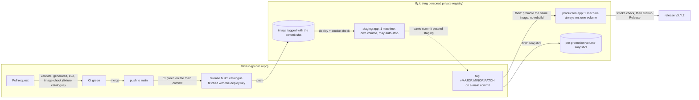

# ADR 0024: Deployment on fly.io: environments, release flow, image and data

**Status**: proposed, 2026-10-16. Steps 5 and 8 and the defaults listed under "Proposed defaults
awaiting the user" are proposals: each one becomes accepted when the user confirms it or picks
another option, and the answer is recorded here with its date.

## Context

User, 2026-10-12: hosting moves from the Proxmox + Tailscale plan (never built) to fly.io.

User, 2026-10-16: _"I'll be able to host freely on fly.io, i still have 10 vm available so we can have
a staging environment, a 2-machines for prod, a pgsql instance and room to spare. devise the plan for
automatic deployment to staging area when merging to main and promotion to prod on version tagging.
or you can propose a better deploy scheme if you see."_ Same day, as a hard rule: nothing reachable
from the public internet may serve the catalogue (book text) or the app without access control.

Today nothing is deployed. CI runs `just validate`, the generated-code check and the e2e suite on
every PR. The only packaging is docker-compose: the API image plus nginx serving a host-built
`web/dist`, with `seeds/` and `.catalogue/` bind-mounted. Two facts shape the design:

- **The catalogue is private book data** ([ADR 0021](0021-spell-catalogue.md) steps 4 and 7). It
  lives in the private `critical-rulebooks` repo; the deployment fetches it with a read-only deploy
  key. Any database built from it holds catalogue rows, so a database copy is private too.
- **Storage is SQLite** ([ADR 0021](0021-spell-catalogue.md) step 6). On fly a volume belongs to one
  machine, so a SQLite database cannot be shared by two machines. The move to PostgreSQL is a
  separate design (the multi-user model), not started.

The requested shape (staging from main, production from version tags) is kept. The one change to it
is that production runs one machine until storage moves to PostgreSQL (step 5).

## Decision

1. **One image per commit, built once.**
   1. A single container image serves everything: the Go binary serves `/api/*` and the built web
      app. Every non-`/api` path is a static file of the web build, or `index.html` when no such
      file exists (SPA fallback). Unknown `/api/*` paths keep the JSON 404. No nginx in production.
   2. The web directory is a configuration value; when it is unset (as in `just dev`), the server
      serves nothing outside `/api`.
   3. The image carries the campaign `seeds/` and the catalogue artifact, at the paths the server's
      configuration points to. The build takes the catalogue only as an explicit input and fails
      with a clear message when it is missing.
   4. `/api/health` reports the build identity: the commit the image was built from (baked in at
      build time, `unknown` when not set), next to `status`.
   5. A main commit is built once; every later deployment of that commit (staging, production,
      rollback) runs that image, identified by its digest.

2. **Environments.** Two fly apps in one fly org: **staging** and **production**. Each has its own
   volume holding its own SQLite database; they share nothing but the image.
   1. Staging is disposable: its data may be wiped at any time, and its machine may stop when idle
      and start on the next request.
   2. Production keeps one machine always running (no auto-stop).

3. **Staging on main.** On a push to main, once the CI jobs for that commit are green:
   1. the release build fetches the catalogue with the read-only deploy key, builds the image of
      step 1 and pushes it to the fly registry, tagged with the commit sha;
   2. that image is deployed to staging;
   3. a smoke check verifies that `/api/health` answers 200 and reports that commit. A failed smoke
      check fails the run.

   Staging deployments are serialized: a newer main commit replaces a queued older one.

4. **Production on a tag.** Pushing a tag `vMAJOR.MINOR.PATCH` promotes a commit to production:
   1. the promotion refuses a tag whose commit is not on main, or whose image did not pass the
      staging smoke check of step 3;
   2. it takes an on-demand snapshot of the production volume and waits for it to be confirmed;
      no snapshot, no deploy;
   3. it deploys **the same image** (same digest as staging, no rebuild) to production;
   4. it runs the smoke check of step 3.3 against production;
   5. it creates a GitHub Release for the tag.

   Rollback is running the promotion again for an older tag (step 6 says when that is not enough).
   Production deployments never run concurrently and are never cancelled midway.

5. **Storage now: SQLite, one machine per environment** (proposed default, awaiting the user).
   SQLite on a fly volume cannot be shared by two machines, so production runs one machine until
   storage moves to PostgreSQL. Options:
   - **(a) Default, recommended:** ship on SQLite now; the second production machine and a
     PostgreSQL instance come with the storage move, whose multi-user model is the user's to design.
   - **(b) PostgreSQL first:** no deployment at all until the whole storage port is done.
   - **(c) LiteFS replication of SQLite: rejected.** Pre-1.0, its cloud backup service is gone, and
     write forwarding adds moving parts to a single-user tool.

   Consequence: a production deploy has a few seconds of downtime (the machine stops, then starts
   on the new image), because fly's blue-green strategy is not available to machines with volumes.
   Accepted.

6. **Migrations run at boot**, as today, before the server listens.
   1. An older binary does not undo a newer schema. Rolling back across a migration means
      redeploying the older tag **and** restoring the pre-promotion snapshot of step 4.2 (step 9.3).
      Data written since that snapshot is lost; the runbook says so before the restore.
   2. The server refuses to start when the database records a migration that its binary does not
      embed, so a rollback across a migration without the restore fails its smoke check instead of
      running on a schema it does not know.

7. **Private book data stays private.** The catalogue, and any database copy (it holds catalogue
   rows), never enters the public repo, a PR build, a workflow artifact, a shared build cache or a
   log. It lives only in the private fly registry image and on the fly volumes (and on the operator's
   machine for a downloaded copy, step 9.4).
   1. PR builds and the CI image check use the fixture catalogue `api/testdata/catalogue.json`.
   2. The release build never echoes the catalogue, the deploy key or a token (no shell tracing), and
      does not export the layer that holds the catalogue to a build cache that other workflows can
      read.

8. **Access control: private by default.**
   1. **Hard rule** (user, 2026-10-16): nothing reachable from the public internet serves the
      catalogue or the app without access control.
   2. **Default, reversible** (proposed, awaiting the user): both apps have **no public IP**. The first
      deploy uses `--no-public-ips` and allocates a private Flycast IPv6 only. Operators reach an app
      with `fly proxy` or fly WireGuard.
   3. Every deploy job (staging and production) checks the app's IPs before deploying and fails if
      the app has a public IP while no public-access option is configured.
   4. Options for public access, the choice awaiting the user:
      - **(a) Shared-secret HTTP basic auth** in the Go server, then public IPs. Recommended for use at
        the table from any phone.
      - **(b) Stay private**: players' devices join through WireGuard or Tailscale. Recommended if only
        the user's own devices need the app.
      - **(c) Real login**, which belongs to the multi-user storage design.

9. **Backups.**
   1. Both volumes have fly's daily snapshots with a set retention (proposed: 30 days production,
      7 days staging).
   2. Every promotion adds the pre-promotion snapshot of step 4.2.
   3. Restore = a new volume created from a snapshot, attached in place of the current one.
   4. An on-demand consistent copy of the database (taken by SQLite itself, not by copying a live
      file) can be downloaded by an operator. It is private data (step 7).
   5. Litestream is rejected for now; continuous replication is reconsidered with the storage move.

10. **Secrets and permissions.**
    1. Each app has its own app-scoped fly deploy token, stored in the GitHub environment of the same
       name: `staging` and `production`.
    2. The `production` environment only accepts deployments from `v*` tags.
    3. The rulebooks deploy key is a read-only key on `critical-rulebooks`, held only by the job that
       builds the release image.
    4. When a staging secret is missing, the main-branch build and deploy jobs skip with a notice and
       never fail main. A promotion with a missing secret fails: pushing a tag is a deliberate act.
    5. Smoke checks reach the app through `fly proxy`, so they work while the app is private.

## Proposed defaults awaiting the user

Applied until the user answers; each answer is recorded here with its date and flips the matching
part of this ADR to accepted.

| Question | Default | Options |
|---|---|---|
| Access for a public URL (step 8) | private, no public IP | (a) basic auth + public IPs, (b) stay private, devices join WireGuard / Tailscale, (c) real login |
| PostgreSQL and the second production machine (step 5) | SQLite, one machine per environment | PostgreSQL first, no deploy until then |
| Production data | fresh database | import the local `.dev/critical.db` once, through the runbook (the copy stays private) |
| Production approval | none: pushing the tag is the act | a required reviewer on the `production` environment |
| Names, region, size | `critical-staging` / `critical-prod`, region `cdg`, shared-cpu-1x 256-512 MB, 1 GB volumes, staging auto-stops | any; app names are global on fly and set in one place |
| Custom domain | none | a domain, only once public access is chosen |

## Consequences

- **What each step's test looks like.** Steps 1.1, 1.2, 1.4 and 6.2 are Go tests (router, health
  handler, migration runner). Steps 1.3 and 7.1 are checked by the CI image job, which builds the
  image with the fixture and smoke-checks it. Steps 3, 4, 8.3 and 10 are workflow behaviour: their
  check is a failing run on the broken case (a smoke check against the wrong commit, a missing
  snapshot, a public IP, a missing secret), exercised once by hand and noted in the PR that adds
  the workflow. Steps 2, 5 and 9.1 are fly configuration, checked by a parse and required-keys test
  of the fly config files.
- **The release flow is driven by GitHub Actions**, with the fly CLI. The deploy runbook
  (`docs/deploy.md`, written with the fly configuration) holds the commands: one-time setup, release,
  rollback, restore, catalogue update.
- **A new catalogue version reaches production** by being in the image: the release build fetches
  the catalogue at build time, so it takes a main build (any merge, or re-running the build for the
  current main commit) and then a tag. The importer ([ADR 0021](0021-spell-catalogue.md) step 5)
  applies it at boot.
- **Promotion and registry layout.** If fly's registry keeps images per app and the production
  token cannot read staging's repository, the promotion copies the image by digest into the
  production app's repository; it never rebuilds. The digest check of step 1.5 holds either way.
- **The release name is not in the image.** The image is built before the tag exists; `/api/health`
  reports the commit, and the GitHub Release maps the tag to it.
- **Downtime and machine count.** One production machine means no redundancy: a host failure means
  downtime until fly restarts the machine elsewhere with the volume, or a restore. Accepted for a
  single-user tool. The target topology the user described (two production machines and a
  PostgreSQL instance, within the 10 free VMs) comes with the storage move.
- **Staging auto-stop.** A stopped staging machine starts on the next request through fly's proxy;
  the deploy starts it anyway, so the smoke check right after a deploy reaches it.
- **Production starts empty** by default: the server imports the catalogue and the campaign seeds at
  first boot. Importing the user's local database is a one-time runbook step if the user wants it.
- **Not covered**: the multi-user model and login, PostgreSQL, a custom domain, preview environments
  per PR (a PR build never sees the catalogue, so a preview would only show the fixture), and
  dependency update automation.
- **docker-compose** remains for running the production image locally, rebuilt on the single image
  of step 1.
