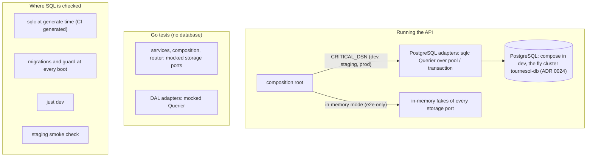

# ADR 0025: PostgreSQL storage and tests without a database

**Status**: accepted, 2026-10-16 (user decisions of the free-hosting triage, critical-m902; written by
critical-m902.1). Amends [ADR 0021](0021-spell-catalogue.md) step 6 (the engine) and
[ADR 0024](0024-deployment.md) steps 2, 4.2, 5, 6.1, 7 and 9 (storage and backups on fly).

## Context

[ADR 0024](0024-deployment.md) step 5 proposed to ship on SQLite, one fly volume per app, and to move
to PostgreSQL later with the multi-user model ([ADR 0021](0021-spell-catalogue.md) step 6 said the
same). The user's fly free allowance rules that out. User, 2026-10-16: _"can't request 1gb"_; _"if we
need a volume, we can't go with fly.io. unless it's just a legacy postgres db"_; _"I need free hosting
for this app."_

So the apps become stateless and keep their data in one fly legacy PostgreSQL cluster (the topology is
[ADR 0024](0024-deployment.md) step 2 as amended). The engine port happens now, before the first
deployment; the multi-user model (users, roles, per-player characters) is still a later design. User,
same triage: Postgres everywhere, local development included, so there is one dialect and one set of
migrations.

The same triage fixed how storage is tested. Today the DAL adapter tests, the composition tests, a few
router tests and the seed check build a temporary SQLite database, and some tests assert the SQL that
ran. User, 2026-10-16: _"go unit tests should never require a database or we failed badly at software
engineering. mocks. e2e tests should also rely on some form of mocking. you don't spin a whole pgsql db
for tests."_ And: _"it was a gross error to begin with to test what queries were run exactly ... we
should test that the right operations are called, not the exact sql query."_ On migrations: _"schemas
only. no data in migration files"_.

Concurrency today: SQLite transactions begin with `BEGIN IMMEDIATE` (`docs/backend.md`), so a second
writer waits, then sees the first writer's result and is refused as a normal 409, never a 500
([ADR 0018](0018-transactions-and-undo.md), [ADR 0019](0019-redo.md): the action stack's expected-top
check). The user's decision: keep that behaviour.

## Decision

1. **PostgreSQL everywhere.** The server stores everything in PostgreSQL, in every environment that
   holds real data: development (a `postgres` service in docker compose, started by `just dev`),
   staging and production (the fly cluster of [ADR 0024](0024-deployment.md) step 2).
   1. The server opens the database from the `CRITICAL_DSN` configuration value, a PostgreSQL DSN.
   2. One dialect, one set of migrations: the server module has no SQLite dependency. The only
      SQLite code left is the copy tool of step 9, in its own binary.
   3. The development database lives in the compose service's volume, not in `.dev/`.

   Check: the server module's dependencies hold no SQLite driver; `just dev` from a clean checkout
   migrates, seeds, imports the catalogue, rolls and undoes on the compose PostgreSQL.

2. **One schema-only baseline.** The SQLite migrations are squashed into one PostgreSQL baseline
   migration whose schema equals today's schema after the last SQLite migration (types may become
   PostgreSQL's own: identity columns, booleans, timestamps, JSON).
   1. **No data in migration files** (user: _"schemas only. no data in migration files"_): no
      migration contains `INSERT`, `UPDATE` or `DELETE`. The SQLite migrations that hold such
      statements only copy rows while rebuilding a table; nothing is lost by dropping them. Data
      comes from the seeds and the catalogue import at boot ([ADR 0021](0021-spell-catalogue.md)
      step 5) and, for existing data, from the copy tool of step 9.
   2. Migrations after the baseline are new files only, never an edited applied one, and are
      schema-only too.
   3. The per-migration SQLite tests are deleted with the squash. An ADR that cites one of them
      gets its citation updated in the same change (`just check-adr-tests` fails otherwise).

   Check: a scan of the migration files for data statements (part of the engine switch's tests):
   `storage/postgres` `TestMigrations_Step2_1_SchemaOnly`.

3. **Migrations at boot, the unknown-migration guard kept** ([ADR 0024](0024-deployment.md) step 6).
   The server applies the pending migrations before it listens, records them in
   `schema_migrations`, and refuses to start on a database that records a migration its binary does
   not embed.
   1. A migration run takes the lock of step 4 for its whole duration, so two machines starting
      together (production runs two, [ADR 0024](0024-deployment.md) step 5) apply each migration
      once.

   Tests: the guard's refusal and acceptance, and the run order of pending migrations, on a mocked
   storage port (no database): `storage/postgres` `TestMigrate_Step6_2_RefusesMigrationsTheBinaryDoesNotEmbed`,
   `TestMigrate_Step6_2_AcceptsADatabaseItsBinaryMigrated`, `TestMigrate_Step3_1_LocksThenAppliesThePendingInOrder`,
   `TestMigrationRun_OneTransactionCommittedOrRolledBack`.

4. **Writers are serialised by one lock per write transaction** (keeps the `BEGIN IMMEDIATE`
   behaviour). Every write transaction takes one transaction-level lock (e.g.
   `pg_advisory_xact_lock` on one fixed key) as its first statement, before any read.
   1. A second writer waits for the first to commit or roll back, then reads the first one's
      result: a stale expected top of the action stack is refused as a 409, never a 500
      (serialisation failure or deadlock).
   2. Transactions run at READ COMMITTED (PostgreSQL's default). A stricter level would take its
      snapshot when the lock statement starts, before the lock is granted, and the second writer
      would not see the first one's commit.
   3. The lock is released by the commit or the rollback; nothing else releases it.
   4. Read-only requests take no lock. Write paths always go through a transaction (as today:
      never read-then-write on the bare pool).

   Tests: the transaction helper, on a mocked connection, issues the lock before any other
   statement of a write transaction, and releases nothing by hand; the router maps a stale stack
   top to 409 (existing tests, kept). Implemented as `storage/postgres`
   `TestInTx_Step4_TakesTheWriterLockFirstAndReleasesItOnlyByCommit`,
   `TestInTx_Step4_3_AFailureRollsBackAndReleasesNothingByHand`, `TestInTx_Step4_2_ReadCommitted`; two
   concurrent pops of the same top (one wins, the other is a stack conflict) on the in-memory store,
   `TestStore_Step8_2_StaleTopRefused` and `TestStore_Step8_2_ConcurrentRedosOneWins`.

5. **The DAL is generated by sqlc, with interfaces.** sqlc replaces bob.
   1. Queries are hand-written `.sql` files per adapter package; sqlc generates their Go code with
      `emit_interface: true`, so each package has a `Querier` interface. Aggregates (`SUM`, `COUNT`)
      are named sqlc queries like the others.
   2. Each adapter depends on its package's `Querier` interface (its constructor takes it). The
      composition root wires the generated implementation over the pool or the current transaction
      (the `Conn(ctx)` routing of today is kept).
   3. Generated code is committed and never edited by hand. `just generate` runs sqlc offline (no
      database server); the CI `generated` job fails on stale output.
   4. Until the last adapter is ported, bob and sqlc coexist on the SQLite engine; then bob is
      removed (its generated code, config, tool directive and docs), and the engine switch moves
      sqlc to the `postgresql` engine.

6. **Go tests never open a database.** No Go test opens a database connection, creates a database
   file or needs a DSN or a database server.
   1. Services, the composition root, the router and the seed check are tested on mocked storage
      ports (mockery mocks of the domain DAL interfaces, `just mocks`).
   2. DAL adapters are tested on a mocked `Querier`: which operation is called, with which
      arguments, in which order where the order matters (an append-only ledger never updates or
      deletes a past entry; undo and redo push and pop in order), and how results and errors map to
      domain values (e.g. no rows -> `domain.ErrCharacterNotFound`).
   3. **No test asserts SQL text** (user: _"we should test that the right operations are called,
      not the exact sql query"_). A test names a `Querier` method, never a statement.
   4. What a database-backed test proved about a rule or a flow is kept, on mocks; an assertion
      that only made sense against SQL moves to the matching adapter's mock test or is dropped with
      the reason given in its change.
   5. The storage package's seed and catalogue import tests (`storage/postgres` `TestSeed_*`,
      `TestImportCatalogue_*`, `TestStateSpellRefs_*`, `TestRecordedCatalogue_*`) run on a
      stateful fake of its `Querier` (`fakeStore`), not on a mockery mock. Those flows are rules
      over many rows (a second seed is idempotent, the same catalogue version writes nothing, a new
      one upserts and keeps what is referenced, a failure leaves no partial rows), which a test
      proves by reading what is stored after one or two runs; a call-by-call mock would restate
      the code. The fake holds only the tables those flows touch and refuses what
      the baseline schema refuses there (a duplicate key, a row whose character does not exist,
      an empty text body, the CHECKs of weapons and items); it runs no SQL.

   Check: CI provides no database service and `just validate` passes; no `_test.go` file imports a
   database driver or opens a DSN (review checklist).

7. **No database test tier.** SQL is checked outside the Go tests, at these points only:
   1. sqlc, at generate time: every query parses and type-checks against the migrations' schema
      (locally and in the CI `generated` job);
   2. the boot: the migrations and the guard of step 3 run at every start;
   3. `just dev`, on the compose PostgreSQL;
   4. the staging smoke check of [ADR 0024](0024-deployment.md) step 3.3, on every main commit.

   A wrong query that sqlc accepts (a constraint violated at runtime, a wrong conflict target) shows
   up in development or on staging, not in CI. Accepted by the user.

8. **e2e runs the API in an in-memory storage mode.** No database, file or server, in an e2e run.
   1. A configuration value selects in-memory storage; the composition root then wires in-memory
      implementations of every storage port (the domain DAL interfaces, not the sqlc `Querier`s),
      seeded from the seeds and the catalogue as the real store is.
   2. The fakes keep the contracts of the real adapters: a transaction is all or nothing (a failing
      write leaves nothing), writers are serialised (step 4), the action log is append-only, undo
      and redo behave as [ADR 0018](0018-transactions-and-undo.md) and
      [ADR 0019](0019-redo.md) say, and a stale stack top is refused as a 409.
   3. The mode can never be enabled in staging or production.
   4. The e2e fixtures start every API in that mode.

   Tests: Go tests of the fakes for each contract of step 8.2; a test that the fly configuration
   never enables the mode (step 8.3). Implemented as `CRITICAL_STORAGE=memory`
   (`api/internal/storage/memory`, `docs/backend.md` "In-memory storage"): `TestStore_Step8_2_` (all
   or nothing, panic, nested and lone writes, writers serialised, append-only log, undo and redo, a
   stale top refused, a failed undo leaving nothing, keys), `TestStore_Step8_1_SeededLikeTheDatabase`,
   `TestNew_Step8_1_InMemoryOpensNoDatabase`, `TestMemoryStorage_EveryPortOnTheOneStore`;
   `TestFly_Step8_3_InMemoryStorageNeverEnabled`, and the boot's refusal on fly.io or in the
   production image, `TestConfigValidate_Step8_3_InMemoryStorageOnlyOutsideFlyAndTheImage`.

9. **A committed copy tool moves a SQLite database of the app into PostgreSQL.** It replaces no
   migration (step 2.1): it moves existing data once.
   1. Its own binary, the only code depending on a SQLite driver. Inputs: the SQLite file and the
      target DSN. It brings the file to the last SQLite schema first, copies every table in
      dependency order in one transaction, sets each identity sequence past the highest copied id,
      then compares the row count of every table and fails on any difference.
   2. It refuses a target that holds rows in any app table, or that is not on the current baseline.
   3. Used twice: the user's `.dev/critical.db` into the compose PostgreSQL, and once, through the
      runbook, to seed production with the same data. Staging starts empty and stays disposable.
   4. A copy is private data ([ADR 0024](0024-deployment.md) step 7): it never leaves the
      operator's machine and fly.
   5. Retired (deleted) once production is seeded.

   Tests: the tool's logic without a database (table order, sequence values, count comparison,
   refusals) on mocked ports. Implemented as `api/internal/sqlitecopy` (binary `api/cmd/sqlite-copy`, `just
   db-import-sqlite`): `TestDependencyOrder_Step9_1_ReferencedTablesFirst`,
   `TestNextID_Step9_1_PastTheHighestCopiedAndHandedOutID`, `TestResetIdentities_Step9_1_SetsEveryIdentityColumn`,
   `TestCompareCounts_Step9_1_FailsOnAnyDifference`, `TestUpgradeSource_Step9_1_AppliesThePendingInOrder`,
   `TestRun_Step9_1_CopiesEveryTableInOrderInOneTransaction`, `TestRun_Step9_1_ACountDifferenceFailsTheTransaction`,
   `TestRefuseNonEmpty_Step9_2_RefusesARowInAnyTable`, `TestPrepareTarget_Step9_2_OnlyANewOrBaselineDatabase`,
   `TestRun_Step9_2_ANonEmptyTargetCopiesNothing`. The sequence goes past SQLite's `sqlite_sequence` too,
   not only past the highest id copied: an undo restores a deleted row under its old id.

## Consequences

- **Order of the work.** The tests stop opening a database first, still on SQLite (composition,
  router and seed check; the adapters with their port to sqlc, in three serial batches since they
  share the sqlc config and output). Then the in-memory mode, then the engine switch, then the copy
  tool and the fly cluster. Nothing is deployed before the engine switch.
- **Test names cited by ADRs.** Many ADRs cite tests that run on SQLite today (adapter tests,
  per-migration tests in `storage/sqlite`). A port that renames or deletes one updates the citing ADR
  in the same change; `just check-adr-tests` enforces it. A deleted per-migration test's step stays
  true of the baseline schema; the citation then names the check that covers it, or says the step
  describes a past migration.
- **Isolation level is part of the design** (step 4.2): raising it breaks the 409 contract silently.
- **Lost with SQLite**: the WAL files, `.dev/critical.db` as the dev store (the copy tool reads it once)
  and the `CRITICAL_UPGRADE_CHECK_DB` check on a copy of a live SQLite file; `just dev-reset` no longer
  deletes database files (what it resets instead is the engine switch's to define). The docs describing
  them are rewritten by the items that change them.
- **What the Go tests no longer prove**: that a query works on a real engine. Steps 7.1 to 7.4 are
  the whole answer, by the user's choice.
- **One cluster for staging and production** ([ADR 0024](0024-deployment.md) step 2): a load on
  staging is felt by production, and the cluster has one node, so its failure stops both. Accepted
  for a single-user tool on a free allowance.
- **Not covered**: the multi-user model (users, roles, per-player characters), connection pooling
  beyond the driver's pool, read replicas.
