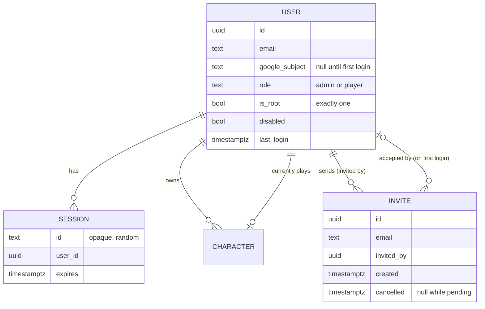
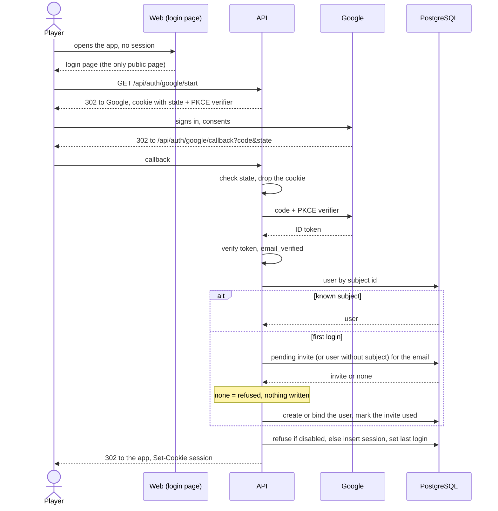

# ADR 0029: Users, Google login, invites, the root admin and characters per user

**Status**: proposed, 2026-10-18. Becomes accepted when the user confirms it. The decisions below were
taken by the user in triage on 2026-10-17 (quoted in "Context"); the numbered steps turn them into a
contract for the implementing items (accounts and sessions, login page, characters per user, admin
section, going public). Amends [ADR 0024](0024-deployment.md) step 8 (see "Amendment to ADR 0024").

## Context

Until now Critical was "a personal tool, not a product": one character, no authentication, run on a
laptop, then (ADR 0024) on two private fly apps. The user's plan, 2026-10-15: _"It is my plan in the
future to have this app host an actual game with the dm and several players."_

Triage, 2026-10-17, user (verbatim):

> they log in with sso. we should support google (must) and facebook (if we can). they must be invited
> first. so we need an admin section in the app. there is an unrevokable root admnistrator (myself). the
> administrator can send invites. this registers the email as authorized to log in when authd through
> sso. the admin page enables to manage users and send invites to new ones

> now. we also need to have many characters per user and remove all hacks we currently have on the one
> character

Answers in the scoper session, the same day:

- Facebook: _"forget about fb then"_. Google only.
- Roles: admin and player now; a DM role and a shared table are a later epic.
- A character belongs to exactly one user; only its owner sees and plays it. Admins see users and their
  character names, not the sheets.
- Root admin: _"it's in the database. a local script sets it. i don't want to tie too much stuff to the
  hosting platform"_.
- Invites: no email is sent (the admin tells the person; a copy-link button). Admin can invite, cancel
  an invite, disable and re-enable a user, make and unmake an admin, see last login and characters; the
  root admin is exempt; nothing is hard-deleted.
- _"no content visible without authentication and authorization"_: only the login page is public.
- Hostnames: _"critical-hit and critical-hit-staging then"_ (`critical.fly.dev` belongs to another
  account).
- Dev login when no OAuth settings exist (local dev, e2e); staging and production refuse to start
  without them.
- Character switch is "extremely rare": it lives in the cog menu, not on the character card.

Two facts of the code shape the design. Storage is PostgreSQL with one writer lock
([ADR 0025](0025-postgresql-storage.md) step 4), and every mutation is a transaction on the action log
([ADR 0018](0018-transactions-and-undo.md)). Today the router hands one fixed character id to every
handler; making that id come from the logged-in user is the work of the characters-per-user item, not
of this ADR.

## Decision

Tests are named by the implementing items; this ADR cites none, because none exists yet
(`just check-adr-tests` fails on a cited test that does not exist). Each step below is implemented by
one item and gets a test that fails on the old code, per the house rule.

1. **Users and roles.**
   1. A **user** has an email (unique, compared lower-cased), the Google subject id once bound (step 3),
      a role, a root flag, a disabled flag and the time of the last login. Roles are `admin` and
      `player`. A DM role is out of scope (a later epic).
   2. Nothing is hard-deleted: a user leaves the app by being **disabled**, which can be undone. A
      disabled user cannot log in and has no session (step 4.4).
   3. An admin may invite, cancel an invite, disable and re-enable a user, make and unmake an admin, and
      see each user's last login and the **names** of their characters. An admin never sees another
      user's sheet (step 7), and a player has none of these powers: every admin endpoint answers 403 to
      a player.
2. **Invites.**
   1. An **invite** is an email an admin authorises: email, who invited, when, and when it was cancelled.
      It authorises that email to log in through Google; it is not a token and carries no secret.
      Inviting an email that already has a user or a pending invite is refused.
   2. **No email is sent** (user, 2026-10-17). The admin tells the person; the admin section shows a
      copy-link button that copies the application's address (the login page). Sending invites by email
      is a separate, later item.
   3. An invite is cancelled, never deleted. A cancelled invite no longer authorises a first login; a
      user already created from it is unaffected (disable them instead).
   4. An invite is consumed by the first successful login of its email (step 3.4): the user row is
      created then, with the role `player`.
3. **Login: Google OpenID Connect.** Google is the only identity provider (Facebook was dropped,
   2026-10-17).
   1. The server runs the **authorisation-code flow with PKCE (S256) and a `state`** parameter: the
      login page links to `GET /api/auth/google/start`, which stores the state and the PKCE verifier in
      a short-lived (10 minutes) HttpOnly cookie and redirects to Google; `GET /api/auth/google/callback`
      checks the state, exchanges the code, and verifies the ID token (signature, issuer, audience,
      expiry). The token is used once and not stored.
   2. Only an ID token whose `email_verified` is true is accepted. The email compared is the token's.
   3. A user already bound to the token's Google subject id logs in. The subject id, not the email, is
      the identity from then on: a changed email at Google does not log anybody else in.
   4. **First login**: a token whose subject is unknown matches a **pending invite** (not cancelled, not
      yet used) or an existing user with that email and no subject yet (the root admin, step 5). The
      match creates the user (or binds the subject id to the existing row) and starts a session. An
      email with no pending invite is **refused** with a login page message and no row is written.
   5. A disabled user is refused, with the same kind of message, and no session is created.
   6. `last login` is set at every successful login.
   7. Refusals (unknown email, disabled, bad state, unverified email) answer with a redirect to the login
      page and a stable code, never a stack trace; the code is worded in the web (en + fr). So do a
      database that cannot serve the login (`database_unavailable`) and a login still running at the
      request deadline (`login_timeout`; _added 2026-10-18 by [ADR 0025](0025-postgresql-storage.md)
      step 10.1_): the browser never lands on a JSON error.

4. **Sessions.**
   1. A session is a **server-side row** in PostgreSQL: an opaque random id (at least 256 bits from the
      system's secure generator), the user, the creation time, the last use and the expiry. The cookie
      holds only the id; nothing about the user is in it.
   2. The cookie is `HttpOnly`, `Secure` (not in dev login mode over plain HTTP), `SameSite=Lax`, path
      `/`, with no domain, so it is host-only. Its **name is per app**, `critical_session_<app>` with `<app>` the public
      URL's host and port (in dev login mode `dev_<listen port>`): browsers send a cookie to every port
      of a host, so apps opened on one host (`just dev` and the tunnels to the hosted apps, all on
      `localhost`) would otherwise log each other out and send one app's token to another.
   3. A session lasts **30 days and is extended while used**: a request more than a day after the last
      extension pushes the expiry to 30 days from now.
   4. **Logout** (`POST /api/auth/logout`) deletes the session and the cookie. **Disabling a user deletes
      all their sessions** in the same transaction, so the next request is refused. Expired sessions are
      refused and removed lazily.
   5. A state-changing request with a cookie session must pass a CSRF defence: `SameSite=Lax` plus a
      check that the `Origin` (or `Referer`) header names the application's own host, since every
      mutation is a non-GET.
   6. The current user is `GET /api/auth/me` (email, role, root flag, current character id); it answers
      401 without a session, which is how the web decides to show the login page.
   7. **A server trusts a session it found valid for 10 seconds** (_added 2026-10-18 by the database
      resilience change, see [ADR 0025](0025-postgresql-storage.md) step 10; the user approves ADR
      changes at merge_), never past the session's expiry: the requests of a page load read the session
      and its user once instead of once each. The server that logs a session out, disables its user or
      changes the user's role forgets it at once, so on that server step 4.4 holds as written: a request
      that read the session before the change and finishes after it does not put it back. On the
      other production server a logout, a disabling or a role change takes effect **within 10 seconds**:
      the window accepted for that saving (the servers share no channel but the database). An answer from
      the cache never extends the session (step 4.3 writes on a read of the database only); a failed
      lookup is never remembered. Tests: `authsvc` `TestAuthenticate_Step4_7_TrustedForTheCacheTTL`,
      `TestAuthenticate_Step4_7_NeverPastTheSessionsExpiry`, `TestAuthenticate_Step4_7_LogoutForgetsAtOnce`,
      `TestAuthenticate_Step4_7_DisablingForgetsAtOnce`, `TestAuthenticate_Step4_7_ARoleChangeForgetsAtOnce`,
      `TestAuthenticate_Step4_7_TheCacheNeverReportsAnExtension`, `TestAuthenticate_Step4_7_AFailureIsNotCached`,
      `TestAuthenticate_Step4_7_ALookupInFlightDuringLogoutIsNotKept`,
      `TestAuthenticate_Step4_7_ALookupInFlightDuringDisablingIsNotKept`.
5. **The root admin.**
   1. Exactly **one** user is the root admin: the flag is a column, kept in the database. It is set by a
      **committed script run locally against a DSN** (`just root-admin <email>`), never by hosting
      configuration, a secret or an environment variable of the app (user, 2026-10-17: _"i don't want to
      tie too much stuff to the hosting platform"_). The script creates the row with the role `admin`
      and the root flag, and no Google subject; the first login of that email binds it (step 3.4). It
      is idempotent, and run with another email it refuses unless the root is still unbound, so the
      root cannot be silently moved.
   2. The root admin **cannot be disabled, demoted, or removed through the app**: the admin endpoints
      refuse it (409, stable code) and the database enforces it (a constraint allowing at most one root
      and a check that a root is an enabled admin), so a bug in a handler cannot break it.
   3. Existing data: the character Kelsen belongs to the root admin once that user exists (the
      characters-per-user item migrates it).
6. **What is public.**
   1. Without a session the server serves **only**: the login page and the assets it needs, the
      `/api/auth/*` endpoints, and `/api/health` (no data: it answers that the server is up and the
      migrations are applied, nothing about users or characters). The login page is a page of the one
      web bundle, so the assets it needs are the **static build**: the content-hashed files under
      `/assets/` and `/favicon.svg` (amendment 2026-10-18, below).
   2. **Everything else needs a session**: every page but the login page, the catalogue, and every other
      `/api` route. The server enforces it in one middleware at the router, with an allow-list of the
      public paths; a new route is protected by default and never by a per-handler check. A request
      with no session to `/api` answers 401; to a page, it redirects to the login page.
   3. User, role and session are read by the middleware once per request and passed on in the request
      context; services receive the owner as an argument and never read the cookie.
7. **Characters belong to users.**
   1. A character has **one owner** (a user) and only the owner sees and plays it. Every character
      route resolves the character through the logged-in user's characters; **another user's character
      answers 404**, the same as an unknown id, so its existence is not revealed. An admin has no
      exception: their view of other users is the names list of step 1.3.
   2. A user has **many characters**. The **current character** is stored server-side, per user, so it
      follows the user across devices. Switching, creating and retiring a character are rare actions in
      the cog menu, not on the character card. The first login of a new player has no character and the
      app offers to create one.
   3. "Retire" hides a character from its owner's lists and never deletes it (nothing is hard-deleted).
   4. The action log, the HP ledger, buffs, spell slots, the round counter and the undo stack
      ([ADR 0018](0018-transactions-and-undo.md)) stay **per character**: each character keeps its own
      round counter until a later shared-table epic. A mutation and its undo only ever touch the
      current character of the logged-in user.
   5. Reference data (the spell catalogue, the rule tables, the localized texts) stays shared by all
      users.
8. **Dev login and refusing to start.**
   1. The Google client id, secret and redirect URL are server settings. **When none is set** the
      server enables **dev login**: a login page button and `POST /api/auth/dev` that start a session for
      an email given in the request, creating the user as an admin without an invite. It exists for
      local development and for the e2e suite, which runs without OAuth.
   2. **Staging and production refuse to start** without the OAuth settings: the server reads the
      environment name and, when it is not `dev`, a missing or partial setting is a start-up error
      (the process exits before listening), so dev login can never be reachable on a hosted app. When
      the OAuth settings are set, `/api/auth/dev` does not exist (404). The environment name is `CRITICAL_ENV`; the dev login is
      an explicit opt-in, `CRITICAL_ENV=dev`, set only by local runs (`just dev`, the e2e stacks, the
      image smoke test). Unset, the server fails closed: no OAuth settings, no start. On fly.io
      (`FLY_APP_NAME`) `CRITICAL_ENV=dev` is itself refused.
   3. The Google client secret is a fly secret of each app ([ADR 0024](0024-deployment.md) step 10); the
      root admin is not.
9. **Concurrency.** The single writer lock ([ADR 0025](0025-postgresql-storage.md) step 4) stays. Users
   play different characters, so their transactions are independent in meaning but still serialise on
   the lock; at table scale this costs nothing. A session lookup is a read and does not take the lock.
   The writes of the login (a new user, a bound subject, a session, `last login`) take it like any
   other mutation.
10. **Migrations.** The tables of step 1, 2 and 4 and the owner and current-character columns of step 7
    arrive by new migration files only, additive, so the previous release keeps working on the new
    schema during a rolling deploy ([ADR 0024](0024-deployment.md) step 5.2). Existing characters get
    their owner when the root admin exists (step 5.3).

## Amendment 2026-10-18: the static bundle is public

Step 6.1 first listed "the login page and the assets it needs" as public and step 6.2 "the rest of the
SPA bundle" as gated. The web app is one Vite bundle and the login page is one of its pages, so the
login page needs the whole bundle: with `/assets/*` behind the session, `/login` loaded blank on the
Go server (the image, hosted or a local `docker run`). The static build (`/assets/*`, `/favicon.svg`)
is therefore public. It is the public repository's code and holds no data: the catalogue, the sheets
and every other datum come from `/api`, which stays gated, and a page other than `/login` still
redirects to the login page without a session. Splitting the login page into its own bundle was
weighed and not chosen: it hides nothing that is not already in the repository, at the cost of a
second Vite entry and a server allow-list kept in sync with it.

A request carrying a session cookie the server no longer knows (expired, logged out, user disabled)
is told apart from one with none, so the login page can say the session ended (its own message,
step 4.4): a page goes to `/login?error=session_expired`, and `GET /api/auth/me` answers 401 with the
code `session_expired` (an `unauthenticated` refusal; the data routes keep `unauthenticated`).
`GET /api/auth/options` (public, under `/api/auth`) tells the login page which login the server offers:
`{"google": bool, "devLogin": bool}` (step 8).

## Amendment to ADR 0024

Applied to [ADR 0024](0024-deployment.md) by this PR; the user chose option (c) in the 2026-10-17
triage (_"no content visible without authentication and authorization"_ with a real login):

- **Step 8**: option **(c), real login** is chosen, as this ADR. The apps are no longer private by
  rule: once the login gate is live (steps 3, 4 and 6 above, in the release being deployed) both apps
  may have **public IPs** and serve a public hostname. Step 8.1 stays: nothing serves the catalogue or
  the app without access control, and the access control is now the session middleware of step 6.
- **Step 8.3**: the **no-public-IP check is replaced by a gate check**. Before a deploy the job
  verifies, with the smoke checks of step 10.5, that the app answers 401 on a data route and on the
  catalogue without a session and 200 only on the public paths of step 6.1, and fails if not. Until the
  release carries the gate the apps stay private and the old check applies.
- **App names**: `critical-hit` (production) and `critical-hit-staging`; the names `critical-prod` and
  `critical-staging` of the defaults table are replaced. App names are set in one place.
- **Options (a) and (b)** (shared-secret basic auth, WireGuard) are not chosen. The basic-auth access
  gate item is replaced by this work.
- **Custom domain** stays open.

## Consequences

- The vocabulary and scope of `docs/all.md` change: the app is a multi-user hosted game, no longer a
  personal single-Bard tool without authentication.
- Every route and every test fixture now has a user. The e2e suite and local dev use dev login
  (step 8.1) so no test needs Google; the real flow is exercised once by hand against staging, noted in
  the PR that goes public.
- Google is a runtime dependency of login only: a session in progress does not call Google, so an outage
  there stops new logins, not the table.
- Losing the root admin's Google account is recoverable: the script run against the database with
  another email while the root is unbound, or a database fix by the operator. Documented in the runbook
  by the implementing item.
- Out of scope, each its own item: class and race rules, Facebook, invite emails, the DM role and a
  shared table with one round for the party.
