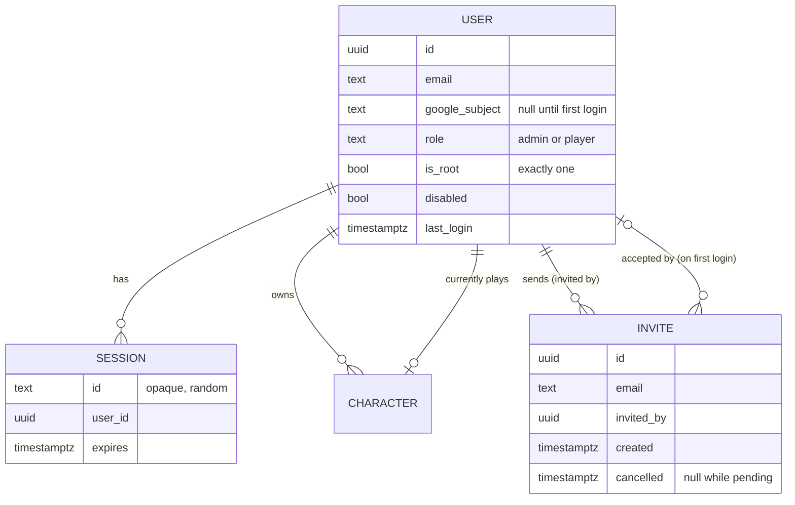
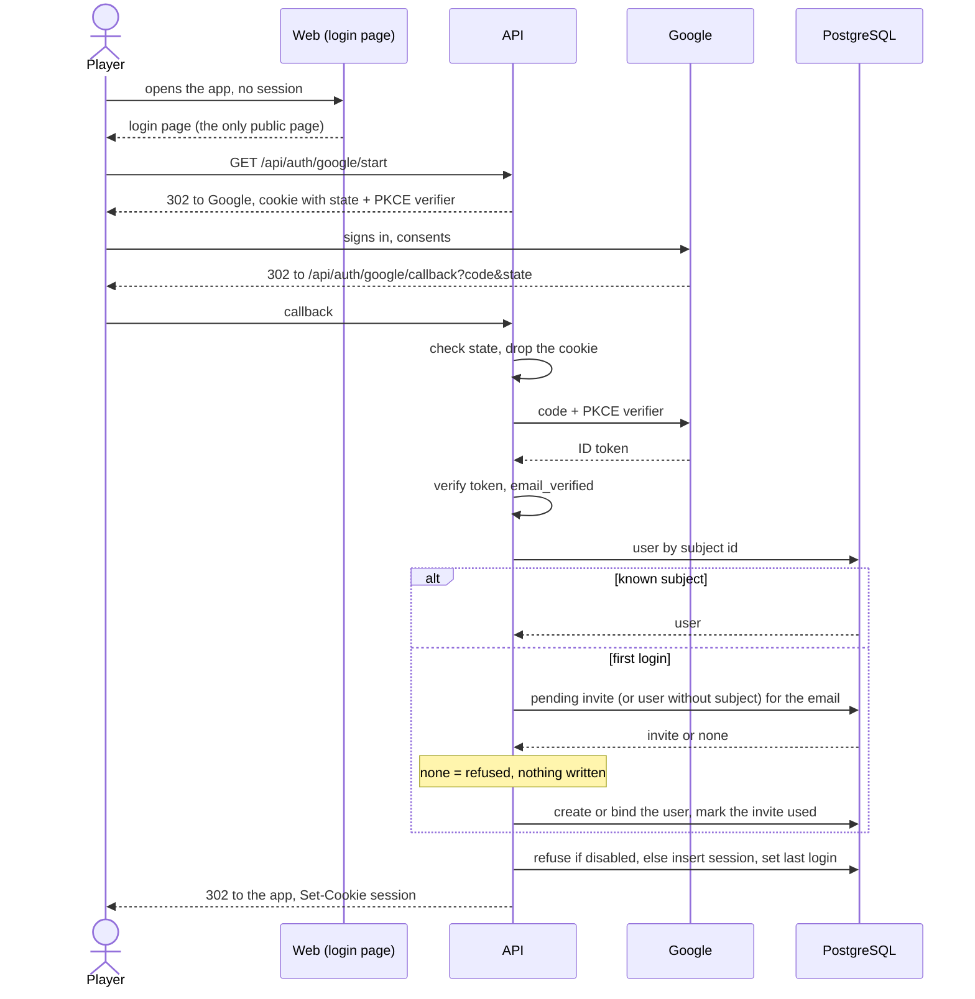

# ADR 0029: Users, Google login, invites, the root admin and characters per user

**Status**: proposed, 2026-10-18. Becomes accepted when the user confirms it. The decisions below were
taken by the user in triage on 2026-10-17 (quoted in "Context"); the numbered steps turn them into a
contract for the implementing items (accounts and sessions, login page, characters per user, admin
section, going public). Amends [ADR 0024](0024-deployment.md) step 8 (see "Amendment to ADR 0024").

## Context

Until now Critical was "a personal tool, not a product": one character, no authentication, run on a
laptop, then (ADR 0024) on two private fly apps. The user's plan, 2026-10-15: _"It is my plan in the
future to have this app host an actual game with the dm and several players."_

Triage, 2026-10-17, user (verbatim):

> they log in with sso. we should support google (must) and facebook (if we can). they must be invited
> first. so we need an admin section in the app. there is an unrevokable root admnistrator (myself). the
> administrator can send invites. this registers the email as authorized to log in when authd through
> sso. the admin page enables to manage users and send invites to new ones

> now. we also need to have many characters per user and remove all hacks we currently have on the one
> character

Answers in the scoper session, the same day:

- Facebook: _"forget about fb then"_. Google only.
- Roles: admin and player now; a DM role and a shared table are a later epic.
- A character belongs to exactly one user; only its owner sees and plays it. Admins see users and their
  character names, not the sheets.
- Root admin: _"it's in the database. a local script sets it. i don't want to tie too much stuff to the
  hosting platform"_.
- Invites: no email is sent (the admin tells the person; a copy-link button). Admin can invite, cancel
  an invite, disable and re-enable a user, make and unmake an admin, see last login and characters; the
  root admin is exempt; nothing is hard-deleted.
- _"no content visible without authentication and authorization"_: only the login page is public.
- Hostnames: _"critical-hit and critical-hit-staging then"_ (`critical.fly.dev` belongs to another
  account).
- Dev login when no OAuth settings exist (local dev, e2e); staging and production refuse to start
  without them.
- Character switch is "extremely rare": it lives in the cog menu, not on the character card.

Two facts of the code shape the design. Storage is PostgreSQL with one writer lock
([ADR 0025](0025-postgresql-storage.md) step 4), and every mutation is a transaction on the action log
([ADR 0018](0018-transactions-and-undo.md)). When this ADR was written the router handed one fixed
character id to every handler; making that id come from the logged-in user is the work of the
characters-per-user item, not of this ADR (built: amendment 2026-10-18, "how a request finds its
character").

## Decision

Tests are named by the implementing items; this ADR cites none, because none exists yet
(`just check-adr-tests` fails on a cited test that does not exist). Each step below is implemented by
one item and gets a test that fails on the old code, per the house rule.

1. **Users and roles.**
   1. A **user** has an email (unique, compared lower-cased), the Google subject id once bound (step 3),
      a role, a root flag, a disabled flag and the time of the last login. Roles are `admin` and
      `player`. A DM role is out of scope (a later epic).
   2. Nothing is hard-deleted: a user leaves the app by being **disabled**, which can be undone. A
      disabled user cannot log in and has no session (step 4.4).
   3. An admin may invite, cancel an invite, disable and re-enable a user, make and unmake an admin, and
      see each user's last login and the **names** of their characters. An admin never sees another
      user's sheet (step 7), and a player has none of these powers: every admin endpoint answers 403 to
      a player.
2. **Invites.**
   1. An **invite** is an email an admin authorises: email, who invited, when, and when it was cancelled.
      It authorises that email to log in through Google; it is not a token and carries no secret.
      Inviting an email that already has a user or a pending invite is refused.
   2. **The server mails the invitee** (amended 2026-10-21, user: the 2026-10-17 "no email is sent" and
      "a separate, later item" are this item). Creating an invite sends one mail to the address (steps
      2.5 to 2.8); the admin can also copy the application's address from the admin section, as the
      fallback when the mail is not sent. The mail is best effort: the invite exists whatever happens
      to it.
   3. An invite is cancelled, never deleted. A cancelled invite no longer authorises a first login; a
      user already created from it is unaffected (disable them instead).
   4. An invite is consumed by the first successful login of its email (step 3.4): the user row is
      created then, with the role `player`.
   5. **The mails (user, 2026-10-21).** Three triggers: an invite is created (to the invitee), an admin
      **resends** a pending invite (step 2.7; the same mail), and the invite is **accepted** (to the
      inviter, step 2.9). Cancelling sends nothing. A mail carries only the inviter's email (amended
      2026-10-21 by step 3.8: users now have a display name, but the mails keep the email until their own
      item), the invitee's address and the application's address
      (`CRITICAL_PUBLIC_URL`): no token, no secret. The domain says which mail, to whom, in which
      language (`authsvc.Notice`, structured data, no wording); the **mail adapter** (`mailadpt`) words
      it from template files embedded in the binary, one set per language (`en`, `fr`: subject, text,
      HTML), and sends it through a `Mailer` (Brevo's HTTPS API; the server log in a local run; a
      recorder in tests). **Email wording is the one place the backend composes text for a person**:
      a mail is worded where it is sent, outside any request of a user whose language the web knows,
      and it is not a `localized_texts` row (ADR 0023) nor a Go `Sprintf` in the domain (the
      `forbidigo` rule on `internal/domain` still holds: the wording lives in the adapter's templates).
      Tests: `mailadpt` `TestNotifier_Step2_5_WordsTheMailsPerLanguage`,
      `TestNotifier_Step2_5_HTMLIsEscaped`; `authsvc` `TestCreateInvite_Step2_5_MailsTheInvitee`.
   6. **Language.** The admin picks `en` or `fr` per invite: one `language` column holding a language
      code (existing invites: `en`; a code, not a column per language, ADR 0023). `POST
      /api/admin/invites {email, language?}`: absent means `en` (the admin screen of earlier releases
      sends none); any other code is a field error on `language` (400). Tests: `authsvc`
      `TestCreateInvite_Step2_6_LanguageIsStored`.
   7. **Resend.** `POST /api/admin/invites/{id}/resend` mails a pending invite again and answers like a
      creation. An unknown invite is 404 `invite_not_found`; a cancelled or used one 409
      `invite_not_pending`. Tests: `authsvc` `TestResendInvite_Step2_7`; `router`
      `TestAdmin_Step2_7_ResendInvite`.
   8. **Outcome.** The mail is sent after the invite committed, with a short timeout (8 s), no queue and
      no retry. The creation (201) and the resend (200) answer the invite plus
      `mail: "sent" | "failed" | "not_configured"`, which the web words (the invite's own `email`
      field keeps its name). A failing or slow mailer leaves the invite created; no mail settings
      give `not_configured`. Tests: `authsvc` `TestCreateInvite_Step2_8_TheInviteSurvivesTheMail`;
      `composition` `TestAdmin_Step2_InviteMail`.
   9. **Accepted.** The first login that consumes an invite (step 2.4) mails the inviter once, **always
      in French** whatever language the invite was sent in (user ruling, 2026-10-21; the inviter's own
      language is not stored), after the login committed and in
      the background: a failing or slow mail never blocks the login. Tests: `authsvc`
      `TestFinishLogin_Step2_9_TellsTheInviter`.
   10. **Settings.** `CRITICAL_BREVO_API_KEY` and `CRITICAL_MAIL_FROM` (the verified sender) go
      together, `CRITICAL_MAIL_FROM_NAME` is optional; none set means no mail is sent and the server
      still starts (a half-set pair stops the start). With `CRITICAL_ENV=dev` the mail is printed in
      the server log and never sent, whatever is set: local runs, tests and e2e send no real email.
      On the hosted apps they are fly secrets (`docs/deploy.md`, "Invite emails"). Tests: `api`
      `TestConfigValidate_Step2_10_MailSettingsAreOptional`, `TestConfigNotifier_Step2_10`;
      `mailadpt` `TestBrevo_Step2_10_RequestShape`, `TestBrevo_Step2_10_ErrorMapping`.
3. **Login: Google OpenID Connect.** Google is the only identity provider (Facebook was dropped,
   2026-10-17).
   1. The server runs the **authorisation-code flow with PKCE (S256) and a `state`** parameter: the
      login page links to `GET /api/auth/google/start`, which stores the state and the PKCE verifier in
      a short-lived (10 minutes) HttpOnly cookie and redirects to Google; `GET /api/auth/google/callback`
      checks the state, exchanges the code, and verifies the ID token (signature, issuer, audience,
      expiry). The token is used once and not stored.
   2. Only an ID token whose `email_verified` is true is accepted. The email compared is the token's.
   3. A user already bound to the token's Google subject id logs in. The subject id, not the email, is
      the identity from then on: a changed email at Google does not log anybody else in.
   4. **First login**: a token whose subject is unknown matches a **pending invite** (not cancelled, not
      yet used) or an existing user with that email and no subject yet (the root admin, step 5). The
      match creates the user (or binds the subject id to the existing row) and starts a session. An
      email with no pending invite is **refused** with a login page message and no row is written.
   5. A disabled user is refused, with the same kind of message, and no session is created.
   6. `last login` is set at every successful login.
   7. Refusals (unknown email, disabled, bad state, unverified email) answer with a redirect to the login
      page and a stable code, never a stack trace; the code is worded in the web (en + fr). So do a
      database that cannot serve the login (`database_unavailable`) and a login still running at the
      request deadline (`login_timeout`; _added 2026-10-18 by [ADR 0025](0025-postgresql-storage.md)
      step 10.1_): the browser never lands on a JSON error.
   8. **The user's name (amended 2026-10-21, user: "since the admin is logged with google we should have
      access to their name and we should put it there, as well as in the app in lieu of the email").**
      Login asks for the scopes `openid email profile`; the ID token's `name` claim is read into the
      identity. `users.display_name` (migration `032_user_display_name.sql`, nullable, additive, no
      backfill) is set at **every** login, and when a first login consumes an invite: a rename at Google
      reaches the app. An absent or blank claim **keeps** the stored name, never erases it; the dev
      login has none. `GET /api/auth/me` and `GET /api/admin/users` carry `displayName` (omitted when
      unknown); invites (no user yet) do not. The web shows `displayName`, else the email, everywhere
      a user is named (settings popover, logout hints); the admin users list shows the name with the
      email beneath, and the email alone for a user without a name. Existing users have no name until
      their next login. **Privacy:** the name is personal data Google shares under the `profile` scope;
      it is stored, shown to the admins and, in the follow-up item, sent to Brevo in mails. Users may
      see a one-time Google consent update for the new scope. Out of scope: editing the name in the
      app, profile pictures.

4. **Sessions.**
   1. A session is a **server-side row** in PostgreSQL: an opaque random id (at least 256 bits from the
      system's secure generator), the user, the creation time, the last use and the expiry. The cookie
      holds only the id; nothing about the user is in it.
   2. The cookie is `HttpOnly`, `Secure` (not in dev login mode over plain HTTP), `SameSite=Lax`, path
      `/`, with no domain, so it is host-only. Its **name is per app**, `critical_session_<app>` with `<app>` the public
      URL's host and port (in dev login mode `dev_<listen port>`): browsers send a cookie to every port
      of a host, so apps opened on one host (`just dev` and the tunnels to the hosted apps, all on
      `localhost`) would otherwise log each other out and send one app's token to another.
   3. A session lasts **30 days and is extended while used**: a request more than a day after the last
      extension pushes the expiry to 30 days from now.
   4. **Logout** (`POST /api/auth/logout`) deletes the session and the cookie. **Disabling a user deletes
      all their sessions** in the same transaction, so the next request is refused. Expired sessions are
      refused and removed lazily.
   5. A state-changing request with a cookie session must pass a CSRF defence: `SameSite=Lax` plus a
      check that the `Origin` (or `Referer`) header names the application's own host, since every
      mutation is a non-GET.
   6. The current user is `GET /api/auth/me` (email, role, root flag, current character id); it answers
      401 without a session, which is how the web decides to show the login page.
   7. **A server trusts a session it found valid for 10 seconds** (_added 2026-10-18 by the database
      resilience change, see [ADR 0025](0025-postgresql-storage.md) step 10; the user approves ADR
      changes at merge_), never past the session's expiry: the requests of a page load read the session
      and its user once instead of once each. The server that logs a session out, disables its user or
      changes the user's role forgets it at once, so on that server step 4.4 holds as written: a request
      that read the session before the change and finishes after it does not put it back. On the
      other production server a logout, a disabling or a role change takes effect **within 10 seconds**:
      the window accepted for that saving (the servers share no channel but the database). An answer from
      the cache never extends the session (step 4.3 writes on a read of the database only); a failed
      lookup is never remembered. Tests: `authsvc` `TestAuthenticate_Step4_7_TrustedForTheCacheTTL`,
      `TestAuthenticate_Step4_7_NeverPastTheSessionsExpiry`, `TestAuthenticate_Step4_7_LogoutForgetsAtOnce`,
      `TestAuthenticate_Step4_7_DisablingForgetsAtOnce`, `TestAuthenticate_Step4_7_ARoleChangeForgetsAtOnce`,
      `TestAuthenticate_Step4_7_TheCacheNeverReportsAnExtension`, `TestAuthenticate_Step4_7_AFailureIsNotCached`,
      `TestAuthenticate_Step4_7_ALookupInFlightDuringLogoutIsNotKept`,
      `TestAuthenticate_Step4_7_ALookupInFlightDuringDisablingIsNotKept`.
5. **The root admin.**
   1. Exactly **one** user is the root admin: the flag is a column, kept in the database. It is set by a
      **committed script run locally against a DSN** (`just root-admin <email>`), never by hosting
      configuration, a secret or an environment variable of the app (user, 2026-10-17: _"i don't want to
      tie too much stuff to the hosting platform"_). The script creates the row with the role `admin`
      and the root flag, and no Google subject; the first login of that email binds it (step 3.4). It
      is idempotent, and run with another email it refuses unless the root is still unbound, so the
      root cannot be silently moved.
   2. The root admin **cannot be disabled, demoted, or removed through the app**: the admin endpoints
      refuse it (409, stable code) and the database enforces it (a constraint allowing at most one root
      and a check that a root is an enabled admin), so a bug in a handler cannot break it.
   3. Existing data: the character Kelsen belongs to the root admin once that user exists (the
      characters-per-user item migrates it).
6. **What is public.**
   1. Without a session the server serves **only**: the login page and the assets it needs, the
      `/api/auth/*` endpoints, and `/api/health` (no data: it answers that the server is up and the
      migrations are applied, nothing about users or characters). The login page is a page of the one
      web bundle, so the assets it needs are the **static build**: the content-hashed files under
      `/assets/` and `/favicon.svg` (amendment 2026-10-18, below).
   2. **Everything else needs a session**: every page but the login page, the catalogue, and every other
      `/api` route. The server enforces it in one middleware at the router, with an allow-list of the
      public paths; a new route is protected by default and never by a per-handler check. A request
      with no session to `/api` answers 401; to a page, it redirects to the login page.
   3. User, role and session are read by the middleware once per request and passed on in the request
      context; services receive the owner as an argument and never read the cookie.
7. **Characters belong to users.**
   1. A character has **one owner** (a user) and only the owner sees and plays it. Every character
      route resolves the character through the logged-in user's characters; **another user's character
      answers 404**, the same as an unknown id, so its existence is not revealed. An admin has no
      exception: their view of other users is the names list of step 1.3.
   2. A user has **many characters**. The **current character** is stored server-side, per user, so it
      follows the user across devices. Switching, creating and retiring a character are rare actions in
      the cog menu, not on the character card. The first login of a new player has no character and the
      app offers to create one.
   3. "Retire" hides a character from its owner's lists and never deletes it (nothing is hard-deleted).
   4. The action log, the HP ledger, buffs, spell slots, the round counter and the undo stack
      ([ADR 0018](0018-transactions-and-undo.md)) stay **per character**: each character keeps its own
      round counter until a later shared-table epic. A mutation and its undo only ever touch the
      current character of the logged-in user.
   5. Reference data (the spell catalogue, the rule tables, the localized texts) stays shared by all
      users.
8. **Dev login and refusing to start.**
   1. The Google client id, secret and redirect URL are server settings. **When none is set** the
      server enables **dev login**: a login page button and `POST /api/auth/dev` that start a session for
      an email given in the request, creating the user as an admin without an invite. It exists for
      local development and for the e2e suite, which runs without OAuth.
   2. **Staging and production refuse to start** without the OAuth settings: the server reads the
      environment name and, when it is not `dev`, a missing or partial setting is a start-up error
      (the process exits before listening), so dev login can never be reachable on a hosted app. When
      the OAuth settings are set, `/api/auth/dev` does not exist (404). The environment name is `CRITICAL_ENV`; the dev login is
      an explicit opt-in, `CRITICAL_ENV=dev`, set only by local runs (`just dev`, the e2e stacks, the
      image smoke test). Unset, the server fails closed: no OAuth settings, no start. On fly.io
      (`FLY_APP_NAME`) `CRITICAL_ENV=dev` is itself refused.
   3. The Google client secret is a fly secret of each app ([ADR 0024](0024-deployment.md) step 10); the
      root admin is not.
9. **Concurrency.** The single writer lock ([ADR 0025](0025-postgresql-storage.md) step 4) stays. Users
   play different characters, so their transactions are independent in meaning but still serialise on
   the lock; at table scale this costs nothing. A session lookup is a read and does not take the lock.
   The writes of the login (a new user, a bound subject, a session, `last login`) take it like any
   other mutation.
10. **Migrations.** The tables of step 1, 2 and 4 and the owner and current-character columns of step 7
    arrive by new migration files only, additive, so the previous release keeps working on the new
    schema during a rolling deploy ([ADR 0024](0024-deployment.md) step 5.2). Existing characters get
    their owner when the root admin exists (step 5.3).

## Amendment 2026-10-18: the static bundle is public

Step 6.1 first listed "the login page and the assets it needs" as public and step 6.2 "the rest of the
SPA bundle" as gated. The web app is one Vite bundle and the login page is one of its pages, so the
login page needs the whole bundle: with `/assets/*` behind the session, `/login` loaded blank on the
Go server (the image, hosted or a local `docker run`). The static build (`/assets/*`, `/favicon.svg`)
is therefore public. It is the public repository's code and holds no data: the catalogue, the sheets
and every other datum come from `/api`, which stays gated, and a page other than `/login` still
redirects to the login page without a session. Splitting the login page into its own bundle was
weighed and not chosen: it hides nothing that is not already in the repository, at the cost of a
second Vite entry and a server allow-list kept in sync with it.

A request carrying a session cookie the server no longer knows (expired, logged out, user disabled)
is told apart from one with none, so the login page can say the session ended (its own message,
step 4.4): a page goes to `/login?error=session_expired`, and `GET /api/auth/me` answers 401 with the
code `session_expired` (an `unauthenticated` refusal; the data routes keep `unauthenticated`).
`GET /api/auth/options` (public, under `/api/auth`) tells the login page which login the server offers:
`{"google": bool, "devLogin": bool}` (step 8).

## Amendment 2026-10-18: how a request finds its character

Step 7 as built (the characters-per-user item; the user approves ADR changes at merge):

1. **Schema** (migration `006_character_owners.sql`, additive): `characters.owner_user_id` (nullable: a
   fresh database seeds its character before any user exists, and a character without an owner is
   nobody's), `characters.retired` (default false) and `users.current_character_id` (nullable). The
   release before keeps running on it during the rolling deploy.
2. **Existing characters** (step 5.3): the characters without an owner go to the root admin, and the
   first of them becomes the root admin's current character when they have none. It happens at every
   start once a root admin exists, and in the transaction of `just root-admin` and of the dev login
   that makes or finds the root admin. No migration holds the data; nothing else changes. On local,
   staging and production Kelsen is therefore the root admin's and current for them after the
   upgrade, with no one-off step. When `just root-admin` moves a root admin that never logged in (a typo,
   step 5.1), that root's characters go to the new root in the same transaction, and the old row keeps no
   current character: Kelsen follows the flag, it does not stay with the disabled row. The same pass
   repairs the root admin's current character when it is none, retired or not theirs (their first
   character not retired). Tests: `authsvc` `TestAdoptUnownedCharacters_Step5_3_GivesThemToTheRootAdmin`,
   `TestAdoptUnownedCharacters_Step5_3_NoRootAdminChangesNothing`, `TestSetRootAdmin_CreatesTheRoot`,
   `TestSetRootAdmin_MovesAnUnboundRoot`; `composition` `TestSwitch_Step5_3_ATypoRootHandsItsCharactersOver`,
   `TestSwitch_Step5_3_StartsAreIdempotent`.
3. **One resolver.** The current character is read with the user, through the ownership (a character the
   user does not own, or retired, is no current character), so it comes with the session the gate
   already reads and remembers (step 4.7): resolving it costs no query of its own. One router
   middleware (`mw.CurrentCharacter`) hands it to every per-character route; there is no start-up
   character and no fixed id. A user with none is refused with **404 `no_character`**, which the web
   turns into "create your first character". The reference reads no character owns (the spell
   filters and names, the house crit table, the XP preview) and the user's characters are outside it.
   Tests: `router` `TestCurrentCharacter_Step7_2_EveryCharacterRouteNeedsOne` (walks every route),
   `TestCurrentCharacter_Step7_1_EachUserActsOnTheirOwn`; `composition`
   `TestOwners_Step7_1_EachUserPlaysOnlyTheirCurrentCharacter`.
4. **Endpoints.** `GET /api/characters` is the user's own characters, not retired, in creation order,
   with the current one's id: `{"characters": [{"id", "name", "class", "level"}], "currentId": n | null}`.
   `PUT /api/characters/current {"id": n}` makes one of them current and answers the same shape;
   another user's character, a retired one and an unknown id are all **404 `character_not_found`**
   (step 7.1), written by one guarded update (no check-then-write) outside the action log (choosing a
   character is no game move and is not undone). `GET /api/auth/me` carries `currentCharacterId`.
   Tests: `TestOwners_Step7_1_AnotherUsersCharacterIsNotFound`, `TestCharacters_SetCurrent`,
   `TestCharacters_ListIsTheUsersOwn`.
5. **Switching, and the character on screen.** The server that switches a user's character forgets the
   user's remembered sessions once it committed, so their next request there plays the new one. The other
   production server may remember the previous one for up to 10 seconds (step 4.7's window), so the
   current character alone could send a write to another character than the one on screen. Rule: **no
   request reads or writes another character than the one the page shows.** The web names it in the
   header `X-Character-Id` on every request (the session's `currentCharacterId`), and the resolver acts on
   that character or on none:
   - the remembered current character: it acts, with no query (the common case);
   - another one: it reads the user's current character from the database (one query, only then; the
     server then forgets the stale session). If that is the named one it acts, else it refuses with
     **409 `character_changed`** before any service runs. The web then reloads the page;
   - a value that is no positive id: 400 `invalid_input`. A request without the header (an API client
     with no page) acts on the remembered current character.

   `GET /api/auth/me`, which the page reads once at load, carries the current character read from the
   database, not the remembered one, so a page loaded right after a switch names the new character. A
   database too slow for that read answers 503 `database_unavailable`, like any other request.
6. **A current character retired or lost.** A current character the user no longer owns or has retired
   reads as none: every per-character route answers `no_character`, while `GET /api/characters` lists
   their other characters with `currentId: null`, and `PUT /api/characters/current` makes one current
   (the switch UI offers it). The root admin's is repaired at the next start (item 2). The item that
   retires characters picks the user's next current character in its own transaction. Tests: `composition`
   `TestSwitch_Step7_2_AWriteOnTheOtherServerLandsOnTheShownCharacter`, `TestSwitch_Step7_2_ARetiredCurrentCharacter`;
   `router` `TestCurrentCharacter_Step7_2_TheShownCharacterOrNone`; `authsvc`
   `TestFreshCurrentCharacter_Step7_2_ReadsTheDatabaseAndForgetsAStaleSession`,
   `TestAuthenticate_Step7_2_ACurrentCharacterChangeForgetsAtOnce`; web `http.test.ts`.

## Amendment 2026-10-18: the admin section as built

Steps 1.3, 2 and 5.2 as built (the admin section item; the user approves ADR changes at merge):

1. **One guard.** Every `/api/admin/*` route, and `PUT /api/crit-table` (the house crit table is one
   rule set shared by every user, so only an admin changes it; reading it stays open to every
   session), is mounted behind one router middleware, `mw.AdminOnly`: a player gets **403
   `admin_only`** before any service runs. Tests: `router` `TestAdmin_Step1_3_APlayerIsRefusedEveryAdminRoute`
   (walks every admin route), `TestCritTable_APlayerReadsButCannotSave`.
2. **Endpoints.** `GET /api/admin/users`, `PATCH /api/admin/users/{id} {disabled?, role?}`,
   `GET /api/admin/invites` (the pending invites: the item named the other three; listing them is what
   the screen needs), `POST /api/admin/invites {email}`, `DELETE /api/admin/invites/{id}` (sets
   `cancelled`, step 2.3). Refusals: `email_has_user` and `already_invited` (409, step 2.1),
   `invite_not_found`, `user_not_found` (404), `root_admin_protected` (409, step 5.2), and an address
   that is not a bare email is a field error on `email`. Tests: `authsvc`
   `TestCreateInvite_Step2_1_ExistingUserOrDuplicateRefused`, `TestCancelInvite_Step2_3`,
   `TestChangeUser_Step5_2_TheRootAdminIsProtected`; `composition` `TestAdmin_Step2_InviteListCancel`.
3. **A change is one transaction.** A `PATCH` that disables and demotes checks both before writing
   anything, and disabling deletes the user's sessions in that transaction (step 4.4). The server that
   made the change forgets the user's remembered sessions once it committed, so on that server the
   user is logged out (or loses the admin routes) at once; on the other production server within
   `SessionCacheTTL` (step 4.7's accepted window, unchanged). Tests: `authsvc`
   `TestChangeUser_Step4_4_DisablingDeletesTheSessionsInTheSameTransaction`,
   `TestChangeUser_Step4_7_DisablingLogsTheUserOutAtOnce`; `composition`
   `TestAdmin_Step4_4_DisablingLogsTheUserOut`.
4. **The admin's view** is each user's email, role, root flag, status, last login and the names of
   their characters not retired, never a sheet (step 1.3). The web shows it at `/admin`, a page of the
   one bundle reached from the cog menu's Admin link, shown to admins only; a player opening `/admin`
   goes to the app.

## Amendment 2026-10-18: creating, switching and retiring characters as built

Steps 7.2 and 7.3 as built (the character creation item; the user approves ADR changes at merge):

1. **Create.** `POST /api/characters` takes the entered values only ([ADR 0030](0030-classes-and-races.md)
   step 1 as built: `name`, `class`, `raceCode`, the six abilities, `hpMax`, `xp`; an unknown field, a
   level or a THAC0 among them, is 400) and answers **201** with the list shape of `GET /api/characters`.
   The new character is the user's, and **becomes their current character** in the same transaction:
   creating one is choosing to play it, and the page loads again on it. It starts with nothing: no weapon,
   item, proficiency, skill or spellbook entry, no prepared spell, no buff, round 0, an empty ledger (full
   HP). Invalid input is 400 `invalid_input` with the field and a code the web words
   (`characters.errors.<code>`, en + fr). An optional `details` object (the shape `GET /api/character`
   shows: `race`, `alignment`, `age` or null, `sex`, `height`, `weight`, `hair`, `eyes`, `languages`)
   carries the character's details; they are checked by the one validation the card's edit uses
   (`charactersvc` `Details.Apply`, which `detailssvc` calls too), and a refusal names its field under
   `details.` (`details.age`), since `race` already names the race code. They are stored in the
   creation's transaction.
2. **Rename and retire.** `PATCH /api/characters/{id} {"name"?, "retired": true?}` changes one of the
   user's characters, current or not; another user's, a retired one and an unknown id are 404
   `character_not_found` (step 7.1), each written by one guarded update (no check-then-write). `retired`
   is only ever `true` (a retired character is never listed, so none comes back here); an empty body is
   400. Retiring the current character makes the user's **first character not retired** current in the
   same transaction (none left: no current character, and the web shows the creation page). It answers
   the list with the current character after the change.
3. **The form's options.** `GET /api/characters/options` gives the classes a character may be created
   with, each with the races it admits, and the ranges the server checks:
   `{"classes": [{"class", "races"}], "ability": {min, max}, "hpMax": {min, max}, "xp": {min, max},
   "maxNameLength"}`. The web offers only those; the server checks them again.
4. **Outside the action log.** Creating, renaming, retiring and switching are no moves of the game and
   are not undone ([ADR 0018](0018-transactions-and-undo.md) covers the play of a character). Each writes
   under the writer lock and the server forgets the user's remembered sessions once it committed, like a
   switch (item 5 above).
5. **The web.** The cog menu's Character group: **Switch** (the user's characters, Play on each but the
   one in play), **Create** (the form) and **Retire** (confirmed, the current character). Each change
   loads the page again (`/`), which reads the current character from the database. A user with no current
   character lands on a creation page that also lists their other characters to play, the language switch
   and Log out. **Rename** sits in the same group (the current character's name, edited in a dialog):
   renaming is rare ([ADR 0027](0027-space-follows-frequency-of-use.md) step 1.4, one click away), it
   is a change of the character itself on the same endpoint as Retire, and outside the action log like
   it, so it belongs with the character actions rather than on the card, whose popover edits the
   details. The creation form also takes the details, optional, under the class's own fields: the
   free-text race is labelled "Précision de race" / "Race detail" there, the rules race being the
   select above it.

Tests: `charactersvc` `TestCreate_StoresTheEnteredValuesAndTheDerivedSheetAndMakesItCurrent`,
`TestCreate_RefusesInvalidInputWithFieldErrors`, `TestChange_RetireRepairsTheCurrentCharacter`,
`TestChange_AnotherUsersCharacterIsNotFound`; `composition` `TestCreate_ANewBardIsTheOwnersOnlyAndStartsWithNothing`,
`TestCreate_RefusedInputStoresNothing`, `TestCreate_TheDetailsEnteredAreStored`, `TestCreate_SwitchAndRetire`; `characterdal`
`TestCreateCharacter_TheRowThenItsStateRows`, `TestRenameRetire_NoRowIsNotFound`; web `session.test.ts`,
e2e `characters.spec.ts`, `layout.spec.ts` ("character dialogs and the creation page uncut").

**Amended 2026-10-18 by [ADR 0032](0032-character-identity-and-creation-rolls.md) (steps 7.2 and 7.3).**
The character actions leave the cog menu: Switch, Create, Rename and Retire move to a character roster
screen (Rename is also available from the character's details), and the cog menu keeps device settings,
language, account and admin. Creating a character is a full-screen, stepped route, not a dialog, and
onboarding is the same route. The creation's `details` object loses `race` and gains the identity fields
of that ADR. Item 5 above ("The web") is superseded when the roster and creation items land; the
endpoints and the other items are unchanged.

**As built 2026-10-19** (the roster item, [ADR 0034](0034-onboarding-screens.md) "As built (the roster and
the cog menu)"): item 5 is superseded. Switch, Create, Rename and Retire are on the roster at `/characters`,
reached from the character card's header; Rename and Retire act on any of the user's characters; Rename is
also the details' Nom field; the cog menu has no character action. A user with no current character sees
the intro when they have no character, the roster otherwise. No endpoint changed. Tests: e2e
`characters.spec.ts`, `character-details.spec.ts`, `layout.spec.ts` ("roster, character card and intro uncut").

## Amendment to ADR 0024

Applied to [ADR 0024](0024-deployment.md) by this PR; the user chose option (c) in the 2026-10-17
triage (_"no content visible without authentication and authorization"_ with a real login):

- **Step 8**: option **(c), real login** is chosen, as this ADR. The apps are no longer private by
  rule: once the login gate is live (steps 3, 4 and 6 above, in the release being deployed) both apps
  may have **public IPs** and serve a public hostname. Step 8.1 stays: nothing serves the catalogue or
  the app without access control, and the access control is now the session middleware of step 6.
- **Step 8.3**: the **no-public-IP check is replaced by a gate check**. Before a deploy the job
  verifies, with the smoke checks of step 10.5, that the app answers 401 on a data route and on the
  catalogue without a session and 200 only on the public paths of step 6.1, and fails if not. Until the
  release carries the gate the apps stay private and the old check applies.
- **App names**: `critical-hit` (production) and `critical-hit-staging`; the names `critical-prod` and
  `critical-staging` of the defaults table are replaced. App names are set in one place.
- **Options (a) and (b)** (shared-secret basic auth, WireGuard) are not chosen. The basic-auth access
  gate item is replaced by this work.
- **Custom domain** stays open.

## Consequences

- The vocabulary and scope of `docs/all.md` change: the app is a multi-user hosted game, no longer a
  personal single-Bard tool without authentication.
- Every route and every test fixture now has a user. The e2e suite and local dev use dev login
  (step 8.1) so no test needs Google; the real flow is exercised once by hand against staging, noted in
  the PR that goes public.
- Google is a runtime dependency of login only: a session in progress does not call Google, so an outage
  there stops new logins, not the table.
- Losing the root admin's Google account is recoverable: the script run against the database with
  another email while the root is unbound, or a database fix by the operator. Documented in the runbook
  by the implementing item.
- Out of scope, each its own item: class and race rules, Facebook, invite emails, the DM role and a
  shared table with one round for the party.
