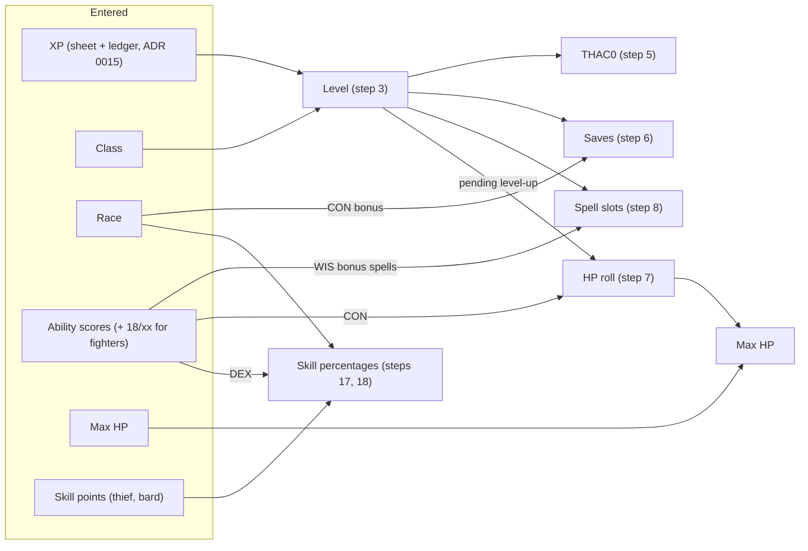

# ADR 0030: Classes and races: everything derived from class, race and XP

**Status**: accepted 2026-10-17 (triage, user; the four questions answered "yes to all" by the
user on 2026-10-17, so each stated default is decided). Steps or parts marked _(proposed)_ are
details this ADR adds beyond the triage and the answers; they await the user's OK in review. Not
implemented. Amends [ADR 0002](0002-attack-resolution.md) step 2, [ADR 0004](0004-buffs.md) steps 7
to 9 (warriors only), [ADR 0006](0006-saving-throws.md) step 1, [ADR 0008](0008-spell-slots-and-long-rest.md)
steps 2 and 3, [ADR 0014](0014-skill-checks.md) step 3 and [ADR 0015](0015-experience.md) steps 2
and 3, each from its implementation.

## Context

Until now the app manages one level 15 half-elf Bard and stores what the sheet says: level, THAC0
and the five saving throw targets are inputs; only the Bard's XP table (PHB Table 25) and spell
table (Table 32) are in the catalogue ([ADR 0021](0021-spell-catalogue.md) step 9). Strength spells
stack up to 18 and Improved Strength up to its own maximum ([ADR 0004](0004-buffs.md) steps 7 to 9).
The hosted game gets many characters of five classes.

Triage, 2026-10-17, user:

- Classes: "mage, thief, warrior, priest. we have the books in the sibling repo. later:
  dual-class, psionics", so **fighter, mage, cleric, thief, plus bard**.
- "we don't enter the level or base thac0. we enter xp amount, all that can be deduced by rules
  should be." **Entered**: ability scores, max HP, thief (and bard) skill points, XP. Everything
  else is derived.
- Race from the six PHB races; the saving throw and thief-skill adjustments are applied; the
  level limits and ability adjustments are shown, not enforced.
- Level up "prompts a roll. the whole point of the app is to automate and streamline what is
  mechanical from the rules".
- The computed values for Kelsen (the existing Bard) should match his sheet, and the app should
  warn if they do not.
- Each class has its own things (a spellbook for mages and bards, spheres for priests).

Questions, answered 2026-10-17 by the user, "yes to all" (each default as stated in the work item
is decided):

1. **Fighter**: exceptional strength 18/01 to 18/00 (warriors only, entered); attacks per round by
   level (1, 3/2 from 7, 2 from 13); weapon specialization as a per-weapon flag (+1 to hit, +2
   damage, the specialist's rates); and the ADR says how strength spells combine with 18/xx.
   Steps 9 to 12.
2. **Cleric**: slots plus Wisdom bonus spells; low-Wisdom spell failure rolled on the server;
   preparation from every priest spell of the cleric's major spheres (all levels) and minor spheres
   (levels 1 to 3); turning undead rolled on the server against a chosen undead type. Steps 13 to
   16.
3. **Thief**: skill points entered; race, Dexterity and armour adjustments computed; backstab as an
   attack option (+4 to hit, ×2 to ×5 damage by level); read scrolls and followers later. Steps 17
   to 19.
4. **Mage and bard spellbook**: adding a spell rolls the Intelligence chance to learn on the server
   (a failure is logged, no retry until the next level) and enforces the Intelligence maximum of
   spells per level. Step 20.

Sources are the PHB and DMG tables in `critical-rulebooks` (`tables/phb-NNN-…`, `tables/dmg-NNN-…`)
and the class and race chapters (PHB chapters 2 and 3, chapter 9 for turning undead). The project's
ADRs win where they differ from the book; the differences are named in each step.

How the derived values hang together:

## Decision

Every rules table named here is reference data in the catalogue artifact
([ADR 0021](0021-spell-catalogue.md) step 9), never code; step 23 lists them. Each step gets one
named test in the implementing item (game logic in Go only, the web renders the server's values).

### The character

1. **Inputs.** A character has: a class (`bard`, `fighter`, `mage`, `cleric`, `thief`); a race
   (`human`, `dwarf`, `elf`, `gnome`, `half_elf`, `halfling`); the six ability scores as they stand
   on the sheet, after the racial adjustments (step 21); for a fighter, an exceptional strength
   percentile (step 9); the max HP; for a thief or bard, the skill points (steps 17 and 18); the
   starting XP and the XP ledger ([ADR 0015](0015-experience.md)). Level, THAC0, saving throw
   targets, spell slot limits and skill percentages are **not entered**: steps 3 to 8 and 17 to 18
   derive them, and the character stores none of them. A thief or bard also has the armour worn
   for skills (step 17) _(proposed: the inventory does not track worn armour, so it is one entered
   field: none, leather, padded or studded leather, elven chain, chain mail (bard only); Table 29
   has no other armour, so no other is offered)_.
2. **Class groups.** Fighter is a warrior, mage a wizard, cleric a priest, thief and bard rogues.
   The group picks the THAC0 row (step 5), the saving throw rows (step 6), the hit dice (step 7) and
   the Constitution hit point bonus (warriors get the higher one, step 7).

### Level and experience

3. **Level from XP.** The level is the highest level `L` from 1 to 20 whose threshold `T(L)` in the
   class's experience table is at or under the XP total ([ADR 0015](0015-experience.md) step 1):
   fighter PHB Table 14 (Fighter column), mage Table 20, cleric Table 23 (Cleric column), thief and
   bard Table 25. The tables stop at 20, so does the level (as ADR 0015 step 3 today). This level
   feeds ADR 0015 step 3's progress (`L` is no longer the sheet's) and every step below. Reaching a
   threshold raises the level at once; the new hit points wait for the roll (step 7). The race's
   level limit is shown, not enforced (step 21). Amends ADR 0015 step 3 ("no level-up").
4. **XP bonus by prime requisites.** A character earns the 10% bonus of [ADR 0015](0015-experience.md)
   step 1 when every prime requisite of the class is 16 or more (PHB chapter 3, each class's
   description): fighter Strength (18/xx counts as 18), mage Intelligence, cleric Wisdom, thief
   Dexterity, bard Dexterity and Charisma. Read from the sheet's scores, as ADR 0015 step 2, which
   this generalises (it was the Bard's rule alone).
5. **THAC0.** The THAC0 is the PHB Table 53 (Calculated THAC0s) value for the class group at the
   level: warriors improve 1 point a level, priests 2 every 3 levels, rogues 1 every 2, wizards 1
   every 3 (Table 54; DMG Tables 37 and 38 are the same). It replaces the sheet's `thac0_base` as
   "the character's THAC0" of [ADR 0002](0002-attack-resolution.md) step 2; every to-hit modifier
   there is unchanged.
6. **Saving throws.** The target of each of the five categories of [ADR 0006](0006-saving-throws.md)
   step 1 is the PHB Table 60 (DMG Table 46) row for the class group and level: priests 1-3, 4-6,
   …; rogues 1-4, 5-8, …; warriors 1-2, 3-4, …; wizards 1-5, 6-10, … (the warriors' level 0 row is
   unused: a character starts at level 1). The race's bonus (step 22) is one named modifier on the
   roll, like a buff's `save_bonus` (ADR 0006 step 1): it moves the roll, never the target. Amends
   ADR 0006 step 1 ("the target of the category on the character sheet").

### Hit points

7. **Level-up roll.** The character keeps the level its max HP was last set for (`hp_level`). When
   the level of step 3 is above it, a level-up is pending and the app prompts for it (the
   character card shows "level up: roll HP", one per pending level). Each roll is one request:
   1. **Up to the name level** (warriors and priests through level 9, wizards and rogues through
      10; Tables 14, 20, 23 and 25, Hit Dice column): one hit die of the group (warrior d10, priest
      d8, rogue d6, wizard d4) rolled through the dice port, plus the Constitution hit point
      adjustment of PHB Table 3: warriors take the bracketed value, every other class at most +2.
      At Constitution 20 and more, Table 3's footnotes raise low dice (a 1 counts as 2 at 20; 1 and
      2 count as 3 at 21-22; 1 to 3 count as 4 at 23 and up): the die shown is the one rolled, the
      gain uses the raised value. _(proposed: the gain is at least 1, a low die with a negative
      adjustment never lowers or keeps the max HP.)_
   2. **Above the name level**: a fixed gain, no die and no Constitution bonus (warrior +3, priest
      +2, rogue +2, wizard +1; PHB chapter 3, each group's hit points paragraph). The prompt still
      appears; the "roll" records the fixed gain.
   3. **Recorded as one transaction** ([ADR 0018](0018-transactions-and-undo.md)): a `level_up`
      entry with the level reached, the die and its raised value (or none), the Constitution
      adjustment and the gain; the max HP rises by the gain and `hp_level` by 1, snapshotted for
      undo. _(proposed: the current HP rises by the same gain, as an HP ledger entry of
      [ADR 0007](0007-hp-ledger.md), so the damage already taken is kept.)_ Several pending levels
      are rolled one by one, lowest first.
   4. _(proposed)_ An XP correction that brings the level below `hp_level` removes nothing: the
      card warns "max HP rolled for level N, XP gives level M" until the player undoes the roll or
      the XP comes back. Level drain stays out of scope.
   5. The max HP entered for an imported or new character is the max HP at its current level:
      `hp_level` starts at the level of step 3. Level 1 hit points are entered, never rolled here.

### Spells

8. **Spell slot limits.** The number of slots of a spell level ([ADR 0008](0008-spell-slots-and-long-rest.md)
   step 2) is, at the character's level: bard PHB Table 32, mage Table 21, cleric Table 24 plus the
   Wisdom bonus spells (step 13). Fighters and thieves have none and are refused a preparation.
   Amends ADR 0008 step 2 (it named the Bard's table only). A mage prepares from his spellbook as
   the Bard does (ADR 0008 step 3); a cleric from the spheres (step 15).

### Fighter

9. **Exceptional strength.** A fighter with Strength 18 enters a percentile 01 to 100 (100 =
   18/00), or none. It is refused for any other class, for a Strength other than 18, and for a
   halfling (PHB Table 7, note: halfling fighters do not roll it). PHB Table 1's exceptional rows
   (already in the catalogue's `strength` table, `exc_min` and `exc_max`) give its hit and damage
   adjustments.
10. **Strength spells and 18/xx (warriors only).** The book: past 18, a warrior's Strength spell
    adds tenths of a point, 10% a point, and cannot reach 19 (PHB, *Strength*, Wizard 2). The
    project keeps its stacking and gates (ADR 0004 steps 7 to 10) and only adds the warrior's scale
    above 18:
    1. A Strength bonus (ADR 0004 step 7) takes a fighter's Strength up 1 point at a time to 18,
       then 10 percentile points per point of bonus, capped at 18/00. Strength 17 with +3: 18/20.
       Strength 18/50 with +4: 18/90. Other classes stop at 18 as today.
    2. Improved Strength (ADR 0004 step 8, a `str_max` above 18) counts an 18/xx as 18 and adds its
       bonus up to its `str_max`; at 19 and more there is no percentile. Strength 18/50 with +4:
       22.
    3. No rule lowers the Strength in effect below the sheet's (ADR 0004 step 9): a percentile is
       never lost to an effect whose result would be a plain 18.
    4. Gates (ADR 0004 step 10) read 18/xx as 18.
11. **Attacks per round.** A fighter's attacks per round are PHB Table 15 by level (1 per round at
    1 to 6, 3 per 2 rounds at 7 to 12, 2 per round from 13), or PHB Table 35 for the weapon in
    hand when he is specialized in it (step 12). Shown on the attack card as the rate; the app does
    not limit the attack requests. _(proposed: with a half rate (3/2, 5/2) the card also shows this
    round's count, the lower one in odd rounds and the higher in even rounds of
    [ADR 0005](0005-rounds-and-time.md).)_
12. **Weapon specialization.** A per-weapon flag, fighters only (refused for another class). A
    specialized weapon adds +1 to hit and +2 to damage, each a named modifier, not magical (it does
    not count as a "+N" of ADR 0002 step 6). _(proposed: a bow or crossbow instead gets +2 to hit at
    point-blank range as an attack option, and no damage bonus, PHB "Effects of Specialization";
    thrown weapons count as melee weapons for the +1/+2.)_ Proficiency slots and the cost of
    specialization are not tracked.

### Cleric

13. **Wisdom bonus spells.** PHB Table 5's bonus spells are cumulative from Wisdom 13 up to the
    cleric's Wisdom (Wisdom 15: two 1st and one 2nd); each adds a slot of its spell level only
    when Table 24 gives the cleric at least one slot of that level. Sixth-level spells need Wisdom
    17 and seventh-level spells Wisdom 18 (Table 24's notes): below it the row's slots of that
    level are 0. Sheet's Wisdom.
14. **Spell failure.** A cleric whose Wisdom has a chance of spell failure (PHB Table 5, Wisdom 12
    and below) rolls one d100 on the server at each cast; at or under the chance, the spell fails:
    the slot is spent, no effect is applied, and the cast entry ([ADR 0008](0008-spell-slots-and-long-rest.md)
    step 7) records the d100, the chance and the failure. Wisdom 13 and up: no die.
15. **Spheres.** A cleric prepares from every priest spell in the catalogue that belongs to one of
    his major spheres at any spell level, or to his minor sphere at spell levels 1 to 3; there is no
    spellbook. The standard cleric has major access to every sphere but Animal, Plant, Weather and
    Elemental, and minor access to Elemental (PHB chapter 3, Cleric); the sphere access is class
    data, not entered (a priest of a specific mythos is out of scope). Amends ADR 0008 step 3 for
    clerics.
16. **Turning undead.** `POST` with an undead type (a PHB Table 61 row, by type or Hit Dice) reads
    the cell for the cleric's level (columns 1 to 9, 10-11, 12-13, 14 and up):
    1. A number: one d20 through the dice port; success at or above the number.
    2. `T`: turned with no d20. `D`: destroyed with no d20. `D*`: destroyed, and 2d4 more of the
       type are affected.
    3. `—`: the cleric cannot turn that type; refused (400) before any die.
    4. On a success (or `T`, `D`) 2d6 undead are affected (plus the 2d4 of `D*`), rolled on the
       server; the lowest Hit Dice go first (PHB chapter 9), which the DM applies.
    5. One logged roll entry (a roll kind of `actionlog.RollKinds`) with the type, the cell, the
       dice and the result; it changes no state. Once per encounter is not enforced.

### Thief and bard skills

17. **Thieving skills.** Each of the eight skills of PHB Table 26 is: base (Table 26) + the
    entered points + race (Table 27) + Dexterity (Table 28, the sheet's Dexterity; skills without a
    column get 0) + armour (Table 29, the armour of step 1; leather is the table's baseline, 0), capped at 95% (PHB p.39: no skill above
    95 with every adjustment) and floored at 0. _(proposed: the points are checked against the
    book's budget, 60 at level 1 and 30 a level after, at most 30 in one skill at level 1; a
    breach is a warning on the skills card, not a refusal.)_
18. **Bard skills.** The four bard skills (Climb Walls, Detect Noise, Pick Pockets, Read
    Languages) are: base (PHB Table 33) + the entered points + race (Table 27) + Dexterity (Table
    28: Pick Pockets only) + armour (Table 29; chain mail is the elven chain column plus the extra -5% of the
    table's note), capped at 95% and floored at 0. _(proposed: budget warning as step 17, 20 points at level 1 and 15 a level
    after.)_ The computed percentage replaces the sheet's in [ADR 0014](0014-skill-checks.md) step
    3. The other bard abilities stay as they are.
19. **Backstab.** A thief's attack has a backstab option (not a bard's): +4 to hit (a named
    modifier), and the weapon's damage dice multiplied by PHB Table 30 for the level (×2 at 1-4, ×3
    at 5-8, ×4 at 9-12, ×5 from 13) as a `DiceMultiplier` factor of
    [ADR 0003](0003-damage.md) step 4: the dice before Strength and magic, as the book says. The
    target's shield and Dexterity bonuses are not modelled (the AC is the one the player enters,
    [ADR 0012](0012-attack-against-unknown-ac.md)); first-attack-only and the conditions of
    surprise are the player's call. Read scrolls (level 10) and followers come later.

### Spellbook

20. **Learning a spell (mage, bard).** Adding a wizard spell to a mage's or bard's spellbook:
    1. Refused (400, before any die) when its level is above the Intelligence's maximum spell
       level (PHB Table 4), above the class's highest spell level (bard 6th, mage 9th), or when
       the spellbook already holds the Intelligence's maximum number of spells of that level
       (Table 4; "All" has no maximum).
    2. Otherwise one d100 through the dice port; at or under the Intelligence's chance to learn
       (Table 4) the spell is written in the spellbook; above it, the failure is logged and that
       spell is refused for this character until his level is higher than at the failure.
    3. One transaction ([ADR 0018](0018-transactions-and-undo.md)), success or failure; undoing a
       failure lifts its block. A spell once learned is never removed by a rule (the book has no
       unlearning); removing it is a sheet correction.
    4. The spellbook of an imported character (Kelsen's) comes in without rolls. Sheet's
       Intelligence.

### Races

21. **The six races.** Human, dwarf, elf, gnome, half-elf, halfling (PHB chapter 2). The race card
    shows, without enforcing them: the ability requirements (PHB Table 7) and adjustments (Table
    8; the entered scores already include them), the classes the race allows and its level limit
    in the class (DMG Table 7; U for unlimited). _(proposed: a level above the limit, or a class the
    race does not allow, is a warning on the card.)_
22. **Racial effects applied.** Applied by the server:
    1. Dwarves, gnomes and halflings add their PHB Table 9 bonus (from the sheet's Constitution) to
       saves against Rod/Staff/Wand and Spells. Dwarves and halflings add it against poison too:
       _(proposed: the Paralyze/Poison save request takes a "poison" flag, and the bonus applies
       only with it, since the category also covers paralysis and death magic.)_
    2. Thief and bard skills: step 17 and 18's Table 27.
    3. _(proposed)_ Elves +1 to hit with bows (not crossbows) and short and long swords; halflings
       +1 to hit with thrown weapons and slings (PHB chapter 2), named modifiers from the weapon's
       kind. Every other trait (infravision, resistance to sleep and charm, secret doors, +1 against
       orcs or goblins, the -4 to giants attacking dwarves and gnomes, magic item malfunction,
       surprise) is shown as text on the race card, not computed.

### Rules data and the sheet

23. **Tables the catalogue carries** (input for the catalogue item; each new table is a new
    artifact format, [ADR 0021](0021-spell-catalogue.md) step 9.1). Only the columns read here:
    - kept: `strength` (Table 1, with the exceptional rows), `dexterity` (Table 2), `bard_spells`
      (Table 32), `bard_experience` (Table 25; it may become one table per class with the others);
    - experience by class: fighter (Table 14), mage (Table 20), cleric (Table 23), thief and bard
      (Table 25);
    - hit dice by group: the die, the name level and the fixed gain after it (Tables 14, 20, 23 and
      25, Hit Dice column, with chapter 3's hit points paragraphs);
    - Constitution (Table 3): hit point adjustment, the warrior's value and the low-die floor;
    - Intelligence (Table 4): maximum spell level, chance to learn, maximum spells per level;
    - Wisdom (Table 5): bonus spells and chance of spell failure;
    - Constitution saving throw bonus (Table 9);
    - THAC0 by group and level (Table 53);
    - saving throws by group and level band (Table 60);
    - warrior attacks per round (Table 15) and specialist attacks per round (Table 35);
    - wizard spells (Table 21) and priest spells (Table 24, with the Wisdom 17 and 18 notes);
    - thieving skills: base (Table 26), race (Table 27), Dexterity (Table 28), armour (Table 29,
      with the bard note); bard skill base (Table 33);
    - backstab multipliers (Table 30);
    - turning undead (Table 61);
    - races: ability requirements (Table 7), adjustments (Table 8), classes allowed (PHB chapter 2)
      and level limits (DMG Table 7; the rulebooks copy of this table is an unverified OCR and must
      be hand-checked before it is shipped);
    - each priest spell's spheres, and the cleric's major and minor spheres.
24. **The sheet comparison.** For a character imported from a sheet that states them (Kelsen's
    seed), the sheet's level, THAC0, five save targets and bard skill percentages are compared with
    the computed values at import. Every difference is a warning naming the value, the sheet's
    figure and the computed one, kept and shown to the player; the computed value is used. The
    sheet's figures are not stored as inputs. _(proposed: Kelsen's bard skill points are derived
    once at import as the sheet's percentage minus the computed base, race, Dexterity and armour
    terms, so his skills come out as on the sheet.)_

## Consequences

- Kelsen (half-elf bard, 1,293,418 XP, sheet level 15, THAC0 13, saves 10 / 8 / 9 / 13 / 9)
  matches: level 15 from Table 25 (1,100,000 to 1,320,000), THAC0 13 from Table 53, saves from the
  rogue 13-16 row of Table 60, no racial save bonus for a half-elf, 3 / 3 / 3 / 3 / 2 slots from
  Table 32. His spellbook (at most 9 spells a level) is within Intelligence 14's maximum. A warning
  at import would mean a data or code error, not a house rule.
- `characters.level`, `thac0_base` and the five `save_*` columns stop being inputs; the catalogue
  item (rules tables) comes before the code that derives them.
- The level rises as soon as the XP reaches the threshold: THAC0, saves and slots follow at once,
  the hit points only with the roll. Training (DMG) is not modelled.
- Every roll here (HP, spell failure, turning, learning) goes through the dice port and the action
  log, and is undoable like any transaction.
- The web shows derived values and prompts; it never computes them (house rule).
- Not covered: paladin, ranger, druid, specialist wizards, priests of specific mythoi, multi-class
  and dual-class, psionics, level drain, levels above 20, thief scroll use and followers, fighter
  followers, proficiency slots, a race's conditional combat traits (shown as text), the Wisdom
  magical defence adjustment on saves, the cleric's blunt-weapon restriction and class armour
  limits (not enforced).
