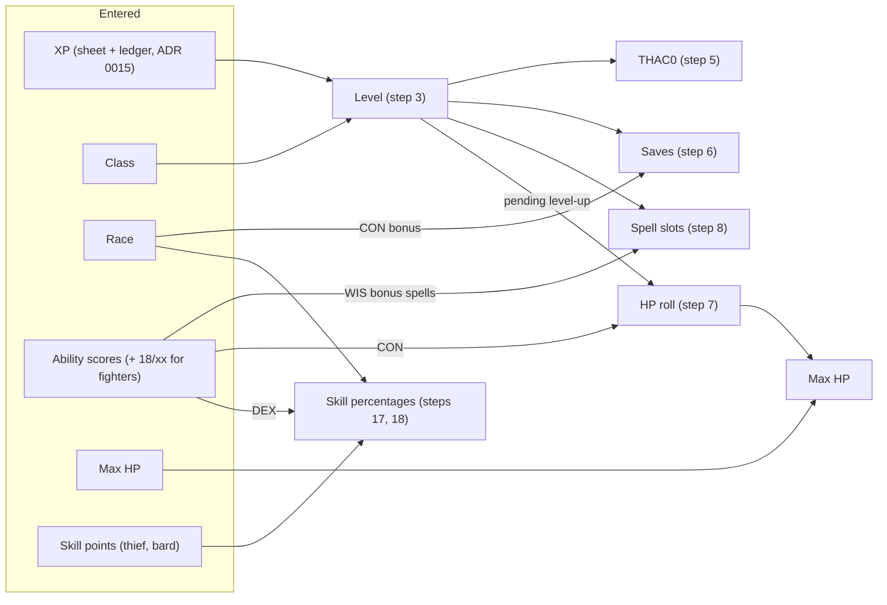

# ADR 0030: Classes and races: everything derived from class, race and XP

**Status**: accepted 2026-10-17 (triage, user; the four questions answered "yes to all" by the
user on 2026-10-17, so each stated default is decided). Steps or parts marked _(proposed)_ are
details this ADR adds beyond the triage and the answers; they await the user's OK in review.
Implemented 2026-10-18: steps 2, 3, 5 and 6, step 8 for the bard and the mage, step 22.1 for the
Rod/Staff/Wand and Spells saves, step 24 for the level, THAC0 and saves, and the race code of step 1
(each with its "Tests:" line); step 7 (realized and target levels, the level-up roll) implemented
2026-10-18 as rewritten by the
user's ruling that day; steps 9 to 12 (the fighter) implemented 2026-10-18, each with its "Tests:"
line and as-built note; the rest is not
implemented. Amends [ADR 0002](0002-attack-resolution.md) step 2, [ADR 0004](0004-buffs.md) steps 7
to 10 (warriors only), [ADR 0006](0006-saving-throws.md) step 1, [ADR
0008](0008-spell-slots-and-long-rest.md)
steps 2 and 3, [ADR 0014](0014-skill-checks.md) step 3 and [ADR 0015](0015-experience.md) steps 2
and 3, each from its implementation.

## Context

Until now the app manages one level 15 half-elf Bard and stores what the sheet says: level, THAC0
and the five saving throw targets are inputs; only the Bard's XP table (PHB Table 25) and spell
table (Table 32) are in the catalogue ([ADR 0021](0021-spell-catalogue.md) step 9). Strength spells
stack up to 18 and Improved Strength up to its own maximum ([ADR 0004](0004-buffs.md) steps 7 to 9).
The hosted game gets many characters of five classes.

Triage, 2026-10-17, user:

- Classes: "mage, thief, warrior, priest. we have the books in the sibling repo. later:
  dual-class, psionics", so **fighter, mage, cleric, thief, plus bard**.
- "we don't enter the level or base thac0. we enter xp amount, all that can be deduced by rules
  should be." **Entered**: ability scores, max HP, thief (and bard) skill points, XP. Everything
  else is derived.
- Race from the six PHB races; the saving throw and thief-skill adjustments are applied; the
  level limits and ability adjustments are shown, not enforced.
- Level up "prompts a roll. the whole point of the app is to automate and streamline what is
  mechanical from the rules".
- The computed values for Kelsen (the existing Bard) should match his sheet, and the app should
  warn if they do not.
- Each class has its own things (a spellbook for mages and bards, spheres for priests).

Questions, answered 2026-10-17 by the user, "yes to all" (each default as stated in the work item
is decided):

1. **Fighter**: exceptional strength 18/01 to 18/00 (warriors only, entered); attacks per round by
   level (1, 3/2 from 7, 2 from 13); weapon specialization as a per-weapon flag (+1 to hit, +2
   damage, the specialist's rates); and the ADR says how strength spells combine with 18/xx.
   Steps 9 to 12.
2. **Cleric**: slots plus Wisdom bonus spells; low-Wisdom spell failure rolled on the server;
   preparation from every priest spell of the cleric's major spheres (all levels) and minor spheres
   (levels 1 to 3); turning undead rolled on the server against a chosen undead type. Steps 13 to
   16.
3. **Thief**: skill points entered; race, Dexterity and armour adjustments computed; backstab as an
   attack option (+4 to hit, ×2 to ×5 damage by level); read scrolls and followers later. Steps 17
   to 19.
4. **Mage and bard spellbook**: adding a spell rolls the Intelligence chance to learn on the server
   (a failure is logged, no retry until the next level) and enforces the Intelligence maximum of
   spells per level. Step 20.

Sources are the PHB and DMG tables in `critical-rulebooks` (`tables/phb-NNN-…`, `tables/dmg-NNN-…`)
and the class and race chapters (PHB chapters 2 and 3, chapter 9 for turning undead). The project's
ADRs win where they differ from the book; the differences are named in each step.

How the derived values hang together:

## Decision

Every rules table named here is reference data in the catalogue artifact
([ADR 0021](0021-spell-catalogue.md) step 9), never code; step 23 lists them. Each step gets one
named test in the implementing item (game logic in Go only, the web renders the server's values).
Every prompt and warning below is **structured data**: a code and its numbers (levels, values,
limits), which the web words in en and fr; the quoted texts are illustrations, never sent by the
server. Text that comes with the rules (race traits, class names) is localized catalogue text, one
row per language ([ADR 0023](0023-localized-text.md)), never parsed by the code.

### The character

1. **Inputs.** A character has: a class (`bard`, `fighter`, `mage`, `cleric`, `thief`); a race
   (`human`, `dwarf`, `elf`, `gnome`, `half_elf`, `halfling`); the six ability scores as they stand
   on the sheet, after the racial adjustments (step 21); for a fighter, an exceptional strength
   percentile (step 9); the max HP; for a thief or bard, the skill points (steps 17 and 18); the
   starting XP and the XP ledger ([ADR 0015](0015-experience.md)). Level, THAC0, saving throw
   targets, spell slot limits and skill percentages are **not entered**: steps 3 to 8 and 17 to 18
   derive them, and the character stores none of them. A thief or bard also has the armour worn
   for skills (step 17) _(proposed: the inventory does not track worn armour, so it is one entered
   field: none, leather, padded or studded leather, elven chain, or, for a bard, "metal armour up
   to chain mail" (chain, ring, scale, hide, brigandine: the bard may wear any armour up to and
   including chain mail, PHB chapter 3, Bard). Table 29 has columns only for the first four; the
   metal one uses the elven chain column plus the bard's extra -5% (Table 29's note), a ruling,
   not book text, step 18)_.
   _(As built)_ The race is a code in `characters.race_code` (`''` when none is set: no racial
   adjustment applies); the free-text race of the character's details stays as the player wrote it.
   The seed names Kelsen's (`half_elf`), given to him by the migration's data step. The derived values
   are computed on every read of the character (`charactersvc.GetCharacter`), so every reader (attack,
   save, preparation, casting, the XP ledger, the character list) gets them.
   Tests: `TestRead_Refusals` ("character race not a PHB race code", seedfile),
   `TestMigrate_TheSeedCharacterGetsItsRaceAfterTheRaceMigration`, `TestSeed_TheCharacterAndItsStateRows`
   (storage/postgres).
   _(As built for creation, 2026-10-18; ranges proposed)_ A character created in the app enters its
   class, race code (one of the six, required), name (1 to 40 characters), the six scores (each **3 to
   19**: 3d6, one more or less for a racial adjustment of PHB Table 8), the max HP (1 to 999) and the
   starting XP (0 to 100,000,000). Only the classes whose entries and rules are built may be created:
   the **bard** for now (`charactersvc.CreatableClasses`; the fighter and the **mage** since,
   a created mage's spellbook starting empty and filling by step 20); each class item adds its own with its entries
   (a fighter's exceptional strength, a thief's skill points). The **thief** is creatable since steps 17 and 19 (its skill points and armour, step 17). The **cleric** is creatable since steps 13
   to 16 (it enters nothing more). A refusal names the field and a code (`empty`, `too_long`,
   `out_of_range`, `not_creatable`, `unknown`, `race_not_allowed`), worded by the web.
   Tests: `TestCreate_RefusesInvalidInputWithFieldErrors`, `TestCreate_AcceptsTheBounds` (charactersvc),
   `TestCreate_RefusedInputStoresNothing` (composition).
2. **Class groups.** Fighter is a warrior, mage a wizard, cleric a priest, thief and bard rogues.
   The group picks the THAC0 row (step 5), the saving throw rows (step 6), the hit dice (step 7) and
   the Constitution hit point bonus (warriors get the higher one, step 7).

### Level and experience

   Tests: `TestClassGroup_Step2` (ruletablesadpt), `TestDerive_Step2_TheClassGroupPicksTheRows`
   (charactersvc).
3. **Level from XP.** The target level (step 7) is the highest level `L` from 1 to 20 whose
   threshold `T(L)` in the
   class's experience table is at or under the XP total ([ADR 0015](0015-experience.md) step 1):
   fighter PHB Table 14 (Fighter column), mage Table 20, cleric Table 23 (Cleric column), thief and
   bard Table 25. The tables stop at 20, so does the level (as ADR 0015 step 3 today). This level
   feeds ADR 0015 step 3's progress (`L` is no longer the sheet's, and `T` is the class's table, not
   `bard_experience`) and step 7's prompt. Reaching a threshold makes a level-up pending; the
   level's benefits (steps 5, 6, 8 and the hit points) follow the realized level of step 7, so they
   wait for the level-up step. The race's level limit is shown, not enforced (step 21).
   Amends ADR 0015 step 3 ("no level-up").
   Tests: `TestLevelFor_Step3_HighestThresholdAtOrUnderTheXP`, `TestXPThreshold_ByClass`
   (ruletablesadpt, against the PHB pages), `TestDerive_Step3_LevelFromTheClassTableAtTheXPTotal`,
   `TestList_IsTheOwnersCharactersAtTheirRealizedLevel` (charactersvc),
   `TestComputeProgress_FromTheClassTable`, `TestGet_ProgressFromTheCharactersClassTable` (xpsvc: a
   mage's progress reads Table 20),
   `TestDerived_BenefitsFollowTheRealizedLevelNotTheXP` (composition: an award crossing a
   threshold raises the target level only; THAC0, saves and slots change with the level-up rolls,
   and the undo brings them back).
4. **XP bonus by prime requisites.** A character earns the 10% bonus of [ADR 0015](0015-experience.md)
   step 1 when every prime requisite of the class is 16 or more (PHB chapter 3, each class's
   description): fighter Strength (18/xx counts as 18), mage Intelligence, cleric Wisdom, thief
   Dexterity, bard Dexterity and Charisma. Read from the sheet's scores, as ADR 0015 step 2, which
   this generalises (it was the Bard's rule alone).
5. **THAC0.** The THAC0 is the PHB Table 53 (Calculated THAC0s) value for the class group at the
   realized level (step 7): warriors improve 1 point a level, priests 2 every 3 levels, rogues 1
   every 2, wizards 1
   every 3 (Table 54; DMG Tables 37 and 38 are the same). It replaces the sheet's `thac0_base` as
   "the character's THAC0" of [ADR 0002](0002-attack-resolution.md) step 2; every to-hit modifier
   there is unchanged.
   Tests: `TestTHAC0For_Step5_Table53` (ruletablesadpt), `TestDerive_Step5_THAC0FromTable53`
   (charactersvc); the attack reads it (`TestResolveAttack`, combatsvc, on the derived THAC0).
6. **Saving throws.** The target of each of the five categories of [ADR 0006](0006-saving-throws.md)
   step 1 is the PHB Table 60 (DMG Table 46) row for the class group and realized level (step 7):
   priests 1-3, 4-6,
   …; rogues 1-4, 5-8, …; warriors 1-2, 3-4, …; wizards 1-5, 6-10, … (the warriors' level 0 row is
   unused: a character starts at level 1). The race's bonus (step 22) is one named modifier on the
   roll, like a buff's `save_bonus` (ADR 0006 step 1): it moves the roll, never the target. Amends
   ADR 0006 step 1 ("the target of the category on the character sheet").

   Tests: `TestSavesFor_Step6_Table60` (ruletablesadpt), `TestDerive_Step6_SavesFromTable60`
   (charactersvc), `TestResolveSavingThrow` (combatsvc, on the derived targets).

### Hit points

7. **Level-up: realized and target levels** (rewritten 2026-10-18 by the user's ruling: "there is
   two levels then. one is the realized level, and the derived is the target level [...] we have
   to split them since there is a manual step for executing the transition"). Two levels:
   - the **target level** is step 3, the level the XP gives. It is never stored and grants
     nothing: it drives the level-up prompt and the XP progress (ADR 0015 step 3);
   - the **realized level** is stored and only the level-up step moves it (a roll or a manual
     entry, and their undo and redo). **Every benefit of a level follows the realized level**:
     the max HP, the THAC0 (step 5), the saves (step 6), the spell slots and preparation limits
     (step 8), the caster level and the level the character card and the character list show.
     DMG chapter 8's optional training rule (p. 49) makes the same split: XP makes a level
     possible, a further step makes it real.

   When the target level is above the realized one, a level-up is pending and the character card
   prompts for it, one prompt per pending level, lowest first (the server sends the pending
   levels, the web words them). Each level is one request:
   1. **Up to the name level** (warriors and priests through level 9, wizards and rogues through
      10; Tables 14, 20, 23 and 25, Hit Dice column): one hit die of the group (warrior d10, priest
      d8, rogue d6, wizard d4) rolled through the dice port, plus the Constitution hit point
      adjustment of PHB Table 3: warriors take the bracketed value, every other class at most +2.
      At Constitution 20 and more, Table 3's footnotes raise low dice (a 1 counts as 2 at 20; 1 and
      2 count as 3 at 21-22; 1 to 3 count as 4 at 23 and up): the die shown is the one rolled, the
      gain uses the raised value. The gain is at least 1: a low die with a negative adjustment
      never lowers or keeps the max HP (PHB: no hit die ever yields less than 1).
   2. **Above the name level**: a fixed gain, no die and no Constitution bonus (warrior +3, priest
      +2, rogue +2, wizard +1; PHB chapter 3, each group's hit points paragraph). The prompt still
      appears; the "roll" records the fixed gain.
   3. **Recorded as one transaction** ([ADR 0018](0018-transactions-and-undo.md)): a `level_up`
      entry with the level reached, the die and its raised value (or none), the Constitution
      adjustment and the gain; the realized level rises by 1 and the max HP by the gain,
      snapshotted for undo. Current HP is `hp_max` plus the HP ledger's SUM
      ([ADR 0007](0007-hp-ledger.md) step 2), so it rises by the same gain and the damage already
      taken is kept, with no extra HP entry (one would count the gain twice). Several pending
      levels are taken one by one, lowest first; nothing applies before its own roll.
   4. An XP correction that brings the target level below the realized one removes nothing: the
      benefits stay the realized level's and the card warns ("level N taken, XP gives level M")
      until the player undoes the roll or the XP comes back. Level drain stays out of scope.
   5. The max HP entered for an imported or new character is the max HP at its realized level,
      which starts at the imported sheet's level, or for a character created in the app at the
      level its starting XP gives. Level 1 hit points are entered, never rolled here.
   6. Out of scope: the DMG's "never more than one level per award" (p. 49); several pending levels
      are all offered, one at a time. Spells prepared in a slot a level gave stay prepared when
      that level-up is undone: like any drop of a slot limit, the preparation shows over the limit
      and can be unprepared.

   _(As built, 2026-10-18)_ `characters.realized_level` is a nullable column (migration 008,
   additive, no data step): NULL is the stored sheet `level`, read with
   `COALESCE(realized_level, level)`, so nothing is copied. The sheet `level` is not itself the
   realized level because step 24 compares it, as imported, with the rules at the import XP; a
   level-up must not turn into a sheet difference. A created character stores `realized_level` with
   its sheet figures. In Go the derived block carries `TargetLevel` and `RealizedLevel`
   (`charactersvc.Derived`; no bare level where both meet); the API's `derived` carries
   `targetLevel` and `realizedLevel`, and `levelUp` carries the `pending` levels (each with the
   group's `die` up to the name level or the `fixedGain` after it) and `realizedAboveTarget`
   (step 7.4). The XP ledger's progress (`/api/xp`) reads the target level.
   `POST /api/character/levelup/roll {level, die?}` takes one level: `level` must be the lowest
   pending one (realized + 1), else 409 `level_up_not_pending` and nothing is rolled (a stale page
   or a double click cannot take a level twice; the check and the write are one transaction).
   `die` is the manual entry, the die rolled at the table (1 to the die's sides, field `die`, code
   `out_of_range`; refused with `fixed_gain` above the name level); the server applies the rest of
   step 7.1 to it. Table 3's plain column already holds the non-warrior value (at most +2), the
   bracketed one is `hp_warrior`. The answer is the full breakdown (`level`, `hitDie`, `rolled`,
   `counted`, `conAdjustment`, `gain`, `fixed`, `manual`, `hpMaxBefore`, `hpMaxAfter`, `pending`);
   the `level_up` entry's payload is the same without `pending`, worded by the web (en, fr), and
   its `realized_level` snapshot holds `realizedLevel` and `hpMax`, which undo writes back (the
   level is pending again and its benefits go) and redo replays. The `level_up` entry has HP delta
   0 and is not a roll kind (never adjusted after it).
   Tests: `TestHitDiceFor_Step7_TheGroupsDieNameLevelAndFixedGain`,
   `TestConstitutionFor_Step7_1_Table3`
   (ruletablesadpt, against the PHB pages); `TestDerive_Step7_PendingLevelUps`,
   `TestDerive_Step7_4_ATargetUnderTheRealizedLevelIsFlagged`,
   `TestDerive_Step3_LevelFromTheClassTableAtTheXPTotal` (the benefits are the realized level's),
   `TestCreate_StoresTheEnteredValuesAndTheDerivedSheetAndMakesItCurrent` (7.5) (charactersvc);
   `TestRoll_Step7_1_OneHitDieOfTheGroupPlusTheConstitutionAdjustment`,
   `TestRoll_Step7_1_WarriorsTakeTheBracketedAdjustment`, `TestRoll_Step7_1_LowDiceRaisedFromConstitution20`,
   `TestRoll_Step7_1_TheGainIsAtLeastOne`, `TestRoll_Step7_2_AFixedGainAboveTheNameLevel`,
   `TestRoll_Step7_3_OneTransactionWithTheRealizedLevelSnapshot`,
   `TestRoll_Step7_3_TwoLevelsAtOnceAreTwoRollsLowestFirst`,
   `TestRoll_RefusesALevelThatIsNotTheLowestPending`, `TestRoll_TheManualEntryTakesTheDieRolledAtTheTable`,
   `TestRestorer_WritesTheRealizedLevelBack` (levelupsvc);
   `TestDerived_BenefitsFollowTheRealizedLevelNotTheXP`,
   `TestLevelUp_TheRollRaisesTheMaxHPAndUndoMakesItPendingAgain`,
   `TestLevelUp_TwoLevelsAtOnceAreTwoDiceThroughTheDicePort`,
   `TestUndo_EveryStateKeyIsRestoredThroughItsServicesStorage` (composition);
   `TestGetCharacter_MapsEveryColumn`, `TestSetRealizedLevel_WritesTheLevelAndItsMaxHP` (characterdal);
   `TestLevelUp_*` (router); `LevelUpPrompt.test.tsx`, `logSummary.test.ts` "level-up entries"
   (web); `web/e2e/xp.spec.ts` "level up: …" and `web/e2e/layout.spec.ts` "level-up prompt: …".

### Spells

8. **Spell slot limits.** The number of slots of a spell level ([ADR
   0008](0008-spell-slots-and-long-rest.md)
   step 2) is, at the character's realized level (step 7): bard PHB Table 32, mage Table 21, cleric
   Table 24 plus the
   Wisdom bonus spells (step 13). Fighters and thieves have none and are refused a preparation.
   Amends ADR 0008 step 2 (it named the Bard's table only). A mage prepares from his spellbook as
   the Bard does (ADR 0008 step 3); a cleric from the spheres (step 15).

   _(As built)_ The cleric's slots are Table 24 with the Wisdom bonus spells of step 13 at the realized
   level (`ruletablesvc.PriestSpellsPerDay`).
   Tests: `TestWizardSpellsPerDay_Step8_Table21`, `TestBardSpellsPerDay` (ruletablesadpt),
   `TestDerive_Step8_SpellSlotsByClass` (charactersvc), `TestInfo` (prepsvc: the limits are the
   derived slots).

### Fighter

9. **Exceptional strength.** A fighter with Strength 18 enters a percentile 01 to 100 (100 =
   18/00), or none. It is refused for any other class, for a Strength other than 18, and for a
   halfling (PHB Table 7, note: halfling fighters do not roll it). PHB Table 1's exceptional rows
   (already in the catalogue's `strength` table, `exc_min` and `exc_max`) give its hit and damage
   adjustments.
   As built: `characters.str_exceptional` (migration 009, 0 = none); refusals on field
   `strExceptional` with code `not_allowed` (wrong class, Strength or race) or `out_of_range`; the
   halfling exclusion is a constant of `ruletablesvc`, not catalogue data; the creation options
   carry each class's `exceptionalStrengthRaces`, so the form offers the field only to those. The
   UI writes it in the
   PHB's notation (18/05, 18/50, 18/00), on the sheet and in the Strength modifier's detail; the
   API sends the score as the detail and the percentile as a number (`strExceptional` on the
   modifier and the damage term), no notation.
   Tests: `TestCreate_Step9_ExceptionalStrength` (charactersvc), `TestExceptionalStrengthAllowed_Step9`
   (ruletablesadpt), `TestResolveAttack_Step12_SpecializedMeleeAnd18_50` (combatsvc: Table 1 at
   18/50), `TestRollSpellToHit_Step9_Reads18xx` (combatsvc: a spell's to-hit at 18/91).
10. **Strength spells and 18/xx (warriors only).** The book: past 18, a warrior's Strength spell
    adds tenths of a point, 10% a point, and cannot reach 19 (PHB, *Strength*, Wizard 2). The
    project keeps its stacking and gates (ADR 0004 steps 7 to 10) and only adds the warrior's scale
    above 18:
    1. A Strength bonus (ADR 0004 step 7) takes a fighter's Strength up 1 point at a time to 18,
       then 10 percentile points per point of bonus, capped at 18/00. Strength 17 with +3: 18/20.
       Strength 18/50 with +4: 18/90. Other classes stop at 18 as today.
    2. Improved Strength (ADR 0004 step 8, a `str_max` above 18) counts an 18/xx as 18 and adds its
       bonus up to its `str_max`; at 19 and more there is no percentile. Strength 18/50 with +4:
       22.
    3. No rule lowers the Strength in effect below the sheet's (ADR 0004 step 9): a percentile is
       never lost to an effect whose result would be a plain 18.
    4. Gates (ADR 0004 step 10) read 18/xx as 18.

    As built: attacks and spell to-hits read Table 1 at the 18/xx in effect; `/api/stats/str` adds
    `baseExceptional` and `effectiveExceptional`.
    Tests: `TestAggregate_Step10_StrengthSpellsAnd18xx`, `TestAggregate_Step10_4_GatesRead18xxAs18`,
    `TestGetEffectiveStr_Step10_TheFightersPercentile` (buffsvc).
11. **Attacks per round.** Read from the weapon's type (step 23), shown on the attack card as a
    rate; the app does not limit the attack requests.
    1. **Melee weapon**: PHB Table 15 by the fighter's level (1 per round at 1 to 6, 3 per 2 rounds
       at 7 to 12, 2 per round from 13); Table 15 is melee attacks only. Specialized (step 12): Table
       35's melee column.
    2. **Missile weapon**: the type's rate of fire, PHB Table 45 (bows 2/1, light crossbow 1, heavy
       crossbow 1/2, dart 3/1, thrown dagger 2/1, sling 1), whatever the level. Specialized in a
       light or heavy crossbow, a thrown dagger, a dart or another non-bow missile: Table 35's
       column for it by level. A bow specialist gains no attacks ("bow specialists do not gain any
       additional attacks", PHB p.53): he keeps the rate of fire.
    3. A weapon with no type, or a missile type without a rate of fire, shows no rate.
    4. Examples at level 13: a heavy crossbow shows 1/2 (specialized: 3/2); a bow shows 2/1,
       specialized or not; a long sword shows 2/1 (specialized: 5/2). _(proposed: with a half rate (3/2, 5/2) the card also shows this
    round's count, the lower one in odd rounds and the higher in even rounds of
    [ADR 0005](0005-rounds-and-time.md).)_

    As built: the rate is the warriors' only (Table 15 is theirs; another class's weapon shows no
    rate, settled 2026-10-18), read at the realized level (step 7). The attack form view carries
    `attackRate {attacks, rounds, thisRound}`; the card writes it "3/2 att." with this round's count
    for a half rate. The weapon editor gains the step 23 type select, without which no rate shows.
    Tests: `TestAttackRateFor_Step11`, `TestAttackRateInRound_Step11_4` (ruletablesadpt),
    `TestGetAttackForm_Step11_AttackRateAndPointBlank` (combatsvc; a level the tables cannot read
    is logged and shows no rate, the form still loads).
12. **Weapon specialization.** A per-weapon flag, fighters only (refused for another class). A
    specialized weapon adds +1 to hit and +2 to damage, each a named modifier, not magical (it does
    not count as a "+N" of ADR 0002 step 6). _(proposed: a bow or crossbow instead gets +2 to hit at
    point-blank range as an attack option, and no damage bonus, PHB "Effects of Specialization";
    slings and thrown weapons (dagger, dart, hand axe…) get no bonus: the book names only melee
    weapons and bows and crossbows (supervisor, 2026-10-18, the PHB literally; was the melee
    +1/+2).)_ Proficiency slots and the cost of
    specialization are not tracked.

    As built (user, 2026-10-18: point-blank is a per-request flag, the bonuses generic by weapon
    kind, which ones a launcher gets taken from the PHB; supervisor, 2026-10-18: the PHB text
    literally). PHB p.53, *Effects of Specialization*: a melee specialist gets +1 to hit and +2
    damage, not magical; bow and crossbow specialists gain a point-blank range category with +2 to
    hit and "no additional damage"; their extra attacks are Table 35's, none for bows (step 11).
    The book grants slings and thrown weapons no to-hit or damage bonus, only Table 35's attacks.
    So: a specialized melee weapon (kind `melee`) gets +1 to hit and +2 damage (modifier
    `specialization`, the damage added after the multipliers with Strength). A specialized bow or
    crossbow, by its weapon type (step 23: long, short, light, heavy or hand crossbow), never by
    whether an ammunition kind is filled in, gets only the point-blank +2 (modifier `point_blank`)
    when the attack request sets `point_blank`; the flag is refused (invalid input) for any other
    weapon. A specialized sling, dart, thrown dagger or other thrown weapon gets neither. The flag
    is never saved; the form's preview carries a `pointBlank` variant so the card shows the
    option's numbers without computing them. Missile range bands beyond point-blank are out of
    scope. `weapons.specialized` (migration 009) is refused on field `specialized`, code
    `not_allowed`, for a class whose `derived.specializes` is false, on every save that has it
    set.
    Tests: `TestSpecializes_Step12_FightersOnly` (ruletablesadpt), `TestCreate_Step12_SpecializedFightersOnly`,
    `TestUpdate_Step12_SpecializedFlag` (weaponsvc), `TestResolveAttack_Step12_SpecializedMeleeAnd18_50`,
    `TestResolveAttack_Step12_LauncherPointBlank`, `TestResolveAttack_Step12_PointBlankRefused`
    (sling with and without an ammo kind, darts, long sword),
    `TestResolveAttack_Step12_SpecializedThrownGetsNoBonus` (combatsvc).

### Cleric

13. **Wisdom bonus spells.** PHB Table 5's bonus spells are cumulative from Wisdom 13 up to the
    cleric's Wisdom (Wisdom 15: two 1st and one 2nd); each adds a slot of its spell level only
    when Table 24 gives the cleric at least one slot of that level. Sixth-level spells need Wisdom
    17 and seventh-level spells Wisdom 18 (Table 24's notes): below it the row's slots of that
    level are 0. Sheet's Wisdom.
14. **Spell failure.** A cleric whose Wisdom has a chance of spell failure (PHB Table 5, Wisdom 12
    and below) rolls one d100 on the server at each cast; at or under the chance, the spell fails:
    the slot is spent, no effect is applied, and the cast entry ([ADR 0008](0008-spell-slots-and-long-rest.md)
    step 7) records the d100, the chance and the failure. Wisdom 13 and up: no die.
15. **Spheres.** A cleric prepares from the priest spells of the catalogue his sphere access opens;
    there is no spellbook. Amends ADR 0008 step 3 for clerics.
    1. **The closed list** (PHB p.33-34, Cleric): major access to exactly twelve spheres, All,
       Astral, Charm, Combat, Creation, Divination, Guardian, Healing, Necromantic, Protection,
       Summoning and Sun; minor access to Elemental, which covers its four subspheres (Elemental
       Air, Earth, Fire and Water). No other sphere is open: Animal, Plant and Weather are closed,
       and so is every sphere the catalogue carries from other books (the *Tome of Magic*'s Chaos,
       Law, Numbers, Thought, Time, Travelers, War, Wards, and any later one). The access is class
       data, not entered; a priest of a specific mythos is out of scope.
    2. **A spell is open** when at least one of its spheres is open to it: a major sphere at any
       spell level, Elemental (any subsphere) at spell levels 1 to 3 only. A spell whose only
       spheres are closed, or Elemental at level 4 and up, is not preparable (refused, 400).
    3. Examples: a *Tome of Magic* spell of the Thought sphere alone is not preparable; an
       Elemental (Fire) spell of level 4 is refused and one of level 3 is allowed; a spell of
       Elemental (Fire) and Combat is open at any level through Combat.
    4. The rule reads each spell's sphere **codes** (step 23), never its localized sphere name.
16. **Turning undead.** `POST` with an undead type (a PHB Table 61 row, by type or Hit Dice) reads
    the cell for the cleric's level (columns 1 to 9, 10-11, 12-13, 14 and up):
    1. A number: one d20 through the dice port; success at or above the number.
    2. `T`: turned with no d20. `D`: destroyed with no d20. `D*`: destroyed, and 2d4 more of the
       type are turned (the table's footnote).
    3. `—`: the cleric cannot turn that type; refused (400) before any die.
    4. On a success (or `T`, `D`, `D*`) 2d6 undead are affected, turned or destroyed as the cell
       says; `D*` destroys those 2d6 and turns 2d4 more. The dice are rolled on the server; the
       lowest Hit Dice go first (PHB chapter 9), which the DM applies.
    5. One logged roll entry (a roll kind of `actionlog.RollKinds`) with the type, the cell, the
       dice and the result; it changes no state. Once per encounter is not enforced.
    _(As built, steps 13 to 16)_ The derived character carries the slots (step 13), the failure
    chance (`Derived.SpellFailure`, step 14) and Table 61 at the realized level (`Derived.Turning`,
    served on the character as `turning`, step 16), so the web offers the types and shows each target
    without computing it. Which class reads what is class data in `ruletablesvc` (`UsesWisdomSpells`,
    `TurnsUndead`), never a handler branch. Step 14's d100 is rolled after every refusal of the request, its effect's included (a target AC, a
    material item left or chosen, a granted-slots split), so an invalid request is a 400 whatever the die; a
    failed cast spends the slot and records only the slot snapshot, the spell and `failure` (d100,
    chance, failed); a cast above the chance carries the roll too. Step 15 reads the sphere access and
    each priest spell's sphere codes of catalogue format 6 ([ADR 0021](0021-spell-catalogue.md) step
    12, decided as built; an access row whose sphere code is on no spell is refused at start-up): the domain's `spheresvc.Spheres` serves a class with a sphere access the open priest spells
    **at the spell levels it has slots of** (a ruling, accepted by the user: a level without a slot offers
    nothing to prepare), level then id order; on a format-5 catalogue there is no access and a cleric prepares
    nothing. Step 16 is `POST /api/character/turn-undead` `{undead}` (a Table 61 row code); the
    breakdown and the `turn_undead` entry carry the type, the level, the cell (`target` or
    `outcome`), the d20, `success`, `effect` (turn or destroy), the 2d6 `affected`, D*'s 2d4
    `more`, and `destroyed` and `turned` (how many undead each, worked out by the server so the web
    adds no rule dice; a D* turn has both: the 2d6 destroyed, the 2d4 turned). The web's Turning
    tab lists `derived.turning` as served (a dash is not offered); the result card, the journal and
    the header word the entry, and a cast's `failure` d100. Refusals: `cannot_turn_undead` (a dash), `class_cannot_turn`, an unknown type (400).
    Tests: `TestPriestSpellsPerDay_Step13_WisdomBonusSpells`, `TestSpellFailureFor_Step14_LowWisdom`,
    `TestTurningAt_Step16_Table61`, `TestSphereAccess_Step15_TheClericsSpheres` (ruletablesadpt),
    `TestDerive_Steps13to16_TheClericsWisdomAndTurning` (charactersvc), `TestCast_Step14_SpellFailure`
    (castsvc), `TestTurn_Step16_TheCellDecidesTheDice`, `TestTurn_Step16_3_RefusalsRollNothing`
    (turnsvc), `TestCleric_Steps13to16_PrepareCastAndTurn`,
    `TestCleric_Steps13_15_AThirdLevelClericOfWisdom15` (composition).

### Thief and bard skills

17. **Thieving skills.** Each of the eight skills of PHB Table 26 is: base (Table 26) + the
    entered points + race (Table 27) + Dexterity (Table 28, the sheet's Dexterity; skills without a
    column get 0) + armour (Table 29, the armour of step 1; leather is the table's baseline, 0), capped at 95% (PHB p.39: no skill above
    95 with every adjustment) and floored at 0. _(proposed: the points are checked against the
    book's budget (PHB p.39): 60 at level 1 and 30 a level after; at most 30 in one skill at level
    1 and at most 15 in one skill per level after. The entered points are per skill and per level
    for this check. A breach is a warning on the skills card (code, skill, points and limit), not
    a refusal.)_
    _(As built for the thief, 2026-10-18)_ A thief enters its armour (`none`, `leather`,
    `padded_studded_leather`, `elven_chain`; stored in `characters.skill_armor`, none stored reads
    as leather) and its points per skill, 0 to 95 each (more could never count), stored as one
    JSON object in `characters.skill_points` (migration 011); another class enters neither
    (`not_allowed`). The percentages are derived on every read with every term
    (`derived.thiefSkills`) and rolled through [ADR 0014](0014-skill-checks.md)'s flow as the
    check kind `thiefSkill` (a d100 at or under, the DM's adjustment moving the target). The
    points are entered as **one total per skill**, not per level, so the budget is checked on the
    totals the realized level allows (60 + 30 a level after the 1st in all, 30 + 15 a level after
    the 1st in one skill): `derived.skillBudget`, codes `skill_points_total` and
    `skill_points_per_skill`, shown under the skills, never a refusal.
    The player spends points **after creation** too (the triage ruling: "the player spends
    them"): `PUT /api/skills/points` sets each skill's total, checked as at creation
    (`charactersvc.ValidSkillPoints`), the budget at the realized level still only a warning. It is
    a `skill_points` entry of the action log with a `skill_points` snapshot (the points before and
    after), so it is undone and redone like any move; the same points as stored log nothing. The
    web edits it from the Skills tab (its "Spend" button). Storing totals loses no budget rule (the
    per-skill and total caps at a level are exactly the conditions under which totals split into
    legal per-level allotments), only which level each point came from. A skill under 1% (the
    floor 0) is shown but refused before the die (`skill_unusable`): PHB p.39 says the player must
    first spend points to raise it to 1% at least.
    Tests: `TestThiefSkills_Step17_TheTermsOfEachSkill`, `TestThiefSkills_Step17_CapFloorAndArmour`,
    `TestSkillPointBudget_Step17` (ruletablesadpt), `TestDerive_Steps17_19_TheThiefsSkillsBudgetAndBackstab`,
    `TestCreate_Step17_ThiefSkillPointsAndArmour` (charactersvc), `TestThiefSkill_Step17_D100AtOrUnderTheDerivedPercent`
    (skillsvc), `TestThief_Steps17_19_CreateRollASkillAndBackstab` (composition); after creation
    `TestSetPoints_Step17_WritesAndLogsTheSpend`, `TestSetPoints_Step17_RefusalsAndNoChange`,
    `TestSetPoints_Step17_RestorerWritesThePointsBack`, `TestThiefSkill_Step17_ZeroPercentRefusedBeforeTheDie`
    (skillsvc), `TestThief_Step17_SpendPointsAfterALevelUpAndUndo` (composition).
18. **Bard skills.** The four bard skills (Climb Walls, Detect Noise, Pick Pockets, Read
    Languages) are: base (PHB Table 33) + the entered points + race (Table 27) + Dexterity (Table
    28: Pick Pockets only) + armour (Table 29; metal armour up to chain mail is the elven chain column plus the extra -5%
    of the table's note, step 1), capped at 95% and floored at 0. _(proposed: budget warning as step 17, 20 points at level 1 and 15 a level
    after; the PHB gives the bard no per-skill limit, so none is checked.)_ The computed percentage replaces the sheet's in [ADR 0014](0014-skill-checks.md) step
    3. The other bard abilities stay as they are.
19. **Backstab.** A thief's attack has a backstab option (not a bard's): +4 to hit (a named
    modifier), and the weapon's damage dice multiplied by PHB Table 30 for the level (×2 at 1-4, ×3
    at 5-8, ×4 at 9-12, ×5 from 13) as a `DiceMultiplier` factor of
    [ADR 0003](0003-damage.md) step 4: the dice before Strength and magic, as the book says. The
    target's shield and Dexterity bonuses are not modelled (the AC is the one the player enters,
    [ADR 0012](0012-attack-against-unknown-ac.md)); first-attack-only and the conditions of
    surprise are the player's call. Read scrolls (level 10) and followers come later.
    _(As built, 2026-10-18)_ The attack request's `backstab` option, refused before any die for a
    class without it (`derived.backstab` 0) and for a weapon that is not a melee one
    (`combatsvc.BackstabAllowed`, as point-blank checks its weapon; no backstab preview then). PHB
    p.40 has the thief strike a blow from behind at a target area he must be able to reach (on a
    giant, from a ledge), which a missile does not do. The +4 is the modifier kind `backstab`; Table 30 at the
    realized level is a `dice_multiplier` damage term of kind `backstab`, multiplied into the dice
    multiplier with any buff's. The attack form previews it; the web clears the option once an
    attack is rolled with it (the player checks it again for another).
    Tests: `TestBackstabFor_Step19_Table30` (ruletablesadpt), `TestResolveAttack_Step19_Backstab`,
    `TestResolveAttack_Step19_BackstabRefusedBeforeAnyDie`, `TestGetAttackForm_Step19_BackstabPreview`,
    `TestBackstab_Step19_MeleeWeaponOnly` (combatsvc), `TestThief_Steps17_19_CreateRollASkillAndBackstab` (composition).

    _(Armour changed after creation, 2026-10-18)_ The armour is edited later with
    `PATCH /api/characters/{id}` `{"skillArmor": …}` (the rename's path, outside the action log: the
    inventory does not track worn armour, so it is a field, not a move; no Undo). The same
    checks as at creation apply (`empty`, `unknown`; `not_allowed` for a class without thieving
    skills); the skills are derived on read, so they follow. The Skills tab's thief block holds the
    selector.

### Spellbook

20. **Learning a spell (mage, bard).** Adding a wizard spell to a mage's or bard's spellbook:
    1. Refused (400, before any die) when its level is above the Intelligence's maximum spell
       level (PHB Table 4), above the class's highest spell level (bard 6th, mage 9th), or when
       the spellbook already holds the Intelligence's maximum number of spells of that level
       (Table 4; "All" has no maximum).
    2. Otherwise one d100 through the dice port; at or under the Intelligence's chance to learn
       (Table 4) the spell is written in the spellbook; above it, the failure is logged and that
       spell is refused for this character until his level is higher than at the failure.
    3. One transaction ([ADR 0018](0018-transactions-and-undo.md)), success or failure; undoing a
       failure lifts its block. A spell once learned is never removed by a rule (the book has no
       unlearning); removing it is a sheet correction.
    4. The spellbook of an imported character (Kelsen's) comes in without rolls. Sheet's
       Intelligence.

    _(As built, 2026-10-18)_ `POST /api/character/spellbook/learn {spellId}` (learnsvc) answers the
    roll's breakdown (`spellId`, `spellLevel`, `roll`, `chance`, `learned`, `characterLevel`, the
    realized level, and `retryLevel`, the realized level from which a failed spell may be tried
    again: the next one, worked out by the server; 0 when learned). The limits are the character's derived `spellbook` block
    (`classMaxSpellLevel`, `intMaxSpellLevel`, `learnChance`, `maxSpellsPerLevel`, `noMaximum`;
    null for a class without a spellbook), so the web shows them without computing them. Which
    classes keep a spellbook and their highest level is a `ruletablesvc` constant (mage 9th, bard
    6th); Table 4 is catalogue data. Refusals, each a code the web words: `no_spellbook`,
    `not_a_wizard_spell`, `already_in_spellbook` (409), `spell_level_above_class`,
    `spell_level_above_intelligence`, `spellbook_level_full`, `spell_learn_failed_at_level`. A
    failure is stored in `spellbook_learn_failures` (migration 010, additive, no data step) at the
    realized level and blocks while the realized level is at or under it (an undone level-up keeps
    it blocked). The roll is a `spell_learn` journal entry whose `spellbook:<spell key>` snapshot
    (in the spellbook, failed at a level) the undo writes back: a success's undo takes the spell
    out, a failure's lifts its block. The catalogue import's reference scan (ADR 0021 step 5.4.3)
    counts the spells held in `spellbook_learn_failures`, in the `spellbook:<key>` snapshots and in
    `spell_learn` payloads. The web shows the answer (with the server's `retryLevel`) while the
    roll's journal entry is the top one. A learned spell goes at the end of the spellbook. The web
    offers **Apprendre** in the lookup's detail on a wizard spell, then the roll's answer or
    "Dans le grimoire". Settled: the bard's spellbook gets the same rules (the user's "yes to all").
    Tests: `TestIntelligenceFor_Step20_Table4`, `TestSpellbookMaxLevel_Step20_1` (ruletablesadpt),
    `TestDerive_Step20_1_SpellbookRules` (charactersvc), `TestLearn_Step20_1_RefusedBeforeAnyDie`,
    `TestLearn_Step20_1_WhatIsNotRefused`, `TestLearn_Step20_2_OneD100AtOrUnderTheChance`,
    `TestRestore_Step20_3_UndoLiftsTheBlock` (learnsvc),
    `TestLearn_Step20_LearnFailUndoAndPrepareAMage`,
    `TestLearn_Step20_4_TheSeedSpellbookComesInWithoutRolls` (composition).

### Races

21. **The six races.** Human, dwarf, elf, gnome, half-elf, halfling (PHB chapter 2). The race card
    shows, without enforcing them: the ability requirements (PHB Table 7) and adjustments (Table
    8; the entered scores already include them), the classes the race allows and its level limit
    in the class (DMG Table 7; U for unlimited). The allowed classes and the level limits are
    catalogue data (class codes and numbers); the trait texts are localized catalogue text (step
    23). _(proposed: a level above the limit, or a class the race does not allow, is a warning on
    the card: code, class, level and limit.)_
    _(As built for creation, 2026-10-18; amends "without enforcing" for the classes a race allows)_ A
    **new character** whose race DMG Table 7 marks with a dash in its class (a race the class does not
    admit: a bard is a human or a half-elf) is **refused** (`race_not_allowed` on the race); humans may
    be of any class. The creation form offers only the races the class admits. The level limits and
    the ability requirements stay shown, not enforced, and an existing character is never refused.
    Tests: `TestRaceAllows_Step21_TheDashOfTable7` (ruletablesadpt), `TestCreate_RefusesInvalidInputWithFieldErrors`
    (charactersvc), `TestCreate_RefusedInputStoresNothing` (composition).
22. **Racial effects applied.** Applied by the server:
    1. Dwarves, gnomes and halflings add their PHB Table 9 bonus (from the sheet's Constitution) to
       saves against Rod/Staff/Wand and Spells. Dwarves and halflings add it against poison too:
       _(proposed: the Paralyze/Poison save request takes a "poison" flag, and the bonus applies
       only with it, since the category also covers paralysis and death magic.)_
       _(As built)_ The bonus is the derived block's `raceSaveBonus` (per category) and, on the
       roll, a modifier of kind `race` whose detail is the race code; the poison flag waits for the
       user's OK (until then dwarves and halflings get no bonus against poison).
       Tests: `TestConSaveBonusFor_Step22_1_Table9` (ruletablesadpt), `TestDerive_Step22_1_RaceSaveBonus`
       (charactersvc), `TestResolveSavingThrow_Step22_1_RaceBonusIsANamedModifier` (combatsvc).
    2. Thief and bard skills: step 17 and 18's Table 27.
    3. _(proposed)_ Elves +1 to hit with bows (not crossbows) and short and long swords; halflings
       +1 to hit with thrown weapons and slings (PHB chapter 2), named modifiers read from the
       weapon's type (step 23), never from its name. Every other trait (infravision, resistance to
       sleep and charm, secret doors, +1 against orcs or goblins, the -4 to giants attacking dwarves
       and gnomes, magic item malfunction, surprise) is shown on the race card as localized
       catalogue text (step 23), not computed.

### Rules data and the sheet

23. **Tables the catalogue carries** (input for the catalogue item; each new table is a new
    artifact format, [ADR 0021](0021-spell-catalogue.md) step 9.1). Only the columns read here:
    - kept: `strength` (Table 1, with the exceptional rows), `dexterity` (Table 2), `bard_spells`
      (Table 32), `bard_experience` (Table 25; it may become one table per class with the others);
    - experience by class: fighter (Table 14), mage (Table 20), cleric (Table 23), thief and bard
      (Table 25);
    - hit dice by group: the die, the name level and the fixed gain after it (Tables 14, 20, 23 and
      25, Hit Dice column, with chapter 3's hit points paragraphs);
    - Constitution (Table 3): hit point adjustment, the warrior's value and the low-die floor;
    - Intelligence (Table 4): maximum spell level, chance to learn, maximum spells per level;
    - Wisdom (Table 5): bonus spells and chance of spell failure;
    - Constitution saving throw bonus (Table 9);
    - THAC0 by group and level (Table 53);
    - saving throws by group and level band (Table 60);
    - warrior attacks per round (Table 15) and specialist attacks per round (Table 35);
    - wizard spells (Table 21) and priest spells (Table 24, with the Wisdom 17 and 18 notes);
    - thieving skills: base (Table 26), race (Table 27), Dexterity (Table 28), armour (Table 29,
      with the bard note); bard skill base (Table 33);
    - backstab multipliers (Table 30);
    - turning undead (Table 61);
    - races: ability requirements (Table 7), adjustments (Table 8), classes allowed (PHB chapter 2,
      as class codes) and level limits (DMG Table 7, hand-checked from the page image and shipped
      by format 5, [ADR 0021](0021-spell-catalogue.md) step 11); each race's trait texts, one
      row per language ([ADR 0023](0023-localized-text.md));
    - each priest spell's spheres as **language-neutral codes** (e.g. `all`, `combat`,
      `elemental_fire`, `thought`), beside the localized sphere text the catalogue already carries
      (which the code never parses, ADR 0023); and the cleric's major and minor sphere codes (step
      15.1), Elemental as its four subsphere codes;
    - rates of fire by missile weapon type (PHB Table 45, the ROF column);
    - **weapon type** (not catalogue data: each weapon of a character's possessions,
      [ADR 0021](0021-spell-catalogue.md) step 9, gains it beside `kind` and `ammo_kind`): a code
      from a fixed list, at least long bow, short bow (composite ones included), light crossbow,
      heavy crossbow, hand crossbow, dagger, dart, sling, short sword, long sword, other melee,
      other thrown, other missile. Steps 11, 12 and 22.3 read it; no rule matches a weapon name.
24. **The sheet comparison.** For a character imported from a sheet that states them (Kelsen's
    seed), the sheet's level, THAC0, five save targets and bard skill percentages are compared with
    the computed values at import. Every difference is a warning naming the value, the sheet's
    figure and the computed one (structured: a code and the
    two numbers), kept and shown to the player; the computed value is used. The
    sheet's figures are not stored as inputs. _(proposed: Kelsen's bard skill points are derived
    once at import as the sheet's percentage minus the computed base, race, Dexterity and armour
    terms, so his skills come out as on the sheet.)_
    _(As built, level, THAC0 and saves; the skills come with step 18)_ The figures the sheet stated
    at import are the character's stored `level`, `thac0_base` and `save_*` columns, never read as
    inputs; each read of the character compares them with the values the rules give at the sheet's
    own XP (the starting XP, without the ledger), which is the comparison at import: XP awarded
    since raises the level without making the sheet "wrong". The differences are the derived
    block's `sheetDifferences` (`value` code, `sheet`, `computed`); the character card lists them.
    A character created in the app states no sheet: its creation stores the figures the rules derive
    at its starting XP in those columns (_as built 2026-10-18_), so it shows no difference.
    Tests: `TestCreate_StoresTheEnteredValuesAndTheDerivedSheetAndMakesItCurrent` (charactersvc),
    `TestCreate_ANewBardIsTheOwnersOnlyAndStartsWithNothing` (composition). Kelsen's seed against the books'
    tables and the real artifact: no difference.
    Tests: `TestDerive_Step24_SheetDifferences`, `TestDerive_KelsenMatchesHisSheet` (charactersvc),
    `TestKelsen_TheSheetMatchesTheDerivedValues` (seedcheck: seeds/character.json on the fixture's
    tables and, when present, the real artifact), `TestCharacter_ServesTheDerivedBlock` (router).

## Consequences

- Kelsen (half-elf bard, 1,293,418 XP, sheet level 15, THAC0 13, saves 10 / 8 / 9 / 13 / 9)
  matches: level 15 from Table 25 (1,100,000 to 1,320,000), THAC0 13 from Table 53, saves from the
  rogue 13-16 row of Table 60, no racial save bonus for a half-elf, 3 / 3 / 3 / 3 / 2 slots from
  Table 32. His spellbook (at most 9 spells a level) is within Intelligence 14's maximum. A warning
  at import would mean a data or code error, not a house rule.
- `characters.level`, `thac0_base` and the five `save_*` columns stop being inputs; the catalogue
  item (rules tables) comes before the code that derives them.
- The level rises as soon as the XP reaches the threshold: THAC0, saves and slots follow at once,
  the hit points only with the roll. Training (DMG) is not modelled.
- Every roll here (HP, spell failure, turning, learning) goes through the dice port and the action
  log, and is undoable like any transaction.
- The web shows derived values and prompts; it never computes them (house rule).
- Not covered: paladin, ranger, druid, specialist wizards, priests of specific mythoi, multi-class
  and dual-class, psionics, level drain, levels above 20, thief scroll use and followers, fighter
  followers, proficiency slots, a race's conditional combat traits (shown as text), the Wisdom
  magical defence adjustment on saves, the cleric's blunt-weapon restriction and class armour
  limits (not enforced).
