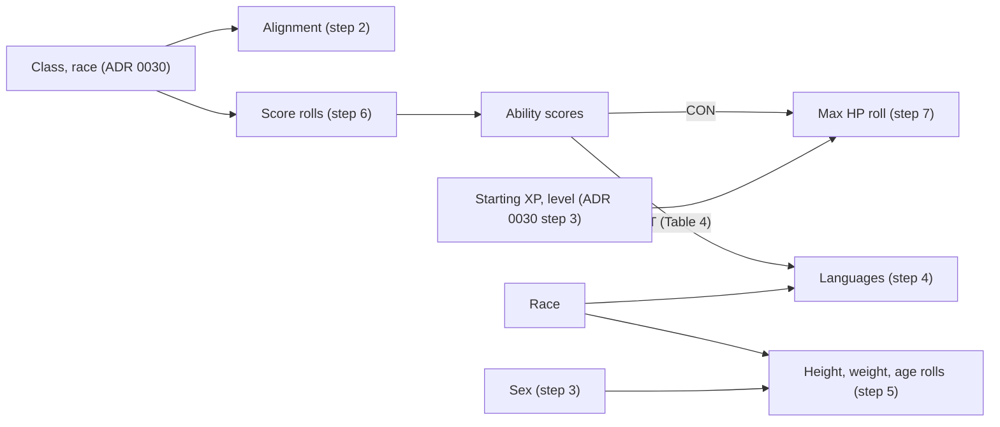

# ADR 0032: Character identity and creation rolls

**Status**: accepted 2026-10-18 (decisions from the user's triage of the onboarding epic, the same
day; the details this ADR added beyond the triage were accepted by the supervisor in review). Steps 1, 2, 3 and 8 (for alignment, sex and the race detail) implemented 2026-10-18, see "As built"; the rest is not implemented. Amends [ADR 0030](0030-classes-and-races.md) step 1 (and the sentence of
step 7.5 on level 1 hit points) and [ADR 0029](0029-users-login-and-access.md) steps 7.2 and 7.3
(character actions leave the cog menu; creation is a full-screen route).

## Context

A character's identity is free text today: race, alignment, sex, height, weight, hair, eyes and
languages are strings; age is a number from 1 to 10,000 ([ADR 0029](0029-users-login-and-access.md)
step 7.3 item 1, the `details` object). Two fields call themselves a race (the rules race of
[ADR 0030](0030-classes-and-races.md) step 1 and a free-text "race detail"), alignment and languages
accept anything, Kelsen's languages are stored as French words (against
[ADR 0023](0023-localized-text.md)), and the only help the creation form gives with the numbers is
none: scores and max HP are typed.

User, 2026-10-18 (the onboarding epic's description, verbatim in part): _"Some things should not be
free form text such as alignment and language, Sex. And what the horror is the two Race fields?"_
and, in triage, that the player can **roll or type** ability scores and max HP, that rolls are made
by the server, and that anything recognisable in the existing data is migrated.

Sources, in `critical-rulebooks` (read as reference; no rulebook text is copied here): PHB chapter 2
(races, languages), chapter 3 (the class chapters: alignment limits, hit dice), chapter 4
(alignment), Table 3 (Constitution), Table 4 (Intelligence), Table 8 (racial adjustments), Table 10
(average height and weight), Table 11 (age), Table 12 (aging effects, out of scope); DMG chapter 1
(the ability score methods I to VI). The project's ADRs and the user's rulings win where they differ
from the book; the differences are named in each step.

How the creation fits together (the screens are the design round's, not this ADR's):

## Decision

**Conventions** for every step below:

- Every refusal is a field and a code, every warning a code with its numbers (limits, counts,
  values). Both are **structured data**: the web words them in en and fr, the server sends no text
  ([ADR 0023](0023-localized-text.md)). A refusal is a 400 `invalid_input` (the existing shape of
  [ADR 0030](0030-classes-and-races.md) step 1); a warning never stops a save. The answer to a
  create or an edit, and the read of the character, carry the warnings that apply.
- A rule, a list or a range the web shows comes from the server (the form's options); the web checks
  and computes nothing, and the server checks again.
- Every roll goes through the dice port, returns a **complete breakdown** (each die, what was kept
  or dropped, the arithmetic) and writes nothing: a roll is a helper that fills a field the player
  then saves. A rolled value is validated exactly like a typed one, so the player may always
  override it, and the server does not check that a typed set of scores "could have been rolled".
- Each step gets one named test in the implementing item. Rolls are tested with every die given a
  distinct value and the exact number of dice drawn asserted, so a reused, missing or misordered
  die fails.
- This ADR describes rules, codes and dice. It does not prescribe the storage shape; the
  implementing items propose it.

### Identity

1. **The rules race is the only race.** A character's race is the code of
   [ADR 0030](0030-classes-and-races.md) step 1 (`human`, `dwarf`, `elf`, `gnome`, `half_elf`,
   `halfling`; PHB chapter 2). The free-text "race detail" is dropped from the details, the API,
   the creation and edit forms and the card, and **its stored data is discarded** (step 8). Subraces
   are out of scope. The creation's `details.race` field and its "Précision de race" label of
   [ADR 0029](0029-users-login-and-access.md) step 7.3 item 5 disappear. Refusal for a request that
   still carries it: `unknown` (unknown field, as already for a level or a THAC0).
2. **Alignment.** One of the nine PHB alignments (chapter 4): lawful good, neutral good, chaotic
   good, lawful neutral, true neutral, chaotic neutral, lawful evil, neutral evil, chaotic evil. It
   is **required at creation**, editable later from the character's details with the same check.
   The class limits come from the class chapters and are a refusal, like `race_not_allowed`:
   - **bard**: PHB chapter 3, Bard: any alignment "but must always be partially neutral", so the
     five alignments with a neutral part (lawful neutral, neutral good, true neutral, chaotic
     neutral, neutral evil) are allowed and the four others refused;
   - **thief**: PHB chapter 3, Thief: any alignment except lawful good;
   - **fighter**: any (PHB chapter 3, Fighter). **Mage**: no limit stated. **Cleric**: the book ties a priest's
     alignment to the deity's, which the app does not model; no limit is checked.

   Refusals, field `alignment`: `empty` (missing at creation, or an edit that clears it),
   `unknown` (not one of the nine), `alignment_not_allowed` (the class limit; the response names the
   class). The nine codes are `lawful_good` ... `chaotic_evil`; words and the one-line class notes
   are i18n keys. Tests: one per class limit (bard refuses each of the four, accepts each of the
   five; thief refuses lawful good only; fighter accepts nine), `empty`, `unknown`, and the edit
   path (the same check).
3. **Sex.** Required, `male` or `female`: the two rows PHB Table 10 gives for height and weight.
   Words are i18n keys. Refusals, field `sex`: `empty`, `unknown`. It is an input of the height and
   weight ranges and rolls (step 5) and has no other effect. Editable later like the alignment.
4. **Languages.** A character's languages are codes of the **language catalogue**: the languages
   of the PHB racial lists (PHB chapter 2, each race's Languages paragraph) plus Common. Free text
   is refused. A campaign language is added by adding it to the catalogue data (each with its
   localized names, [ADR 0023](0023-localized-text.md)), with no code change.
   1. **Native language, automatic.** The race's own language is always among the character's
      languages, added by the server and not removable: dwarf, elf, gnome and halfling each their own
      (PHB chapter 2); human and half-elf have none of their own (the book: humans start knowing
      their regional language, half-elves have no language of their own), so Common.
      It does not count against the limit of item 2.
   2. **The count (PHB Table 4).** The additional languages a character may know are Table 4's
      "# of Lang." for its Intelligence score (score 1: none; 2 to 8: 1; 9 to 11: 2; 12 to 13: 3;
      14 to 15: 4; 16: 5; 17: 6; 18: 7; 19 and up as the table), the native language not counted.
      Going over is a **warning, never a refusal**: `languages_over_limit` with `count` and
      `limit`. The same warning is read again when the Intelligence score is later edited below the
      languages known.
   3. **Offered, not restricted**: the form offers the whole catalogue with the
      race's PHB list marked, since the book lets the DM allow any other language; the server accepts
      any catalogue language. Refusals, field `languages`: `unknown` (not in the catalogue),
      `duplicate`.
5. **Height, weight and age.** Numbers. **Height and weight are stored metric** (centimetres and
   kilograms); the web converts to what the player's language shows (fr: metres and centimetres,
   kilograms; en: feet and inches, pounds) and back when the player types. Table 10 and Table 11
   are in inches, pounds and years, converted with 1 in = 2.54 cm and 1 lb = 0.45359237 kg.
   Aging effects (Table 12) are out of scope; hair and eyes stay free text.
   1. **The ranges.** For the race, and the sex for height and weight: height is the Table 10
      base for the sex plus the height modifier dice; weight is the base for the sex plus the
      weight modifier dice (two independent rolls); the starting age is Table 11's base age plus the
      variable dice. The range of a figure is its lowest possible total (every die 1) to its highest
      (every die at its maximum). The age range runs from the lowest starting age to the highest
      maximum age of the maximum age range column (base plus its dice at their maximum); a young
      character is thereby never warned for being young. The converted range is rounded outward to
      the stored unit, so a value the roll produces never warns. A character with no race or no sex
      (a migrated one) is checked against the union of the sexes, and with no race against nothing.
   2. **Warnings, never refusals**: `height_outside_range`, `weight_outside_range`,
      `age_outside_range`, each with `value`, `min` and `max` (stored units; age in years). The
      refusals are only about being a number: field `height`, `weight` or `age`, code
      `out_of_range` outside a sanity bound above every table value (age keeps 1 to 10,000 of the
      current rule; the implementing item proposes the two others), `not_a_number`.
   3. **The roll.** Rolls the table's dice through the dice port, one roll per figure asked:
      height rolls the race's height modifier dice (for example half-elf `2d6`), weight its weight
      modifier dice, age its variable dice. The answer is the breakdown (dice, base for the sex, the
      total in inches or pounds or years, then the stored-unit value) and fills the field; the player
      may override it. A roll needs the race (and the sex for height and weight): without them the
      refusal is `race_required` or `sex_required` on the rolled field.
6. **Ability scores: roll or type.** The player either types the six scores or picks one of the
   six methods of DMG chapter 1 (the PHB's chapter 1 lists the same six) and the server rolls. The
   method is the player's choice per character, not a campaign setting (the DMG has the
   DM choose; at a table of many players with one DM this is the table's to agree, not the app's to
   enforce). What the server rolls, and what the player arranges, per method (a "d6 roll" below is
   one die; `3d6` is three of them added):

   | Method | The server rolls | The player |
   |---|---|---|
   | I | `3d6` six times, for Strength, Dexterity, Constitution, Intelligence, Wisdom, Charisma, in that order (18 dice) | nothing; the rolls are the scores |
   | II | `3d6` twice for each of the six abilities (36 dice, in ability order, the pair for an ability together) | keeps one of the two totals of each ability |
   | III | `3d6` six times (18 dice) | assigns the six totals to the abilities |
   | IV | `3d6` twelve times (36 dice) | keeps six of the twelve totals and assigns them |
   | V | `4d6` six times (24 dice), the lowest die of each dropped, the other three added | assigns the six totals to the abilities |
   | VI | seven `d6` (7 dice); each ability starts at 8 | adds each die, whole, to one ability; no ability above 18 |

   The answer is the breakdown: every die in the order drawn, the dropped die of method V, each
   total. For I the answer is the finished scores; for II to V the totals to choose from; for VI the
   seven dice and the base of 8. The arrangement is done in the web (it is a choice, not a rule),
   and the six scores are then saved as typed values: the server validates them like any typed set,
   the range of [ADR 0030](0030-classes-and-races.md) step 1 (3 to 19) and class and race
   eligibility (`race_not_allowed`, the class minimums). Method VI's limits (the base 8, no ability above 18, and no 18 that the dice cannot make by exact
   count) come in the roll's answer as data for the screen to arrange within; they are not enforced on the
   saved scores, which may be typed. The roll shows the racial adjustments of PHB Table 8 for the chosen race next
   to the totals; the stored score is the adjusted one ([ADR 0030](0030-classes-and-races.md) step
   1). Refusals, field `method`: `unknown`. Tests: one per method, asserting the exact dice drawn
   (18, 36, 18, 36, 24 and 7) with distinct values, the order and grouping above, method V's dropped
   die being the lowest of its four (a tie drops one), and method VI's base 8.
7. **Max HP: roll or type.** The player either types the max HP (1 to 999,
   [ADR 0030](0030-classes-and-races.md) step 1) or has the server roll it. The roll takes the class,
   the Constitution score and the starting XP (the starting level `L` is the target level of
   [ADR 0030](0030-classes-and-races.md) step 3; the starting realized level, step 7.5) and, for each
   level `n` from 1 to `L` in order:
   1. up to the class group's name level (warrior and priest through 9, wizard and rogue through 10;
      [ADR 0030](0030-classes-and-races.md) step 7.1): **one hit die** of the group (warrior `d10`,
      priest `d8`, rogue `d6`, wizard `d4`) plus the Constitution hit point adjustment of PHB Table 3
      (warriors take the bracketed value, every other class at most +2), with Table 3's raised low
      dice at Constitution 20 and more, and a gain of at least 1; exactly the arithmetic of the
      level-up roll, step 7.1 of that ADR;
   2. above the name level: the **fixed gain** of step 7.2 of that ADR, no die and no Constitution
      bonus (warrior +3, priest +2, rogue +2, wizard +1).

   So a level 15 bard (rogue, name level 10) draws 10 `d6` and takes five fixed gains of 2, and a
   level 1 character draws exactly one die. The max HP is the sum of the gains. The answer is the
   breakdown, one row per level (the die rolled, the counted value, the Constitution adjustment,
   the gain, or the fixed gain), and the total; the value stays editable. This replaces the
   sentence "Level 1 hit points are entered, never rolled here" of
   [ADR 0030](0030-classes-and-races.md) step 7.5 for a created character: they may now be rolled
   (a typed value is still accepted). Refusals: field `class` `unknown` or `not_creatable`, `con`
   `out_of_range`, `xp` `out_of_range` (the ranges of step 1 of that ADR). Tests: a level 1 mage
   draws one `d4`; a level-3 fighter three `d10` in level order with the bracketed Constitution
   bonus; a level 12 bard ten dice then two fixed; Constitution 21's raised die; the gain floor of
   1; each with distinct die values and the exact count of dice.

### Existing characters

8. **Migration of the existing characters.** One data migration, run once, additive
   ([ADR 0024](0024-deployment.md) step 5.2: the release before keeps working on the schema while
   the new one is being deployed), whose mapping tables are committed data with tests, never a
   one-off script. It reads the free-text values and maps the recognisable ones, **en and fr,
   ignoring case, accents and punctuation**:
   1. alignment: the nine names in en and fr, their usual abbreviations (LG, NE, loyal bon ...) and
      "neutral" / "neutre" alone as true neutral; sex: male and female in en and fr, and "M" / "F" /
      "H"; languages: each item of a list (separated by commas, semicolons, "and" and
      "et") that names a catalogue language in either language, so Kelsen's French words become
      codes; height, weight and age: a number, with or without a recognised unit (cm, m, feet-inches,
      kg, lb, years / ans; a bare height under 3 reads as metres and otherwise as centimetres, a bare
      weight as kilograms), stored metric;
   2. **an unmapped value is cleared**, each language item on its own (the recognised ones stay),
      and the character card shows each required field left empty (alignment, sex) as **missing** and
      asks the player to pick; the rest of the card works meanwhile and nothing is blocked by it.
      A read of the character lists its missing fields as data (`missing`, a list of field codes);
   3. **the free-text race detail is discarded**, mapped or not; the rules race code
      ([ADR 0030](0030-classes-and-races.md) step 1) is untouched;
   4. a mapped alignment that the class limit of step 2 refuses (for example a thief of
      "lawful good") is **kept**, because it is the player's own recorded choice, and read with the
      warning `alignment_not_allowed`; the check refuses only a value being set;
   5. hair and eyes are untouched; the migration is idempotent (a second run changes nothing) and
      touches no character without a value to map.

   Tests: one per mapping table row family (alignment en and fr, sex, a language list with an
   unknown item, each unit of height and weight, an age), the clearing, the discarded race detail,
   idempotence, and a migration over the seed character (Kelsen keeps a race, gets languages as
   codes, and has no French word left).

## Amendments

**ADR 0030 step 1** (creation inputs). A created character also enters: its **alignment** (step 2,
required), **sex** (step 3, required, `male` or `female`), its **languages** (step 4; the native
language is automatic) and the **identity numbers** height, weight and age (step 5). The race is
the rules race alone (step 1 above); the free-text race of the details is dropped. **Rolling is
offered** for the six ability scores (step 6), the max HP (step 7) and the three numbers (step 5.3);
typing stays possible for each, and a rolled value is validated as a typed one. The refusal codes of
step 1 of that ADR gain `alignment_not_allowed`, `not_a_number` and `race_required` /
`sex_required` (rolls). Step 7.5's "Level 1 hit points are entered, never rolled here" is amended by
step 7 above for a created character. The index row says so.

**ADR 0029 steps 7.2 and 7.3.** The character actions leave the cog menu: Switch, Create, Rename and
Retire move to a **character roster screen**, and Rename is also available from the character's
details. The cog menu keeps device settings, language, account and admin. **Creating a character is a
full-screen, stepped route**, not a dialog, and onboarding (a short intro, then the first character)
is the same route; where each action sits is the design round's decision (French first,
[ADR 0027](0027-space-follows-frequency-of-use.md)). The server side of step 7.2 and 7.3 (the
endpoints, the creation making the character current, retire repairing the current character, the
`X-Character-Id` rule) is unchanged, except that the `details` object of the creation loses
`race` (step 1 above) and gains the fields of this ADR. Item 5 of the as-built amendment ("The web",
the cog menu's Character group and the creation dialog) is superseded by this paragraph when the
roster and creation items land.

## As built (steps 1, 2, 3 and 8, alignment and sex)

2026-10-18, the item that made alignment and sex codes. The rest of the ADR is not built.

- **Storage.** `characters.alignment` and `characters.sex` stay TEXT columns and hold the codes, `''`
  for missing. Migration 013 changes no column ([ADR 0024](0024-deployment.md) step 5.2: the release
  before keeps working on the schema while the new one deploys); its data step maps the stored free
  text (`mapIdentity`, the spellings in `storage/postgres/identity.go`), clears the unmapped values,
  empties `characters.race` and gives the seed character the alignment and sex of `seeds/character.json`
  when he lacks them. The new code no longer reads or writes `characters.race`: **a later migration
  drops it**, in the release after this one is deployed everywhere (until then the release before may
  still write free text into it, which nobody reads).
- **Refusals** are field errors `details.alignment` / `details.sex` at creation (the `details.` prefix of
  that route) and `alignment` / `sex` on `PATCH /api/character/details`, codes `empty`, `unknown`,
  `alignment_not_allowed` (the web knows the class, so the response does not name it). The class
  limits are the table in `ruletablesvc/alignment.go`. A request still carrying `race` is a 400
  `bad_request` (unknown field).
- **Reads.** `GET /api/character` carries `missing` (field codes the character lacks: `alignment`,
  `sex`) and `warnings` (`{code, field}`: `alignment_not_allowed` for a kept alignment its class
  refuses, step 8.4); `race` is gone from it and from the details.
- **Options.** `GET /api/characters/options` gains `alignments` per class (the codes it admits, in the
  PHB order) and `sexes`; the creation form and the card's edit offer only those.

## Consequences

- The domain gains real concepts: alignment, sex, a language catalogue and measured identity numbers
  replace strings, and the form's options (alignments per class, the languages, the ranges, the
  methods) come from the server, so a campaign changes by data.
- The roll operations, the class-aware alignment check, the metric conversions and the migration
  mapping are the implementing items' work: alignment and sex (with the race detail removal), languages,
  height, weight and age, and the score and HP rolls, in that order, each citing its step of this
  ADR with one test per step. The creation route, the roster and the cog menu clean-up are the UI
  items after the design round.
- Kelsen's languages stop being French words ([ADR 0023](0023-localized-text.md)); characters whose
  free text does not map show a missing alignment or sex until the player picks, and no one is
  blocked from playing.
- A language over the Intelligence count, an unusual height, weight or age and an alignment a class
  no longer allows are warnings, so the game stays the table's; only a malformed value, a value that
  does not exist (an unknown alignment or language) and the alignment limits of a class refuse.
- Not covered: aging effects (PHB Table 12), subraces, hair and eyes as catalogue data, a cleric's
  alignment against a deity, languages learned during play (proficiency slots), dual-class and
  multi-class, the level-up flow (unchanged), and the screens' layout.
