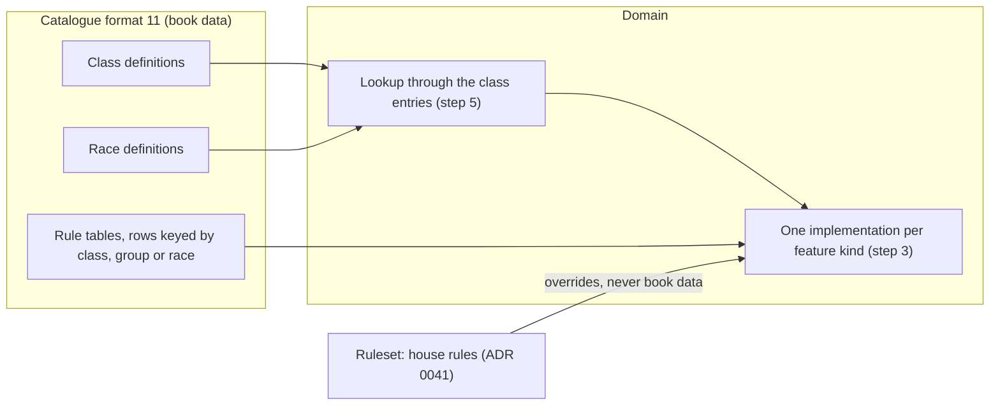
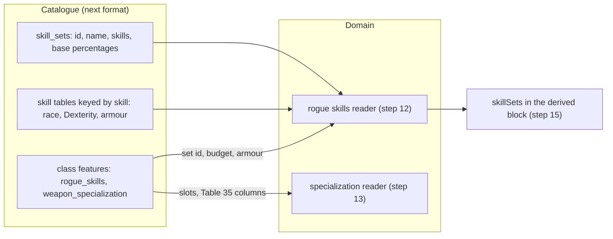

# ADR 0040: Classes and races are data, with typed features; no special case per class, race or kit

**Status**: accepted 2026-10-21 (the user's triage of the rules-engine foundation, quoted in
Context). The shape of the definitions, the closed list of feature kinds and their parameters
(steps 1 to 4), and the choices beyond the triage (group ids under the rule of step 10, one
`rogue_skills` kind with a `set` parameter, the weapon proficiency types derived from the
`equipment` list, the package `domain/classes`) were accepted in review, 2026-10-21.
Step 11.1 is built (2026-10-22, [ADR 0021](0021-spell-catalogue.md) step 18: the catalogue publishes format 11). Step 11.2
is built for the class list, groups, races, prime requisites, ability minimums, alignments and XP rows (2026-10-22: the
class registry, steps 5, 6, 8 and 9; see the as-built notes there). Step 11.3 is built for the class
features and the spell progression (2026-10-22: every kind of step 3 is read through the
lookup of step 5, the Go lists are gone; see the as-built notes of steps 3, 5, 8 and 11). The rest is
not implemented: each step names the test its implementing item writes. Steps 12 to 16 (skill sets and weapon
specialization as feature parameters, one amendment) are accepted 2026-10-23 (the user accepted every open question's default: "ok with all"). Amends
[ADR 0030](0030-classes-and-races.md) steps 1, 2, 4, 9 to 20, 22 and 23 and
[ADR 0015](0015-experience.md) step 2, each on implementation. Builds on the vocabulary of
[ADR 0036](0036-vocabulary.md) (`GLOSSARY.md`, `docs/domain-model.md`). The house rules live in the
Ruleset, not in this book data ([ADR 0041](0041-ruleset.md)); multi-class and dual-class rules (ADR 0042) and psionics
(ADR 0043) build on the class entries of step 5.

## Context

The user, 2026-10-21: "We need to make sure we build our rule engine so that it's scalable and
logical. We've been doing a lot of hardcoding and shortcuts and plain stupid things that we need to
undo as we go (like when you gave bard talents to all classes)." Decided in the triage:

- The catalogue carries classes and races as data in a new format 11. Each class has an id, a
  group, prime requisites, ability minimums, allowed alignments, weapon and armour limits, an XP
  table, hit dice, a spell progression (by reference) and a **list of features with
  parameters**. The app switches on the **feature kind**, never on a class id. Tables keyed by
  class id become rows keyed by class.
- House rules live in the Ruleset ([ADR 0041](0041-ruleset.md)), not in book data.
- Foundation first: the five existing classes move onto it before the cleric's remaining work,
  multi-class and dual-class, and psionics.

How classes and races are coded today (code audit, 2026-10-21). The numbers already come from the
catalogue's rule tables ([ADR 0021](0021-spell-catalogue.md) steps 9 to 16), but **which class has
which mechanic is decided in Go**:

| What | Where it is today |
|---|---|
| The classes, the groups, the races | closed Go lists `ruletablesvc.Classes`, `Groups`, `Races` (`RaceCodes` adds `human`) |
| Class to group | the map `ruletablesvc.classGroups` |
| THAC0 by group, warrior attacks per round | a `switch` on the group code in `THAC0For`; `AttackRateFor` tests `group != "warrior"` |
| XP thresholds | the column map `experienceColumns` over a row with one field per class (`ExperienceRow{Fighter, Mage, …}`, and the adapter's DTO) |
| Spell slots | a `switch` on the class in `charactersvc.spellSlots` (Table 32, 21 or 24, none) |
| The feature flags | one Go list per mechanic: `exceptionalStrengthGroups`, `specializingClasses`, `wisdomFailureClasses`, `turningClasses`, `thiefSkillClasses`, `bardSkillClasses`, `backstabClasses`, `freeSpellClasses`, `spellbookMaxLevels` |
| Skill budgets and armour | constants per class (`SkillPointsFirstLevel`, `BardSkillPointsFirstLevel`, …), `ThiefArmors`, `BardArmors` with `metal` |
| Ability minimums, alignments | the maps `classMinimums`, `alignmentLimits` |
| Weapons and armour | `itemsvc.classRules` (the warnings, [ADR 0033](0033-equipment.md) step 20) and, separately, `ruletablesvc.classWeaponTypes` (the proficiency picks, [ADR 0037](0037-proficiencies.md) step 7) |
| Creatable classes | `charactersvc.CreatableClasses` |
| Race traits | `charactersvc.conSaveRaces` (Table 9), `ruletablesvc.noExceptionalStrengthRaces`, Tables 10 and 11 as a Go literal (`identity.go`), `race == "human"` tests |
| The seeded character | `seedfile.DefaultClass = "bard"` |

Three bugs follow from it: the XP bonus tests the bard's Dexterity and Charisma for every class
(`xpsvc.BonusEligible(c.Dex, c.Cha)`, [ADR 0015](0015-experience.md) step 2, never generalised as
ADR 0030 step 4 asked); spell effects always used the rogue's by-group entry (fixed 2026-10-21 in
the cast service, ADR 0030 step 2); and a seeded character is always a bard. Each new class today
means touching a dozen lists in four packages, which is what this ADR stops.

The way spell effects already work ([ADR 0008](0008-spell-slots-and-long-rest.md) step 8 and the
"no special case per spell" rule) is the model: the data names a **kind** with **parameters**, and
the code implements each kind once.

## Decision

Book facts are cited by file and section of `critical-rulebooks`; no book text is copied here.
**Test names** below are written without their `Test` prefix while the test does not exist (the
`check-adr-tests` gate refuses a cited `Test…` name with no such function); the implementing item
writes `Test<name>` and adds the prefix here in the same PR.

### The data

1. **A class definition** (catalogue format 11, one entry per class) carries:
   1. `id`: a language-neutral code (`fighter`, `mage`, `cleric`, `thief`, `bard`), the value
      `characters.class` already stores; `name`: a language map ([ADR 0023](0023-localized-text.md),
      never a per-language field).
   2. `group`: a class group code (`warrior`, `wizard`, `priest`, `rogue`). The group picks the
      THAC0 row (Table 53), the saving throw rows (Table 60), the proficiency slots (Table 34) and a
      spell effect's by-group entry (ADR 0030 steps 2, 5 and 6, ADR 0037 step 3). Classes of a group
      share these (PHB chapter 3, `01-chapter-3-player-character-classes.md`: classes of a group
      share hit dice, combat and saving throw progressions).
   3. `prime_requisites`: a list of ability codes (step 6).
   4. `ability_minimums`: `[{ability, min}]`, PHB Table 13 (`tables/phb-013-class-ability-minimums.md`,
      p.25): fighter Str 9, mage Int 9, cleric Wis 9, thief Dex 9, bard Dex 12, Int 13, Cha 15.
   5. `alignments`: the alignment codes the class allows; absent means any. PHB chapter 3: the
      thief any but lawful good (`11-rogue.md`, Thief), the bard always partly neutral
      (`14-bard.md`; the project reads it as at least one neutral axis, the five codes the app
      already allows), the fighter, mage and cleric any (`02-class-descriptions.md`, Fighter;
      `06-mage.md`; the cleric's order may narrow it, out of scope).
   6. `equipment`: what the class may wear and wield, the one source of the warnings of
      [ADR 0033](0033-equipment.md) step 20 **and** of the weapon proficiency types of
      [ADR 0037](0037-proficiencies.md) step 7: `armour` (the Table 29 columns allowed, `none`
      for no body armour, absent for any), `shields` (bool), `weapon_types` and `weapons` (catalogue
      codes with their weapon type), and `blunt_only` (bool). The proficiency types are **derived**
      from it with the catalogue (a type is allowed when the list names it or a weapon of it; for
      `blunt_only`, when a catalogue weapon of the type deals bludgeoning damage, a launcher by its
      ammunition), which is what seedcheck proves today: the second Go list goes.
   _(As built in format 11, class equipment names catalogue weapons only: the importer checks that every `weapons` code is in the equipment's weapons with the same `weapon_type`, and every `weapon_types` entry is a type of some weapon. The thief's lasso is in no catalogue weapon, so it is dropped from the class data; Go's classwarn list kept it until the equipment limits moved onto the data (step 11, as built), which loses it.)_
   7. `experience`: the class's XP thresholds, rows `{level, xp}` inside the class entry (the class is the
      entry's; PHB Tables 14, 20, 23, 25), replacing the column per class.
   8. `hit_dice`: `{die, dice_levels, after}` and the Constitution column (`warrior` or
      `standard`, PHB Table 3): warrior d10 to level 9 then +3, wizard d4 to 10 then +1, priest d8
      to 9 then +2, rogue d6 to 10 then +2 (PHB Tables 14, 20, 23 and 25, Hit Dice column;
      `02-class-descriptions.md`, `05-wizard.md`, `07-illusionist.md` (Priest), `11-rogue.md`).
      ADR 0030 step 7 reads it.
   9. `spell_progression`: the id of a slot table (`bard_spells` Table 32, `wizard_spells` Table
      21, `priest_spells` Table 24) or absent for none. ADR 0030 step 8 reads the table it names,
      never a `switch` on the class.
   10. `nonweapon_groups`: the proficiency groups the class learns at the listed cost (PHB Table
       38; the catalogue's crossover rows keyed by class today, moved here).
   11. `features`: a list of `{kind, from_level, params}` (step 3), `from_level` 1 when absent.

   Tests: `ClassCatalogue_Step1_EveryClassCarriesEveryField` (ruletablesadpt: the fixture's five
   classes parse, a missing field or a per-language name is refused),
   `ClassWeaponTypes_Step1_6_DerivedFromTheEquipmentList` (domain: the lists of ADR 0037 step 7
   come out of `equipment` and the catalogue, equal to today's).

2. **A race definition** (format 11, one entry per race, `human` included) carries `id`, `name` (a
   language map), the ability adjustments (PHB Table 8) and requirements (Table 7), the identity
   rows (PHB Tables 10 and 11: height, weight, age, today a Go literal), and a list of typed
   **traits** `{kind, params}` (step 4). The thief skill adjustments (Table 27), the racial level
   limits and the classes a race admits (DMG Table 7, [ADR 0021](0021-spell-catalogue.md) step 11)
   and the race languages (format 8) stay tables, rows keyed by race (and class). They are book
   data; **how they apply** is the ruleset's: the level limits warn (`level_limits` `warn`) and the
   racial lift waives Table 7's dash for a multi-class or dual-class character ([ADR 0041](0041-ruleset.md) steps 2.2,
   2.3 and 5). A class or race definition never carries a house rule. A human is a race with no adjustments
   and no traits, not a `race == "human"` test. A race's trait texts that the app does not compute
   stay localized catalogue text (ADR 0030 step 22.3).
   Tests: `RaceCatalogue_Step2_SixRacesWithTheirTraitsAndIdentityRows` (ruletablesadpt),
   `Identity_Step2_TablesTenAndElevenFromTheCatalogue` (ruletablesvc: the creation rolls of
   [ADR 0032](0032-character-identity-and-creation-rolls.md) step 5 read the catalogue rows, equal
   to today's literal).

### The feature kinds

3. **The closed list of class feature kinds.** The code implements each kind once; a class has a
   mechanic only by listing its kind. Each kind's parameters are checked at start-up (step 8). The
   five classes' features, as the triage and the Go lists of Context have them:

   | Kind | Params | Computed by | Today's classes |
   |---|---|---|---|
   | `exceptional_strength` | none | ADR 0030 steps 9 and 10 (18/xx, the warrior's scale over 18) | fighter |
   | `melee_attacks_per_round` | `table` (Table 15) | ADR 0030 step 11.1 | fighter |
   | `weapon_specialization` | none; _(amended: `default_slots`, `melee_column`, `missile_column`, `types`, step 13)_ | ADR 0030 steps 11 and 12, ADR 0037 step 9 (Table 35) | fighter |
   | `wisdom_bonus_spells` | none | ADR 0030 step 13 (Table 5) | cleric |
   | `spell_failure` | `ability` (`wis`) | ADR 0030 step 14 (Table 5) | cleric |
   | `sphere_access` | `major`, `minor` (sphere codes), `minor_max_level` (3) | ADR 0030 step 15 (format 6's access rows, moved here; read by `spheresvc`) | cleric |
   | `turn_undead` | `table` (Table 61) | ADR 0030 step 16 | cleric |
   | `rogue_skills` | `set` (the id of a `skill_sets` entry, step 12; the book's `thief` or `bard`: the skill list and base rows, Table 26 or 33), `budget` `{first, per_level, per_skill_first, per_skill_per_level}`, `armour` `[{code, column, extra}]` | ADR 0030 steps 17 and 18, ADR 0037 steps 10, 11 and 15 | thief (set `thief`, budget 60/30/30/15, one entry per armour `skill_column`); bard (set `bard`, budget 20/15/0/0, the same entries, `metal` on the elven chain column with an extra -5) |
   | `backstab` | `table` (Table 30) | ADR 0030 step 19 | thief |
   | `spellbook` | `max_spell_level`, `free_spell_per_new_spell_level` (bool) | ADR 0030 step 20 (20.1, 20.7, 20.8) | mage (9, true), bard (6, false) |

   1. A **new mechanic is a new kind**: an amendment of this step (its params and the ADR step that
      computes it) and its code, never a branch on a class id. A new class made of existing kinds
      is a catalogue change only.
   2. The **check kind** a skill set logs (`thiefSkill`, `bardSkill`, [ADR 0014](0014-skill-checks.md)
      step 3) follows the `rogue_skills` set, so the logged checks still read.
   3. The book constants that are the same for every class that has the kind (the backstab +4, the
      skill cap 95, the specialization costs) stay in the kind's code; only what differs between
      classes is a parameter.
      _(Amended 2026-10-23, step 13: the specialization costs and Table 35 columns become parameters of
      `weapon_specialization`; the skill set's identity becomes data, step 12.)_
   4. The starting spellbook stays a seed keyed by class (`seeds/starting_spellbook.json`, ADR 0030
      step 20.7): seeds are data.
   5. **A skill set per `rogue_skills` feature.** A class lists `rogue_skills` once per
      `set` (`classes.New` refuses the same set twice), so a thief/bard grants both. A character
      has one **skill set** for each such feature granted at its realized level, in the class's
      order, each with its own percentages, skill armour (read through its own armour entries,
      ADR 0033 step 14) and budget (ADR 0037 step 10), and its own stored points: two sets can
      share a skill (both have pick pockets) and never share points. The sheet's `derived`
      block and `GET /api/skills` serve `skillSets: [{set, skillArmor, budget, skills}]` (the
      skills tab's also `kind`, the check kind of step 3.2), and the client renders one section per
      set, naming no class. A spend, its preview and its `skill_points` journal entry name the
      `set` (a class with one set may leave it out); a roll names it in `?set=` when two sets
      share the skill (else the first set that holds it). The points are stored per set in
      `characters.skill_sets` (`{"<set>": {"<skill>": points}}`, migration 034, additive; its data
      step copies the flat `skill_points` under the class's first set); a `skill_points`
      snapshot without a `set`, from before, restores the character's only set. What is left to
      spend (ADR 0037 step 15) adds the sets' left points, a set over budget leaving 0. A new
      character enters its points in the class's first set; a creation that enters points in a
      second set belongs to the multi-class item (ADR 0042).

   Tests: `TestFeatures_Step3_EveryKindParsesItsParams` (domain: each kind with its params, an unknown
   param or a missing one refused), `TestFeatures_Step3_TheFiveClassesGrantTodaysMechanics` (seedcheck:
   the real artifact's five classes list exactly the kinds of the table, with its params).

   _(As built, 2026-10-22: `domain/classes.Feature` holds a kind, its `from_level` and the params of its kind
   (`Table`, `Ability`, `Spheres`, `RogueSkills`, `Spellbook`); `classes.New` refuses an unknown kind, a kind
   twice, a `from_level` outside 1 to 20 and a missing param or one of another kind. The adapter maps the params
   by kind and ignores keys of other kinds (the format-11 schema refuses them upstream). One test per kind, each
   on the fixture's real tables with edited definitions (the book class with the kind struck keeps its id and
   loses the mechanic; a test class listing the kind gets it): `TestFeatures_Step3_ExceptionalStrengthFromTheKind`,
   `TestFeatures_Step3_WeaponSpecializationFromTheKind`, `TestFeatures_Step3_WisdomBonusSpellsFromTheKind`,
   `TestFeatures_Step3_SpellFailureFromTheKind` (its `ability` param read), `TestFeatures_Step3_TurnUndeadFromTheKind`
   (with `from_level`), `TestFeatures_Step3_RogueSkillsFromTheKind` (a warrior test class with the thief's set),
   `TestFeatures_Step3_BackstabFromTheKind`, `TestFeatures_Step3_SpellbookFromTheKind` (charactersvc),
   `TestFeatures_Step3_MeleeAttacksPerRoundFromTheKind` and `TestFeatures_Step3_TheCreationGatesReadTheKind`
   (ruletablesvc), `TestDefinitions_Step3_TheFeatureListsMapWithTheirParams` (ruletablesadpt: the fixture's five
   lists equal this table). The derived block carries `exceptionalStrength` (the class has the kind at its
   level) and the creation draft says whether the form offers the 18/xx field (the kind, Strength 18 entered,
   a race without `no_exceptional_strength`): the web has no `str === 18` rule of its own
   (`TestDraft_Step9_TheServerOffersExceptionalStrength`). The `rogue_skills` set codes `thief` and `bard` pick
   the skill list, base rows and check kind (3.2) in `ruletablesvc`; they are skill-set codes, not class ids, and
   step 10's check lists them as such. **`sphere_access` is read** (2026-10-22): `spheresvc` takes a priest's open
   spheres and the minor cap from the class's feature params (`classes.SphereAccess.Opens`), so
   `ruletablesvc.MinorSphereMaxLevel` and the class-keyed rows' reader are gone; the artifact still carries
   the rows until the next format drops them (step 11.4).)_

   _(Amended 2026-10-21 by [ADR 0043](0043-psionics.md) steps 2 and 3, on implementation: two new kinds, `psionics` (params `progression`, `psp`, `recovery`; the PSPs, picks and power checks of ADR 0043 steps 4 to 12) and `save_bonus` (params `against`, `bonus`; ADR 0043 step 3); the psionicist lists both. As built, 2026-10-22: both are in `classes.FeatureKinds` with no params read (the schema checks them) and are **not implemented**: `classes.Class.Implemented` is false for a class listing one, which step 8's creation gate reads.)_

4. **The closed list of race trait kinds:**

   | Kind | Params | Computed by | Races |
   |---|---|---|---|
   | `con_save_bonus` | `categories` (save category codes), `poison` (bool) | ADR 0030 step 22.1 (Table 9) | dwarf and halfling (rod/staff/wand, spells, poison), gnome (rod/staff/wand, spells; no poison) |
   | `no_exceptional_strength` | none | ADR 0030 step 9 | halfling |
   | `weapon_to_hit` | `weapon_types`, `bonus` | ADR 0030 step 22.3, _(proposed there, not built; the kind lands with it)_ | elf, halfling |

   Sources: PHB chapter 2 (`01-chapter-2-player-character-races.md`, Dwarves, and Class
   Restrictions and Level Limits for the halfling fighter's exceptional Strength;
   `03-gnomes.md`, Gnomes and Halflings), Table 9 (`tables/phb-009-constitution-saving-throw-bonuses.md`).
   The gnome's poison save gets no Table 9 bonus in the book. The poison flag on the save request
   still waits for the user's OK (ADR 0030 step 22.1), so `poison` is carried but not read yet.
   _(As built in format 11: the `weapon_to_hit` kind is accepted by the schema, but no race carries it; it lands with ADR 0030 step 22.3's code.)_
   _(As built in format 11, the armour entries of `rogue_skills`: one per `skill_column` value of the equipment's armour rows (`leather`, `padded_studded`, `elven_chain`, `metal`, `none_allowed`) plus `none`; `code` is that value, `column` the `thief_skill_armor` row it reads (absent for leather, the baseline), `extra` the bard's penalty from `bard_armor_penalty` (bard set only; a hand-set value that differs is refused). `none_allowed` (an armour the class may not wear) and a thief's `metal` are entered with the worst column, `padded_studded_leather`, which is what `SkillArmorFor` does today, so the reader needs no fallback rule: the start-up check (step 8) refuses a `rogue_skills` without an entry for each of these columns, and `SkillArmorFor` reads a column outside the list (one no item can store) as `none_allowed`. `min_to_use` is not in the data: the book gives no such figure (Go's floor `MinSkillPercent` is 0 for both sets and stays a constant until a reader needs a per-class value).)_
   Tests: `RaceTraits_Step4_ConSaveBonusFromTheTrait` (charactersvc: a race listing the trait
   gets Table 9's bonus on its categories, a race without it none, whatever its id),
   `RaceTraits_Step4_NoExceptionalStrengthFromTheTrait` (ruletablesvc).

### Reading the data

5. **The lookup goes through the class entries.** A character has feature kind K when one of its
   class entries' classes lists K at a `from_level` at or under that entry's realized level; the
   rule reads that entry's parameters and level (a backstab multiplier at the thief's level). Today
   a character has one class entry (its class and realized level), so at most one entry grants a
   kind; how two entries' grants combine (two spell progressions, the better THAC0) is
   ADR 0042's. Every reader asks the lookup, never a class id or a
   `Has<Mechanic>(class)` list: the derived character (the read of [ADR 0030](0030-classes-and-races.md)
   step 1), the attack, the cast, the creation options and the item warnings. The
   definitions and the lookup are one pure domain package (`domain/classes`, beside
   `domain/skills` and `domain/spellbook`), filled from the catalogue by the composition root.
   Tests: `TestLookup_Step5_AFeatureThroughTheClassEntry` (domain: granted from its level, not below
   it, read with the entry's level), `TestLookup_Step5_ANewClassOfKnownKindsNeedsNoCode` (charactersvc: a
   fixture class `test_skald`, group rogue, `rogue_skills` set `bard` and `spellbook`, derives its
   skills and spellbook with no code change).
   _(As built, 2026-10-22: `domain/classes.Registry` holds the class, group and race definitions, built by the catalogue
   adapter and handed out by the rule tables (`Definitions`). It reads each class's group, prime requisites, ability
   minimums, alignments and XP rows; the features, equipment and hit dice keep their readers until step 11.3, so the
   feature lookup proper (and its `test_skald` test) comes with them. _(Built 2026-10-22 for the features:
   `Class.Feature(kind, level)` is the feature at a realized level, `Class.Lists(kind)` whether the class lists it
   at all (the creation options and entry checks, before a level is known); both hand out copies. The derived
   character, the attack rate, the creation checks and options, the skill services, the item warnings' skill
   armour and the starting spellbook read them. The `test_skald` test derives on the fixture's real tables, so it
   lives in charactersvc.)_ Built so far:
   `Lookup_Step5_ANewClassOfKnownFieldsNeedsNoCode` and `Lookup_Step5_TheDefinitionsAreCopies` (domain/classes).
   A by-group spell effect on a character with no class group is refused ("needs the character's class group"),
   never a fallback to the default die. The THAC0 lookup, the race-and-class check and the proficiency groups
   (PHB Table 37: `general` plus the definitions' groups) read the definitions, with no class, group or race id.
   The id literals left in the derived character (the spell-slot table by class, the races with a Constitution
   save bonus, the feature checks in the cleric, fighter and creation readers) are features and traits: they
   move with the feature list and the race traits (step 11.3, 11.4), and step 11.5's check refuses them after.)_
   _(Amended 2026-10-21 by [ADR 0042](0042-multi-class-and-dual-class.md) step 12, on implementation: with several class entries, each entry grants its kinds at its own realized level (a frozen entry at the level it was left at) and each grant is read with its entry's parameters and level; a figure that is one per character (THAC0, saves, proficiency slots, hit points) combines by ADR 0042 steps 8 to 10 and 15, never by a class id)_

6. **Prime requisites and the XP bonus.** A character is eligible for the 10% bonus of
   [ADR 0015](0015-experience.md) step 1 when **every** prime requisite of its class is 16 or more
   on the sheet (PHB chapter 3, `02-class-descriptions.md`, Prime Requisite: 16 or more in all
   prime requisites gives 10%). Prime requisites (PHB chapter 3): fighter Strength, mage
   Intelligence, cleric Wisdom, thief Dexterity, bard Dexterity and Charisma (`14-bard.md`). A
   fighter's 18/xx is 18 for the test. This is ADR 0030 step 4, now read from the class's
   `prime_requisites`; it replaces ADR 0015 step 2's bard-only test (Dexterity and Charisma for
   every class). The flag stored on each entry still counts, as there (a DM ruling).
   Tests: `BonusEligible_Step6_EveryPrimeRequisiteAt16` (xpsvc: a fighter of Str 16 eligible, a
   mage of Int 15 not, a bard of Dex 16 and Cha 15 not), `Get_Step6_TheClassPicksThePrimeRequisites`
   (composition: a fighter of Str 17, Dex 10, Cha 10 is eligible; fails on the old code).
   _(As built, 2026-10-22: both tests, and `Classes_Golden_FiveClassesDeriveTheBooksFigures` (composition: one human
   of each class at level 5 with the XP of level 6 derives Table 53's THAC0, Table 60's saves, its hit die with
   Table 3's Constitution adjustment and the XP bonus, every figure read in the PHB).)_

7. **Tables keyed by class become rows.** Every rule table that has a column per class or group
   becomes rows with a `class`, `group` or `race` key (XP thresholds, Table 53, Table 60, the
   slot tables, Table 34), so a new class or group is new rows, never a new field in a Go struct
   or a DTO. A **group** id is data like a class id: no `switch` on `warrior` or `rogue`.
   _(As built in format 11, [ADR 0021](0021-spell-catalogue.md) step 18.2 and 18.4: the XP rows are in the class entries and Table 53 is the `groups` list, `{id, thac0}`;
   the class-keyed tables of formats 3 to 10 stay beside them until their readers move, step 11.3.)_
   Tests: `RuleTables_Step7_RowsKeyedByClassAndGroup` (ruletablesadpt: the thresholds, THAC0 and
   saves of the fixture's rows equal today's per-column reads for each class and group).

8. **Checked at start-up.** The catalogue import refuses to start (as every format does,
   [ADR 0021](0021-spell-catalogue.md)) on: an unknown feature or trait kind, an unknown or
   missing parameter, a kind listed twice on a class, a class whose group has no THAC0, save,
   hit dice or slot rows, a `spell_progression` or `table` naming no table, a race or class key in
   a table that names no definition, and a level-limit row for an unknown class. Every class the
   catalogue defines is **creatable** (`CreatableClasses` goes) when every feature kind it lists is
   implemented: a class that passed the check is fully supported, except a class listing a kind of
   step 3 that the code does not compute yet (`psionics`, `save_bonus`, until ADR 0043's items land),
   which the catalogue may define but creation neither offers nor accepts. The gate reads kinds,
   never class ids.
   Tests: `Import_Step8_RefusesAnUnknownKindOrParam`, `Import_Step8_RefusesARowForAnUnknownClass`
   (ruletablesadpt), `Options_Step8_EveryCatalogueClassIsCreatable` (charactersvc: every class but the one
   listing an unimplemented kind), `Create_RefusesInvalidInputWithFieldErrors` (the psionicist: `not_creatable`),
   `Features_Step8_AClassIsImplementedWhenEveryKindIs` (domain/classes), `Create_Options` (composition: the five
   book classes, unchanged).
   _(As built, 2026-10-22, for the fields read so far: `classes.New` refuses an unknown group or ability, a class
   without a prime requisite, an unknown alignment, a class or race listed twice and XP rows that are not levels
   1 to 20 from 0 and increasing (`Import_Step8_TheRegistryRefusesBrokenDefinitions`, domain/classes); the
   adapter refuses a row keyed by an unknown class, group or race (`Import_Step8_RefusesARowForAnUnknownClass`).
   The kinds and params come with step 11.3 _(built 2026-10-22: `classes.New` refuses an unknown kind or param, a
   missing param and a kind listed twice; `ruletablesvc.CheckDefinitions`, run by the adapter at start, refuses a
   `spell_progression` naming no slot table, a `table` param naming another table than its kind's and an unknown
   `rogue_skills` set: `TestImport_Step8_TheTablesRefuseWhatTheyCannotRead` (ruletablesvc),
   `TestImport_Step8_RefusesABrokenFeature` (ruletablesadpt))_. `classes.New` also refuses a group without THAC0 rows for levels
   1 to 20 (Table 53 is read from the group definitions, `RuleTables_Step7_RowsKeyedByClassAndGroup`) and a race
   requirement on an unknown ability or with its minimum above its maximum. The per-race tables (racial level
   limits, `race_requirements`, `thief_skill_race`): a race whose definition has ability requirements (every
   race of the book but the human) must have a row for every key, so a race with its rows missing is refused at
   start; a race with none (the human) may have rows or none, and with none has no level limit (it may be any
   class) and no adjustment. The exemption is read from the data (`classes.Race.Restricted`), not an id. The creation options list the
   classes and races in catalogue order (fighter, mage, cleric, thief, bard; human last). `CreatableClasses` is
   gone.)_

9. **The seed names its class.** `seeds/character.json` carries `class` (Kelsen: `bard`) and
   `race`; a seed without them is refused at start; `seedfile.DefaultClass` goes. The storage
   default of `characters.class` is not read as a class.
   Tests: `Seed_Step9_TheSeedNamesItsClass` (seedfile: a seed of class `fighter` loads as a
   fighter; a seed without `class` is refused).
   _(As built, 2026-10-22: in composition, where the seed is loaded; `seedfile` also refuses a class or race the
   catalogue does not define.)_

### The rule

10. **No special case per class, race or kit.** No class, group, race or kit id literal in
    production code: `api/internal/` outside `_test.go` files and `testdata/`, and `web/src`
    outside tests. Ids live only in catalogue data, seeds, tests and test fixtures. The code reads
    a definition's fields and feature kinds (step 5); the web renders what the server sends (the
    options, the derived block). A kit (a class's optional specialisation from the supplements,
    future) will be data that adds or removes features on a class, under the same rule. A house
    rule that changes a class's or race's book data is a Ruleset setting ([ADR 0041](0041-ruleset.md) step 2), never an edit
    of the book data or a literal. Written in `docs/agent-workflow.md` "Hard rules for
    implementers" and review checklist item 9; enforced by `just check-no-class-ids` (part of
    `just validate` once the literals are gone, step 11.5) with a script test that plants a
    literal in a throwaway tree, as `check-no-tracker-ids` does.
    Test: `scripts/test-check-no-class-ids.sh` (a class, group and race literal planted in Go and
    TypeScript production files is refused; the same ids in a `_test.go` file, `testdata/` and the
    catalogue pass).

### Migration

11. **The five classes move first, behaviour unchanged.** In this order, each a separate item:
    1. The catalogue publishes format 11 (the class and race definitions of steps 1, 2 and 4 and
       the rows of step 7) for the five classes and six races, cross-checked against formats 3 to
       9 (same thresholds, THAC0, saves, slots); an [ADR 0021](0021-spell-catalogue.md) step for
       format 11 comes with it.
    2. The API imports format 11 into `domain/classes` (steps 5 and 8). While the Go lists still
       exist, a test proves the data equals each of them.
    3. Each reader moves to the lookup, one feature kind (or field) at a time, and its Go list is
       deleted in the same PR: the existing step tests of ADR 0030, 0033 and 0037 stay green
       **unchanged** (the regression proof: no rule moves for the five classes). The two fixes,
       steps 6 and 9, are the only behaviour changes, each with its test that fails on the old
       code.
    4. The races (steps 2 and 4), then the tables' rows (step 7).
    5. `just check-no-class-ids` joins `just validate` once no literal is left.
       _(Built 2026-10-22: the check reads the ids from the catalogue fixture plus the psionicist,
       skips tests, `testdata/`, comments and Go struct tags, and lets through the literals of
       `scripts/class-ids-allowlist.txt`: the spell lists `wizard` and `priest`, the language
       spellings of a migration, and TEMPORARY entries for the literals the other items of this step
       still remove.)_
    6. Only then the cleric's remaining work, multi-class and dual-class (ADR 0042) and the
       psionicist (ADR 0043), each a catalogue class of known or new kinds.

    No database migration: `characters.class` and `characters.race_code` keep the same codes.
    Tests: `ClassData_Step11_2_MatchesTheGoListsItReplaces` (ruletablesadpt, deleted with the last
    list), and the existing tests named in ADR 0030 steps 2 to 22, unchanged.

    _(As built for 11.3, the class features, 2026-10-22: the Go lists of Context's "feature flags" row, the skill
    budget constants, `ThiefArmors` and `BardArmors`, and the `switch` on the class choosing the slot table are
    deleted; each reader asks the lookup of step 5. The existing step tests were ported to read the fixture's
    definitions where they read a Go list, and their expectations are unchanged but one: the skill points of a
    character with no catalogue (a nil book, tests only) are 0, since the budget is the `rogue_skills` params.
    The regression proof is `TestClasses_Golden_FeaturesDeriveWhatTheGoListsDid` (composition): its golden file
    was written by the same test on the code before the move and passes unchanged after it (spell slots, spell
    failure, turning, skills with their armour and budget, backstab, specialization, the spellbook's maximum
    level and the attacks per round, for the five classes at levels 1, 7 and 13, unarmoured and in chain mail).
    The derived block's new `exceptionalStrength` is the one addition. Left for the next items of step 11: the
    hit dice, then step 11.5's `just check-no-class-ids`.)_

    _(As built for the equipment limits and the race traits, steps 11.3 and 11.4, 2026-10-22: `itemsvc.classRules`,
    `ruletablesvc.classWeaponTypes`, `charactersvc.conSaveRaces`, `noExceptionalStrengthRaces` and the Tables 10 and 11
    literal are deleted. `classes.Class.Equipment` is the class's limits (`AllowsArmour`, `AllowsWeapon`): `armour`
    `["none"]` alone means no body armour at all (a piece of the none column is warned too), the class warnings of
    ADR 0033 step 20 are `itemsvc.ClassWarnings(equipment, ...)`, and the weapon types of ADR 0037 step 7 are
    `Equipment.PickTypes`, derived once at import by `ruletablesvc.WeaponPickTypes` from the list and the weapon
    catalogue (a launcher judged by the damage types of the ammunition kind it fires) and set with
    `Registry.WithPickTypes`; absent for a class with no weapon limit. `classes.Race.Traits` and `Race.Identity` carry
    the traits (`con_save_bonus` adds Table 9's bonus to the saves of its `categories`; `no_exceptional_strength`
    bars the 18/xx) and Tables 10 and 11; `ruletablesvc.IdentityFor(defs, race)` builds the row the creation rolls
    and the ranges read. The existing step tests are unchanged but for their call shapes. The regression proof is
    `TestRacesAndEquipment_Golden_DeriveWhatTheGoTablesDid` (composition): its golden file was written by the same
    test on the code before the move (the class warnings of three sets of pieces for the five classes, the saves and
    race save bonus of every class and race, the creation options with every weapon type list and identity range)
    and passes with one change: **the thief's weapon types lose `other_thrown`**, which only the lasso gave it (PHB
    p.39), and the lasso is in no catalogue weapon (step 1.6). A thief's proficiency in the lasso, and a homebrew
    thrown weapon without a catalogue code judged by that type, need the lasso as a catalogue weapon (a
    catalogue change, not a code one). `weapon_to_hit` is parsed and checked, and no race carries it. Tests:
    `TestEquipment_Step1_6_TheListsAnswerTheLimits` (domain/classes),
    `TestClassWarnings_Step20_ALimitComesFromTheDataOfAnyClass` (itemsvc),
    `TestWeaponPick_Step7_ClassLimitsRefuseThePick` and
    `TestWeaponPickTypes_Step7_AnyClassFromItsEquipment` (skills, ruletablesvc),
    `TestRaceTraits_Step4_ConSaveBonusFromTheTrait` (charactersvc),
    `TestRaceTraits_Step4_NoExceptionalStrengthFromTheTrait` (ruletablesvc),
    `TestRaceCatalogue_Step2_SixRacesWithTheirTraitsAndIdentityRows` (ruletablesadpt),
    `TestIdentity_Step2_TablesTenAndElevenFromTheCatalogue` (ruletablesvc).)_

### Skill sets and weapon specialization as parameters

_(Amendment, proposed 2026-10-23, awaiting the user's review; not implemented. Two class rules are still
Go: which skills a `rogue_skills` set holds, and the numbers of `weapon_specialization`. This amendment
moves both into the catalogue, under the rule of step 10. It answers the two TEMPORARY allowlist groups
of `scripts/class-ids-allowlist.txt` that name the skill-set codes. The elf literal of `itemsvc/classwarn.go`
is another item's. The implementing items cite these steps; each is testable on its own, in the order of
step 16.)_

12. **A skill set is catalogue data.** The catalogue gains a top-level list `skill_sets`, one entry per set:
    `{id, name, min_percent, skills}`. `id` is a language-neutral code and is what `rogue_skills.set`
    (step 3) names; `name` is a language map (ADR 0023) the client shows as the section's heading;
    `skills` is the set's ordered list of `{id, base, armour_free}`: `base` is the base percentage (PHB
    Table 26 for the thief's set, Table 33 for the bard's), `armour_free` marks a skill a multi-class
    character in body armour its class may not wear still uses (ADR 0042 step 16.3: today the Go list
    `ArmourFreeSkills`, open locks and detect noise); `min_percent` is the least percentage a skill of
    the set is used at (today the thief's 1, the bard's 0; the book gives no figure for the bard, so the
    value stays what it is, Q3). The three tables that adjust a skill are shared by every set that has
    the skill and are **rows keyed by skill**, never a column per skill: Table 27 by race (already rows),
    Table 29 by armour column (already rows) and **Table 28 by Dexterity, reshaped** from one field per
    skill to `{dex_min, dex_max, skill, adjustment}` (a skill with no row at a score adjusts by 0, as
    today). `ruletablesvc.RogueSkills` reads the set named by the feature through these lists: the Go
    constants `SkillSetThief` and `SkillSetBard`, the lists `ThiefSkills`, `BardSkills`, `SkillArmors` and
    `ArmourFreeSkills`, the `switch` on the set in `SkillsOf` and `RogueSkills`, `CheckSkillSet` and the
    `switch` on the skill in `dexterityColumn` are deleted. The start-up check (step 8) refuses a
    `rogue_skills.set` naming no `skill_sets` entry, a set with a skill twice, a skill with no base, and
    the shared tables when a skill of a set misses a race, armour or Dexterity coverage that the tables
    promise today (every race x skill and armour x skill pair once; Dexterity rows ascending and not
    overlapping). A new set (a class from a supplement with its own list) is a catalogue change only.
    **Removes** the allowlist entries `api/internal/domain/service/ruletablesvc/bard.go:thief` and
    `api/internal/domain/service/ruletablesvc/bard.go:bard`; the file's name goes too (`bard.go` becomes
    `rogueskills.go`).
    Tests: `SkillSets_Step12_ASetComesFromTheCatalogue` (ruletablesadpt: a test set `test_scout` with two
    skills and a base each, listed by a test class, gets its skills and percentages with no code change),
    `Classes_Golden_FeaturesDeriveWhatTheGoListsDid` (composition: its skills part passes unchanged),
    `Import_Step12_RefusesABrokenSkillSet` (ruletablesadpt: unknown set, skill twice, missing base, a
    pair missing from a shared table), `SkillDexterity_Step12_RowsKeyedBySkill` (ruletablesadpt: the
    reshaped Table 28 gives the old per-skill columns).
    _(As built, 2026-10-23: `ruletablesadpt.definitions` resolves each `rogue_skills.set` against the artifact's
    `skill_sets` and fills `classes.RogueSkills.Skills` and `.ArmourFree` (not params: the loader's); it refuses
    a set the catalogue does not list at start, naming the class. `ruletablesvc.SkillsOf` returns `Skills`; the
    base rows are the set's `base`, read by `RogueSkills`; `ArmourFreeSkills`, `ThiefSkills`, `BardSkills`,
    `CheckSkillSet` and `SkillSetThief`/`SkillSetBard` are gone, and `bard.go` is `rogueskills.go`.
    `CheckDefinitions` still refuses a `rogue_skills` whose set resolved to no skill. The shared tables are
    checked against the union of the sets' skills: Table 27 and Table 29 need every race x skill and armour x
    skill pair once, and a Table 28 row for a skill no set lists is **refused**, not ignored, since it could
    never be read and is a mistake of the data. `SkillArmors` (Table 29's armour columns, not skills) stays.
    The two allowlist entries moved from `ruletablesvc/bard.go` to `skillsvc/rules.go`: `KindOfSet` still maps
    the set code to the per-set check kind until step 15's single `rogueSkill` kind, which strikes them. The
    "five classes keep today's percentages" test is the existing composition golden, unchanged.)_

13. **Weapon specialization carries its numbers.** The `weapon_specialization` feature (step 3) takes
    parameters, replacing `specializationSlots`, `bowSpecializationSlots`, `bowTypes` and
    `specialistColumns` of `ruletablesvc/fighter.go`:
    - `default_slots`: the slots a specialization costs in all (PHB p.53, "Cost of Specialization":
      `02-weapon-proficiencies.md`, two for a melee weapon or a crossbow: one to become proficient and
      one to specialize), 2;
    - `melee_column` and `missile_column`: the Table 35 column (`specialist_attacks.weapon`) a specialist
      reads in melee, and in a missile type no row below names, `melee` and `other_missile`;
    - `types`: `[{weapon_types, slots, column | rate_of_fire}]`, a row per kind of missile weapon that
      differs: `{long_bow, short_bow}` costs 3 in all (a bow needs one slot for proficiency and two to
      specialize, same section) and keeps its Table 45 rate of fire (`rate_of_fire: true`: "bow specialists
      do not gain any additional attacks", ADR 0030 step 11.2); `light_crossbow` and `heavy_crossbow` read
      their own column; `dagger` reads `thrown_dagger` and `dart` reads `thrown_dart`, 2 slots each (the
      thrown and missile types the book does not name are the proposed reading of ADR 0037 step 9, kept).
    `SpecializationSlots` and `AttackRateFor` read the class's feature params (the pick's class entry,
    step 5) instead of the constants; a class listing the kind with other params gets other costs and
    columns, whatever its id. The weapon type codes inside the params are catalogue codes (ADR 0030 step
    23), not class ids. The start-up check refuses a `column` that is no Table 35 weapon, a `types` type
    twice, a `rate_of_fire` type with no Table 45 row, and a count under 1. Step 3.3's statement that the
    specialization costs stay in the kind's code is **withdrawn** for the two figures this step moves
    (the cost and the column); the book constants that do not differ by class stay in code.
    **Removes** no allowlist entry: none names it, the Go list was a per-entity constant under the
    spirit of step 10, not a class-id literal that `check-no-class-ids` can see. Its proof is the test
    that a class with other params behaves differently.
    Tests: `WeaponSpecialization_Step13_ParamsDecideSlotsAndColumns` (ruletablesvc: a test class listing
    the kind with bow = 2 slots and a crossbow on `other_missile` spends and reads those, and the
    fixture's fighter spends 3 for a long bow and 2 for a long sword; fails on the old constants),
    `WeaponSpecialization_Step13_TheFighterKeepsTodaysNumbers` (composition: the same golden file,
    specialization part, unchanged), `Import_Step13_RefusesBrokenSpecializationParams`
    (ruletablesadpt: unknown column, type twice, bow without a rate row, slots under 1).
    _(As built: `classes.WeaponSpecialization.SlotsFor` and `ColumnFor` answer from the params;
    `ruletablesvc.SpecializationSlots` now takes the class definition (0 for a class that does not
    specialize) and `AttackRateFor` reads the class's params, so the four constants are gone. A pick is a
    specialization when its slots equal the cost its class gives that type (`WeaponPick.IsSpecializationOf`;
    in `skills`, any class entry of the character, a dual-class's old class included). A
    two-slot pick by a class none of whose entries specializes (a mage) stays `not_allowed`, as before
    (`Proficiencies.SpecializationCostedAt`: some catalogue class costs that type at that count). The start-up check sits in `ruletablesadpt/classtables.go`;
    it also refuses a type's `column` that is no Table 35 weapon and a type's `slots` under 1. `WeaponSpecialization_Step13_TheFighterKeepsTodaysNumbers` asserts the fighter's slots and rates; the
    composition golden is unchanged.)_

14. **The catalogue format.** Steps 12 and 13 change the artifact, so the catalogue **bumps to the next
    format number** (the supervisor allots it; the API then reads that format only, as
    [ADR 0021](0021-spell-catalogue.md) step 18.6 did). The bump holds: the `skill_sets` list; Table 28
    as rows keyed by skill; the `weapon_specialization` params in the class features and their schema;
    and it drops the tables the new list repeats, `thief_skill_base`, `bard_skill_base` and
    `bard_armor_penalty` (the last is already `extra` in `rogue_skills.armour`), whose readers move with
    step 12 (ADR 0021 step 18.4's "dropped by a later format, when the last reader moved"); the shared
    skill tables keep their keys, renamed `skill_race`, `skill_dexterity` and `skill_armor` since the
    `thief_` prefix would be false for a set that is not the thief's (Q2). The builder in
    `critical-rulebooks` publishes it first; an ADR 0021 step for the format comes with the
    implementation (this amendment does not edit ADR 0021). The fixture
    `api/testdata/catalogue.json` is regenerated with it. No database migration: `characters.skill_sets`
    already stores points by set id (step 3.5), and a stored set id (`thief`, `bard`) stays valid because
    the catalogue keeps those ids.
    **Removes** no allowlist entry by itself; it is the prerequisite of steps 12, 13 and 15.
    Tests: `Schema_Step14_OnlyTheNextFormatIsValid` (cataloguecheck), `Parse_Step14_ReadsSkillSetsAndRefusesTheOldFormat`
    (catalogueadpt); in `critical-rulebooks`: `check_skill_sets` in `scripts/check` (the sets equal Tables
    26 and 33, the reshaped Table 28 equals the old one row for row, fault injection for each refusal of
    step 12).

15. **What the web reads.** The server serves each skill set as
    `skillSets: [{set, name, skillArmor, budget, skills}]` in the derived block and in `GET /api/skills`
    (step 3.5), with `name` the set's language map (step 12) and `skills[].usable` already decided by the
    server (`min_percent`). The client renders one section per set with that name as its heading, a
    test id built from `set`, and rolls with the `set` it was given; it holds no table of heading keys by
    kind, no `kind === "thiefSkill"` test and no `"thief"` or `"bard"` literal. The logged check kind of
    step 3.2 follows: a skill-set check logs the single kind `rogueSkill` with the `set` in its payload,
    and the server's replay and the journal view keep reading the entries already stored as `thiefSkill`
    or `bardSkill` (Q1). The roll endpoint's `kind` and `skillsvc.KindOfSet` go with the two per-set
    kinds. The proficiency's own kind is unchanged. The specialization side needs no new reading: the
    creation and level-up options already carry the cost as `specializationSlots`, now computed from the
    params (step 13).
    _As built (server half):_ `name` and `min_percent` reach the rogue_skills params at load, as `Skills`
    does, so no port grew. A skill-set check logs `rogueSkill` with `set`; `skillsvc` keeps the two
    literals `thief` and `bard` only to give an entry stored as `thiefSkill` or `bardSkill` the set it
    stood for (its last check, its adjustment). `GET /api/skills` and the roll's answer carry `set`; the
    roll takes `?set=`.
    **Removes** the allowlist entries `web/src/components/actions/SkillsTab.tsx:thief` and
    `web/src/components/actions/SkillsTab.tsx:bard`.
    Tests: `SkillsTab` (web unit: two sets, one of them a test set the client has never heard of,
    render two sections named by the server, with their test ids; fails on the old `kindPrefix`),
    `SkillSets_Step15_TheDerivedBlockNamesEachSet` (charactersvc: `name` served from the catalogue),
    `RollSkill_Step15_ALegacyKindStillReads` (skillsvc: a stored `thiefSkill` entry replays),
    `just check-no-class-ids` with the two web entries struck.

16. **Order.** Four items, each leaving `just validate` green: (1) step 14, the format and the builder
    (the fixture carries both shapes of the reader's input until step 12 lands, or the two ship in one
    item if the supervisor prefers); (2) step 12, the reader and the deletion of the Go lists, striking
    the two `bard.go` allowlist lines; (3) step 13, independent of step 12 once step 14 is in; (4) step
    15, the API shape and the web, striking the two `SkillsTab.tsx` lines and, in the same PR, the
    TEMPORARY comment of the allowlist's skill-set group (the group is empty then). Steps 12 and 13 do not
    touch each other's files.

    _Questions for the user, each with the default applied until answered:_
    - **Q1. The logged check kind.** The two kinds `thiefSkill` and `bardSkill` differ only by their
      label and by the thief's minimum percentage; dice and success are identical (`ThiefSkillDie`,
      `BardSkillDie`, both 100). Default: one kind `rogueSkill` plus the `set`; old entries still read.
      Alternative: keep one logged kind per set id, a string the catalogue chooses.
    - **Q2. Renaming the shared skill tables** (`thief_skill_race` to `skill_race`, and so on) in the
      same bump. Default: rename, since Table 28 is reshaped anyway. Alternative: keep the names.
    - **Q3. `min_percent`.** The thief's 1 comes from ADR 0030 step 17 (PHB p.39) and the bard has none.
      Default: a set parameter, thief 1 and bard 0, as today. Alternative: drop the minimum from the set
      and treat any percentage above 0 as usable for both.
    - **Q4. The to-hit bonus of a ranged specialist.** `combatsvc.bowAndCrossbowTypes` lists the weapon
      types whose specialist gets the point-blank range bonus (PHB p.53), another per-weapon-type list
      that belongs to the same feature. Default: left in code, out of this amendment (it names weapon
      types, not classes). Alternative: a `ranged_types` param of `weapon_specialization`, one more row
      in step 13.
    - **Q5. Specialization's numbers as parameters at all.** The issue asks for it, but step 3.3 kept
      them in code because every class with the kind shares them, and no allowlist entry forces the
      move. Default: parameters (this amendment). Alternative: leave step 13 out; then the cost is
      still a Go constant by weapon type.
    - **Q6. `armour_free` as a per-skill flag** instead of a list in code. Default: a flag in the set's
      skill entry (a Go list of skills is the same per-entity constant).

## Consequences

- A new class of known kinds (a fixture class proves it, step 5) is a catalogue change, not a code
  change; a new mechanic is one new kind, implemented once, and reusable by any later class.
- The per-class Go lists of Context are deleted, not wrapped: a list kept "for now" beside the data
  would be a second source.
- The feature list is the class's whole mechanical identity, so reviewing a class is reviewing its
  catalogue entry against the PHB.
- Group ids fall under the rule too, which is stricter than the triage's wording (it named class
  ids): the THAC0 `switch` and the warrior tests are the same shortcut one level up.
- The by-group spell effects (`by_group`, `max_by_group` in `seeds/spell_effects.json`) already key
  by group code in data; they are unaffected.
- Out of scope: how several class entries combine (ADR 0042), the psionicist's kinds (ADR 0043),
  the Ruleset and the racial lift ([ADR 0041](0041-ruleset.md)), kits, and the classes not built (paladin, ranger,
  druid, specialist wizards, priests of specific mythoi).
