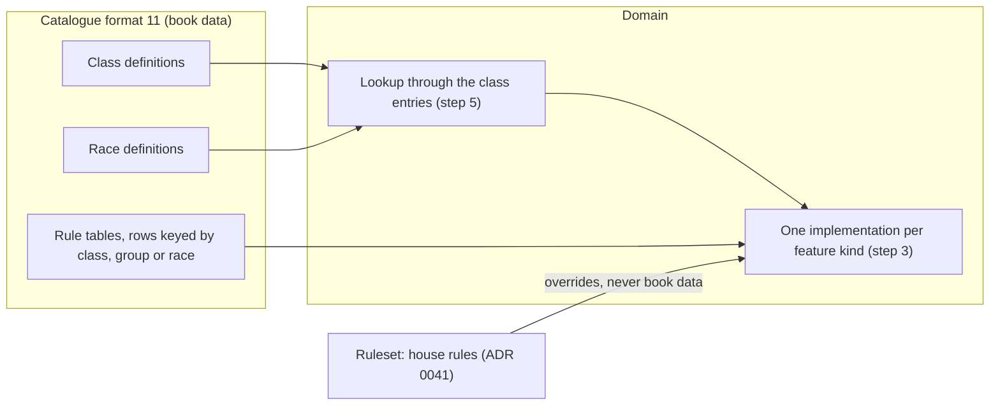

# ADR 0040: Classes and races are data, with typed features; no special case per class, race or kit

**Status**: accepted 2026-10-21 (the user's triage of the rules-engine foundation, quoted in
Context). The shape of the definitions, the closed list of feature kinds and their parameters
(steps 1 to 4), and the choices beyond the triage (group ids under the rule of step 10, one
`rogue_skills` kind with a `set` parameter, the weapon proficiency types derived from the
`equipment` list, the package `domain/classes`) were accepted in review, 2026-10-21.
Step 11.1 is built (2026-10-22, [ADR 0021](0021-spell-catalogue.md) step 18: the catalogue publishes format 11). The rest is
not implemented: each step names the test its implementing item writes. Amends
[ADR 0030](0030-classes-and-races.md) steps 1, 2, 4, 9 to 20, 22 and 23 and
[ADR 0015](0015-experience.md) step 2, each on implementation. Builds on the vocabulary of
[ADR 0036](0036-vocabulary.md) (`GLOSSARY.md`, `docs/domain-model.md`). The house rules live in the
Ruleset, not in this book data ([ADR 0041](0041-ruleset.md)); multi-class and dual-class rules (ADR 0042) and psionics
(ADR 0043) build on the class entries of step 5.

## Context

The user, 2026-10-21: "We need to make sure we build our rule engine so that it's scalable and
logical. We've been doing a lot of hardcoding and shortcuts and plain stupid things that we need to
undo as we go (like when you gave bard talents to all classes)." Decided in the triage:

- The catalogue carries classes and races as data in a new format 11. Each class has an id, a
  group, prime requisites, ability minimums, allowed alignments, weapon and armour limits, an XP
  table, hit dice, a spell progression (by reference) and a **list of features with
  parameters**. The app switches on the **feature kind**, never on a class id. Tables keyed by
  class id become rows keyed by class.
- House rules live in the Ruleset ([ADR 0041](0041-ruleset.md)), not in book data.
- Foundation first: the five existing classes move onto it before the cleric's remaining work,
  multi-class and dual-class, and psionics.

How classes and races are coded today (code audit, 2026-10-21). The numbers already come from the
catalogue's rule tables ([ADR 0021](0021-spell-catalogue.md) steps 9 to 16), but **which class has
which mechanic is decided in Go**:

| What | Where it is today |
|---|---|
| The classes, the groups, the races | closed Go lists `ruletablesvc.Classes`, `Groups`, `Races` (`RaceCodes` adds `human`) |
| Class to group | the map `ruletablesvc.classGroups` |
| THAC0 by group, warrior attacks per round | a `switch` on the group code in `THAC0For`; `AttackRateFor` tests `group != "warrior"` |
| XP thresholds | the column map `experienceColumns` over a row with one field per class (`ExperienceRow{Fighter, Mage, …}`, and the adapter's DTO) |
| Spell slots | a `switch` on the class in `charactersvc.spellSlots` (Table 32, 21 or 24, none) |
| The feature flags | one Go list per mechanic: `exceptionalStrengthGroups`, `specializingClasses`, `wisdomFailureClasses`, `turningClasses`, `thiefSkillClasses`, `bardSkillClasses`, `backstabClasses`, `freeSpellClasses`, `spellbookMaxLevels` |
| Skill budgets and armour | constants per class (`SkillPointsFirstLevel`, `BardSkillPointsFirstLevel`, …), `ThiefArmors`, `BardArmors` with `metal` |
| Ability minimums, alignments | the maps `classMinimums`, `alignmentLimits` |
| Weapons and armour | `itemsvc.classRules` (the warnings, [ADR 0033](0033-equipment.md) step 20) and, separately, `ruletablesvc.classWeaponTypes` (the proficiency picks, [ADR 0037](0037-proficiencies.md) step 7) |
| Creatable classes | `charactersvc.CreatableClasses` |
| Race traits | `charactersvc.conSaveRaces` (Table 9), `ruletablesvc.noExceptionalStrengthRaces`, Tables 10 and 11 as a Go literal (`identity.go`), `race == "human"` tests |
| The seeded character | `seedfile.DefaultClass = "bard"` |

Three bugs follow from it: the XP bonus tests the bard's Dexterity and Charisma for every class
(`xpsvc.BonusEligible(c.Dex, c.Cha)`, [ADR 0015](0015-experience.md) step 2, never generalised as
ADR 0030 step 4 asked); spell effects always used the rogue's by-group entry (fixed 2026-10-21 in
the cast service, ADR 0030 step 2); and a seeded character is always a bard. Each new class today
means touching a dozen lists in four packages, which is what this ADR stops.

The way spell effects already work ([ADR 0008](0008-spell-slots-and-long-rest.md) step 8 and the
"no special case per spell" rule) is the model: the data names a **kind** with **parameters**, and
the code implements each kind once.

## Decision

Book facts are cited by file and section of `critical-rulebooks`; no book text is copied here.
**Test names** below are written without their `Test` prefix while the test does not exist (the
`check-adr-tests` gate refuses a cited `Test…` name with no such function); the implementing item
writes `Test<name>` and adds the prefix here in the same PR.

### The data

1. **A class definition** (catalogue format 11, one entry per class) carries:
   1. `id`: a language-neutral code (`fighter`, `mage`, `cleric`, `thief`, `bard`), the value
      `characters.class` already stores; `name`: a language map ([ADR 0023](0023-localized-text.md),
      never a per-language field).
   2. `group`: a class group code (`warrior`, `wizard`, `priest`, `rogue`). The group picks the
      THAC0 row (Table 53), the saving throw rows (Table 60), the proficiency slots (Table 34) and a
      spell effect's by-group entry (ADR 0030 steps 2, 5 and 6, ADR 0037 step 3). Classes of a group
      share these (PHB chapter 3, `01-chapter-3-player-character-classes.md`: classes of a group
      share hit dice, combat and saving throw progressions).
   3. `prime_requisites`: a list of ability codes (step 6).
   4. `ability_minimums`: `[{ability, min}]`, PHB Table 13 (`tables/phb-013-class-ability-minimums.md`,
      p.25): fighter Str 9, mage Int 9, cleric Wis 9, thief Dex 9, bard Dex 12, Int 13, Cha 15.
   5. `alignments`: the alignment codes the class allows; absent means any. PHB chapter 3: the
      thief any but lawful good (`11-rogue.md`, Thief), the bard always partly neutral
      (`14-bard.md`; the project reads it as at least one neutral axis, the five codes the app
      already allows), the fighter, mage and cleric any (`02-class-descriptions.md`, Fighter;
      `06-mage.md`; the cleric's order may narrow it, out of scope).
   6. `equipment`: what the class may wear and wield, the one source of the warnings of
      [ADR 0033](0033-equipment.md) step 20 **and** of the weapon proficiency types of
      [ADR 0037](0037-proficiencies.md) step 7: `armour` (the Table 29 columns allowed, `none`
      for no body armour, absent for any), `shields` (bool), `weapon_types` and `weapons` (catalogue
      codes with their weapon type), and `blunt_only` (bool). The proficiency types are **derived**
      from it with the catalogue (a type is allowed when the list names it or a weapon of it; for
      `blunt_only`, when a catalogue weapon of the type deals bludgeoning damage, a launcher by its
      ammunition), which is what seedcheck proves today: the second Go list goes.
   7. `experience`: the class's XP thresholds, rows `{level, xp}` inside the class entry (the class is the
      entry's; PHB Tables 14, 20, 23, 25), replacing the column per class.
   8. `hit_dice`: `{die, dice_levels, after}` and the Constitution column (`warrior` or
      `standard`, PHB Table 3): warrior d10 to level 9 then +3, wizard d4 to 10 then +1, priest d8
      to 9 then +2, rogue d6 to 10 then +2 (PHB Tables 14, 20, 23 and 25, Hit Dice column;
      `02-class-descriptions.md`, `05-wizard.md`, `07-illusionist.md` (Priest), `11-rogue.md`).
      ADR 0030 step 7 reads it.
   9. `spell_progression`: the id of a slot table (`bard_spells` Table 32, `wizard_spells` Table
      21, `priest_spells` Table 24) or absent for none. ADR 0030 step 8 reads the table it names,
      never a `switch` on the class.
   10. `nonweapon_groups`: the proficiency groups the class learns at the listed cost (PHB Table
       38; the catalogue's crossover rows keyed by class today, moved here).
   11. `features`: a list of `{kind, from_level, params}` (step 3), `from_level` 1 when absent.

   Tests: `ClassCatalogue_Step1_EveryClassCarriesEveryField` (ruletablesadpt: the fixture's five
   classes parse, a missing field or a per-language name is refused),
   `ClassWeaponTypes_Step1_6_DerivedFromTheEquipmentList` (domain: the lists of ADR 0037 step 7
   come out of `equipment` and the catalogue, equal to today's).

2. **A race definition** (format 11, one entry per race, `human` included) carries `id`, `name` (a
   language map), the ability adjustments (PHB Table 8) and requirements (Table 7), the identity
   rows (PHB Tables 10 and 11: height, weight, age, today a Go literal), and a list of typed
   **traits** `{kind, params}` (step 4). The thief skill adjustments (Table 27), the racial level
   limits and the classes a race admits (DMG Table 7, [ADR 0021](0021-spell-catalogue.md) step 11)
   and the race languages (format 8) stay tables, rows keyed by race (and class). They are book
   data; **how they apply** is the ruleset's: the level limits warn (`level_limits` `warn`) and the
   racial lift waives Table 7's dash for a multi-class or dual-class character ([ADR 0041](0041-ruleset.md) steps 2.2,
   2.3 and 5). A class or race definition never carries a house rule. A human is a race with no adjustments
   and no traits, not a `race == "human"` test. A race's trait texts that the app does not compute
   stay localized catalogue text (ADR 0030 step 22.3).
   Tests: `RaceCatalogue_Step2_SixRacesWithTheirTraitsAndIdentityRows` (ruletablesadpt),
   `Identity_Step2_TablesTenAndElevenFromTheCatalogue` (ruletablesvc: the creation rolls of
   [ADR 0032](0032-character-identity-and-creation-rolls.md) step 5 read the catalogue rows, equal
   to today's literal).

### The feature kinds

3. **The closed list of class feature kinds.** The code implements each kind once; a class has a
   mechanic only by listing its kind. Each kind's parameters are checked at start-up (step 8). The
   five classes' features, as the triage and the Go lists of Context have them:

   | Kind | Params | Computed by | Today's classes |
   |---|---|---|---|
   | `exceptional_strength` | none | ADR 0030 steps 9 and 10 (18/xx, the warrior's scale over 18) | fighter |
   | `melee_attacks_per_round` | `table` (Table 15) | ADR 0030 step 11.1 | fighter |
   | `weapon_specialization` | none (the cost is ADR 0037 step 9's) | ADR 0030 steps 11 and 12, ADR 0037 step 9 (Table 35) | fighter |
   | `wisdom_bonus_spells` | none | ADR 0030 step 13 (Table 5) | cleric |
   | `spell_failure` | `ability` (`wis`) | ADR 0030 step 14 (Table 5) | cleric |
   | `sphere_access` | `major`, `minor` (sphere codes), `minor_max_level` (3) | ADR 0030 step 15 (format 6's access rows, moved here) | cleric |
   | `turn_undead` | `table` (Table 61) | ADR 0030 step 16 | cleric |
   | `rogue_skills` | `set` (`thief` or `bard`: the skill list and base rows, Table 26 or 33), `budget` `{first, per_level, per_skill_first, per_skill_per_level}`, `armour` `[{code, column, extra}]`, `min_to_use` | ADR 0030 steps 17 and 18, ADR 0037 steps 10, 11 and 15 | thief (set `thief`, budget 60/30/30/15, the four Table 29 armours, `min_to_use` 1); bard (set `bard`, budget 20/15/0/0, the four plus `metal` on the elven chain column with an extra -5, `min_to_use` 0) |
   | `backstab` | `table` (Table 30) | ADR 0030 step 19 | thief |
   | `spellbook` | `max_spell_level`, `free_spell_per_new_spell_level` (bool) | ADR 0030 step 20 (20.1, 20.7, 20.8) | mage (9, true), bard (6, false) |

   1. A **new mechanic is a new kind**: an amendment of this step (its params and the ADR step that
      computes it) and its code, never a branch on a class id. A new class made of existing kinds
      is a catalogue change only.
   2. The **check kind** a skill set logs (`thiefSkill`, `bardSkill`, [ADR 0014](0014-skill-checks.md)
      step 3) follows the `rogue_skills` set, so the logged checks still read.
   3. The book constants that are the same for every class that has the kind (the backstab +4, the
      skill cap 95, the specialization costs) stay in the kind's code; only what differs between
      classes is a parameter.
   4. The starting spellbook stays a seed keyed by class (`seeds/starting_spellbook.json`, ADR 0030
      step 20.7): seeds are data.

   Tests: `Features_Step3_EveryKindParsesItsParams` (domain: each kind with its params, an unknown
   param or a missing one refused), `Features_Step3_TheFiveClassesGrantTodaysMechanics` (seedcheck:
   the real artifact's five classes list exactly the kinds of the table, with its params).

4. **The closed list of race trait kinds:**

   | Kind | Params | Computed by | Races |
   |---|---|---|---|
   | `con_save_bonus` | `categories` (save category codes), `poison` (bool) | ADR 0030 step 22.1 (Table 9) | dwarf and halfling (rod/staff/wand, spells, poison), gnome (rod/staff/wand, spells; no poison) |
   | `no_exceptional_strength` | none | ADR 0030 step 9 | halfling |
   | `weapon_to_hit` | `weapon_types`, `bonus` | ADR 0030 step 22.3, _(proposed there, not built; the kind lands with it)_ | elf, halfling |

   Sources: PHB chapter 2 (`01-chapter-2-player-character-races.md`, Dwarves, and Class
   Restrictions and Level Limits for the halfling fighter's exceptional Strength;
   `03-gnomes.md`, Gnomes and Halflings), Table 9 (`tables/phb-009-constitution-saving-throw-bonuses.md`).
   The gnome's poison save gets no Table 9 bonus in the book. The poison flag on the save request
   still waits for the user's OK (ADR 0030 step 22.1), so `poison` is carried but not read yet.
   _(As built in format 11: the `weapon_to_hit` kind is accepted by the schema, but no race carries it; it lands with ADR 0030 step 22.3's code.)_
   Tests: `RaceTraits_Step4_ConSaveBonusFromTheTrait` (charactersvc: a race listing the trait
   gets Table 9's bonus on its categories, a race without it none, whatever its id),
   `RaceTraits_Step4_NoExceptionalStrengthFromTheTrait` (ruletablesvc).

### Reading the data

5. **The lookup goes through the class entries.** A character has feature kind K when one of its
   class entries' classes lists K at a `from_level` at or under that entry's realized level; the
   rule reads that entry's parameters and level (a backstab multiplier at the thief's level). Today
   a character has one class entry (its class and realized level), so at most one entry grants a
   kind; how two entries' grants combine (two spell progressions, the better THAC0) is
   ADR 0042's. Every reader asks the lookup, never a class id or a
   `Has<Mechanic>(class)` list: the derived character (the read of [ADR 0030](0030-classes-and-races.md)
   step 1), the attack, the cast, the creation options and the item warnings. The
   definitions and the lookup are one pure domain package (`domain/classes`, beside
   `domain/skills` and `domain/spellbook`), filled from the catalogue by the composition root.
   Tests: `Lookup_Step5_AFeatureThroughTheClassEntry` (domain: granted from its level, not below
   it, read with the entry's level), `Lookup_Step5_ANewClassOfKnownKindsNeedsNoCode` (domain: a
   fixture class `test_skald`, group rogue, `rogue_skills` set `bard` and `spellbook`, derives its
   skills and spellbook with no code change).
   _(Amended 2026-10-21 by [ADR 0042](0042-multi-class-and-dual-class.md) step 12, on implementation: with several class entries, each entry grants its kinds at its own realized level (a frozen entry at the level it was left at) and each grant is read with its entry's parameters and level; a figure that is one per character (THAC0, saves, proficiency slots, hit points) combines by ADR 0042 steps 8 to 10 and 15, never by a class id)_

6. **Prime requisites and the XP bonus.** A character is eligible for the 10% bonus of
   [ADR 0015](0015-experience.md) step 1 when **every** prime requisite of its class is 16 or more
   on the sheet (PHB chapter 3, `02-class-descriptions.md`, Prime Requisite: 16 or more in all
   prime requisites gives 10%). Prime requisites (PHB chapter 3): fighter Strength, mage
   Intelligence, cleric Wisdom, thief Dexterity, bard Dexterity and Charisma (`14-bard.md`). A
   fighter's 18/xx is 18 for the test. This is ADR 0030 step 4, now read from the class's
   `prime_requisites`; it replaces ADR 0015 step 2's bard-only test (Dexterity and Charisma for
   every class). The flag stored on each entry still counts, as there (a DM ruling).
   Tests: `BonusEligible_Step6_EveryPrimeRequisiteAt16` (xpsvc: a fighter of Str 16 eligible, a
   mage of Int 15 not, a bard of Dex 16 and Cha 15 not), `Get_Step6_TheClassPicksThePrimeRequisites`
   (composition: a fighter of Str 17, Dex 10, Cha 10 is eligible; fails on the old code).

7. **Tables keyed by class become rows.** Every rule table that has a column per class or group
   becomes rows with a `class`, `group` or `race` key (XP thresholds, Table 53, Table 60, the
   slot tables, Table 34), so a new class or group is new rows, never a new field in a Go struct
   or a DTO. A **group** id is data like a class id: no `switch` on `warrior` or `rogue`.
   _(As built in format 11, [ADR 0021](0021-spell-catalogue.md) step 18.2 and 18.4: the XP rows are in the class entries and Table 53 is the `groups` list, `{id, thac0}`;
   the class-keyed tables of formats 3 to 10 stay beside them until their readers move, step 11.3.)_
   Tests: `RuleTables_Step7_RowsKeyedByClassAndGroup` (ruletablesadpt: the thresholds, THAC0 and
   saves of the fixture's rows equal today's per-column reads for each class and group).

8. **Checked at start-up.** The catalogue import refuses to start (as every format does,
   [ADR 0021](0021-spell-catalogue.md)) on: an unknown feature or trait kind, an unknown or
   missing parameter, a kind listed twice on a class, a class whose group has no THAC0, save,
   hit dice or slot rows, a `spell_progression` or `table` naming no table, a race or class key in
   a table that names no definition, and a level-limit row for an unknown class. Every class the
   catalogue defines is **creatable** (`CreatableClasses` goes): a class that passed the check is
   fully supported.
   Tests: `Import_Step8_RefusesAnUnknownKindOrParam`, `Import_Step8_RefusesARowForAnUnknownClass`
   (ruletablesadpt), `Options_Step8_EveryCatalogueClassIsCreatable` (charactersvc).

9. **The seed names its class.** `seeds/character.json` carries `class` (Kelsen: `bard`) and
   `race`; a seed without them is refused at start; `seedfile.DefaultClass` goes. The storage
   default of `characters.class` is not read as a class.
   Tests: `Seed_Step9_TheSeedNamesItsClass` (seedfile: a seed of class `fighter` loads as a
   fighter; a seed without `class` is refused).

### The rule

10. **No special case per class, race or kit.** No class, group, race or kit id literal in
    production code: `api/internal/` outside `_test.go` files and `testdata/`, and `web/src`
    outside tests. Ids live only in catalogue data, seeds, tests and test fixtures. The code reads
    a definition's fields and feature kinds (step 5); the web renders what the server sends (the
    options, the derived block). A kit (a class's optional specialisation from the supplements,
    future) will be data that adds or removes features on a class, under the same rule. A house
    rule that changes a class's or race's book data is a Ruleset setting ([ADR 0041](0041-ruleset.md) step 2), never an edit
    of the book data or a literal. Written in `docs/agent-workflow.md` "Hard rules for
    implementers" and review checklist item 9; enforced by `just check-no-class-ids` (part of
    `just validate` once the literals are gone, step 11.5) with a script test that plants a
    literal in a throwaway tree, as `check-no-tracker-ids` does.
    Test: `scripts/test-check-no-class-ids.sh` (a class, group and race literal planted in Go and
    TypeScript production files is refused; the same ids in a `_test.go` file, `testdata/` and the
    catalogue pass).

### Migration

11. **The five classes move first, behaviour unchanged.** In this order, each a separate item:
    1. The catalogue publishes format 11 (the class and race definitions of steps 1, 2 and 4 and
       the rows of step 7) for the five classes and six races, cross-checked against formats 3 to
       9 (same thresholds, THAC0, saves, slots); an [ADR 0021](0021-spell-catalogue.md) step for
       format 11 comes with it.
    2. The API imports format 11 into `domain/classes` (steps 5 and 8). While the Go lists still
       exist, a test proves the data equals each of them.
    3. Each reader moves to the lookup, one feature kind (or field) at a time, and its Go list is
       deleted in the same PR: the existing step tests of ADR 0030, 0033 and 0037 stay green
       **unchanged** (the regression proof: no rule moves for the five classes). The two fixes,
       steps 6 and 9, are the only behaviour changes, each with its test that fails on the old
       code.
    4. The races (steps 2 and 4), then the tables' rows (step 7).
    5. `just check-no-class-ids` joins `just validate` once no literal is left.
    6. Only then the cleric's remaining work, multi-class and dual-class (ADR 0042) and the
       psionicist (ADR 0043), each a catalogue class of known or new kinds.

    No database migration: `characters.class` and `characters.race_code` keep the same codes.
    Tests: `ClassData_Step11_2_MatchesTheGoListsItReplaces` (ruletablesadpt, deleted with the last
    list), and the existing tests named in ADR 0030 steps 2 to 22, unchanged.

## Consequences

- A new class of known kinds (a fixture class proves it, step 5) is a catalogue change, not a code
  change; a new mechanic is one new kind, implemented once, and reusable by any later class.
- The per-class Go lists of Context are deleted, not wrapped: a list kept "for now" beside the data
  would be a second source.
- The feature list is the class's whole mechanical identity, so reviewing a class is reviewing its
  catalogue entry against the PHB.
- Group ids fall under the rule too, which is stricter than the triage's wording (it named class
  ids): the THAC0 `switch` and the warrior tests are the same shortcut one level up.
- The by-group spell effects (`by_group`, `max_by_group` in `seeds/spell_effects.json`) already key
  by group code in data; they are unaffected.
- Out of scope: how several class entries combine (ADR 0042), the psionicist's kinds (ADR 0043),
  the Ruleset and the racial lift ([ADR 0041](0041-ruleset.md)), kits, and the classes not built (paladin, ranger,
  druid, specialist wizards, priests of specific mythoi).
