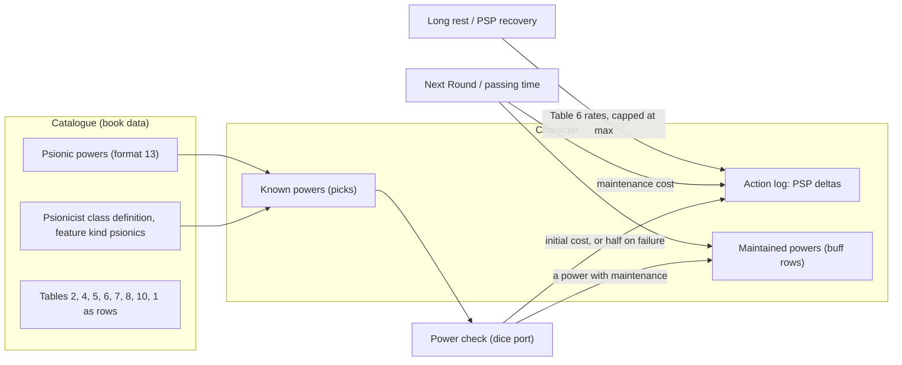

# ADR 0043: The psionicist: PSPs, powers, power checks and maintenance

**Status**: accepted 2026-10-21 for what the user's triage decided (quoted in Context); the
readings where the book is silent, unclear or differs from the triage (Q1 to Q14) are proposed
defaults put to the user ("Questions for the user"), each step citing the question it waits on.
Not implemented. Amends [ADR 0004](0004-buffs.md) step 17, [ADR 0005](0005-rounds-and-time.md)
steps 1, 6 and 7, [ADR 0008](0008-spell-slots-and-long-rest.md) steps 11 and 12,
[ADR 0040](0040-classes-are-data.md) step 3 and [ADR 0042](0042-multi-class-and-dual-class.md)
steps 10 and 16, each in place (dated 2026-10-21) and each on implementation. Builds on the class
definitions, the feature kinds and the lookup of ADR 0040, the class entries of ADR 0042 and the
racial lift of [ADR 0041](0041-ruleset.md). Layer 2 (psionic combat: attack and defence modes,
contact) is named here as later steps (20 to 23), not decided.

## Context

The table's human thief/psionicist (multi-class, around level 15, ADR 0042 step 17) cannot be
entered today: the app has no psionicist class, no PSP pool and no psionic power.

Decided in triage (user, 2026-10-21):

- The **Complete Psionics Handbook** only (not *Skills & Powers*); the French names from *Le
  Manuel Complet des Psioniques*.
- **Layer 1**: the psionicist as class data (an ADR 0040 feature kind `psionics` and its
  parameters); the PSP pool as an append-only ledger like HP, refilled by rest; powers
  (disciplines, sciences, devotions) known within the per-level allowance; power checks through
  the dice port against the power's score (ability-based) with modifiers; initial and maintenance
  PSP costs; maintenance charged on Next Round, as buffs are; stopping maintenance.
- **Layer 2 later**: attack and defence modes, contact.
- **Multi-class psionicist** per the CPsiH (the party's human thief/psionicist; racial restriction
  lifted).
- Out of scope: wild talents (deferred), *Skills & Powers* psionics.

What exists to build on (code and ADRs, 2026-10-21):

| What | Where it is today |
|---|---|
| A class and its mechanics | ADR 0040: a class definition with a group, tables keyed by class or group and a closed list of feature kinds; ADR 0042: a character is a list of class entries |
| A pool that is a ledger | current HP is `hp_max` plus the sum of every entry's effective HP delta, any kind may carry one, capped and floored in the recording path ([ADR 0007](0007-hp-ledger.md) step 2, [ADR 0018](0018-transactions-and-undo.md) step 4) |
| A d20 check with a breakdown | the proficiency check ([ADR 0014](0014-skill-checks.md) steps 1, 2, 5 and 6) |
| Something that lasts and counts down | the buff list: Next Round and passing time ([ADR 0004](0004-buffs.md), ADR 0005) |
| A daily refill | the long rest ([ADR 0008](0008-spell-slots-and-long-rest.md) steps 11 and 12) |
| Effects as data | a spell's effect entry, one implementation per effect kind (ADR 0008 step 8) |

## Decision

Book facts are cited by file and section of `critical-rulebooks`, under `cpsh/` (the English
CPsiH) unless named otherwise; no book text is copied here. The extracted tables' file names
are numbered by extraction, not by the book: the book's Table 2 (XP) is
`cpsh/tables/04-psionicist-experience-levels.md`, Table 4 (power progression)
`tables/06-psionic-power-progression.md`, Table 5 (inherent potential)
`tables/07-inherent-potential.md`, Table 6 (PSP recovery) `tables/08-psionic-strength-recovery.md`,
Table 7 (THAC0) `tables/09-psionicist-calculated-thac0s.md`, Table 8 (saves)
`tables/10-psionicist-saving-throws.md`, Table 9 (armour penalties)
`tables/11-psionicist-armor-penalties.md`, Table 10 (proficiency slots)
`tables/12-psionicist-proficiency-slots.md`. "Ch. 1" is `cpsh/ch01-the-psionicist/`, "ch. 2"
`cpsh/ch02-psionic-combat/`, "power descriptions" `cpsh/ch00-understanding-power-descriptions.md`.
**Test names** are written without their `Test` prefix while the test does not exist (the
`check-adr-tests` gate); the implementing item writes `Test<name>` and adds the prefix here.
Every warning and refusal is structured data (a code and its numbers), worded by the web.

### The class

1. **The psionicist is a class definition** (ADR 0040 step 1, catalogue format 13's class data):
   1. `id` `psionicist`; `name` en *Psionicist*, fr *Psioniste* (`cpsh-fr/ch01-le-psioniste/05-le-psioniste.md`).
   2. `group` `psionicist`, a **new group** (ADR 0040 step 7: a group is data). The book gives the
      psionicist its own saving throws (Table 8) and proficiency slots (Table 10) and the rogue's
      THAC0 progression (ch. 1, `10-special-abilities.md`, THAC0 and Saving Throws), which no
      existing group has together. Its rows: Table 53's THAC0 as Table 7 (20 at levels 1 and 2,
      one better every two levels), Table 60's saves as Table 8 _(Q13 on one cell)_, Table 34's
      slots as Table 10 (weapon 2 initial, one every 5 levels; non-weapon 3 initial, one every 3
      levels; non-proficiency penalty -4). The group is never a code literal (ADR 0040 step 10).
   3. `prime_requisites` `[con, wis]`; `ability_minimums` Con 11, Int 12, Wis 15
      (ch. 1, `05-requirements.md`; `tables/02-psionicist-ability-requirements.md`); `alignments`
      every code that is not chaotic (same section, Alignment). The XP bonus is the PHB's 16 in all
      prime requisites (ADR 0040 step 6), the CPsiH stating none of its own _(Q14)_.
   4. `experience`: Table 2's thresholds, levels 1 to 20: 0, 2,200, 4,400, 8,800, 16,500, 30,000,
      55,000, 100,000, 200,000, 400,000, 600,000, 800,000, 1,000,000, 1,200,000, 1,500,000,
      1,800,000, 2,100,000, 2,400,000, 2,700,000, 3,000,000
      (`tables/04-psionicist-experience-levels.md`).
   5. `hit_dice`: `{die: d6, dice_levels: 9, after: 2}`, Constitution column `standard` (Table 2's
      Hit Dice column: 9 dice at level 9, then 9+2, 9+4…).
   6. `equipment` (ch. 1, `11-followers.md`, Weapons and Armor): `armour` padded, studded leather
      and hide; `shields` true (a small shield); `weapons` the book's list (short bow, hand and
      light crossbows, dagger, dirk, knife, club, hand axe, throwing axe, horseman's mace and pick,
      scimitar, spear, short sword, war hammer, as catalogue codes); `blunt_only` false. The
      book's optional rule (any armour, Table 9's power score penalty) is not taken _(Q11)_.
   7. No `spell_progression`. `nonweapon_groups`: the psionicist group and the general one
      (ch. 1, `12-proficiencies.md`; the rows of Table 38, keyed by class).
   8. `features`: `psionics` (step 2) from level 1, and `save_bonus` (step 3) from level 1.
   The racial level limits (`tables/01-psionicist-racial-level-limits.md`: dwarf 8, elf 7, gnome
   9, half-elf 7, halfling 10, human none) are the level-limit rows of ADR 0040 step 2 and warn
   (ADR 0041 step 5). The book's races (all six, ch. 1, `05-requirements.md`) need no lift.
   Tests: `ClassCatalogue_Step1_ThePsionicistParses` (ruletablesadpt: the fixture's psionicist with
   every field and its group rows), `Derive_Step1_APsionicistsTHAC0SavesAndSlots` (charactersvc: a
   psionicist 15 has THAC0 13, Table 8's 13-16 row and 2 + 3 weapon, 3 + 5 non-weapon slots).

2. **The feature kind `psionics`** (amends [ADR 0040](0040-classes-are-data.md) step 3: a new
   mechanic is a new kind). Params:
   1. `progression`: the id of a power progression table (Table 4, `psionicist_powers`: per level,
      the cumulative disciplines, sciences, devotions and defence modes; step 6);
   2. `psp`: `{base_ability: wis, modifier_abilities: [int, con], per_level: {ability: wis, plus: 10},
      table: inherent_potential}` (Table 5's rows; step 4);
   3. `recovery`: the id of the PSP recovery table (Table 6, `psp_recovery`; step 5).
   The kind is read through the class entries (ADR 0040 step 5, ADR 0042 step 12): the entry's
   realized level picks the progression row. The book constants that are the same for every
   psionic class (the natural 20 and natural 1, half the cost on a failure, one power initiated
   a round) stay in the kind's code (ADR 0040 step 3.3).
   Tests: `Features_Step2_PsionicsParsesItsParams` (domain: the kind with its three params; a
   missing table refused at start, ADR 0040 step 8), `Lookup_Step2_PsionicsAtTheEntrysLevel`
   (domain: a thief 15/psionicist 14 reads Table 4 at 14).

3. **The kind `save_bonus`** (amends ADR 0040 step 3). Params: `against` (an effect tag of the
   save request), `bonus`. The psionicist's: `+2` against enchantment/charm (ch. 1,
   `10-special-abilities.md`), in addition to Wisdom's magical defence adjustment
   ([ADR 0006](0006-saving-throws.md) step 9). It is a labelled modifier of the save's breakdown,
   given when the save request carries the tag; the tag is the mind-affecting tag of ADR 0006
   step 9 _(Q12)_.
   Test: `Save_Step3_ThePsionicistsTwoAgainstCharm` (savesvc: a psionicist's mind-affecting save
   carries +2 and the Wisdom adjustment, two labelled lines; a fighter's carries no +2).

### PSPs

4. **The PSP maximum** (ch. 1, `08-psionic-strength-points-psps.md`, Psionic Strength Points and
   Gaining Psionic Strength Points; Table 5).
   1. **At level 1**: Table 5's base score for Wisdom, plus Table 5's modifiers for Intelligence
      and Constitution (the book's *inherent potential*: Wis 17, Con 16, Int 15 gives
      24 + 1 + 0 = 25).
   2. **Each psionicist level from 2**: Table 5's Wisdom modifier plus 10, no die (Wis 17: 12).
      It never stops growing (the book gives no last level).
   3. Table 5 has rows 15 to 18 only; a score under 15 gives a modifier of 0, over 18 continues the
      table's steps _(Q1)_.
   4. **Stored like `hp_max`**: `psp_max` is set at creation (computed, or entered from the sheet
      for an existing character, never recomputed; as ADR 0042 step 4 for HP) and a psionicist
      level-up adds the gain in its `level_up` transaction (ADR 0030 step 7.3), with the gain and
      its terms in the payload. A multi-class character's gain is not divided by its classes
      _(Q2)_.
   Tests: `PSPMax_Step4_1_InherentPotential` (domain: the book's example, Wis 17 Con 16 gives 25),
   `Roll_Step4_2_ALevelUpAddsWisdomModifierPlusTen` (levelupsvc: +12 at Wis 17, in the `level_up`
   entry, undone with it), `Create_Step4_4_PSPMaxEnteredIsKept` (charactersvc).

5. **The PSP ledger.** Like HP (ADR 0007 step 2, ADR 0018 step 4): **any** action-log entry may
   carry a signed `psp_delta`; current PSPs are `psp_max` plus the sum of every entry's effective
   PSP delta, summed by one domain rule (`actionlog.PSPTotal`, beside `HPTotal`). In the recording
   path a gain is capped at the maximum (the book: never more than was lost, ch. 1,
   `08-psionic-strength-points-psps.md`, Recovering) and the total is never under 0; a capped
   entry carries `pspRequested` and `pspApplied`. Entries are never edited; undo pops the
   transaction and its PSPs (ADR 0018 step 2). An entry of a kind that is not psionic carries no
   delta. The derived character serves `psp` `{current, max}` for a character with the kind.
   The manual adjust is a `psp_change` entry (`POST /api/psp/event`, like HP's `hp_change`): a
   signed delta bounded as above, refused with delta 0 or with no PSP maximum (`no_psp_pool`).
   Tests: `PSPTotal_Step5_EveryKindCounts` (domain/actionlog), `Record_Step5_CapsAGainAtTheMax`
   and `Record_Step5_NeverUnderZero` (actionlogsvc), `PSPChange_Step5_UndoRedoExact` (composition).

6. **Recovering PSPs** (ch. 1, `08-psionic-strength-points-psps.md`, Recovering Psionic Strength
   Points; Table 6). A `psp_recovery` request names the hours (ADR 0005 step 5's validation) and
   the activity (`exertion`, `walking`, `resting`, `sleeping`: Table 6's rows, the hourly rates 0,
   3, 6 and 12 as data). One transaction, one `psp_recovery` entry whose delta is hours × rate,
   capped (step 5). Refused (`psp_recovery_while_maintaining`) while a power is maintained: the
   book recovers only in hours with no PSP spent. The per-turn optional rates are not taken.
   As built (2026-10-22): `POST /api/psp/recover` `{hours, activity}` answers the pool
   `{current, max}`; the hours are refused as passing time's are (more than 0, at most 720); the
   delta is rounded down to whole PSPs (1.5 h walking gives 4); exertion logs the hours with a
   delta of 0; the payload carries `hours`, `activity` and `perHour`. The refusal while
   maintaining is built with maintenance (steps 13 to 16): until then nothing can be maintained.
   Tests: `TestRecover_Step6_HoursTimesTheActivityRate` (the new `psionicsvc`: 3 h resting gives
   18), `TestRecover_Step6_CappedAndUndone` (composition: capped at the max, undone exactly),
   `Recover_Step6_RefusedWhileMaintaining` (with maintenance).

7. **The long rest recovers PSPs** (amends [ADR 0008](0008-spell-slots-and-long-rest.md) steps 11
   and 12; the triage's "refilled by rest"). The long rest's one transaction also ends every
   maintained power (step 13: the book allows no maintenance asleep, ch. 1,
   `10-special-abilities.md`) and recovers a night's sleep, 8 hours at Table 6's sleeping rate
   (96), capped at the maximum _(Q3: the book has no full refill)_; the `long_rest` entry carries
   the delta and snapshots the maintained powers. Undoing the rest spends them again.
   Tests: `LongRest_Step7_RecoversANightsSleepAndEndsMaintenance` (restsvc),
   `LongRest_Step7_UndoRestoresPSPAndTheMaintainedPowers` (composition).

### Powers

8. **A psionic power is catalogue data** (catalogue format 13, en and fr; power descriptions,
   Statistics). Each power has: `id`; `name` (a language map); `discipline` (one of the six:
   clairsentience, psychokinesis, psychometabolism, psychoportation, telepathy, metapsionics; fr
   clairsentience, psychokinésie, psychométabolisme, psychotranslation, télépathie,
   métapsionisme); `kind` (`science`, `devotion`, `defence_mode` or `attack_mode`); `score`
   `{ability, modifier}` (the power score, ability plus or minus the power's number);
   `initial_cost` (a number, `variable`, or `contact`, layer 2); `maintenance` `{cost, period}`
   (period 1 round, or what the power names, as rounds) or absent (the power cannot be
   maintained); `prerequisites` (power ids); the range, preparation time and area as localized
   text; the description and the optional power-score and natural-20 results as localized text;
   and an optional `effect` (step 17). A power's rules are its data: no special case per power
   (the "no special case per spell" rule).
   Tests: `PowerCatalogue_Step8_EveryPowerParses` (the format 13 adapter: a fixture power with
   every field; an unknown discipline, kind or prerequisite refused at start).

9. **Powers known, within the allowance** (ch. 1, `07-advancement.md`, Gaining Disciplines,
   Gaining Sciences and Devotions; Table 4; `09-defense-modes.md`). A character with the kind
   holds a list of **picks**: a discipline, a known power, or a relearn of a known power (+1 to
   its score, same file, Raising Psionic Power Scores). At the entry's realized level:
   1. disciplines, sciences, devotions and defence modes known are at most Table 4's cumulative
      counts (a relearn takes a science's or devotion's place, as the book's alternative to a new
      power); defence modes do not count as sciences or devotions;
   2. the **first discipline** picked is the **primary discipline**; in every other discipline
      the sciences known stay under the primary's sciences and the devotions under the primary's
      devotions (the book: never as many; its example of 3 primary sciences allowing 2 elsewhere);
   3. in each discipline the devotions are at least twice the sciences;
   4. a power's discipline must be picked, and its prerequisites known;
   5. the player picks freely within these rules (no roll; wild talents are out of scope).
   A pick is one undoable transaction (ADR 0018), as a proficiency pick is
   ([ADR 0037](0037-proficiencies.md)); a pick over the rules is refused with its code
   (`psionic_allowance_exceeded`, `primary_discipline_exceeded`, `devotions_below_twice_sciences`,
   `discipline_not_known`, `prerequisite_not_known`). An existing character's picks are entered
   under the same rules _(Q4)_.
   Tests: `Picks_Step9_TableFourAllowance` (psionicsvc: a level 1 psionicist takes 1 discipline,
   1 science, 3 devotions, 1 defence mode, a fourth devotion refused), `Picks_Step9_PrimaryAndRatio`
   (the book's 3-sciences example; 2 sciences with 3 devotions refused),
   `Picks_Step9_PrerequisitesAndRelearn` (a power without its prerequisite refused; a relearn
   gives +1 to the score), `Picks_Step9_UndoRemovesThePick` (composition).

### Using a power

10. **The power check** (ch. 1, `06-a-psionics-primer.md`, Power Scores and Power Checks; power
    descriptions, Statistics and the optional results). One d20 through the dice port. The
    **target** is the power score: the character's ability score plus the power's modifier, plus
    1 per relearn (step 9), plus the labelled modifiers (an adjustment the player gives before the
    roll, as ADR 0014 step 5, with the power's or the DM's reason; ranges -20 to +20). Outcomes:
    1. a **natural 20** fails whatever the target (`natural_20`; the power's natural-20 text is
       shown when it has one);
    2. a **natural 1** succeeds whatever the target, even at 0 or under (`success`) _(Q9)_;
    3. a roll **equal to the score** succeeds with the power's special result (`power_score`; its
       text shown, the DM's to apply, the book calls it optional) _(Q5)_;
    4. otherwise success when the roll is at or under the target, failure above.
    Every activation is checked; maintaining is not (step 12). The check is a roll entry (ADR 0018
    step 10) with its breakdown (the ability, the modifier, each adjustment).
    Tests: `PowerCheck_Step10_TheFourOutcomes` (psionicsvc, with a dice mock: 20 at a target of
    25 fails, 1 at a target of -2 succeeds, a roll equal to 14 is `power_score`, 15 against 14
    fails), `PowerCheck_Step10_TheBreakdown`.

11. **The initial cost** (power descriptions, Initial Cost; primer, Power Checks). On a success
    the power's initial cost is spent, on a failure half of it, rounded up (the primer's rounding),
    as the check entry's PSP delta, in the check's one transaction. A `variable` cost is entered
    by the player with the request (the power's text or table gives it, e.g. Teleport's distance
    table), at least 1. A check is refused before the roll (`not_enough_psp`) when the current
    PSPs are under the full initial cost _(Q6)_. A `contact` cost is layer 2 (step 19): such a
    power is refused (`needs_contact`) until then.
    Tests: `Activate_Step11_SuccessSpendsTheCostFailureHalfRoundedUp` (a 7-PSP power: 7, or 4),
    `Activate_Step11_RefusedUnderTheCost`, `Activate_Step11_UndoGivesThePSPBack` (composition).

12. **One power a round** (ch. 2, `01-using-powers.md`). In combat (the round counter above 0,
    ADR 0005), initiating a second power in the same round warns `second_power_this_round`;
    maintained powers and defence modes do not count (same section). Outside combat nothing is
    warned. A warning, never a refusal (the DM's table).
    Test: `Activate_Step12_ASecondPowerInTheRoundWarns`.

### Maintenance

13. **A maintained power is a buff row** (amends [ADR 0004](0004-buffs.md) step 17). A successful
    check of a power that has `maintenance` puts a row on the buff list, untimed (until stopped),
    carrying the power's catalogue id (`power_id`, beside `spell_id`) and its maintenance cost and
    period, with the power's effect when it has one (step 17). Activating a power already
    maintained renews it (ADR 0004 step 6). A power without `maintenance` puts no row unless its
    effect has rounds (step 17).
    Tests: `Activate_Step13_AMaintainedPowerIsAnUntimedRow` (psionicsvc: the row, its id and
    cost), `Activate_Step13_NoMaintenanceNoRow`.

14. **Next Round charges maintenance** (amends [ADR 0005](0005-rounds-and-time.md) step 1; ch. 2,
    `01-using-powers.md`; power descriptions, Maintenance Cost: per round, to keep the power from
    the previous round, no check). In the `round_advance` transaction, each maintained power whose
    period falls due (every round for a period of 1; every `period` rounds since its start round,
    ADR 0004 step 15) charges its cost as the entry's PSP delta, in the list's order. A power whose
    cost the remaining PSPs cannot pay **ends** instead (named in the entry with the expired buffs,
    as `maintenance_unpaid`; the book's case: maintained until the PSPs run out). The round a power
    starts in charges nothing (the first charge is for keeping it from that round) _(Q10)_. Undo restores
    the PSPs and the rows (ADR 0005 step 4).
    Tests: `AdvanceRound_Step14_ChargesEachMaintainedPower` (buffsvc: two powers of 1 and 3 charge
    4), `AdvanceRound_Step14_UnpaidMaintenanceEnds` (2 PSPs left for a 3-PSP power: it ends, 0
    spent on it), `AdvanceRound_Step14_PeriodOfTenChargesEveryTenthRound`,
    `AdvanceRound_Step14_UndoRestoresPSPAndRows` (composition).

15. **Passing time charges maintenance** (amends ADR 0005 steps 6 and 7). Passing `n` rounds
    charges each maintained power for every period due in them, in round order, ending a power at
    the first charge it cannot pay; the `time_passed` entry carries the PSP delta and the preview
    (ADR 0005 step 8) shows the PSPs spent and the powers that would end. Passing time recovers no
    PSP (step 6 is its own request) _(Q7)_.
    Tests: `PassTime_Step15_ChargesMaintenanceForTheRounds` (buffsvc: 1 h of a 1-PSP power with 40
    PSPs ends it after 40 rounds), `PassTime_Step15_PreviewShowsThePSP`.

16. **Stopping maintenance** (ch. 2, `01-using-powers.md`; the powers' texts: stopping ends the
    power). Dismissing the row (ADR 0004 step 13's dismiss) stops it: free, one logged entry,
    undoable. A disrupted power spends nothing (ch. 2, `05-the-combat-round.md`): the player undoes
    the activation.
    Test: `Dismiss_Step16_StoppingIsFreeAndUndoable` (buffsvc).

17. **A power's effect uses the existing kinds** (ADR 0008 step 8's effect data and ADR 0004 steps
    11, 12 and 18). A power whose effect the existing kinds express (an AC, a to-hit, a damage, a
    save bonus, a Strength) carries it in its catalogue `effect`; the row applies it while
    maintained (step 13), or for its `rounds` when the power is not maintained but lasts. Every
    other effect is the power's text, shown and not computed. No new effect kind in layer 1; a
    power that needs one is a later amendment of ADR 0008 step 8 with its code.
    Test: `Activate_Step17_AnEffectFromTheData` (psionicsvc: a fixture power with an `ac` effect
    changes the derived AC while maintained and stops when dismissed).

### Several classes

18. **The psionicist in a multi-class or dual-class character** (amends
    [ADR 0042](0042-multi-class-and-dual-class.md) steps 10 and 16; ch. 1, `05-requirements.md`,
    Multi-class and Dual-class Characters; `tables/03-multi-class-psionicists.md`).
    1. The book allows halfling and dwarf fighter/psionicists and thief/psionicists, and human
       dual-class psionicists by the normal rules. With `multiclass_any_race` (ADR 0041 step 2.2)
       any race may combine the psionicist with any classes, as ADR 0042 step 2.1 (the party's
       human thief/psionicist). The CPsiH adds no rule of its own: THAC0, saves, hit points and
       proficiency slots combine by ADR 0042 steps 8 to 10 and 15 (Table 7 and the thief's Table
       53 row are the same, so a thief/psionicist's THAC0 is that row).
    2. PSPs and powers are the psionicist entry's alone, at its realized level (steps 4 and 9; a
       frozen entry's at its `left_at_level`, used before the crossover with ADR 0042 step 13's
       warning).
    3. **Armour** (ADR 0042 step 16.2): a power check while the character wears body armour
       outside the psionicist's `armour` list warns `power_in_armour`, as a wizard spell in armour
       does; a normal helmet blocks powers in the book (ch. 1, `11-followers.md`, Armor), read as
       the same warning for a worn helmet _(Q8)_.
    4. **Weapons**: ADR 0042 step 16.1's union (the psionicist is not `blunt_only`).
    Tests: `MultiClass_Step18_AHumanThiefPsionicist` (charactersvc: accepted with the lift; THAC0,
    saves best per category, PSPs from the psionicist's level), `Activate_Step18_PowerInArmourWarns`
    (psionicsvc: a fighter/psionicist in chain warned; in studded leather not).

19. **The party's thief/psionicist is the acceptance fixture** (ADR 0042 step 17): entered from
    the sheet (levels, XP, max HP, max PSP, the picks), it derives its THAC0, saves, PSPs, picks
    and the warnings of its sheet.
    Test: `Party_Step19_TheThiefPsionicistDerivesAsItsSheet` (composition).

### Layer 2, later (not decided)

The psionic combat of ch. 2 is a later ADR, which will amend this one. What it will need:

20. **Defence modes in use** (ch. 1, `09-defense-modes.md`; ch. 2, `08-telepathic-defense-modes.md`):
    the five modes are known by step 9's column; activating one is a power with its cost that
    works from the start of the round and covers every attack that round; it does not count
    toward step 12. Needs: a round-scoped activation and the attack-versus-defence modifiers
    (`tables/19-attack-versus-defense-modes.md`, the book's Table 14) as rows.
21. **Attack modes and contact** (ch. 2, `06-telepathic-combat.md`, `07-telepathic-attack-modes.md`,
    `10-tangents.md`; `tables/29-contact-initial-cost.md`): the five attack modes (two attacks a
    round for one cost), contact against an open mind (its cost by the target's level), tangents
    against a closed one (three make contact, maintained at 1 PSP a round), and the `contact`
    initial cost of step 11. Needs: a target with its own state (open or closed mind, its
    defences), which the app has not (an NPC or another character).
22. **Psychic contests and psychic lock** (ch. 2, `03-psychic-contests.md`, `04-psychic-lock.md`):
    two power checks compared (the higher success wins, the defender on a tie or two failures; a
    maintained power +1), and the deadlock with its 4d4 PSP backlash. Needs: two checks in one
    transaction, the opponent's roll entered by hand.
23. **Out of scope beyond layer 2**: wild talents (ch. 1, `13-wild-talents.md`), followers
    (`11-followers.md`), the per-turn recovery option, *Skills & Powers* psionics, the
    psionicist's individual class awards (`tables/05-individual-class-awards.md`, the DM's XP).

## Questions for the user

Each is a reading where the book is unclear, silent or differs from the triage; the step is
written with the proposed default.

1. **Q1, Table 5 outside 15 to 18** (step 4.3). The extracted Table 5 (en and fr) has rows 15 to
   18 only, and the Intelligence and Constitution modifiers are read from it. Proposed: a score
   under 15 gives modifier 0 (and a Wisdom under 15 cannot be a psionicist, Wis 15 minimum);
   over 18, base +2 and modifier +1 per point (19: 28, +4). Other reading: check the printed book
   for more rows.
2. **Q2, a multi-class psionicist's PSP gain** (step 4.4). The PHB divides a multi-class level's
   hit die by the classes; the CPsiH says nothing of PSPs. Proposed: the full gain (Wisdom
   modifier + 10) per psionicist level. Other reading: divided like hit points.
3. **Q3, PSPs on a long rest** (step 7). The triage says "refilled by rest"; the book has hourly
   rates only (12 an hour asleep, capped at what was lost), no full refill. Proposed: the long
   rest is 8 hours of sleep (96 PSPs, capped). Other reading: the long rest refills to the
   maximum.
4. **Q4, an existing character's picks** (step 9). Proposed: entered under the same rules
   (refused when the sheet breaks them). Other reading: entered as on the sheet with a warning.
5. **Q5, the roll equal to the score** (step 10.3). The primer says it always gives the special
   result; the power descriptions call those results optional. Proposed: shown as the outcome
   `power_score` with the power's text, the DM applying it. Other reading: an ordinary success.
6. **Q6, the PSPs needed to try** (step 11). The book says a failure costs half, not what is
   needed before the roll. Proposed: the full initial cost. Other reading: half the cost.
7. **Q7, passing time and recovery** (step 15). Proposed: passing time charges maintenance and
   recovers nothing; recovery is its own request with the activity. Other reading: passing time
   also recovers at the resting rate when no power is maintained.
8. **Q8, the helmet** (step 18.3). The book: a normal helmet blocks powers (a psionic one does
   not). Proposed: a worn helmet warns `power_in_armour` on a power check (the catalogue has no
   psionic helmet yet). Other reading: the check is refused, or the helmet is not checked.
9. **Q9, the power-score natural 1** (step 10.2). The primer says a 1 is always at least a minimum
   success; the power descriptions give no "1" result. Proposed: an ordinary success. Other
   reading: a reduced effect named per power (data the catalogue would need).
10. **Q10, maintenance in the round a power starts** (step 14). The book charges maintenance "to
    keep the power from the previous round". Proposed: the first charge on the Next Round after
    the activation. Other reading: a charge on the activation round's own Next Round too (the
    same thing for a power started mid-round; differs only for one started and stopped in a
    round).
11. **Q11, the optional armour rule** (step 1.6). The book's optional rule lets a psionicist wear
    any armour with Table 9's power score penalty (-1 to -7). Proposed: not taken (the armour
    list warns, as for every class). Other reading: taken as a ruleset switch (ADR 0041 step 2)
    with Table 9 as rows, the penalty a labelled modifier of step 10.
12. **Q12, "enchantment/charm" and the mind-affecting tag** (step 3). Proposed: the +2 applies to
    a save tagged mind-affecting (ADR 0006 step 9's tag). Other reading: a separate
    enchantment/charm tag on the save request.
13. **Q13, Table 8's spell column at 13 to 16** (step 1.2). The English extraction reads 7, the
    French book 11; the column runs 15, 14, 12, ?, 9, 7. Proposed: 11 (the French book and the
    progression). Other reading: check the printed English book.
14. **Q14, the XP bonus** (step 1.3). The CPsiH states none; the PHB's rule gives 10% at 16 in all
    prime requisites. Proposed: the PHB's rule (Con and Wis 16). Other reading: no bonus.

## As built: the catalogue data (format 13, 2026-10-22)

CRI-178 built steps 1, 2, 4, 6 and 8's data ([ADR 0021](0021-spell-catalogue.md) step 20). Where the books or the schema forced a reading:

- **Power ids** are the English name's slug with underscores (`mind_thrust`, the catalogue's id pattern), not the hyphen slugs of `cpsh-fr/POWERS`.
- **`min_level`** (step 8 names power ids only): a prerequisite such as "3rd level" is the power's `min_level`, beside its `prerequisites`.
- **`score`** is absent for Intensify and Splice (the book gives a formula in the text, not an ability and a number); the check of step 10 reads
  it from the power's rules, not from a score.
- **Variable costs**: `initial_cost` is `variable` where the printed cost is "3+" or "varies" (Telekinesis, Empower...) and `maintenance.cost` is
  `variable` ("1+/round", "up to 20/round"); the amount comes from the power's text. A cost of `contact` is for layer 2.
- **The ten modes' kind** is `defence_mode` or `attack_mode`, not `devotion` (and not `science`: Psionic Blast is a science by the book, so its pick
  takes a science slot, the other attack modes a devotion slot). Table 4's defence modes are counted apart (step 9.1).
- **The equipment list** (step 1.6): ADR 0040's `armour` names the skill columns of Table 29, and hide shares the `metal` column with the chain
  mails, so the class lists `padded_studded` only (hide is not expressible without admitting chain mail). The dirk and the throwing axe are not
  catalogue weapons.
- **The grids**: the psionicist's saves and level limits are rows of the shared `saving_throws` and `race_level_limits` tables, its XP, hit dice and
  THAC0 are in its class and group entries and also a column (`experience`, `thac0`) and a row (`hit_dice`) of the shared grids the API still reads
  by class or group (ADR 0021 step 20.1). The proficiency slots of Table 10 are not in the catalogue: they are the app seed's `psionicist` slot
  row and crossover (`seeds/proficiencies.json`).
- **The creation gate** (ADR 0040 step 8, amended): the catalogue lists the psionicist now, but its two kinds are not computed yet, so the
  class is **not offered at creation and refused** (`not_creatable`) until the implementing items land; each kind leaves
  `classes.notImplemented` when its reader does (`Class.Implemented`, a test on kinds, never an id). The kinds are in the Go closed list
  (`KindPsionics`, `KindSaveBonus`: parsed with no params, which the schema checks; nothing reads them).
- **French is optional on a power's text** (the localized schema type: English required, an absent language omitted). 21 of the 152
  descriptions have no French body in the artifact (OCR); a reader serves the English one for a language a text lacks, as every localized
  text does (ADR 0023 step 3): `TestParse_Step20_APowerWithoutFrenchTextFallsBackToEnglish`.
- **Q13** is fixed by one dated line (`catalogue-inputs/PSIONICIST_FIXES`): Spell 11 at levels 13 to 16.

## As built: the powers lookup (2026-10-22)

Step 8's catalogue is served; knowing and using powers are later items.

- **Read at start, never imported.** The disciplines and powers are read from the artifact beside the rule tables (ADR 0021 step 9.4's
  rule), held in memory by `powersvc`, and need no table, migration or import: a power has no state of its own. The artifact's parse refuses
  a repeated id, an unknown discipline, an unknown kind and an unknown prerequisite (`catalogue.CheckPowers`).
- **`GET /api/powers`** (`q`, `discipline`, `kind`, `page`, `page_size`), **`/api/powers/{id}`** and **`/api/powers/filters`**: a session, no
  current character. `q` matches the name in every language, case and accents ignored, ranked exact, prefix, substring, the book order
  within a rank (the spells' rule, ADR 0023 step 7). Texts are language maps; a cost is a number or the word `variable` or `contact`.
- **The lookup** gains a Powers entry beside the spell classes; the list is searched and filtered by discipline and kind.
- **The psionicist stays out of creation** until the implementing items: reading the catalogue of its powers does not make the class
  playable, since its `psionics` and `save_bonus` kinds have no reader (the gate of the section above). It leaves `classes.notImplemented`
  with the PSP items, not with this one: a psionicist character today would have neither PSPs nor the +2 save.
- Tests: `PowerCatalogue_Step8_EveryPowerParses` (catalogueadpt), `Search_Step8_*`, `Get_Step8_*`, `New_Step8_*` (powersvc),
  `Powers_Step8_ServedFromTheCatalogueAsLanguageMaps` (router).

## Consequences

- A new class of data (the psionicist and its group rows), two new feature kinds (`psionics`,
  `save_bonus`), a new catalogue format for powers (format 13, en and fr), a PSP pool that is a
  ledger like HP, a new service (`psionicsvc`: picks, checks, recovery) and buff rows that charge
  maintenance. No psionicist id, group id or power id in production code (ADR 0040 step 10).
- New entries and payload fields: `psp_delta` on any entry, `power_check`, `psionic_pick`,
  `psp_recovery`; new outcomes `power_score`, `natural_20`; new warnings `second_power_this_round`,
  `power_in_armour`, `maintenance_unpaid`; new refusals of steps 6, 9 and 11. Each gets its render
  row and `apiError` / warning key (en, fr).
- The schema change (`psp_max`, the picks, `power_id` on a buff row) and the API change (the
  check, the picks, the recovery; `psp` in the derived block) are the implementing items',
  reviewed as risky. ADR 0040 step 11's order holds: the five classes become data first, then
  class entries (ADR 0042), then the psionicist.
- Amended in place, 2026-10-21, on implementation: ADR 0004 step 17 (step 13), ADR 0005 steps 1,
  6 and 7 (steps 14 and 15), ADR 0008 steps 11 and 12 (step 7), ADR 0040 step 3 (steps 2 and 3),
  ADR 0042 steps 10 and 16 (steps 4.4 and 18).
- The vocabulary: `GLOSSARY.md` and `docs/domain-model.md` take the book's French words (the
  *psioniste*, not *psioniciste*; *points de force psionique*, PFP) and the new terms.
