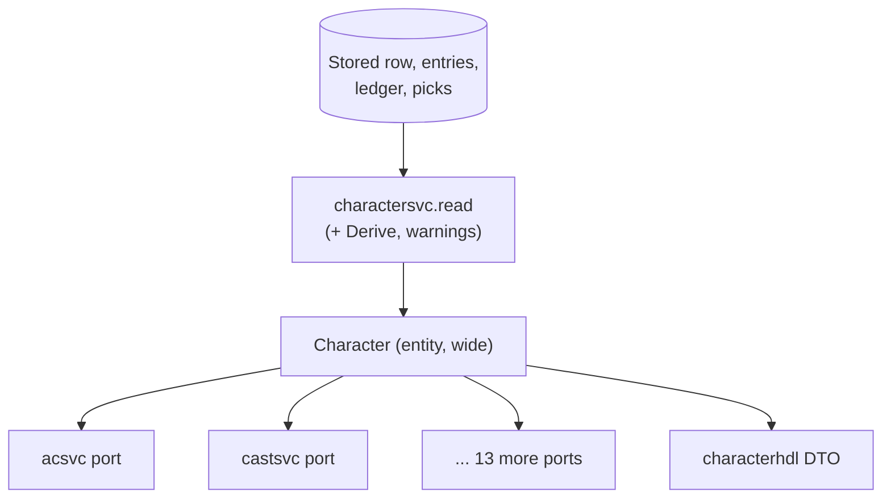

# ADR 0045: The character view: one read model for the services

**Status**: accepted 2026-10-23 (the user accepted every open question's default: "ok with all") (design step; the user's goal, 2026-10-21: "a logical rule engine
with locality"; triage 2026-10-22). The shape (Shape B below) is the recommendation; the user rules
in review. Not implemented. Amends [ADR 0030](0030-classes-and-races.md) (the sentence of steps 3
to 8 that every reader of a character gets the derived values) and
[ADR 0042](0042-multi-class-and-dual-class.md) steps 1, 15 and 16 (the mirror, the single-class
reads of the first active entry, the active-class helpers), each on implementation. The psionicist
services are a later consumer ([ADR 0044](0044-psionic-combat.md) is in flight).

## Context

Fifteen services each declare their own port `GetCharacter(ctx, id) (*charactersvc.Character, error)`
(buffsvc, combatsvc, itemsvc, castsvc, acsvc, xpsvc, skillsvc, levelupsvc, learnsvc, prepsvc,
spheresvc, turnsvc, dualclasssvc, psionicsvc, and the REST handlers). Each port returns the whole
entity, so:

- **Width.** A service that reads one figure (acsvc reads Dexterity; turnsvc reads `Derived.Turning`
  and one grant) depends on a struct with three nested blocks and dozens of fields and methods. Each port also has a mockery mock, and a test that needs a character builds it by hand
  or runs `Derive`.
- **One derivation per read.** `charactersvc.GetCharacter` reads the row, the XP awards, the worn
  armour, the languages, the PSP ledger and the powers, runs `Derive` (a 20-plus-method `Rules`
  interface) and the warnings, on every call. That is intended ([ADR 0030](0030-classes-and-races.md)
  steps 3 to 8: an XP award that crosses a threshold changes every reader at once) and stays.
- **"Which entry, which level" is answered in six places** in Go, each a little different, and once
  more in TypeScript:

| Today | What it answers | Reads |
|---|---|---|
| `classes.Primary(entries)` | the first active entry; `ok` false when none | `[]classes.Entry` |
| `firstActive(entries)` (derive.go) | the first active entry, else `entries[0]` | `[]entryCalc` |
| `entryLevel(c, class)` (create.go) | the level of the entry of `class` (left-at when frozen), else `c.RealizedLevel` for an unknown class | stored entity |
| `Character.SetEntryLevel(class, level)` | moves the realized level of the active entry (`""` = the first active one) and the mirror | stored entity (mutates) |
| `Character.ActiveClasses()`, `ActiveClassIDs()` | the active entries at their realized level | stored entity |
| `Character.StoredClasses()` | every entry, frozen at the left-at level, `Frozen` flagged | stored entity |
| `Character.ProficiencyClasses()` | every entry from the derived block, frozen flagged | derived block |
| `skillsLevel` (create.go) | the level the skill budget reads before a character derives | a draft |
| `primaryClass`, `primaryLevel` (`web/src/lib/classEntries.ts`) | the first active entry, else the first entry | wire `classes` |

  There are 21 non-test call sites of `ClassEntries(`/`Entries()` outside the storage, and the
  mirror fields `Character.Class`, `RealizedLevel` and `XPTotal` (ADR 0042 step 1) still stand
  beside the entries, so a service can read either and be wrong for a multi-class character.
- **The domain is not the wire** ([ADR 0038](0038-domain-and-wire.md)). Whatever the services
  receive carries no transport tags, and the REST DTO stays the handler's own mapping.

## Shapes considered

**Shape A: keep the entity, gather the helpers.** Services keep receiving `*Character`; the six
helpers move onto it (or into one file) and the TS twin is kept. *Depth*: unchanged, the interface
is still the whole entity. *Locality*: the rule is in one file, but a service can still reach the
mirror fields or `Derived` pieces and read them wrongly; a test still builds a `Character` and its
`Derived` block by hand or by running `Derive`. Cheapest, and it fixes nothing about width.

**Shape B: one concrete read model, `charactersvc.View`.** `charactersvc` builds a `View` value from
the stored character and its derived block and is the only place that does. A `View` is plain,
immutable data with exported fields and a handful of methods; no service sees the entity, the mirror
fields or `Derive`. A service's port becomes `View(ctx, id) (charactersvc.View, error)`. *Depth*:
the view is as wide in data as what the services read (it drops what none reads: warnings, details,
the sheet, the stored mirror), but the entries are reached only through the methods of step 3, so
the rule "which entry / which level" has one implementation. *Locality*: a change of that rule, or
of a derived figure's name, touches `charactersvc` and the compiler finds every reader; a test
builds a `View` as a literal or through a test builder (step 6) with no `Derive`.

**Shape C: one narrow interface per consumer.** Each service declares the interface of what it reads
(`type Armour interface { Dexterity() int }`) and `charactersvc` returns a type satisfying all of
them. *Depth*: the deepest per consumer (acsvc depends on one method). *Locality*: the rule is in the
methods that implement them, but fifteen interfaces, fifteen sets of fakes and a mock each is the
cost today's mocks already show; every new figure adds a method to an interface and to every fake of
it. The `Derived` pieces (`SkillSets`, `Turning`, `Grant`) cross the port as named types anyway.

| | A: entity + helpers | B: one `View` | C: interface per consumer |
|---|---|---|---|
| A service depends on | the whole entity | the view's fields and methods | its own methods |
| "Which entry / level" | one file, still bypassable | one implementation, the only way in | one implementation behind each interface |
| A service test builds | `Character` + `Derived` or runs `Derive` | a `View` literal / builder | a small fake |
| Mocks to regenerate | 15 (as today) | 15, one method each | 15 plus the interfaces |
| Cost of a new figure | a field | a field (and a builder line) | a method per interface that needs it |
| Migration | none | one service at a time | one service at a time, more code each |

**Recommendation: Shape B.** It gives the one-implementation rule and the Derive-free tests of
Shape C without fifteen fakes, and the accessors already make a service's reads narrow in practice.
A service whose reads settle to two or three methods may later declare a consumer-side interface
that `View` satisfies; nothing in B prevents it (step 2.3).

## Decision

Test names are written without their `Test` prefix while the test does not exist (the
`check-adr-tests` gate). No class id, race id or power id in production code (the "no special case
per class" rule, [ADR 0040](0040-classes-are-data.md)).

1. **The view's contents.** `charactersvc.View` holds, and only holds, what a service reads:
   1. *Identity*: `ID`, `Name`, `Race`.
   2. *Abilities*: `Str`, `StrExceptional`, `Dex`, `Con`, `Int`, `Wis`, `Cha`, `HPMax`, `PSPMax`.
   3. *Entries*: `Entries []EntryView`, in character order. An `EntryView` is the stored entry
      (`Class`, `State`, `StartingXP`, `LeftAtLevel`) with its derived figures (`Group`, `XP`,
      `TargetLevel`, `RealizedLevel`, `NextLevelXP`, `SpellSlots`, `Casts`, `NoArmour`,
      `SpellFailure`, `LevelUp`, `Dormant`: today's `EntryDerived`, joined to `classes.Entry`).
      A character built from the mirror alone has its one entry (today's `Entries()`).
   4. *Derived figures of the character*: the rest of today's `Derived` that services read
      (`THAC0`, `Saves`, `RaceSaveBonus`, `MagicDefence`, `ClassSaveBonuses`, `SpellImmunities`,
      `SpellSlots`, `Specializes`, `Spellbook`, `Turning`, `SkillColumn`, `SkillSets`, `Backstab`,
      `Proficiencies`, `PSP`, `Powers`) and the grants (`Grant`, `ActiveGrant`, `SkillGrants`,
      `FeatureLevel`, `FeatureClass`, `Groups`, `Casters`, `CasterEntry`, `CasterLevel`).
      `THAC0` and the level pass-throughs leave the services' own `Rules` interfaces first (the
      item that removes them), so a service reads them here and only here.
   5. *Picks*: `SkillPoints`, `Proficiencies` (the picks), `PsionicPicks`.
   6. *Not in the view*: `Warnings`, `Details`, `Sheet`, the stored mirror (`Class`,
      `RealizedLevel`, `XPTotal`) and the XP total. A service that needs one of them asks
      `charactersvc` for it by name (`Details`, `ClassEntries`), as it does today.
   7. *No transport tags* ([ADR 0038](0038-domain-and-wire.md)). The view is not the DTO:
      `characterhdl` keeps its own mapping from `Character`; the view never crosses the wire.
2. **The one place that builds it.**
   1. `charactersvc` builds the view in one function, `buildView(c Character, d Derived)`, called
      by `read` after `Derive`, the service-set figures (PSP, powers, proficiencies) and the
      warnings. `GetCharacter` keeps returning the entity to the handler; the service interface
      gains `View(ctx, id) (View, error)`, which is `read` followed by `buildView`.
   2. Derivation still runs once per read, as today (Open question Q1): the view is a projection of
      one `Derive`, never a second derivation and never cached across reads.
   3. A service depends on the view and not on the entity. From the first consumer's migration, no
      package outside `charactersvc` and `characterhdl` names `charactersvc.Character` in a port
      or a field (a `check-no-entity-port` gate at the end of the migration, step 7). A service
      may narrow further with a consumer-side interface that `View` satisfies.
3. **One helper per rule "which entry / which level".** Every name below is a method of `View`
   (or of `[]classes.Entry` where noted) and replaces the rows of the table in Context. A
   service never ranges over `Entries` to find the first active one.
   1. `View.Primary() EntryView`: the first active entry. It cannot fail: the view is built from
      entries `classes.ValidateEntries` accepted (one active at least) or from the mirror's one
      entry. It replaces `firstActive`, and `classes.Primary` is kept only as the low-level form
      over stored `[]classes.Entry` for storage and validation code (its `ok` is for rows not yet
      validated).
   2. `View.Entry(class string) (EntryView, bool)`: the entry of a class, `false` when the
      character has none. The quiet fallback of `entryLevel` (an unknown class answers the
      character's realized level) is dropped: the caller decides what no entry means. `View.Level(class)`
      is `Entry(class)` read as the realized level, the left-at level for a frozen entry.
   3. `View.Active() []EntryView`: the active entries in order. It replaces `ActiveClasses` and
      `ActiveClassIDs` (the class equipment warnings, ADR 0042 step 16).
   4. `View.SkillClasses() skills.Classes`: every entry, a frozen one at its left-at level and
      `Frozen`. It replaces `StoredClasses` and `ProficiencyClasses`, which differ today only in
      their source (the stored row against the derived block) and give the same figures for a
      derived character; the golden test of step 6.3 proves it before either is removed.
   5. `View.CasterEntry`, `View.CasterLevel`, `View.Grant`, `View.FeatureLevel` and the other
      readers of today's `Derived` keep their names and semantics, moved to the view.
   6. *Writing is not the view's.* `Character.SetEntryLevel` (the level-up and its undo) stays on
      the stored entity inside `charactersvc` and the write services (levelupsvc, dualclasssvc), whose
      read goes through `ClassEntries`/the DAL as today. It is re-expressed on `classes.Entry`
      (the "first active" it uses is `classes.Primary`) and loses the mirror when the mirror goes
      (step 4.3). The view is read-only.
   7. *The creation draft keeps its own rule.* `skillsLevel` reads a draft that has not derived;
      it stays in `charactersvc/create.go`, implemented over the draft's entries with
      `classes.Primary`, and is not a view method.
4. **The mirror.**
   1. The view carries no `Class`, `RealizedLevel` or `XPTotal`; a reader asks `Primary()`.
   2. The entity keeps the mirror until the last reader of it is migrated (step 7), then the
      mirror is removed from `Character` and the stored columns' contract step (ADR 0042 step 1,
      "As built") is its own item.
   3. A new rule that needs "the class" or "the level" reads `Primary()` or `Entry(class)`; the
      `check-no-class-ids` gate and review refuse a new read of the mirror outside `charactersvc`.
5. **The web twin.** `web/src/lib/classEntries.ts` repeats "first active entry, else the first
   entry" in `primaryClass` and `primaryLevel` (ADR 0042 step 1).
   1. The wire already carries `classes: [{class, level, startingXp, state, leftAtLevel}]`
      (ADR 0042 step 1, "As built"). The web keeps exactly one helper over it, `primaryEntry`, from
      which `primaryClass` and `primaryLevel` are derived at call sites; the second copy of the
      rule goes (default, Q2).
   2. **As built (changed: the first draft kept a web helper and a shared case table, with no
      server-sent field).** The user ruled that game logic lives only in Go, so the web keeps no
      helper at all: `CharacterDTO.primaryClass` carries the class code of the first active entry,
      else of the first entry (the rule of step 3.1, `classes.PrimaryIndex`). `primaryClass` and
      `primaryLevel` are deleted from the web; a level is read from `classes` or `derived.classes`
      by that code. A Go test (`TestToDTO_PrimaryClass`) covers single-class, multi-class, a
      dual-class's frozen first entry and no active entry.
   3. The wire gained that one field; no other shape changes.
6. **Tests without `Derive`, and what stays composed.**
   1. *A service's test builds a view without `Derive`.* The tests package `charactersvc/viewtest`
      offers `viewtest.Single(class, level)`, `viewtest.Multi(...)` and options (`WithScores`,
      `WithEntry`, `WithPSP`, ...) that fill the entries' figures from the arguments alone; a test
      that needs a figure the builder does not set writes the field on the returned literal. The
      builder holds no rule: it never computes a THAC0, a save or a slot, so a test states the figure
      it wants. The service's port mock returns it (`View(...).Return(v, nil)`).
   2. *What stays tested through composition.* The figures themselves (a rule's table lookups,
      the multi-class best-of, the dual-class crossover) are `charactersvc`'s `Derive` tests and the
      composition tests over the real services and the memory store (`internal/composition`), which
      are not rewritten. A service's own unit tests prove what the service does with a view.
   3. *The projection is proved once.* A `charactersvc` test builds the view from `Derive` for the
      party's fixtures (single, multi, dual-class before and after the crossover) and checks it
      against the entity field by field; the existing golden character tests of `internal/composition`
      keep running through `GetCharacter`. Names: `View_Step6_ProjectsTheDerivedBlock`,
      `View_Step3_SkillClassesEqualsStoredAndProficiencyClasses`,
      `View_Step3_PrimaryIsTheFirstActive`.
   4. A builder-made view and a `Derive`-made one must have the same shape: a test
      (`Viewtest_Step6_BuilderMatchesDerivedShape`) builds a single-class character both ways and
      compares the entries' structure (not the figures).
7. **Migration order of the consumers.** One service per item, each ending green on its own and
   regenerating its mock (`just mocks`). The port is added next to `GetCharacter` and the old
   method is removed from that service's port in the same item.
   1. `charactersvc`: `View`, `buildView`, the helpers of step 3, `viewtest`, the tests of step 6.
      Additive: nothing is removed yet. Done after the item that removes the THAC0 and level
      pass-throughs from the services' `Rules`.
   2. The derived-only readers, the smallest first: acsvc (Dexterity), turnsvc, spheresvc, prepsvc,
      castsvc, learnsvc.
   3. The readers that range over entries: skillsvc, itemsvc, xpsvc, then combatsvc and the non
      psionic part of buffsvc.
   4. The writers that read before they write: levelupsvc, dualclasssvc (they keep their DAL
      writes and replace only the read of the character; `SetEntryLevel` as in step 3.6).
   5. `psionicsvc` is a later consumer: it reads `PSP`, `Powers` and `PsionicPicks` (in the view
      from step 1.4 and 1.5), and migrates after ADR 0044's rounds land, so it is not part of this
      migration's items. buffsvc's psionic code and `charactersvc/psp.go` are untouched until then.
   6. The end: `GetCharacter` leaves the service interface for the services (it stays for
      `characterhdl`), the mirror is removed from `Character` (step 4.2), and the gate of step 2.3
      is added. The gate fails the build when a port outside `charactersvc` and `characterhdl` names
      `charactersvc.Character`.
8. **Amendments of earlier ADRs** (written in place on implementation, with their index rows in
   `docs/adr/README.md`):
   1. [ADR 0030](0030-classes-and-races.md) steps 3 to 8: "every reader of a character gets the
      derived values" now reads "through the character view"; the derivation is unchanged.
   2. [ADR 0042](0042-multi-class-and-dual-class.md) step 1: the mirror (`Class`, `RealizedLevel`,
      `XPTotal`) and "the derivation reads `classes.Primary` until the multi-class math lands" are
      superseded by step 3 and step 4 of this ADR; the wire shape is unchanged.
   3. ADR 0042 step 15 (the attack's non-proficiency penalty reads the active entries) and step 16
      (the equipment warnings read the active class ids): they read `View.Active()` and
      `View.SkillClasses()` of step 3.
   4. [ADR 0043](0043-psionics.md) steps 5 and 9 and ADR 0044: `PSP` and `Powers` reach
      `psionicsvc` through the view (step 7.5), no change to their rules.

## Open questions

Each is a choice the ADR cannot settle alone; the step is written with the default.

1. **Q1, derive once per read, or cache.** Default: once per read, no cache (step 2.2). A cache would
   need invalidation on an XP award, a level-up, an equip and a buff end, which is the coupling the
   read-time derivation avoids.
2. **Q2, the web twin: removed, or served by the wire.** Decided: served by the wire (`primaryClass`,
   step 5.2); the web helper is gone.
3. **Q3, `SkillClasses`: one method for two sources.** Default: merge `StoredClasses` and
   `ProficiencyClasses` (step 3.4), proved by `View_Step3_SkillClassesEqualsStoredAndProficiencyClasses`
   on the party's fixtures; if they differ for a case the party does not cover, the test names it
   and the ADR is amended before either helper is removed.
4. **Q4, an unknown class in `Entry(class)`.** Default: `false`, no fallback to the character's level
   (step 3.2). Callers that relied on the fallback (`entryLevel`) are the creation draft's, which
   use `classes.Primary` (step 3.7).
5. **Q5, a consumer-side interface after the migration.** Default: allowed, not required; no
   service is asked to write one in this migration (step 2.3).
6. **Q6, where `viewtest` lives.** Default: a package under `charactersvc` (`charactersvc/viewtest`),
   imported by tests only; if its import graph pulls production code in, it moves next to the
   mocks.

## As built (steps 7.1 to 7.4)

- Step 7.1: `View`, `buildView`, the helpers, `viewtest` and the tests of step 6 exist
  (`TestView_Step6_ProjectsTheDerivedBlock`, `TestView_Step3_SkillClassesEqualsStoredAndProficiencyClasses`,
  `TestView_Step3_PrimaryIsTheFirstActive`, `TestViewtest_Step6_BuilderMatchesDerivedShape`).
- Steps 7.2 and 7.3 (first half): acsvc, turnsvc, spheresvc, xpsvc, skillsvc and itemsvc read
  `View`; their ports no longer name `GetCharacter` or `charactersvc.Character`. Their tests build views
  with `viewtest`; the composition tests are unchanged.
- Additions to the view the readers needed: `Languages` (the sheet's languages; the rest of `Details` stays
  with `charactersvc`, so step 1.6 is relaxed for this one list), `StoredEntries()` (the entries as
  `classes.Entry` for the XP split), `SetSkillFigures` (the skill-points preview, sharing `skillSetsOf` with
  `Derived.SetSkillFigures`), `HasDormant`, `Score`. `EntryView` carries `IgnoredAwardsThrough` (the XP ledger's cut-off of a dual-class
  crossed in play), so `StoredEntries()` is the full stored entry for the split.
- "First active" has one low-level rule, `classes.PrimaryIndex`; `View.Primary` and the derivation's `firstActive`
  both call it. `Derived.{Grant, Casters, Groups, HasDormant, ...}` still duplicate `View`'s methods of the
  same names until step 7.6 removes the entity's readers.
- `skillsLevel` stays in `charactersvc/create.go`: it reads the creation draft's new-class entry, not a
  derived entry (step 3.7). `SetEntryLevel` is untouched (the write services, step 7.4).
- Step 7.4: combatsvc, buffsvc, castsvc, levelupsvc, learnsvc, prepsvc and dualclasssvc read `View`. Their tests
  build views with `viewtest` (for instance `TestSwitch_Step2_2_TheNewClassMinimumsAndAlignmentAreRefusedWithNothingWritten`,
  `TestAdd_Step20_8_RefusedWhenNotOwed`, `TestEffects_Step14_ByGroupGainTakesTheBestDie`); no composition test was
  changed or removed. `GetCharacter(ctx` remains in three places only: charactersvc's own method; psionicsvc's
  port (it migrates after the psionics ADR lands); buffsvc's `Characters.GetCharacter`, kept for the psionic
  maintenance charge (the PSP read).
- Additions to the view (all additive): `ExceptionalStrength`, `SpellFailure`, `LevelUp` (the pending levels
  across the entries, as `Derived.LevelUp`, with their grants and free spells), `Alignment`. `BaseStrengthOf` takes
  a `View`; combat's non-proficiency penalty reads `View.Proficiencies`.
- The services' `Rules` interfaces carry no pass-through for a figure the view holds (they left in an earlier item),
  so nothing was left to remove from them.
- Still to migrate: psionicsvc and buffsvc's psionic path, then step 7.6 (the gate).

## Consequences

- A service port is one method returning a value; its mock is one expectation with no entity to
  build. The hand-built `Character` fixtures in the services' tests become `viewtest` calls as services
  migrate, without `Derive` in a unit test.
- The rule "which entry / which level" has one implementation per language, the table of cases
  tested twice; changing a figure's name or an entry's meaning is a compile error in every reader
  rather than a silent wrong read of the mirror.
- The view is a second type to keep in step with `Derived`: a new derived figure that a service
  reads is a field of both (a builder line when the figure is common). The projection test of step
  6.3 is what catches a figure forgotten in `buildView`.
- Nothing about storage, the wire, migrations, the catalogue or a rule changes; `GetCharacter` and
  the REST DTO are as they are until the last migration item.
- Migrating fifteen ports is a long, mechanical, low-risk series; each item ends green alone.
