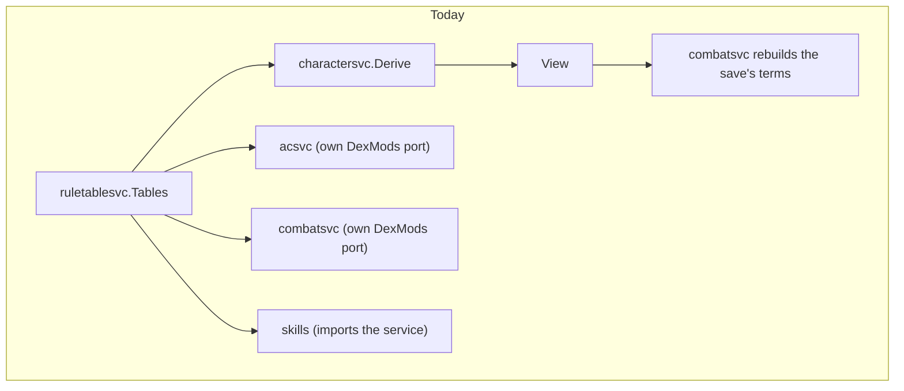

# ADR 0046: Derived figures: one owner each for AC, saves, slots and levels

**Status**: accepted 2026-10-23 (the user accepted every open question's default: "defaults") (design step; the user's goal, 2026-10-21: "a logical rule engine
with locality"; triage 2026-10-22). Shape A below is the chosen shape. Steps 2 (AC), 3 (saves) and 4 (slots) implemented 2026-10-23; the others not. Builds on
[ADR 0045](0045-character-view.md) (the character view) and respects
[ADR 0038](0038-domain-and-wire.md) (no transport tags in the domain). Amends, each on
implementation: [ADR 0002](0002-attack-resolution.md) step 5, [ADR 0006](0006-saving-throws.md)
steps 1 and 9, [ADR 0008](0008-spell-slots-and-long-rest.md) step 9,
[ADR 0030](0030-classes-and-races.md) steps 3 and 6, [ADR 0033](0033-equipment.md) step 10,
[ADR 0037](0037-proficiencies.md) steps 3, 5 and 15 and [ADR 0042](0042-multi-class-and-dual-class.md)
steps 8 and 9 (the index rows are in step 8). Out of scope: code, and the psionic figures (the PSP
maximum, power checks: [ADR 0043](0043-psionics.md) and [ADR 0044](0044-psionic-combat.md)).

## Context

[ADR 0045](0045-character-view.md) gave every service one way to read a character: the view. It did
not say who computes a figure. Four figures are still derived in more than one place, and none of the
places owns the figure's provenance (the table it came from and the terms that make it up), so a rule
change is a hunt. What the code holds today (read 2026-10-23; where the work item's list was
stale, it is said):

**AC.** `acsvc.Derive` already is the one derivation (a pure function of the worn pieces, the buffs
that apply, the powers that are on and the Dexterity adjustment, returning the value and its rows).
The copy is the Dexterity input: `acsvc` declares its own `Tables` port (`DexMods`, PHB Table 2's
defensive column) and `combatsvc.Rules` declares a second `DexMods` for the missile column, two
call sites (`attack_modifiers.go`, `spell_attack.go`). Both read the same table row, each through
its own mock. (The item named only the combat port; acsvc has its own as well.) Nothing else computes
an AC and the web has no AC arithmetic.

**Saves.** The row is read in `ruletablesvc.SavesFor` (Table 60) and the best-of across entries
(`bestCore`), the race's Constitution bonus (`raceSaveBonus`, with `ConSaveBonusFor`), the magical
defence and the class `save_bonus` grants are derived in `charactersvc/derive.go`; they reach services as
`View.Saves`, `RaceSaveBonus`, `MagicDefence`, `ClassSaveBonuses`. The copies are of the *shape*: five
named fields and the switch on a category exist in `charactersvc` (`saveField`), `combatsvc`
(`savesByCategory`, and a `saveCategories` list beside `classes.SaveCategories`) and `characterhdl`
(`savesDTO`), plus the labels in the web. And the roll's target and its named modifiers (race,
Wisdom, class, buffs) are assembled inside `combatsvc.ResolveSavingThrow` from five view fields: a
rule that belongs to the figure, written in the service that rolls. **Stale in the item:**
`spellstats.ParseSave` reads a *spell's* saving-throw text ("Neg.", "1/2"), not a character's save;
it is not a copy and stays.

**Slots.** The word covers four different things; only two are duplicated.
1. *Spell slots per day* (the class progression): derived once in `charactersvc` (`SpellsPerDay`)
   and read from the view by `prepsvc` and `spheresvc`. One owner already. `spellsvc.GetSlots` is
   the stored list (the `used` flags: state), and `prepsvc.SlotsSnapshot` is the log's codec for it;
   neither derives a figure. **Stale in the item.**
2. *Extra slots a spell grants*: `spelleffectsvc.GrantSlots.SlotSplits` enumerates the splits; `castsvc`
   (`grant_slots.go`) validates the chosen split against it and `prepsvc` serves the list. One
   enumeration. `web/src/lib/slotSplit.ts` only words a split the server sent
   (`splitText`), and `castInputs.ts` reads `slot_splits` from the server. **Stale in the item**:
   the web does not recompute them.
3. *Proficiency slots*: the pool formulas (`NonweaponSlots`, `WeaponSlots`, `SlotsGainedAt`,
   `ExtraSlots`) live in `ruletablesvc/proficiencyslots.go`, a *service* package that the `skills`
   *domain* package imports (`picks.go`, `classes.go`, `grants.go`: the layering runs backwards).
   `skills.GrantsAt` (one class) reads `SlotsGainedAt` while `skills.GrantsOf` (several entries) subtracts two
   `FiguresOf` results: two ways to say "what a level grants". `ruletablesvc.ExtraSlots` shares its
   name with the cast's field above and has one production caller.
4. *The `skills.ProficiencySlots` value* (pools, picks, warnings) is the figure and its breakdown;
   `charactersvc` and `skillsvc` reach it through `skills.FiguresOf`. One owner already.

**Levels.** XP to level lives in `classes.Class` (`LevelFor`, `XPThreshold`): `charactersvc.setLevels`,
the creation draft (`create.go`) and `creationrollsvc` call it. The copy is the table path next to it:
`ruletablesvc.Tables.XPThreshold` wraps the same method, and two ports declare it again
(`charactersvc.Rules.XPThreshold`, `xpsvc.Thresholds`) so that `charactersvc`, the creation
draft and `xpsvc.ComputeProgress` read the *next* threshold through the table object rather than
through the entry's class. `BardXPThreshold` is a second, older table read kept for the importer's
tests. "Which entry, which level" is [ADR 0045](0045-character-view.md) step 3 and is not repeated
here.

## Shapes considered

All three keep the rule that a figure is *derived, never entered*, and that a roll endpoint returns
the figure with its breakdown.

**Shape A: one pure domain package per figure, no ports.** A figure's owner is a package of pure
functions over plain input values (the table rows arrive as data, never through a port) returning a
`Figure`: the value and its terms in order. `charactersvc.Derive` and the services call the function; they
do not re-derive. New: `domain/saves` and `domain/slots`. Not new: `acsvc.Derive` stays the
owner of AC (its inputs are the item and buff types of the services; moving it would move the types
and nothing else), and `classes` stays the owner of levels (`Class.LevelFor`, `XPThreshold`). *Depth*:
the interface is one function per figure. *Locality*: the table, the formula and the terms are in
one file; a service test builds the input value, no `Derive`, no mock for the table.

**Shape B: the owner is the existing service, consumers call its port.** `acsvc`, `charactersvc`
(saves, levels) and `skillsvc` (proficiency slots) export the figure as a method and every other
service declares a port to it. *Depth*: the figure sits next to its stored inputs. *Locality*: worse
than today for the services, which gain a port, a mock and a transaction boundary per figure
(combat would call acsvc and a saves port inside its roll), and `skills` still imports a service.

**Shape C: one `figures` package for all four.** One import, one file layout, one test file.
*Locality*: a package named after nothing but "figures" mixes tables of unrelated rules (a save row
and a Table 34 pool), and its imports are the union of its members', so a change in slots recompiles
what reads AC.

| | A: package per figure | B: existing service + port | C: one `figures` package |
|---|---|---|---|
| A consumer depends on | a pure function and its `Figure` | a port and a mock | one big package |
| Table read | in the owner, by data | in the owner, through its tables port | in the owner |
| A service test builds | an input value | a mock of the owner | an input value |
| Layering (domain does not import services) | restored for `skills` | `skills` still inverted | restored |
| New code | two packages | three ports, three mocks | one package, wide |
| Migration | one figure at a time | one figure at a time, more wiring | one figure at a time |

**Recommendation: Shape A**, with AC and levels keeping the owners they already have (step 2 and
step 5). The recommendation is Open question Q1.

## Decision

Test names are written without their `Test` prefix while the test does not exist (the
`check-adr-tests` gate). No class, race or power id in production code (the "no special case per
class" rule, [ADR 0040](0040-classes-are-data.md)). Each step ends green on its own, in the order
below (AC, saves, slots, levels), and cites its number in the code and the commit.

1. **What an owner is.**
   1. A figure's owner is the one package that holds its rule *and* reads its table. No other
      package reads that table row, declares a port for it, or restates the arithmetic.
   2. An owner is pure: inputs in, `Figure` out, no port, no clock, no dice, no store. The table
      rows are values handed to it by the caller that holds the catalogue (`charactersvc`'s `Rules`).
   3. A `Figure` is `{Value, Terms}`: the number and the ordered terms that make it up
      (each term: a code, the source, its value, and `Off` when it is shown but does not add), the shape
      `acsvc.AC` has today. The owner never words a term (the API carries structured data; the web
      words it, [ADR 0023](0023-localized-text.md)).
   4. A consumer reads a figure from the view ([ADR 0045](0045-character-view.md) step 1) when it
      depends on the character alone, and calls the owner's function when it depends on more (AC on
      items and buffs, a save on the buffs and the player's flags).
2. **AC (first).** Owner: `acsvc.Derive`, unchanged (ADR 0033 step 10). Implemented 2026-10-23 (2.1 to 2.3 as written).
   1. *Dexterity reaches `acsvc` and `combatsvc` through the view.* `charactersvc` reads PHB
      Table 2 once in `Derive` and the view carries both columns (`DexMissile`, `DexDefence`). A Dexterity outside the
      table is refused where the table is read, with today's message, so a character whose score is
      outside 1..25 cannot be read at all instead of failing only in the AC and the attack (Q2).
   2. *Removes:* `acsvc.Tables` and `Deps.Tables` (with the `DexMods` call in `Get` and its mock
      and its wiring in the composition root); `combatsvc.Rules.DexMods` and its two call sites; the
      `DexMods` method stays only on `ruletablesvc.Tables`, read by `charactersvc`.
   3. *Tests proving the figure unchanged.* `Derive_Step2_DexterityRowsMatchTheTable` runs every
      score of Table 2 through `acsvc.Derive` with the view-fed adjustment and compares each AC and
      its rows with the pre-change value from a committed table of expected values;
      `Attack_Step2_MissileAdjustmentFromTheView` and `SpellAttack_Step2_MissileAdjustmentFromTheView`
      assert the attack's Dexterity modifier for the same scores; `Derive_Step2_TheDexterityTableIsReadOnce`
      counts one `DexMods` call per derivation (`acsvc` and `combatsvc` have no table to read). The existing
      `acsvc` derive tests and the composition tests run unchanged.
3. **Saves (second).** Owner: a new package `domain/saves`, which takes over from `charactersvc`. Implemented 2026-10-23 (3.1 to 3.5 as amended below; 3.2 amended in place after review):
   1. *The type.* `saves.Saves` (the five numbers) with `Of(category)` and the category list (the
      one list, `classes.SaveCategories` re-exported by the owner as `saves.Categories`), so no package
      re-types the switch. `itemsvc.SaveCategories`, a third copy of the list that the ADR's context
      did not name, folded into it: item validation reads `saves.Categories`. `charactersvc.Saves` becomes an alias for it for one item, then goes.
   2. *The derivation.* The best-of across entries (ADR 0042 step 9), the race's Constitution
      bonus (ADR 0030 step 22.1) and the class `save_bonus` grants (ADR 0043 step 3) are computed by
      `charactersvc.Derive` with the table rows it already holds, and reach `saves` only through
      `saves.Inputs`. The magical defence stays a table read in `charactersvc.Derive`, and so does the
      crossover and dormant-entry filtering (ADR 0042 step 9): it did not move into `saves`. The
      tables stay in `ruletablesvc`; `SavesFor` is called by `charactersvc` only.
   3. *The roll's terms.* `saves.Check(category)` (an unknown category is invalid input, so
      `combatsvc` refuses it before its transaction and rolls nothing), `saves.Target(inputs, category)`
      and `saves.Terms(inputs, category, flags)`
      build the save's target and its ordered named modifiers (race, Wisdom if mind-affecting,
      class bonuses) from the view's `saves.Inputs` (`View.SaveInputs()`, the owner's input, not the step 1.3 `Figure` it returns) and the player's flags; `combatsvc` adds the buffs' contributions it
      reads from `buffsvc`, draws the d20, settles the verdict and records it.
   4. *Removes:* `combatsvc.savesByCategory` and `saveCategories`; `charactersvc.saveField`;
      `characterhdl.savesDTO`'s own copy of the five fields (it never held a switch; it now takes
      `saves.Saves` and maps it field by field);
      the modifier assembly in `ResolveSavingThrow` (the race, Wisdom and class blocks).
   5. *Tests proving the figure unchanged.* `TestSaves_Step3_GoldenRows` computes every group and
      level band for a single class and the best-of for the party's multi-class and dual-class
      fixtures, and compares them with the values the old code gave (a committed table, taken from
      the old code before it is removed); `TestSaves_Step3_RaceBonusPerCategory` for each race trait;
      `TestResolveSavingThrow_Step3_ModifiersInOrder` with dice that give every roll a distinct value and
      exact call counts, asserting the same modifiers, target and verdict as before for a race
      bonus, a mind-affecting save with a class bonus and a buff; the existing `ResolveSavingThrow`
      tests and the web `Saves` rendering run unchanged. The owner's own tests are
      `TestTarget_TheCategorysValue`, `TestTarget_UnknownCategoryRefused`,
      `TestSaves_Step3_TermsWisdomOnlyWhenFlagged` and `TestTerms_ZeroValuesDropped`.
4. **Slots (third).** Owner: a new package `domain/slots`. Implemented 2026-10-23 (4.1 to 4.6 as amended below).
   1. *Proficiency pools* (ADR 0037 step 3). `NonweaponSlots`, `WeaponSlots`, `ExtraSlots` and the
      pool types move from `ruletablesvc/proficiencyslots.go` into `slots`, taking the `SlotRow`
      value (Table 34's row, a plain type) as input; `skills` imports `slots` for them. _(As built: they are named `slots.Nonweapon`, `slots.Weapon`, `slots.Extra` and `slots.Row`;
      only the slot formulas left `skills`' reads of a service package; it still reads the rest of
      `ruletablesvc` (languages, skill points, specialization). `TestSlots_Step4_SkillsReadsNoPoolFromAService`
      pins it: no selector into a service import names a `slots` export or a removed pool name.)_
   2. *What a level grants* (ADR 0037 step 15). One rule: the pools at the entry's new level minus the
      pools at the level below, over the character's entries. `skills.GrantsAt` becomes
      `GrantsOf` over a single entry and `ruletablesvc.SlotsGainedAt` goes. _(As built: `GrantsAt`
      is gone, every caller reads `skills.GrantsOf`; the cited `TestGrantsAt_Step15_GrantsSlotsAndPoints`
      keeps its name and now reads `GrantsOf` for one entry.)_
   3. *Extra slots a spell grants* (ADR 0008 step 9). `GrantSlots.SlotSplits` moves to `slots.Splits(levels)`;
      `GrantSlots` keeps the data and calls it. _(As built: `GrantSlots.SlotSplits()` is a one-line call
      to `slots.Splits`, and `castsvc` and `prepsvc` call that method, so the owner is the only
      code that enumerates splits.)_
   4. *Not moved.* Spell slots per day stay derived in `charactersvc` and reach `prepsvc`/`spheresvc`
      through the view (already one owner); the stored list (`spellsvc`, the `used` flags) is state and
      `SlotsSnapshot` is its codec. The web keeps `slotSplit.ts` (it only words the server's splits).
   5. *Removes:* `ruletablesvc.NonweaponSlots`, `WeaponSlots`, `SlotsGainedAt`, `ExtraSlots` and the
      pool types; `skills.GrantsAt`'s separate path; `spelleffectsvc.GrantSlots.SlotSplits`'s body.
   6. *Tests proving the figure unchanged.* `TestSlots_Step4_PoolsMatchTable34` over every class row and
      level 1..20 and every Intelligence score, against the old values (a committed table);
      `TestSlots_Step4_GrantsAtEqualsGrantsOfForOneEntry` (in `skills`: once `GrantsAt` was gone it
      runs `GrantsOf` alone over the golden committed from the old code, which is unchanged);
      `TestSlots_Step4_SplitsOfThreeLevels` (in `slots`: the cases [1 1 1], [1 2], [3]) with
      `TestSlots_Step4_SplitsMatchGolden`; `TestGrantSlots_SlotSplits` stays in `spelleffectsvc`
      beside it and checks that `GrantSlots` returns the owner's splits; the existing skill-check, picks,
      level-up grant and cast tests run unchanged.
5. **Levels (fourth).** Owner: `classes.Class` (`LevelFor`, `XPThreshold`), unchanged.
   1. *Every level and threshold read goes through the entry's class definition.* The next threshold
      of an entry is a field of the view's entry (`NextLevelXP`, already there), and
      `xpsvc.ComputeProgress` takes the class definition (or the entry from the view), not a table.
   2. *Removes:* `ruletablesvc.Tables.XPThreshold`, `charactersvc.Rules.XPThreshold`,
      `xpsvc.Thresholds` and their mocks; `entryLevel` and `skillsLevel`'s fallbacks are
      [ADR 0045](0045-character-view.md) step 3.2 and 3.7, listed here only so the two ADRs close the
      same copies. `BardXPThreshold` is kept until the importer's tests are moved off it (it reads the
      raw bard column, not a class definition).
   3. *Tests proving the figure unchanged.* `Levels_Step5_ThresholdsEqualTheTable` walks every class
      of the fixture catalogue, levels 1 to the maximum, comparing `LevelFor(XPThreshold(l))` with `l` and
      the old table's value; `Progress_Step5_ReadsTheClassDefinition` asserts `xpsvc`'s floor, ceiling and
      cells equal the old output for the party's fixtures; the existing level-up and creation
      tests run unchanged.
6. **A figure's breakdown reaches the wire without a tag in the domain** ([ADR 0038](0038-domain-and-wire.md)).
   1. The owners (`saves`, `slots`, `acsvc.Derive`, `classes`) have no `json` tag on any type. An
      owner's `Figure` is a domain value.
   2. The wire shape is the transport side's: the AC's `achdl.ToDTO`, the character's block by
      `characterhdl` and `rest/wire` (`ProficiencySlotsToDTO`, a new `SavesDTO` mapping), each one
      mapping function per answer, shared when two endpoints serve the same figure (ADR 0038 step 2).
      A new term is one field on the owner's type, one on the DTO and one on the TypeScript type.
   3. A roll's *stored* breakdown is the exception ADR 0038 step 3 allows and no wider: `combatsvc`'s
      `SaveBreakdown` is the log's payload record (it carries its tags where it is written); it is
      filled from the owner's terms by `combatsvc`, so the tag lives on the record and the owner does not
      see it.
   4. `TestFigures_Step6_OwnersCarryNoTransportTags` parses the sources of `saves` (and, at step 4,
      `slots`) with `go/ast`, since reflection cannot list a package's types, and fails on any struct tag with a `json` key; `achdl`'s and `characterhdl`'s existing mapping
      tests keep the wire shape (the golden JSON of the sheet and of `GET /api/ac`).
7. **How each step proves "unchanged".** Before an old path is removed, a test computes the figure
   through both paths for the same fixtures and compares them; the old path is then removed and
   the test is rewritten against the committed expected values (taken from the old code, committed as
   a table, never a throwaway). Dice mocks give every roll a distinct value and assert the call
   count (the hard rule for rules math). The composition tests over the real services and the memory
   store ([ADR 0045](0045-character-view.md) step 6.2) run unchanged and are the end-to-end proof.
8. **Amendments of earlier ADRs** (written in place on implementation; the index rows are updated in
   this ADR's PR):
   1. [ADR 0033](0033-equipment.md) step 10: the Dexterity row of the AC is read from the view; the
      AC derivation is unchanged.
   2. [ADR 0002](0002-attack-resolution.md) step 5: the missile adjustment is read from the view.
   3. [ADR 0006](0006-saving-throws.md) steps 1 and 9: the target and the roll's modifiers are
      assembled by `saves`; the rules of the steps are unchanged.
   4. [ADR 0030](0030-classes-and-races.md) steps 3 and 6 (and 22.1): levels and the saves are owned
      as in steps 5 and 3 above; [ADR 0042](0042-multi-class-and-dual-class.md) steps 8 and 9
      (best THAC0, best saves): the best-of saves lives in `saves`.
   5. [ADR 0037](0037-proficiencies.md) steps 3, 5 and 15 and [ADR 0008](0008-spell-slots-and-long-rest.md)
      step 9: the pool formulas, the extra-slot count and the split enumeration live in `slots`.
   6. [ADR 0045](0045-character-view.md): the view gains `DexMissile` and `DexDefence` (step 1 of
      this ADR); nothing else of it changes.

## Decided

The user accepted the default of every question on 2026-10-23 ("defaults"); the steps are written
with them. The questions and their reasons:

1. **Q1, the shape of the owners.** Shape A (a pure package per figure; AC and levels keep the
   owners they have), Shape B (the existing services own the figures and the others call a port) or
   Shape C (one `figures` package). Default: Shape A. B adds ports the view was built to remove; C
   makes one package that every rule change recompiles.
2. **Q2, a Dexterity outside Table 2.** Today only the AC and the attack refuse it; once the table
   is read in `Derive`, reading the whole character refuses it. Default: refuse at the read, with
   the same message. Table 2 covers 1 to 25 and creation already bounds the score, so the case
   is unreachable by the API; the alternative is a `DexOK` flag on the view and the old refusals kept.
3. **Q3, `Saves` as a type in its own package, or a method set on the existing one.** Default: its own
   package `saves` (step 3.1), because `combatsvc`, `charactersvc` and `characterhdl` all name the
   type; an alias keeps the move to one item. The alternative is leaving `charactersvc.Saves` where
   it is and adding `Of`.
4. **Q4, who assembles the save roll's terms.** Default: `saves.Terms` (step 3.3), `combatsvc` only adds
   the buffs' contributions, rolls and records. The alternative is to leave the assembly in
   `combatsvc` and move only the type; the race, Wisdom and class rules stay in the roller.
5. **Q5, `ruletablesvc.XPThreshold` and `BardXPThreshold`.** Default: remove the first (step 5.2) and
   keep the second until the importer's tests read the class definition. Removing both in one item
   is possible but moves unrelated importer tests.
6. **Q6, the same pattern for Strength.** `combatsvc.Rules.StrengthMods` is the sibling of the Dexterity
   copy (ADR 0002 step 4). Default: not in this ADR; filed as a follow-up item that applies step 2.1's pattern, with
   the ADR 0002 step 4 amendment.

## Consequences

- A rule change is one package and its table: a save row, a pool formula or a split is edited in the
  owner and its golden test fails in the owner first.
- `skills` stops importing a service package; `acsvc` and `combatsvc` lose a table port and a mock
  each; `combatsvc` no longer holds a rule of the save figure, only the roll.
- Two new packages (`saves`, `slots`) to keep in step with the view and the DTOs: a new term is a
  field on three types (owner, DTO, TypeScript), kept equal by the golden tests and the DTO tests,
  the cost ADR 0038 accepted.
- The migration is four items in the order AC, saves, slots, levels, each small and each ending green
  alone; psionic figures wait for [ADR 0044](0044-psionic-combat.md) to land and then join as a fifth.
- Nothing about storage, the migrations, the catalogue format or any value on the wire changes: the
  figures are the same numbers by the same rules, through fewer paths.
