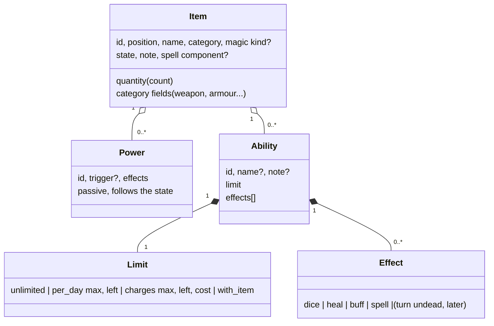

# ADR 0049: Equipment model: items have a quantity, abilities have a usage limit, effects are one domain

**Status**: proposed 2026-11-13 (CRI-360, the first step of the epic CRI-359). The user's triage of
2026-11-13 is quoted in Context and binds; the model's shape is the working shape the triage accepted,
and the points it leaves open are in "Questions for the user", each with a recommended default. Not
implemented. Amends [ADR 0016](0016-inventory.md) (steps 1 to 3, 5 and 9: the behaviour, the count,
the item-level effect dice, what a use is) and [ADR 0033](0033-equipment.md) (step 1: `behaviour` and
`count`; step 1.1: what a spell may spend; step 9: the daily use; step 26: the conversion),
[ADR 0008](0008-spell-slots-and-long-rest.md) (steps 10 and 11) and
[ADR 0035](0035-equipment-screens.md) (item 6.2: which use corrects the initiative), all on
implementation.

## Context

User, 2026-11-13: *"There is a big issue with equipment. All by default have a consume behaviour. It
makes no sense."* Then: *"We fundamentally did a bad job at defining the domain of equipment."*

Today one pair of fields, `behaviour` and `count`, carries three different ideas
([ADR 0016](0016-inventory.md) steps 1 to 3, kept by [ADR 0033](0033-equipment.md) step 1):

- **quantity**: three torches, forty arrows;
- **spendable**: a potion, an arrow, a flask: using one removes one;
- **recharge**: charges that never come back (a wand), a number a day (the Power Gem's dispel).

Every item has them, so a longsword and plate mail are listed in Act · Items with a Use button, as
"Stock · 1". And the things an item can *do* are spread over four places that were never mapped as one
domain: the buff effect kinds ([ADR 0004](0004-buffs.md) step 11), an item's passive powers (ADR 0016
steps 9 to 16), the spell effects ([ADR 0021](0021-spell-catalogue.md), cast by
[ADR 0008](0008-spell-slots-and-long-rest.md)) and the item-level dice that a use rolls and applies
to nothing.

### Decided in triage (user, 2026-11-13)

- A usage limit attaches to **any item** as a trait, not to rings or miscellaneous items only. Example:
  a magical sword with an ability "turn zombies", 2 per day.
- The number of uses per day is **settable**, not just "daily or none".
- An ability's effect comes from the **domain of effects**.
- Working shape, accepted: an item is a category plus a quantity and is **not consumable itself**; an
  **ability** is attachable to any item, with a usage limit (unlimited, N per day, N charges in
  total, or spent together with the item, like a potion) and effects. **Use acts on an ability.**
  Today's passive powers stay passive.
- Weapons, armour and shields are never consumable (CRI-361 ships that rule as a stopgap before this
  model; this record gives it its place).

### What the code does today (read, 2026-11-13)

**Buff effects** (`buffsvc.BuffEffects`, ADR 0004 steps 7 to 12, 18; ADR 0033 steps 11 and 12). One
bag of numbers, used by hand-made buffs, by spell buffs and by item powers alike, each key optional:
`min_str` (a gate on a buff, a trigger on a power), `str_bonus` and `str_max` (the effective STR,
refused on a power), `to_hit`, `damage`, `save_bonus`, `ac` (a signed change of the AC number),
`base_ac` ("an AC of N as if armoured"), `initiative`, `weapon_buff` (the weapon becomes +N, the best
wins), `multiplier` (the weapon's damage dice), `spells_buff` (a factor on spell effects), and the
conditions `weapon_kind` (melee or missile) and `without_magic_armour`. They fold into one aggregate
that feeds every roll (ADR 0004 step 11, ADR 0016 step 11). A buff adds rounds, charges, a spell id and
a note around them; it is timed, can be dismissed, and is logged and voidable (ADR 0004 step 13).

**Item powers** (ADR 0016 steps 9 to 16, ADR 0033 steps 9 and 17). A list on the item: a slug id, an
optional trigger (`min_str`) and a subset of the buff effects (no Strength effect). Passive: on while
the item is worn or wielded and the trigger holds; no counters, nothing to dismiss; shown by the item's
name. The editor writes them; the "+N" of armour is sugar for one power.

**Spell effects** (`spelleffectsvc.Entry`, ADR 0021 and ADR 0008). Per spell: a `kind` (`buff`, `damage`,
`utility`, `heal`), a target, a duration (`rounds`, `instant`, `permanent`, `until_discharged`,
`special`), charges, a save and what a successful one does (`half`, `negates`, `none`, `special`),
damage as parts, by-level rows, steps and instances, modes and exposure, a heal (dice or full), a buff
(formula modifiers, `ability_gain`, `ability_set`, a condition), `grant_slots`, `consume_item` (spends
an item by its component code), `attack_roll`, and end effects (a heal when the row ends by a cause).
Everything that reads a **caster level** (dice per level, duration) has none on an item.

**What using an item does** (`itemsvc.UseItem`, `castsvc/consume_item.go`). A use spends one count
(whatever the category), rolls the item's `effect_dice` (`NdM` or `NdM+K`) if it has some, shows the
save category and the note, writes one `item_use` entry with the item's snapshot, and corrects the
round's initiative for a magic item by its kind (Table 56, ADR 0035 item 6.2). The dice change no hit
point and put no buff on: they are a roll the player reads. A spell's `consume_item` spends a piece of
a component code through the same count change; an attack spends one ammunition the same way. The
long rest refills `daily` items to `max_count` and nothing else (ADR 0016 step 3, ADR 0008 step 11).

### What the books say (restated, cited; no book text)

Rules lookups were done by reading the files through their index (a subagent cannot start the
rules-lookup agent).

- **Charges** (DMG p.153 "Charges", `dmg/app3-magical-item-descriptions/12-race.md`; wands:
  `15-wands.md`; rods: `10-substance.md`; staves: `14-staves.md`). Wands, rods and staves are powered
  by charges and **a use costs one or more charges, depending on the item**. A wand at zero charges
  cannot be recharged and the DM may rule it dust; a rod drained of all charges cannot be recharged
  either; before that, a recharge is possible by the construction rules. Some rods have functions that
  cost no charge; some staves have powers that cost none and are used **once per day** (`14-staves.md`). Some items are limited per day without any charge (`35-armor-and-shields.md`: items used once per
  day, or with a risk when used more often). One item can hold several abilities that draw on one pool
  of charges (the rod of lordly might, `11-saving.md`; the ring of the ram, `08-rings-part-1.md`, whose
  cost grows with the effect chosen).
- **Recharging** (DMG p.88-90, `ch10-treasure-and-magical-items/08-recharging-magical-items.md`): optional,
  risky for the item, not a daily refill: the app treats a recharge as an edit by hand.
- **Table 56** (PHB p.94, `tables/phb-056-optional-modifiers-to-initiative.md`): a magic item's use
  modifies the initiative by its kind (potion +4, ring +3, rod +1, staff +2, wand +3, miscellaneous
  +3; a scroll by its spell). Already built (ADR 0035 item 6.2).
- **Turning undead** (PHB p.103, Table 61, `tables/phb-061-turning-undead.md`; DMG p.67, Table 47):
  a class feature of clerics and paladins; no item rule in the books turns undead by a charge, so the
  user's "turn zombies" sword is a house ability: its effect is a roll or a note, not a book rule.
- **Cursed items** (DMG p.90 "Cursed Items, in Combat", `08-recharging-magical-items.md`; PHB p.90):
  a cursed item acts in combat by its negative numbers (a -1 sword, a shield that attracts missiles)
  and cannot always be put away; the numbers already fit the buff effects (negative `to_hit`, `damage`,
  `ac`, `save_bonus`); the unremovable part is a note.

## Decision

Tests are named by the slice that builds each step (the citation `ADR 0049 step N` in the test's name
or comment); this ADR names none yet. The word for an item is **item** ([ADR 0036](0036-vocabulary.md)
step 5, GLOSSARY): the triage's "piece" is an item. The new concept is the **item ability** (UI:
ability, fr: capacité); "ability" alone keeps meaning an ability score and a class's feature stays a
class feature (see Questions, Q1).



### The item and its quantity

1. **An item is a category and a quantity; it is never consumed by itself.** `behaviour` and `max_count`
   leave the item. Its `count` becomes its **quantity**: how many of it there are, and nothing else.
   Nothing the item *is* (a longsword, plate mail) can be Used. What an item can *do* is an ability
   (step 2) or a power (ADR 0016 step 9, unchanged: passive, follows the state).
2. **Quantity per category.**

   | Category | Quantity means | The player changes it | At 0 |
   |---|---|---|---|
   | `weapon`, `armour`, `shield` | one object: always 1 | no (a stored count above 1 is kept, not edited; the server refuses Use and Restock with 409 `item_not_usable` / `item_not_restockable` and serves `usable: false` on the item, which the web filters and hides controls by) | n/a |
   | `ammunition` | the stock; each attack spends one ([ADR 0002](0002-attack-resolution.md) step 10) | restock (+) and spend one (-) | stays listed |
   | `gear` | the stock (3 torches, 5 flasks of fire) | restock and spend one | stays listed |
   | `magic` potion, scroll | the doses or scrolls; each use of its `with_item` ability spends one | restock and spend one | the item is removed in the same entry (as a `charges` item today); undo puts it back |
   | `magic` ring, rod, staff, wand, misc | one object: 1 | no | n/a |

   A quantity is 0 to 999 (ADR 0016 step 5's maximum). The inventory's minus is **spend one**, a count
   change with no ability, no effect and no initiative (what the minus did with `stock` before): it is
   logged as an `item_use` entry without an `abilityId`, which is also how every entry recorded before
   this ADR reads. Restock stays `item_restock`, 1 to 999, now refused only for the one-object
   categories and for an item holding a `per_day` or `charges` ability (step 4).
3. **A spell spends a component, never a limited item.** ADR 0033 step 1.1 and ADR 0008 step 10 are
   unchanged except the exclusion of "a daily item": a spell spends a quantity of an item whose
   component code matches, and an item with a `per_day` or `charges` ability is never offered (the Power
   Gem has no component anyway).

### The ability

4. **An ability is an item's own trait.** An item has a list of abilities (like its powers, ADR 0016
   step 9). An ability has: an **id** (a slug, unique within the item), an optional **name** (a language
   map, [ADR 0023](0023-localized-text.md); none means the item's own name, usual for an item with one
   ability), an optional **note**, one **usage limit** (step 5) and a list of **effects** (step 12; empty
   is allowed: a use that spends the limit and shows the note, "turn zombies" until its effect is
   modelled). Any category may carry abilities: a sword with "turn zombies", a rope with "climb".
   An item may carry a `per_day` or `charges` ability only when its quantity is 1 (one counter per
   object: two wands are two items); an ability limited `with_item` needs a quantity. Abilities are
   stored with the item and part of its `items:<id>` snapshot (ADR 0016 step 15's rule), written by the
   editor, and part of `item_edit`.
5. **The usage limit.** Four kinds, all settable:

   | Limit | Fields | One use costs | When there is none left | Long rest |
   |---|---|---|---|---|
   | `unlimited` | none | nothing | never | n/a |
   | `per_day` | `max` 1 to 99, `left` | 1 of `left` | refused (409, `exhausted`) until the long rest | `left` back to `max` |
   | `charges` | `max` 1 to 100 (the total it holds), `left`, `cost` 1 to `max` (default 1) | `cost` of `left` | refused when `left` is below `cost`; the item stays listed at 0 and is removed by hand | nothing |
   | `with_item` | none (the item's quantity) | 1 of the quantity | refused at quantity 0 (409, `exhausted`); a potion or scroll is gone at 0 (step 2) | nothing |

   `max` and `left` are stored on the ability; the stored `left` never exceeds `max`. A `charges`
   ability is never recharged by the app: a recharge is an edit of `left` by hand (DMG p.88-90, the
   books make it optional and risky), and **`charges` items stay listed at 0** instead of being
   removed, as the DMG leaves a spent wand to the DM (Q2). **What "a day" is:** the long rest, as
   today ([ADR 0005](0005-rounds-and-time.md) step 7: passing time refills nothing).
   Mermaid, the states of a `per_day` ability:

   ```mermaid
   stateDiagram-v2
     [*] --> Ready: left = max
     Ready --> Ready: Use (left - 1, left > 1)
     Ready --> Exhausted: Use (left = 0)
     Exhausted --> Ready: long rest
     Ready --> Ready: long rest
     Exhausted --> Exhausted: Use refused (409)
   ```
6. **The long rest refills `per_day` abilities of every item.** It is the same transaction as the slots
   ([ADR 0008](0008-spell-slots-and-long-rest.md) step 11, whose "per-day items" read "per-day
   abilities"): one logged entry with the items' snapshots; `charges` and `with_item` are untouched;
   a failure in either part changes nothing. Amends ADR 0016 step 3.
7. **Use acts on an ability.** `POST /api/items/{id}/abilities/{abilityId}/use`. In one transaction
   ([ADR 0018](0018-transactions-and-undo.md)): the limit is paid first (a refusal changes nothing);
   then the effects run in list order (step 13); then the item's snapshot and the effects' own snapshots
   are written with one `item_use` entry; then the round's initiative is corrected (step 15). Undo pops
   the entry and restores the counters and everything the effects wrote (an HP change, a buff). The
   entry (add fields, never rename, as `useRecord`): `{itemId, abilityId, name, limit, left, max,
   effects: [{kind, dice, rolls, modifier, total, save, applied}], notes}`, where `applied` says what
   changed (HP delta, buff name, spell id). An item or ability that does not exist, or an ability that
   is exhausted, is refused with a code (404, 409 `exhausted`). An item with no ability has nothing to
   Use: there is no use of "the item" (the old `POST /api/items/{id}/use` goes with step 22).
   Use does **not** depend on the item's state: an ability works carried, worn or wielded, as ADR 0033
   step 9 already says of a daily use (and the user's *"the dispel magic once a day is available
   regardless"*); the screen tags an unequipped item (step 17).
8. **Powers stay passive and stay separate.** ADR 0016 steps 9 to 16 and ADR 0033 steps 9 and 17 are
   unchanged. A power is an always-on effect set with no limit and no Use; an ability is used and may
   put effects on. The two are not merged now (a power is an ability with an "always on" limit, which is
   a reading, not a need); the two share the effect vocabulary of step 12, so a later merge changes the
   storage, not the rules.

### The effects domain

9. **One vocabulary, four consumers.** An *effect* is something that changes a number or the state of
   the character; the app has four ways to apply one, and this step maps them. Each row says what exists
   today and what an item ability does with it.

   | Effect family | Today | In an item ability |
   |---|---|---|
   | **Modifier on rolls** (`to_hit`, `damage`, `save_bonus`, `ac`, `base_ac`, `initiative`, `weapon_buff`, `multiplier`, `spells_buff`; conditions `weapon_kind`, `without_magic_armour`) | the buff aggregate: from buffs and from powers | **`buff`**: Use puts a timed buff on the list (step 12), the aggregate folds it as any buff. A modifier that is on *while the item is worn* stays a **power** (a ring of protection, magic armour): not an ability |
   | **Strength** (`str_bonus`, `str_max`) | buffs only; refused on a power so a trigger cannot read its own effect | allowed in a `buff` effect (a potion of Strength is a buff); refused on a power, unchanged |
   | **Dice rolled and shown** (an item's `effect_dice`, its save; a spell's damage dice) | item-level dice on the item, rolled by a use and applied to nothing | **`dice`**: the effect keeps `NdM`, `NdM+K`, an optional save category and an optional label; rolled, logged and shown, applied to nothing (the app tracks no monster's hit points) |
   | **Hit points regained** (a spell's `heal`, end effects) | `castsvc` heals through the HP ledger ([ADR 0007](0007-hp-ledger.md)); an item's dice never do | **`heal`**: `dice` or `full`; applied to the character through the HP ledger in the use's transaction (a potion of healing) |
   | **A spell's own effect** (damage, buff, heal, utility, slots, spend an item, attack roll) | `castsvc`, keyed by the spell catalogue id, using a caster level | **`spell`**: `{spellId, level}`; Use runs that spell's effect entry at the fixed level, with no slot and no preparation (a wand of a spell, a staff, a scroll). One entry of the catalogue stays the one source: no second copy of spell data on the item |
   | **Spell-like utility with no number** (dispel magic, turn zombies, a text) | a note on the item (the Power Gem's dispel) | no effect at all: an ability with the limit, the note and an empty `effects` list. The use is logged, the limit paid, nothing computed |
   | **Item spent as a component** (`consume_item`) | `castsvc` | unchanged (step 3); not an ability effect |
   | **Ammunition spent by an attack** | `combatsvc` | unchanged (ADR 0002 step 10): the attack spends a quantity, never an ability |
   | **Initiative term for an item used** (Table 56) | `itemsvc.correctInitiative` | unchanged rule, now fired by an ability's use (step 15) |
   | **Class features** (turning, backstab) and **psionic powers** | classes and psionics, [ADR 0040](0040-classes-are-data.md) and [ADR 0043](0043-psionics.md) | out of the item domain; an item that does a class feature's thing is an ability whose effect is a note until a `turn_undead` effect exists (gap G3) |

10. **The effects an ability can hold (the closed list).** `dice`, `heal`, `buff` and `spell`, plus the
    empty list. Adding a kind is an amendment of this step. Validation (400, `{error, field, code}`):
    dice are `NdM` or `NdM+K` as ADR 0016 step 5; a `heal` is `dice` or `full` and not both; a `buff`
    carries a name defaulting to the ability's (or the item's), a number of rounds (0 is untimed, as
    ADR 0004 step 2) and **effects from the buff effects of ADR 0004 step 11** with ADR 0004's rules (a
    Strength effect allowed here); a `spell` names a spell the catalogue knows (`unknown`) and a level 1
    to 30 (the caster level the item casts at: DMG items state theirs). A `spell` whose entry asks the
    player for something (an AC, a split, a component) is asked at Use, like a cast.
11. **Mapping the PHB and DMG items onto it, with the gaps named.**

    | Need | Source | Model | Gap and plan |
    |---|---|---|---|
    | Potion of healing, extra healing | DMG potions | quantity, `with_item`, `heal` | none once `heal` exists (slice 7) |
    | Potion of heroism, speed, giant strength, invisibility | DMG potions | `with_item`, `buff` with rounds | none once `buff` exists (slice 8) |
    | Scroll of one spell | ADR 0033 step 2 (`spellId`) | `with_item`, `spell` | the scroll's `spellId` moves into the effect (slice 9) |
    | Wand of fireball, staff of curing, rod of... | DMG wands, rods, staves | one `charges` ability per function (a staff of curing: `spell` cure light wounds, `per_day` or `charges`) | **G1**, below |
    | Rod / staff powers that cost no charge, or once a day | DMG staves, rods | an `unlimited` or `per_day` ability next to a `charges` one | none |
    | Wand of lightning today (6d6, a save, 4 charges) | the seed | `charges` 4, `cost` 1, `dice` 6d6 with its save | none |
    | Ring of protection, cloak of protection, bracers of defense | DMG p.148-149, 162-164 | a **power** (ADR 0033 step 17's templates), unchanged | none |
    | Armour and shield "+N", a weapon's "+N" | ADR 0033 steps 5 and 17, ADR 0002 | unchanged | none |
    | Protection scrolls, potion of protection | DMG p.146 | `with_item`, `buff` (`ac`, `save_bonus`) | none once `buff` exists |
    | Spell-like at will or a number a day (rod of ...) | DMG | `unlimited` or `per_day` with `spell` | none once `spell` exists |
    | Turn undead style (the user's sword, a holy item) | house rule | `per_day` N, empty effects or `dice`; a note says what it turns | **G3**, below |
    | Curses (-1 sword, shield attracting missiles, cannot be put away) | DMG p.90 | negative numbers fit a power or a `buff`; the "cannot be removed" is a note | **G4**, below |
    | Charges drawn by several functions from one pool, a cost that depends on the effect chosen (ring of the ram, rod of lordly might) | DMG p.153 | one `charges` ability per function, each with its own counter and a fixed `cost` | **G1**, below |
    | Recharge, a wand turned to dust at 0 | DMG p.88-90, 153 | an edit of `left` by hand; the DM's dust ruling is the player's `remove` | none (Q2) |
    | Intelligent weapons, ego, command words, artifact and relic powers | DMG | not modelled | out of scope, as ADR 0016 Consequences |
    | Item identification, weight, cost | DMG | not modelled | out of scope, as ADR 0016 Consequences |

    **G1, a shared pool of charges and a cost the player picks.** The one-ability-one-counter model
    cannot say "the rod has 41 charges and its three functions draw 1, 2 and 3". Plan: later add an
    optional `pool` id to a `charges` limit so abilities of one item share one counter, and a `cost`
    list the Use asks for; until then, the player sets one ability per function and keeps them in step by
    hand. Not built by this record's slices.
    **G2, a variable amount per use** (the ring of the ram: 1, 2 or 3 charges for a stronger blow):
    the same answer as G1.
    **G3, turning.** No effect rolls the Turning table for an item. Plan: a `turn_undead` effect
    `{level}` reading the class feature's table ([ADR 0040](0040-classes-are-data.md) step 3) at the
    ability's level, built after this record's slices; until then the ability is a limit and a note.
    **G4, curses and "cannot be put away".** Plan: a flag `cursed` on the item (a warning tag, never a
    refusal, as ADR 0033 step 20), its numbers as negative effects; no slice yet.
12. **Effect application, in order.** Within one use, effects run in list order inside one transaction;
    a `buff` goes through `buffsvc` (the same entry kind and snapshots as a cast or a hand-made buff,
    ADR 0004 steps 6 and 13, so a same-name buff is renewed), a `heal` through the HP ledger, a `spell`
    through `castsvc`'s effect path, a `dice` through the dice port. The item's own entry carries the
    result of each; the effects' snapshots ride the same transaction, so one undo pops them all. A
    failure in any effect rolls the use back, the limit included. `itemsvc` does not import `castsvc`:
    the use reaches the three through ports wired in the composition root, as the aggregate reads
    powers through an items port (ADR 0016 step 11).
13. **The item-level effect dice and save are gone.** `effect_dice` and `effect_save` leave the item;
    they live in a `dice` effect (step 9). The item form's "Dice rolled on use" and "Save against the
    effect" fields move to the ability form.

### What Act · Items lists, and how Use works in the round

14. **Act · Items lists abilities, not items.** One row per ability of every item that has some, in the
    item list order: the item's name (and the ability's when it has one), the limit as the player reads
    it (`∞`, `1 / 2 par jour`, `3 / 10 charges`, `× 3` for `with_item`), the item's state as a tag
    when it is not equipped and could be ([ADR 0035](0035-equipment-screens.md) item 3), and **Use**
    (en: Use, fr: Utiliser). An exhausted ability stays listed, its button disabled, with the reason as
    text ("épuisé jusqu'au repos long"). An item with no ability, ammunition and every weapon, armour
    and shield without an ability are never listed (CRI-310's acceptance, CRI-361's stopgap becomes this
    rule). If nothing is listed, a worded empty state points to Inventory (en and fr). The server serves
    for each item `canUse` per ability (`usable`, and `reason` when not) so the web re-derives nothing.
15. **Use in the round and the initiative.** Use is one action at the table, free of any declaration
    (ADR 0035 item 5: no declaration), at any time; the app orders nothing (ADR 0013). In combat, using
    an ability corrects the round's initiative as ADR 0035 item 6.2 does for an item used, as the last
    entry of the use's transaction: by the item's **magic kind** (Table 56: potion +4, ring +3, rod +1,
    staff +2, wand +3, miscellaneous +3), a scroll by its spell's casting time, and an item of any other
    category (the sword's "turn zombies", a rope) by the `misc` row, +3 (Q3). An item with no Table 56
    data (a catalogue before format 7) corrects nothing, as today. Out of combat nothing changes. A
    `spell` effect on a non-scroll uses the item's kind row, not the spell's casting time (a wand is
    +3 whatever it casts: Table 56 prices the device).
16. **The inventory.** The Use button leaves the Inventory (and with it the old `isCounted` guess): a
    row shows the quantity control by the table of step 2, the abilities as chips with their limit, and
    the editor's **Abilities** section (add, edit, remove an ability: limit kind and numbers, effects
    dice, heal, buff, spell; Q4 for how much of it is built first). The editor's "How it is used"
    behaviour field is gone; the form shows "Quantity" where the category has one (step 2).
17. **An unequipped item with an ability** is listed with a muted "not equipped" tag and its Use stays
    enabled (step 7).

### Migration

18. **Storage: additive first, then a contract.** (ADR 0024 step 5.2: a release's migrations are
    additive.) A migration adds `items.abilities` (JSON text, **NULL** for every existing row: not
    converted yet; `[]` means converted with none). `behaviour`, `max_count`, `effect_dice`,
    `effect_save` and `count` stay as stored and keep the old meaning until a later contract migration
    (slice 10) drops what nothing reads. The conversion is a **boot step on rows with NULL `abilities`**
    (the CRI-34 precedent, ADR 0033 step 26: migrations hold no data, ADR 0025 step 2.1.1; a data step
    cannot be used here because it runs on the schema before its migration, without the new column),
    in one transaction, idempotent, and it logs how many rows it converted and how many went on the
    review list.
19. **The conversion function is one pure function.** `legacy item -> {quantity, abilities, review
    reason}`; the boot step, the snapshot restorer (step 20) and the seed loader use the same one.

    | Today | Becomes |
    |---|---|
    | `stock`, no effect dice (arrows, rope, torches, rations) | quantity = `count`, no ability |
    | `stock` with effect dice (Fire flasks, 5d6, 5) | quantity = `count`; one ability `with_item` with a `dice` effect (dice, save) |
    | `stock`, category potion or scroll, no dice | quantity = `count`; one ability `with_item`, no effect (its note says what it does); a scroll keeps its `spellId` |
    | `charges` with dice (Wand of lightning, 4) | quantity 1; one ability `charges`, `max` = `left` = `count`, `cost` 1, a `dice` effect |
    | `charges`, no dice (a wand without a rule, a potion of one dose) | a potion or scroll: quantity = `count`, `with_item`, as above; any other kind: `charges`, `max` = `left` = `count`, no effect |
    | `daily` N (Power Gem's dispel, 1) | quantity 1; one ability `per_day`, `max` = `max_count`, `left` = `count`, the dice effect if any; the Power Gem's keeps its note and is **named** "Dispel Magic" ("Dissipation de la magie") by the conversion of the seed row `power_gem_dispel`, as ADR 0016 step 16's migration named the item |
    | a weapon, armour or shield, any behaviour | quantity = `count` as stored (shown, not edited); an ability only if it was `charges` or `daily` or had dice, and each such item goes on the review list ("a weapon with a use") |
    | a quantity above 1 on a one-object category (ring, rod, staff, wand, misc) | kept as stored; on the review list |
    | ammunition with any behaviour other than `stock` | as stock; on the review list |

    The ability's id is `use` (`use_2`... when several), its name empty (the item's name shows) except
    the Power Gem's. **What cannot be known:** a `charges` item's original total (only what is left
    survives); the conversion sets `max` to `left`, and the player corrects it in the editor.
    The ADR 0033 step 27 review list takes the new reasons (codes) and its band words them.
20. **History keeps working.** `items:<id>` snapshots recorded before this ADR have no `abilities`
    key. Popping one runs the same conversion function on the snapshot's old fields (as ADR 0016 step
    15 did for a snapshot without powers), so undoing an old use of the Power Gem's dispel gives it
    back as an ability at `left` 0 or 1, and undoing an old removal of a `charges` item brings it back
    as a `charges` ability. Old `item_use` and `item_restock` entries stay decodable (no `abilityId`:
    a spend). Payloads are never rewritten.
21. **Switch-over for the user's existing local data** (the developer's one database, `just dev`):
    1. `just stop` (the database's data is kept). Back it up before the first start of the new
       release: a `pg_dump` of the compose database, a file kept outside the repo (the rollback below
       restores it).
    2. Merge the release's branch and run `just dev`. The migration adds the column and the boot step
       converts the rows (the log line states `converted N, review M`); nothing else is needed, and
       nothing is asked.
    3. Open the Inventory: an amber band "M possessions à vérifier" lists what the conversion could not
       settle (ADR 0033 step 27's band): weapons with a use, quantities above 1 on one-object items,
       the `charges` items whose total is now the count left. Set the totals, or dismiss.
    4. Check the Power Gem: its ability "Dispel Magic", 1 a day, still at the left it had (used today
       stays used) and its thunder hammer still on at STR 18.
    5. Act · Items now lists only abilities: the longsword, plate mail and shield are gone from it; the
       Fire flasks and the Wand of lightning stay, as one ability each.
    6. **Rollback**: stop, restore the dump, run the previous release. Until the contract migration the
       old columns are untouched by the conversion, so the previous release also still runs on the
       migrated database; what it writes after is not seen by the converted rows (the reason to
       restore the dump, not just to switch back).
    No manual SQL, no `just dev-reset`: the database is migrated in place.
22. **The old use is retired in one release.** `POST /api/items/{id}/use` answers the spend-one
    behaviour only for an item without an ability and no effect dice (the minus of the inventory) until
    the web has moved (slice 5 and 6); then it goes, and `behaviour` leaves the wire. The web types
    follow the wire in the same change as each endpoint change (workflow doc: wire contract).

### Catalogue and seeds

23. **The seed is in the new shape.** `seeds/items.json` (for a new database) writes the quantity and
    abilities directly; the old keys are read by the conversion only. No catalogue change: the DMG
    magic items are not catalogue data (ADR 0033 step 22), and the abilities of an item picked from a
    catalogue row (a weapon, an armour) start empty.

## Questions for the user

Each has a recommended default; the record takes the default as written unless the user says otherwise.

- **Q1. The word.** The triage says "ability"; the glossary already has "ability score" and "class
  feature" (an ability a class grants), and "power" is the psionic word. Recommend: **item ability**
  in the glossary and code (`ItemAbility`), "ability" / "capacité" in the UI, "item power" kept for the
  passive ones.
- **Q2. A charged item at 0.** Today it is removed; the record keeps it listed at 0 (the DMG leaves a
  spent wand to the DM). Recommend: keep it listed, removable by hand.
- **Q3. An ability of a sword, a rope or armour and Table 56.** The table prices magic item kinds only.
  Recommend: the `misc` row (+3) for any non-magic category. Alternative: no initiative correction.
- **Q4. How much of the editor.** Recommend: the first editor builds the limit and the `dice` effect
  and the note; `heal`, `buff` and `spell` come with their slices.
- **Q5. A stack of thrown weapons** (darts, javelins). CRI-361 says a weapon has no quantity; the PHB's
  darts are bought by the dozen. Recommend: a hurled weapon's count is not tracked (as today the
  attack spends no weapon); an archer's ammunition is the stock.

## Implementation slices

Each is one change (one PR), listed with what it depends on. The scoper files them after this record
is accepted. CRI-361 (no Use, count or behaviour for weapons, armour and shields) ships first and
independently: it is today's field rule, and slice 3's "no ability, no Use" subsumes it. CRI-310
(Act · Items lists only what can be used) is slice 5.

1. **The ability on the item.** `abilities` column, the Ability and Limit types, validation (steps 4,
   5, 10 for the first three effect kinds: none, `dice`), the wire read and write, the snapshot and the
   editor's `item_edit`. No behaviour change. Needs nothing.
   *Built.* How it reads the steps: an item's `abilities` is `nil` (NULL, not converted) or a list, and
   a body or patch that sends none leaves the column as it is; the wire omits the key for NULL and
   serves `[]` for converted-with-none, so a client written before this slice sees no change. The
   ability's name is a language map stored inside the JSON list (as the snapshots already hold names),
   its note and a dice effect's label are plain typed text. "A `with_item` ability needs a quantity" is
   read as: refused on a piece whose quantity is no stock (a weapon, armour, shield, ring, rod, staff,
   wand or misc item); `per_day` and `charges` are refused above a count of 1 (a one-object piece
   spent to 0 keeps its ability and stays editable). The list is bounded (20 abilities, 10 effects an
   ability, 100 characters a name per language and a label, 2000 a note) because it is copied into
   every snapshot and log entry. A snapshot with no `abilities` key (every one written before this
   slice, and one of an unconverted item) restores the item as not converted, not as "keep the
   current" as powers do; step 20's conversion of old snapshots is slice 2, and its boot conversion
   must go through `keepCurrent` or an undo of an old entry would strip the converted abilities.
   A stored row reads with unknown keys ignored (a rollback past a later slice still reads it); the
   wire stays strict. **Amends ADR 0023 step 2** for this data: the ability's name is a language map
   stored inside the item's JSON, not a keyed row, as snapshots already inline an item's name; keyed
   rows would need a lifecycle and garbage collection under undo. Revisit if catalogue abilities appear.
2. **The conversion.** The pure function, the boot step, the review reasons, the snapshot restorer for
   old shapes, the seed in the new shape, the Power Gem's name (steps 18 to 20, 23). Needs 1.
   *Built, with these rulings* (user, 2026-11-13, after the conversion was found unbuildable as step 19
   reads it, since the only column is `count`):
   - **What slice 2 converts: the abilities only.** The boot step writes `items.abilities` and the review
     rows; `count`, `behaviour`, `max_count`, `effect_dice` and `effect_save` stay exactly as stored, so
     steps 18 and 21.6 hold (the previous release still runs on the migrated database) and the Power
     Gem's `left` is its stored count. The pure function `ConvertLegacy` still returns the **quantity**
     step 19 gives (1 for a charged or daily item), tested per row, but nothing writes it to `count` yet.
   - **What it leaves to slice 3: applying the quantity to `count`, and the Use cut-over.** Until Use acts
     on abilities, the old Use moves `count` and an ability's `left` goes stale; slice 3 must, in one
     change, make `left` the counter (reading it from the converted ability, equal to `count` at
     conversion), set `count` to the quantity for the one-object items (a charged or daily item's count
     becomes 1) and stop reading `behaviour`, `max_count` and `effect_*`. Slices 2 and 3 should merge
     close together; a use between them is the only way the two counters diverge.
   - **The validator follows:** the `per_day`/`charges` "quantity 1 at most" refusal applies only to the
     abilities a request adds or changes, or to a request that changes the count, never to a stored item
     (a converted wand keeps its count of 4, the record's "kept, not edited"), so a converted item stays
     editable: a rename passes, a count edit to more than 1 is refused.
   - **Out-of-range values are clamped, and flagged:** a charges total above `MaxCharges` (100) or a daily
     number above `MaxPerDay` (99), or a daily count above its max, is brought down and the item is on
     the review list as `limit_clamped`. The boot step checks every converted list as the editor would
     (`Converted.Check`) and stops, naming the row, rather than store a list the editor refuses (the
     transaction leaves every row as it was); the restorer leaves such a snapshot item unconverted.
   - **Names are data, not a branch:** the Power Gem's "Dispel Magic" comes from the abilities of the
     seed row of the same item id (the seed character's), lent to an unnamed ability of the same ability
     id by `NamedFrom`, in the boot step and when a snapshot is popped. No item id is in the code.
   - **A weapon, armour or shield that was stock with dice** gets an `unlimited` ability with the dice
     effect (a `with_item` limit needs a stock, step 4); the same for a one-object magic item. It is on
     the review list as `weapon_with_use`. The other reasons: `quantity_above_one`, `charges_total`,
     `ammo_not_stock`, `limit_clamped` (codes the Inventory's band words).
   - **The seed** reads both shapes: an entry with `abilities` is the new shape (`quantity`, default 1;
     the old columns derived by `MirrorLegacy`, for the previous release); one without is converted by
     `ConvertLegacy`, as the boot step does. `seeds/items.json` is in the new shape.
   - **The restorer:** a snapshot with no `abilities` key is converted by `ConvertLegacy` on its old
     fields when its item is written back (step 20), going through `keepCurrent`, so an undo neither leaves
     the item unconverted nor strips the abilities of the stored item (its names are kept by ability id).
     One whose conversion gives no ability is written back as the snapshot had it (NULL when it had no
     list), which the next boot converts to the same empty list.
   - The log line at each start: `items converted to abilities converted=N review=M`; zero rows, zero lines
     of change.
3. **Use of an ability.** The endpoint, the limit payment, the `dice` effect, the logged entry and its
   undo, the long rest refill, spend-one for the inventory's minus, `usable` and `reason` on the wire,
   the initiative correction for an ability (steps 5 to 7, 15). Needs 2.
   *Built.* How it reads the steps (the cut-over slice 2 left to this one, in one change):
   - **Use acts on an ability** (step 7): `POST /api/items/{id}/abilities/{abilityId}/use`. The limit is
     paid first, by kind (per_day one of `left`, charges `cost` of `left`, with_item one of the quantity
     by an atomic decrement, unlimited nothing; a potion or a scroll spent to 0 is removed in the same
     entry); then the effects, in list order, each `dice` rolling once per die; then one `item_use` entry
     with the whole item's snapshot before and after (so undo and redo restore the counter, or put the
     removed potion back); then the initiative (step 15). A refusal is 404 `item_not_found` or
     `ability_not_found`, 409 `exhausted` (a `charges` ability whose `left` is below its `cost` too), and
     changes nothing. The entry adds `abilityId`, `abilityName`, `limit`, `left`, `max` and `effects` and
     keeps the flat fields the journal words (`dice`, `rolls`, `total`, `save` from the first dice
     effect, `remaining` the counter or quantity, `maxCount` the max); `applied` comes with the first
     effect that applies something (slice 7), a dice effect applies nothing.
   - **Per ability, the server serves `usable` and `reason`** (`exhausted`, step 14); the item's own
     `usable` is now "has a stock the player moves" (ammunition, gear, potion, scroll), so a wand, a gem
     or a sword is `usable: false` as an item: the web hides the minus and plus by it, and the use of its
     abilities is the ability's own flag.
   - **Spend one** (step 2): `POST /api/items/{id}/use` keeps its path and becomes the inventory's minus
     for any item with a stock, **whatever abilities it holds** (the Fire flasks' minus spends a flask and
     rolls nothing). **This amends step 22**, which read "only for an item without an ability and no
     effect dice": the supervisor's ruling (2026-11-13) keeps the Fire flasks' minus working, so the
     old use is "never acts on an ability", the one count change of step 2. It refuses (409 `item_not_usable`) an item with no stock or
     holding a per_day or charges ability. It logs an `item_use` entry with no `abilityId`, corrects no
     initiative, and a potion or scroll at 0 is removed in the same entry. **Until Act · Items and the
     Inventory move (slices 5 and 6) the web's Use button on a wand, a gem or a sword finds nothing to
     call**: those items are `usable: false`, so the Act · Items tab no longer lists them; slices 3 and 5
     should merge together.
   - **The cut-over:** the counter is `left` (per_day, charges) and the quantity is `count` (stock). The
     boot step sets `count` to 1 for every converted item holding a per_day or charges ability (the
     ability's `left` keeps what the count was at conversion; it also covers the rows slice 2 converted:
     what a use between the two releases did to the old count is not read back), logs `quantities=N`
     with its line, and writes nothing on a second start. The editor cannot have made such an item with a
     quantity above 1 (it refuses a per_day or charges ability on a quantity above 1, and a count edit to
     more than 1 on one), so the only quantities the step discards are the old counters of the
     conversion itself. **After this release, an older release reads such an item with count 1** (a wand
     of 4 charges is one charge, a gem 1 use): the boot step is not reversible, and the rollback past
     slice 3 is the dump restore, not a switch back to the previous release.
   - **A use is atomic through the writer lock** (ADR 0025 step 4): every write transaction, `UseAbility`
     and the editor's save, the rest and the undo included, takes the one writer lock first, so a second
     use of a one-left ability waits, reads the result and is refused (409 `exhausted`), and a use and an
     editor save of the same item run one after the other: neither whole-item write is lost. Tested on
     the in-memory store (same contract) and proved on PostgreSQL with concurrent requests. `behaviour`, `max_count`, `effect_dice` and
     `effect_save` are read by no use, rest or restock rule any more (the editor and the wire still carry
     them until slice 6 and the contract); the seed writes `count` = the quantity. `Removed` is the rule
     of step 2 (a potion or a scroll at 0), not the old `charges` behaviour; a restock needs a stock
     and no per_day or charges ability; a spell never spends an item with such an ability (step 3).
   - **The long rest** (step 6): every `per_day` ability back to `max`, in the rest's transaction; the
     entry's snapshot of each changed item is the whole item (an old rest entry, a count-only snapshot,
     popped now writes its count into the ability's `left`).
   - **Old entries** (step 20): a count-only snapshot popped on an item whose counter is an ability's
     writes the count into that ability's `left` (clamped to its `max`) and leaves the quantity; a
     whole-item snapshot without the `abilities` key is converted, and its `count` becomes the
     conversion's quantity. Nothing in the log is rewritten.
   - **Initiative** (step 15): an ability's use corrects it with the item's magic kind row, a scroll by
     its spell, any other category by the `misc` row (Q3); not table math of the rules engine, a lookup
     in Table 56 by the existing corrector.
4. **Quantity by category.** Restock and spend rules by category, removal at 0 for a potion or scroll,
   `per_day` and `charges` needing a quantity of 1, a spell spends a component (steps 2 and 3). Needs
   2. (The server part of CRI-361 is done by then.)
   *Built.* Slice 3 already carried the category rules, the removal at 0 and the per_day/charges
   refusals; this slice adds what was left and one test per row of step 2's table
   (`quantity_test.go`): a quantity is 0 to 999 (`MaxQuantity`; the editor's count was 9999), and a
   restock that would build more than 999 is refused (400 `invalid_input`) before any write. The daily
   number (`maxCount`, legacy) keeps its own bound until slice 10.
5. **Act · Items lists abilities.** The rows, the limit text, the empty state, the Use call and the
   result card (steps 14 and 17). Needs 3. Closes CRI-310.
   *Built.* The web lists `abilities` of every non-ammunition item and reads `usable` and `reason` from the
   server; the reason is worded by the limit kind (per day, charges, with the item). The use call is the
   ability endpoint; its answer becomes the result card in the shape of a logged `item_use` entry, which
   draws every dice effect. An unlimited ability words no "(N left)" in the journal and shows no left
   line on the card.
6. **Inventory and editor.** Quantity by category, no Use and no `isCounted` guess, abilities as chips,
   the Abilities section for the limit, the `dice` effect and the note, the behaviour field removed
   (steps 13 and 16). Needs 1 and 4; its Use-free rows can ship before 5.
7. **The `heal` effect.** Applied through the HP ledger in the use's transaction, with the editor
   field (step 9, 12). Needs 3 and 6.
8. **The `buff` effect.** A timed buff through `buffsvc`, with the editor field and the buff's
   effects (steps 9, 10, 12). Needs 3 and 6.
9. **The `spell` effect.** A port from itemsvc to castsvc's effect path at a fixed level, the asks at
   Use, the scroll's `spellId` folded into it, the editor's spell picker (steps 9, 10, 12). Needs 3, 6
   and the inversion of the dependency between `itemsvc` and `castsvc` (a port in the composition
   root); the largest slice.
10. **The contract.** Drop `behaviour`, `max_count`, `effect_dice`, `effect_save` and the old reads,
    retire the old use endpoint and the `behaviour` wire field, delete the legacy half of the
    snapshot restorer once no environment holds an old entry that needs it, amend ADR 0016, 0033, 0008
    and 0035 "as built", the glossary and `docs/domain-model.md` (steps 18, 22). Needs 1 to 6 released
    everywhere (local, staging and production databases converted).

Not scheduled, named so they are not lost: **G1/G2** a shared pool and a cost the player picks,
**G3** a `turn_undead` effect, **G4** the `cursed` flag.

## Consequences

- A weapon, armour or shield offers no Use because it has no ability, not because a guess hides the
  button; the rule is in the data and the same for any category.
- The model is bigger: an item has a quantity, powers and abilities. A power is one ability's cousin
  kept apart on purpose (step 8).
- An ability's effects are four closed kinds; a spell-like item is a `spell` effect, so the catalogue
  stays the one source for spell numbers and the item stores a reference, like a scroll's `spellId`.
- The first slices ship the limit, the dice and the note, which is what the Power Gem, the Fire flasks
  and the Wand of lightning need; the user's "turn zombies" is a `per_day` ability with a note from
  slice 3, and gains a rolled effect when G3 is decided.
- A `charges` item no longer disappears at 0: a change the player may notice (Q2). Using a `charges`
  ability costs `cost`, not always 1.
- Not covered: shared pools and variable costs (G1, G2), a turning effect (G3), curses (G4), recharge
  by the construction rules, item identification, weight, cost, intelligent weapons, artifacts, and
  merging powers with abilities.
