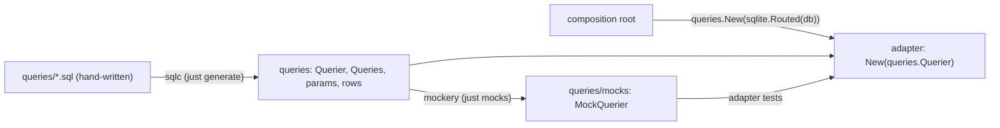

# Critical — Backend Context (Go Agents)

## Stack

- **Language**: Go (latest stable)
- **HTTP**: standard `net/http` or `chi` router
- **Database**: SQLite via `modernc.org/sqlite` (pure Go, no CGO). `sqlite.Open` sets `busy_timeout=5000` on every pooled connection and `journal_mode=WAL` for file-backed DBs (WAL adds `-wal`/`-shm` files beside the DB). It also sets `_txlock=immediate`: every transaction (`WrapTx`/`InTx`) begins with `BEGIN IMMEDIATE` and takes the write lock up front. A deferred read-then-write transaction (the action stack's expected-top check, then its pop) would otherwise fail at once with `SQLITE_BUSY_SNAPSHOT` (a 500) when another writer commits in between; with the lock taken first the second writer waits, then sees the first one's result and is refused as a normal 409. Write paths must go through a transaction, never read-then-write on the bare pool.
- **Migrations**: simple sequential SQL files, applied at startup and recorded in `schema_migrations`
  ("Migrations at startup" below)
- **Seed loader**: reads `seeds/*.json` at startup if corresponding table is empty; spells come from the
  catalogue artifact instead ("Spell catalogue" below)

## Project Structure (api/)

```
api/
  main.go               ← HTTP server, router, startup
  internal/
    db/
      db.go             ← SQLite open, migrate, seed
      migrations/       ← 001_init.sql, 002_hp_ledger.sql, etc.
    domain/
      character.go      ← Character struct, attributes
      hp.go             ← HpEvent struct, ledger logic
      combat.go         ← RollResult, attack/damage resolution
      buff.go           ← BuffEffect struct, charge/duration logic
      spell.go          ← SpellSlot, Spell structs
    handlers/
      hp.go             ← HTTP handlers for /api/hp/*
      combat.go         ← HTTP handlers for /api/roll/*
      buffs.go          ← HTTP handlers for /api/buffs/*
      spells.go         ← HTTP handlers for /api/spells/*
      round.go          ← HTTP handler for /api/round/advance
    engine/
      dice.go           ← All dice rolling (seeded RNG for tests)
      combat.go         ← attack and damage resolution
      buffs.go          ← Buff application, expiry detection
```

## SQLite Data Model

**Hybrid model:** core scalars as columns, complex variable-length state as JSON columns.

### Normalized tables (core scalars)
```sql
-- characters: one row for the Bard
id, name, str, dex, con, int, wis, cha,
hp_max, thac0_base, level, xp_total

-- action_log: THE append-only log of table actions (HP ledger + combat log)
id, character_id, round, kind TEXT, summary TEXT, hp_delta INTEGER, payload JSON, created_at,
transaction_id
-- (transaction_id: the id of the first entry of the request that recorded it, ADR 0018 step 1;
--  undo pops a transaction whole. Rows older than the column are each their own transaction)
-- action_snapshots: before/after state an entry changed, one row per state key
id, action_id, state_key, before_state JSON, after_state JSON
-- action_corrections: audited amend/void events pointing at an entry (never edit an entry)
id, action_id, kind ('amend'|'void'), hp_delta, summary, payload JSON, note, step_id, created_at
-- (step_id: the 'correction' entry a post-roll correction belongs to, ADR 0010 step 6; popping
--  that entry puts the amend out of effect. NULL on older amends, which stay in effect)
-- (each amend field, when set, replaces the entry's: latest amend that set it wins; the log's
--  amend now sets only note, post-roll adjustments set the payload)
-- summary holds only text the player typed (an HP change's source); every other entry is a
-- structured payload the UI words in the player's language (older rows keep an English summary)

-- hp_events: legacy HP ledger, carried into action_log by migration 007; no longer written

-- xp_entries: the XP ledger, outside the action log (edited and deleted in place, ADR 0015);
-- the total is characters.xp_total plus every entry (base + 10% when bonus)
id, character_id, entry_date TEXT, session TEXT, reason TEXT, base INTEGER, bonus INTEGER (0/1)

-- proficiencies, bard_skills: the skill catalog (ADR 0014), reconciled by id with seeds/skills.json
-- at startup; a check is an action_log entry (skill_check), nothing is stored here
id TEXT, position, ability TEXT ('str'..'cha'), modifier INTEGER
id TEXT, position, percent INTEGER (0-100)

-- dice_favourites: the composer's saved formulas, per character, in normal form (unique per character)
id, character_id, formula TEXT
```

### Dice composer (dicesvc)

`POST /api/roll/dice {formula}` rolls a free formula through the dice port and records a `dice` action
log entry (payload `{formula, groups, modifier, total}`, no snapshot: undo only pops it). `dice` is
deliberately not a roll kind (`actionlog.RollKinds`): a stray composer roll neither replaces the result
card nor ends the correction window of the latest save or attack (ADR 0006 step 6). Favourites:
`GET|POST /api/dice/favourites`, `PUT /api/dice/favourites/order` (body `{"ids":[…]}`, the full order: every favourite id once, else 400 on `ids`; answers the list), `DELETE /api/dice/favourites/{id}` (answers the remaining list).

Grammar (`dicesvc.Parse`, not `pkg/formula`, which serves spell effects): terms joined by `+` or `-`, each
`NdM`, `dM`, `d%` (a d100) or an integer constant; spaces ignored, `d` case-insensitive. At least one
die. Limits: formula up to 200 characters, 1 to 100 dice per term and 100 in total, 2 to 1000 sides,
constants adding up to at most 10000 (in absolute value), 50 favourites. A violation is a 400 with a
`formula` field error. The answer's `formula` is the normal form (same dice merged in order of first
appearance, one trailing constant, `d%` for 100 sides, no count for one die), which is also what a
favourite stores. Out of scope: keep-highest, advantage, named rolls.

### JSON column tables (complex state)
```sql
-- active_buffs: JSON array of BuffEffect objects
id, character_id, buffs JSON

-- spell_slots: JSON object of slots by level
id, character_id, slots JSON

-- round_state: current round counter and its initiative (d10, the log entry that rolled it; NULL: none)
id, character_id, round_number INTEGER

-- attack_forms: the attack form's last choices, one row per character (no row: the defaults)
character_id, weapon_id, previous_weapon_id, ammo_item_id, target_ac, target_size,
situational_value, situational_label
```

**Recording actions.** A service that changes state records an `actionlog.NewEntry` through the
action log's `Record` inside the same `domain.TxRunner.InTx` as its state write (the runner is
`actionlogsvc.Transactions(db)`, built once in the composition root: every entry recorded in one
outermost `InTx` is one transaction, popped by one undo, ADR 0018), with
`Snapshots` of the state it changed (a `before` and an `after` JSON per state key). It registers an
`actionlog.Restorer` for its state key on the action log in the composition root, so voiding
(popping) the entry restores the "before" state; a service exposes its restorers (for example
`buffSvc.Restorers()`) for the composition root to register. A state key `family:id` (for example
`items:arrows_plus3`) is restored by the Restorer of its family. A snapshot of state that other
services also write (the slot list, the buffs) is produced by one helper of the owning service
(`prepsvc.SlotsSnapshot`, `buffsvc.Add`) so every writer encodes it the same way.

What each service records, and the rules it follows, are in the ADRs ([index](adr/README.md)).

## Migrations at startup

`sqlite.Migrate` (run by the composition root before the server listens) applies every embedded
`api/internal/storage/sqlite/migrations/*.sql` file not yet recorded in `schema_migrations`, each in
its own transaction. Migrations are new files only: never rename, edit or delete an applied one.

Before applying anything it refuses a database that records a migration the binary does not embed
([ADR 0024](adr/0024-deployment.md) step 6.2): the server exits with
`migrate: database records migrations this binary does not embed: <names>; …`. An older binary
does not undo a newer schema, so it must not run on one. In production this is a rollback across a
migration without the snapshot restore (ADR 0024 steps 6.1 and 9.3).

In development it happens when `.dev/critical.db` was migrated by a branch that added a migration
and you then run a branch that does not have it (e.g. `main` before that PR merged). To get past it:
- go back to (or merge `main` into) a branch that embeds the named migrations; or
- in a worktree, or for fixture data only, `just dev-reset` and restart `just dev` (deletes
  `.dev/*.db`). Never in the main checkout: its `.dev/critical.db` is the user's real campaign data; or
- keep a copy of the database before trying a migration branch and restore it afterwards.

Never delete the rows from `schema_migrations` to get past the check: the schema would still be the
newer one.

## DAL code generation

The DAL adapters in `api/internal/adapters/*dal/` run hand-written SQL through generated Go code.
Two generators coexist while the adapters move to sqlc ([ADR 0025](adr/0025-postgresql-storage.md)
step 5): **sqlc** for `critdal`, `dicedal`, `hpdal`, `skilldal` and `xpdal`, **bob** for the others
until their port. `just generate` runs both. Generated files are committed and never edited by hand;
the CI `generated` job reruns `just generate` and `just mocks` and fails on any difference.

### sqlc (ported adapters)

Every ported adapter has a `queries` package generated by sqlc (`emit_interface: true`), with a
`Querier` interface, and a mockery mock of it in `queries/mocks`:



- **Wiring.** The adapter's constructor takes its package's `queries.Querier`. The composition root
  passes `queries.New(sqlite.Routed(db))`: `Routed` runs each statement on the transaction the
  statement's context carries (`InTx`), else on the pool, the same routing as `sqlite.Conn`.
- **Tests.** An adapter test builds the adapter on `mocks.NewMockQuerier(t)` and asserts which
  `Querier` methods are called, with which params, in which order where it matters (`mock.InOrder`),
  and how rows and errors map to domain values (`sql.ErrNoRows` -> the domain's not-found error, zero
  rows affected -> not found). No database, no SQL text ([ADR 0025](adr/0025-postgresql-storage.md)
  step 6). What only the SQL decides (an `ORDER BY`, a `CHECK` or `UNIQUE` constraint) is checked by
  sqlc at generate time and by running the app (step 7), not by these tests.
- **Config.** `api/sqlc.yaml`: one `sql` entry per adapter (`queries:` and `out:` both its
  `queries` directory, package `queries`), engine `sqlite` until the engine switch.
  `omit_unused_structs` keeps each package to the tables its queries use.
- **Schema.** sqlc reads `api/tmp_schema.sql`, which `just generate` dumps (`sqlite3 .schema`) from a
  temp database built by applying every migration, then deletes. sqlc's SQLite parser rejects some
  data-copy statements of the old migrations, so it never reads the migration files directly. The
  file is not a dotfile on purpose: sqlc skips hidden schema files.

**Adding a query** to a ported adapter:
1. Add it to the adapter's `queries/*.sql` with a sqlc header, `-- name: <GoName> :one|:many|:exec|:execrows`,
   and `?` placeholders (sqlc names the params after their columns).
2. `just generate`, then `just mocks` (the `Querier` interface changed).
3. Call it from the adapter through `d.q`, and test the call on the mock.

**Porting an adapter** from bob: move its query file to the sqlc header syntax and delete its
`*.bob.*` files; add an entry to `api/sqlc.yaml` and remove its directory from `api/bobgen.yaml`; add its
`queries` package to `.mockery.yaml` (interface `Querier`, dir `queries/mocks`); make its constructor
take `queries.Querier` and wire `queries.New(sqlite.Routed(db))` in the composition root; rewrite its
tests on the mock; `just generate`, `just mocks`. A renamed or deleted test cited by an ADR is
updated in that ADR (`just check-adr-tests`).

**Constraints and conventions.**
- `:execrows` returns the rows affected: use it for an update or delete whose caller needs to know
  whether the row existed, instead of `RETURNING id`.
- A `:one` query with no row returns `sql.ErrNoRows`; the adapter maps it to its domain error (or to a
  default, as `dicedal` does for the first position).
- Aggregates (`SUM`, `COUNT`) are named queries like the others.
- On the SQLite engine, `INTEGER` is `int64`, `REAL` `float64`, `TEXT` `string`; a 0/1 flag column
  stays `int64` and the adapter converts it.
- sqlc is a `tool` in `api/go.mod` (`go tool sqlc`); it builds with cgo (its PostgreSQL parser), so
  `just generate` needs a C compiler, as well as the `sqlite3` CLI.

### bob (adapters not yet ported)

The remaining adapters use [bob](https://github.com/stephenafamo/bob) for typed SQL queries. This
section goes away when the last of them is ported (ADR 0025 step 5.4).

### When to regenerate

Regenerate whenever:
- A migration is added or changed (new table/column)
- A `.sql` query file under `api/internal/adapters/*/queries/` is added or changed
- The bob or sqlc version in `api/go.mod` is bumped

### How to regenerate

```bash
just generate
```

This recipe (defined in `justfile`):
1. Applies all migrations in `api/internal/storage/sqlite/migrations/` to a temp SQLite DB (`.tmp_schema.db`)
2. Dumps its schema to `tmp_schema.sql` and runs `sqlc generate` (section above)
3. Runs `bobgen-sqlite -c bobgen.yaml` to regenerate Go wrappers
4. Deletes the temp DB and schema dump
5. Runs `go mod tidy`

### Dependency bumps

Dependabot (`.github/dependabot.yml`) opens one grouped minor/patch PR per week for each of Go modules (`api/go.mod`, including the `tool` directives: golangci-lint, mockery, bobgen-sqlite, sqlc, air), npm, GitHub Actions and Docker base images. bob (v0) and sqlc are excluded from the Go group: their bumps arrive as their own PR, are never auto-merged, and change the generated output (sqlc writes its version into every generated file).

When a bump's `generated code is up to date` CI job fails (bob, sqlc or mockery changed their output), check out the Dependabot branch, run `just generate` and `just mocks`, and commit the regenerated files on it; then `just validate`. Never hand-edit generated files.

### Layout

| Path | Contents |
|------|----------|
| `api/bobgen.yaml` | Generator config: DSN, query dirs, output destinations |
| `api/internal/storage/sqlite/bob/models/` | ORM models for all tables (generated) |
| `api/internal/storage/sqlite/bob/factory/` | Test factories (generated) |
| `api/internal/adapters/*/queries/*.sql` | Hand-written SQL query sources |
| `api/internal/adapters/*/queries/*.bob.go` | Generated typed Go query wrappers |
| `api/sqlc.yaml` | sqlc config of the ported adapters (section above) |
| `api/internal/adapters/*/queries/{db,models,querier}.go`, `*.sql.go` | sqlc output of a ported adapter |
| `api/internal/adapters/*/queries/mocks/` | mockery mock of a ported adapter's `Querier` |

### Key constraints

- `SUM()`, `COUNT()`, and other aggregates are **not supported** by bob's static parser — keep those as raw `d.q.QueryRowContext(...)` calls in the DAL.
- LIMIT parameters generate as `string` — pass `strconv.Itoa(n)` from the DAL.
- `DATETIME` columns require an inline type annotation in the `.sql` file: `created_at /*:time.Time:notnull*/`
- The `sqlite.BobExec` wrapper in `api/internal/storage/sqlite/bob_exec.go` bridges `sqlite.Querier` (returns `*sql.Rows`) to `bob.Executor` (expects `scan.Rows`)

<!-- br-agent-instructions-v1 -->

## Key Go Structs

```go
type HpEvent struct {
    ID          int64
    CharacterID int64
    Delta       int
    Source      string // "goblin arrow", "cure light wounds", etc.
    CreatedAt   time.Time
}

type BuffEffect struct {
    ID       string // uuid
    Name     string
    Charges  int
    Duration int
    Effects  BuffEffects // pointers: nil = no contribution
}

type RollResult struct {
    D20Roll         int
    D100CritRoll    int
    IsCrit          bool
    CritMultiplier  float64
    CritPlaceholder bool
    BaseThac0       int
    Modifiers       []Modifier // {kind, detail, value}: every to-hit modifier
    EffectiveThac0  int
    TargetACNeeded  int
    Hit             bool
    HitMargin       int
    // Damage breakdown (populated if hit)
    BaseDamage      int
    DamageDice      string
    SpellsBuff      float64
    WeaponBuff      int
    Multipliers     float64
    DiceMultiplier  float64
    StrengthBonus   int
    BonusDamage     int
    DamageTerms     []DamageTerm // {term, kind, detail, value}: every damage contribution
    UnroundedDamage float64      // before the final floor; the UI lays out the formula
    TotalDamage     int
    // Attack context: weapon, target AC/size, ammo spent + remaining, log entry id
}
```

## Seed Loader Pattern

At startup, for each seed file (character, weapons, items: only into an empty table; skills: reconciled
by id):
```go
// Check if table is empty, if so load from seeds/
var count int
db.QueryRow("SELECT COUNT(*) FROM weapons").Scan(&count)
if count == 0 {
    loadSeedsFromFile("seeds/weapons.json", db)
}
```

## Spell catalogue

Spells are not seeds: they come from the versioned catalogue artifact built in the private rulebooks repo
([ADR 0021](adr/0021-spell-catalogue.md)). The public repo never holds it.

- **Getting it**: `just catalogue` clones or fast-forwards the rulebooks repo (`just rulebooks`) and copies
  its `dist/catalogue.json` (at `CATALOGUE_REF`, default the checked-out branch) to the gitignored
  `.catalogue/catalogue.json`. Never part of `just validate`.
- **Config**: `CRITICAL_CATALOGUE`, default `.catalogue/catalogue.json`; a relative path is resolved against
  the repo root (the nearest directory above the working directory with a `.git` entry; outside a checkout,
  against the working directory). A missing file stops the API with a message naming the path and
  `just catalogue`.
- **Formats**: the API reads format 3 only (spells and the PHB rule tables, ADR 0021 step 9); any other,
  the retired format 1 included, is refused, naming it and `just catalogue`. See "Rule tables" below.
- **Without access**: `api/testdata/catalogue.json` is a small fixture, format 3, with invented text
  (every spell the `api/testdata/seeds` spellbook and spell effects use, some with French, one list, one
  table) and the PHB's real rule-table numbers (ADR 0021 step 9.7). Go tests and the e2e suite always use it; `just dev` uses it, with `api/testdata/seeds` and its
  own database `.dev/fixture.db`, when `.catalogue/catalogue.json` is absent (the campaign seeds refer to
  spells only the real artifact holds). `.dev/critical.db` is only ever opened with the real catalogue.
- **Seed checks**: the spellbook and every `spell_effects.json` id are checked against the catalogue at
  startup; an id it does not hold refuses the start.
- **Import** (`catalogueadpt` reads and validates against the embedded copy of
  `schemas/catalogue.schema.json`, kept identical by a test; `sqlite.ImportCatalogue` imports): same
  version as recorded in `catalogue_meta` → only the typed `stats` of rows whose stored English stat texts
  the current parser reads differently are rewritten (none when the parser is unchanged); otherwise one transaction keys old rows (first
  import on a database seeded before the catalogue: `spellsvc.Keys`, verified against the artifact),
  upserts every spell by `spells.key`, deletes the spells the artifact dropped unless the seeds or the game
  state (slots, undo snapshots, log payloads) refer to them, and records the version. Each step and its test
  are in ADR 0021 step 5.
- **Columns**: `spells.key` (the artifact id, unique; NULL on older duplicate rows, never served), `class`,
  `level`, `source`, the typed `stats` JSON, and ten text columns (`name`, `description`, `school`, `sphere`,
  the six raw stat texts) that hold a **key into `localized_texts`**, not text
  ([ADR 0023](adr/0023-localized-text.md), migration 031).
- **Localized text**: `localized_texts (text_id, lang, body)`, primary key `(text_id, lang)`, one row per
  language present; English is the `en` row and the fallback. A text column is NULL (a text in no language,
  such as a Wizard spell's sphere) or keys at least one row; an absent language has no row, never an empty
  body. The importer keeps a spell's text keys across imports, writes only the rows that changed, deletes the
  row of a language the artifact dropped (and the key of a text it dropped), deletes a removed spell's texts
  with it, and gives a new text one more than the highest key. In Go a text is `localized.Text` (a map from
  language code to body, `domain/localized`); the rules code and the stats parser read `Default()`, the
  books' English. No column, field, JSON key or TS property is ever named for a language.
- **Reading**: `spelldal.Search` reads only the texts a search filters and ranks on (name, school, sphere) in
  one batched lookup by key through the primary key (`TestTextsQuery_SearchesThePrimaryKey` asserts the plan
  never scans `localized_texts`); the service ranks the query against the names in every language, cuts the
  page, then reads the page's full texts with one `Details` call.
- **REST**: every text field of a spell payload (`name`, `description`, `school`, `sphere`, the six stat
  texts) is a language map, `{"en": "…", "fr": "…"}`, holding only the languages the catalogue has (`{}` for
  a text in none); `GET /api/spells/names` is `[{id, name: {en, fr?}}]`. The client picks its language and
  falls back to English per field; there is no `lang` parameter. Descriptions are in the catalogue's Markdown
  subset (paragraphs, `- ` lists, pipe tables).
- **Checking a live database**: `CRITICAL_UPGRADE_CHECK_DB=<path to .db> go test -count=1 -run
  TestRealCatalogue_UpgradesACopyOfALiveDatabase ./internal/seedcheck` (from `api/`, with the real
  artifact fetched) imports the catalogue into a copy of that database and checks every reference resolves.
  The database is only read.

## Production image

One container serves everything ([ADR 0024](adr/0024-deployment.md) step 1): the Go binary answers
`/api/*` and serves the built web app. There is no nginx.

- **Build**: the root `Dockerfile`, from the repo root, in stages: the web build (`npm ci`, `npm run build`),
  the Go build (`CGO_ENABLED=0`, on the `golang` tag of the Go version in `api/go.mod`: the build fails when
  they differ), and an Alpine runtime running as the non-root user `critical`, with a `HEALTHCHECK` on
  `/api/health`. `.dockerignore` keeps `.catalogue/`, `.dev/`, databases and any `catalogue.json` (at any
  depth), `.git`, `.beads`, `docs/`, `node_modules`, test results and `api/testdata` out of the default
  build context.
- **Build inputs**: the named build context `catalogue` (a directory holding `catalogue.json`) and the build
  argument `COMMIT`. Without the `catalogue` context the build stops with a message naming the flag. PR and CI
  builds and `just image` pass the fixture (`--build-context catalogue=api/testdata`); only the release
  build and the local `docker compose` pass the real catalogue, and it never enters the public repo, a PR
  build or a shared cache (step 7). `just image` also smoke-checks the result.
- **In the image**: `/app/critical-srv`, the web build in `/app/web`, the campaign `seeds/` in `/app/seeds`,
  the catalogue at `/app/catalogue.json`, and the database at `/data/critical.db` (a volume). The `CRITICAL_*`
  variables point at those paths; any of them can be overridden at `docker run`.
- **`CRITICAL_WEB_DIR`** (optional): the web build to serve. Set, every path outside `/api` is the file of
  that path, or `index.html` when there is none (SPA fallback, so a deep link reloads into the app); files
  under `assets/` (content-hashed by Vite) are sent with `Cache-Control: public, max-age=31536000,
  immutable`, everything else with `no-cache`; only GET and HEAD are served. A directory without
  `index.html` stops the server at boot. Unset (as in `just dev`, where Vite serves the app), nothing is
  served outside `/api`. Either way an unknown path that is not served is the JSON 404
  (`{"error": "not found: /api/nope", "code": "not_found"}`).
- **`/api/health`**: `{"status": "ok", "commit": "<sha>"}`. The image build sets the commit with
  `-ldflags -X …/internal/cmd/api.commit=$COMMIT`; any other build reports `unknown`. The release name is not
  in the image (ADR 0024, consequences): the GitHub Release maps a tag to its commit.
- **Smoke check**: `scripts/image-smoke.sh <image> <commit>` runs the image on the fixture seeds (the fixture
  catalogue knows only their spells) and checks health with the commit, `/` and a deep link returning
  `index.html`, the JSON 404 on `/api/nope`, a non-root user and the `HEALTHCHECK`. The CI `image` job builds
  the image with the fixture and runs it on every PR and on main; nothing is pushed.
- **On fly.io**: configuration in `deploy/fly.*.toml`, operator commands in [deploy.md](deploy.md).
- **Locally**: `docker compose up --build` builds the image with the real `.catalogue/` (fetch it with
  `just catalogue` first) and serves the app on http://localhost:8888, the database in the `critical-data`
  volume.

## Rule tables

The AD&D 2e Player's Handbook lookup tables: Table 1 (Strength: hit and damage adjustments, including
18/01-18/00), Table 2 (Dexterity: reaction, missile attack and defensive adjustments), Table 32 (Bard
spells per day by level 1-20) and Table 25 (`bard_experience`: the XP that reaches each level 1-20,
Thief/Bard column). They come from the catalogue artifact's `rule_tables`
([ADR 0021](adr/0021-spell-catalogue.md) step 9); `seeds/` holds none (format 1, which took them from
`seeds/rule_tables.json`, is retired, step 9.6.3). The fixture `api/testdata/catalogue.json` carries the
same numbers.

They are not loaded into SQLite: at every start (whatever catalogue version the database recorded) the
`ruletablesadpt` parser reads them (a gap or overlap in a table is a startup error naming the table) into
`ruletablesvc.Tables`, which implements `ruletablesvc.Lookup`:
`StrengthMods(str, exceptional) (hit, dmg)`, `DexMods(dex) (missile, ac)` and
`BardSpellsPerDay(level) map[spellLevel]count`; `Tables` also has `BardXPThreshold(level)` (the
XP ledger's port). `exceptional` is the 18/xx percentile (1-99, 100 for
18/00). Values are returned as printed in the tables. The tests check
values against the PHB pages, not against the data; a test keeps the fixture's numbers equal to the real
artifact's (by lookup; skipped without `.catalogue/catalogue.json`).

## Seeding the character

`seeds/character.json` (the campaign Bard) only loads into an empty `characters` table. To pick up
an edited seed in the dev database: stop `just dev`, run `just dev-reset` (deletes `.dev/critical.db` and `.dev/fixture.db`),
and start `just dev` again. This discards all dev state (HP ledger, buffs, action log).

## Testing Conventions

- Go tests never open a database: ports and sqlc `Querier`s are mocked, and tests assert the
  operations called and their arguments, never SQL text ([ADR 0025](adr/0025-postgresql-storage.md)
  steps 6 and 7). Tests that still build a temporary SQLite database are being rewritten.
- Use table-driven tests
- Dice engine accepts a seeded `rand.Source` for deterministic tests
- Test the domain/engine layer directly — do not test HTTP handlers for game logic
- Test breakdown struct accuracy: every modifier must appear in the result
- Use `testify/assert` for assertions

## Panicking Helpers

Use `pkg/must` (`must.Do(formula.Parse("3+level"))`) instead of per-package
`MustX` functions. Panicking is allowed only in tests and in package-level
initialisation from literals; anything fed by users, files or the network returns
its error.
