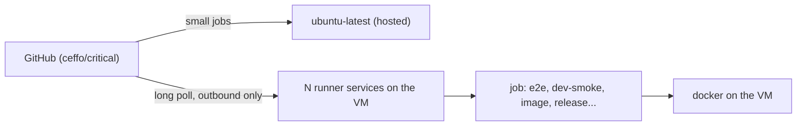

# CI runner

The heavy and privileged jobs run on self-hosted GitHub Actions runners (`runs-on: [self-hosted, critical]`), VM
instances on the owner's own hardware; the small jobs run on GitHub-hosted `ubuntu-latest`. Standard GitHub-hosted
runners are free in a public repository ([GitHub billing docs, "Actions billing"](https://docs.github.com/en/billing/concepts/product-billing/github-actions)),
so the hosted jobs cost nothing. The Actions budget did run out on 2026-11-11 (the heavy CodeQL and CI load that
day), which is why everything moved here; with only the small jobs hosted that stops mattering. If a hosted job
ever queues or fails for billing, check Settings → Billing first. [agent-workflow.md](agent-workflow.md)
("CI and PRs") describes the jobs themselves.

| Where | Jobs | Why |
|---|---|---|
| GitHub-hosted `ubuntu-latest` | `changes`, `validate`, `generated`, `pr-title`, Dependabot auto-merge | Small, parallel-friendly, no queue (about 2 s start, against minutes behind the runners); a fork's code never runs on the VM anyway |
| Self-hosted runners (`critical`) | `e2e`, `dev-smoke`, `image`, release, promote, major, main catch-up | Chromium's system packages are preinstalled (no per-run apt), docker is there, and release/promote hold the environment secrets and deploy key |

Queueing was the whole PR-latency regression when every job shared one runner (median wait 4 min, p90 15-20 min,
CRI-333); keeping the cheap jobs off it, and running several runner instances, brings it back.



## The machine

A Linux VM with docker (and the compose and buildx plugins), Go, Node, `just` and Playwright's Chromium system
packages, running one or more runner services registered with the label `critical`. Its specifics (host, address,
logins, sizing, rebuild commands) are in the owner's private homelab notes, not in this repository.

The e2e suite takes about 5 minutes there (budget in [ADR 0048](adr/0048-e2e-runs-on-ui-and-api-paths.md)).
One runner service runs one job at a time; GitHub gives a queued job to any idle runner with the label, so
several services on the VM (named per runner, see below) run several jobs at once. Jobs on the VM are
safe side by side: e2e and dev-smoke use free ports and throwaway compose projects, the image job tags and removes
`critical:ci-<run id>-<attempt>`, and the Playwright browser download is serialized with `flock` on
`~/.cache/ms-playwright.lock`. A cancelled run (a newer push) can be killed before its cleanup trap, leaking its docker
network; about 30 leaks exhaust the daemon's address pools and every `docker network create` then fails with "all predefined
address pools have been fully subnetted". `dev-smoke` and `image` therefore start with `scripts/ci-docker-sweep.sh`,
which removes smoke containers and networks older than an hour (never a running job's). If it ever recurs, run
`docker network prune -f` on the VM by hand, and consider `"default-address-pools": [{"base":"10.200.0.0/16","size":24}]`
in `/etc/docker/daemon.json` (254 networks). Each runner has its own `_work` directory; Go and npm caches under `$HOME` are
safe to share. If e2e slows down with several jobs at once, give the VM more cores and memory.

## Fork pull requests never run here

The repository is public, so anyone can open a pull request, and a job runs the PR's code on this machine.
Two guards, both required:

1. Repository setting **Settings → Actions → General → Fork pull request workflows from outside
   collaborators → Require approval for all outside collaborators**.
2. The jobs started by `pull_request` (`ci.yml`, `pr-title.yml`) carry
   `github.event.pull_request.head.repo.full_name == github.repository`; a fork's run skips them. Release,
   promote, major and the catch-up start only from this repository's own events (`push`, `workflow_run`,
   `workflow_dispatch`, `schedule`); the Dependabot job (`pull_request_target`) checks out nothing from the PR.

The runner is persistent: a job leaves files and Docker images behind, and the release jobs run on it with
the staging and production environment secrets. Keep the VM single-purpose and never register it on another
repository.

## Setting up a runner

Generic steps; the machine-specific ones live in the private notes.

1. **VM**: a recent Ubuntu LTS server with about 4 vCPU, 8 GB RAM, a few GB of swap and 40 GB of disk, a
   non-root user for the runner (below, `<runner user>`), starting on boot.
2. **Tools** (as `<runner user>`, `sudo` for the installs):
   - apt: `ca-certificates curl git jq build-essential postgresql-client xvfb docker.io docker-buildx docker-compose-v2 unzip
     gh shellcheck python3`; `sudo usermod -aG docker <runner user>`.
   - Go: the version in `api/go.mod`, from `https://go.dev/dl/`, unpacked in `/usr/local/go`.
   - Node: the current LTS (NodeSource `setup_lts.x`, then `apt install nodejs`).
   - just: the release in `.github/actions/setup-just/action.yml` (binary into `/usr/local/bin`).
   - Playwright: in a scratch directory, `sudo npx playwright@<version in web/package-lock.json> install-deps
     chromium`, then `npx playwright@<version> install chromium` as `<runner user>` (browsers land in
     `~/.cache/ms-playwright`). When Playwright's version moves, the e2e job downloads the new browser by
     itself; only a change of its system packages needs `install-deps` again.
     (`scripts/ci-install-chromium-deps.sh` is the retrying installer the hosted runners needed; CI no longer calls it.)
3. **Runner**: download the latest `actions-runner-linux-x64` release from
   `https://github.com/actions/runner/releases` into `~/actions-runner`, then in the repository's
   **Settings → Actions → Runners → New self-hosted runner** copy the registration token (it expires in an
   hour; never put it in a file, a commit or an issue) and run
   `./config.sh --unattended --url https://github.com/ceffo/critical --token <token> --name <runner name>
   --labels critical --replace`. Put the Go directories on `PATH` in `~/actions-runner/.env` (the service does
   not read the shell profile), then `sudo ./svc.sh install <runner user>` and `sudo ./svc.sh start`.
4. **Check**: the runner shows Idle in the repository's runner list; reboot the VM and see it come back;
   open a pull request and see CI run on it. To check the machine alone, copy the repository to it and run
   `just validate`, `just e2e` and `just dev-smoke`.

### More runner instances (parallel jobs)

Needs the user: a registration token per runner (Settings → Actions → Runners → New self-hosted runner; it expires
in an hour; never put it in a file, a commit or an issue). On the VM, as `<runner user>`, for `n` in 2, 3..., with a
fresh token each, and a distinct name per runner:

```bash
n=2
mkdir ~/actions-runner-$n && tar -C ~/actions-runner-$n -xzf ~/actions-runner/actions-runner-linux-x64-*.tar.gz
# or download the same release tarball again if the archive is gone
cp ~/actions-runner/.env ~/actions-runner-$n/.env
cd ~/actions-runner-$n
./config.sh --unattended --url https://github.com/ceffo/critical --token <token> \
  --name <runner name>-$n --labels critical --replace
sudo ./svc.sh install <runner user> && sudo ./svc.sh start
```

Check: the repository's runner list shows every instance Idle; reboot the VM and they all come back.
Remove one like the first runner (its own directory, `./config.sh remove`).

Removing the runner: **Settings → Actions → Runners → Remove** (or `./config.sh remove --token <token>`), then
destroy the VM. To move a job to GitHub-hosted runners, switch its `runs-on` line to `ubuntu-latest` (for e2e, also restore the Chromium apt steps of the e2e job (git history of `ci.yml`)).
