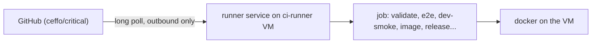

# CI runner

Every workflow job runs on one self-hosted GitHub Actions runner (`runs-on: [self-hosted, critical]`), a VM on
the owner's Proxmox host. GitHub-hosted minutes were exhausted, and the runner also means the e2e job no longer
installs Chromium's system packages on each run. [agent-workflow.md](agent-workflow.md) ("CI and PRs") describes
the jobs themselves.

## The machine

| | |
|---|---|
| Host | Proxmox `centauri` (`root@centauri.home.lan`), VM id 106, name `ci-runner` |
| Size | 4 vCPU, 8 GB RAM, 4 GB swapfile, 40 GB disk (`local-lvm`), starts on boot |
| OS | Ubuntu 24.04 LTS cloud image, user `ci` (key login, passwordless sudo) |
| Runner | `~/actions-runner`, systemd service `actions.runner.ceffo-critical.centauri-ci`, label `critical` |

The e2e suite takes about 5 minutes here (budget in [ADR 0048](adr/0048-e2e-runs-on-ui-and-api-paths.md)).
One runner runs one job at a time: a CI run's jobs queue behind each other.

## Fork pull requests never run here

The repository is public, so anyone can open a pull request, and a job runs the PR's code on this machine.
Two guards, both required:

1. Repository setting **Settings → Actions → General → Fork pull request workflows from outside
   collaborators → Require approval for all outside collaborators**.
2. The jobs started by `pull_request` (`ci.yml`, `pr-title.yml`) carry
   `github.event.pull_request.head.repo.full_name == github.repository`; a fork's run skips them. Release,
   promote, major and the catch-up start only from this repository's own events (`push`, `workflow_run`,
   `workflow_dispatch`, `schedule`); the Dependabot job (`pull_request_target`) checks out nothing from the PR.

The runner is persistent: a job leaves files and Docker images behind, and the release jobs run on it with
the staging and production environment secrets. Keep the VM single-purpose and never register it on another
repository.

## Rebuilding it

1. **VM** (on `centauri`): download `noble-server-cloudimg-amd64.img` to `/var/lib/vz/template/iso/`;
   `qm create 106 --name ci-runner --memory 8192 --cores 4 --cpu host --net0 virtio,bridge=vmbr0
   --scsihw virtio-scsi-pci --agent 1 --onboot 1 --ostype l26`; `qm importdisk 106 noble.img local-lvm`;
   attach it as `scsi0` (discard, ssd), add the cloud-init drive (`--ide2 local-lvm:cloudinit --ciuser ci
   --sshkeys <public key file> --ipconfig0 ip=dhcp`), boot order `scsi0`, `qm resize 106 scsi0 40G`,
   `qm start 106`. Give the VM a DHCP reservation (nothing depends on its address). Add a 4 GB `/swapfile`
   (and its `fstab` line).
2. **Tools** (as `ci`, `sudo` for the installs):
   - apt: `ca-certificates curl git jq build-essential postgresql-client xvfb docker.io docker-buildx docker-compose-v2 unzip
     gh shellcheck python3`; `sudo usermod -aG docker ci`.
   - Go: the version in `api/go.mod`, from `https://go.dev/dl/`, unpacked in `/usr/local/go`.
   - Node: the current LTS (NodeSource `setup_lts.x`, then `apt install nodejs`).
   - just: the release in `.github/actions/setup-just/action.yml` (binary into `/usr/local/bin`).
   - Playwright: in a scratch directory, `sudo npx playwright@<version in web/package-lock.json> install-deps
     chromium`, then `npx playwright@<version> install chromium` as `ci` (browsers land in
     `~/.cache/ms-playwright`). When Playwright's version moves, the e2e job downloads the new browser by
     itself; only a change of its system packages needs `install-deps` again.
     (`scripts/ci-install-chromium-deps.sh` is the retrying installer the hosted runners needed; CI no longer calls it.)
3. **Runner**: download the latest `actions-runner-linux-x64` release from
   `https://github.com/actions/runner/releases` into `~/actions-runner`, then in the repository's
   **Settings → Actions → Runners → New self-hosted runner** copy the registration token (it expires in an
   hour; never put it in a file, a commit or an issue) and run
   `./config.sh --unattended --url https://github.com/ceffo/critical --token <token> --name centauri-ci
   --labels critical --replace`. Put `PATH=/usr/local/go/bin:/home/ci/go/bin:` + the default path in
   `~/actions-runner/.env` (the service does not read the shell profile), then `sudo ./svc.sh install ci`
   and `sudo ./svc.sh start`.
4. **Check**: the runner shows Idle in the repository's runner list; reboot the VM and see it come back;
   open a pull request and see CI run on it. To check the machine alone, copy the repository to it and run
   `just validate`, `just e2e` and `just dev-smoke`.

Removing the runner: **Settings → Actions → Runners → Remove** (or `./config.sh remove --token <token>`), then
destroy the VM. To go back to GitHub-hosted runners, switch the `runs-on` lines back to `ubuntu-latest` and
restore the Chromium apt steps of the e2e job (git history of `ci.yml`).
