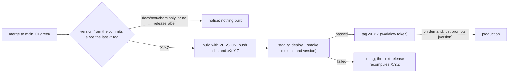

# Deploy runbook (fly.io)

Operator commands for [ADR 0024](adr/0024-deployment.md). Configuration lives in `deploy/fly.staging.toml`
and `deploy/fly.prod.toml` (checked by `just check-fly`, and by `just validate` through the Go test in
`api/internal/flycheck`). The image is built by the release workflow and passed with `--image`; the
config never names it. Steps marked **(user)** need fly credentials or GitHub admin rights; an agent
never runs them. Nothing here is public: the apps and the database have no public IP (ADR 0024 step 8).

Topology (ADR 0024 step 2, as amended): apps `critical-staging` (one machine, stops when idle) and
`critical-prod` (two machines, always running, rolling deploys), `shared-cpu-1x` with 512 MB, region
`yyz` (Toronto: fly has no Montreal region; user, 2026-10-16). The apps have **no volume**: their data
lives in the fly PostgreSQL cluster `tournesol-db`, shared with the user's other app, in the databases
`critical_staging` and `critical_prod`. Each app's DSN is its fly secret `CRITICAL_DSN`. App names are
global on fly; to rename an app or change the region, edit `app` / `primary_region` in the two toml
files; the Go test checks the app names against the file names.

```bash
fly=~/.fly/bin/fly   # flyctl on the operator's machine
```

## State and user steps left

First private deploy, 2026-10-16, image of commit `1648083` (one digest, both apps):

| App | Machines | Addresses | Checked |
|---|---|---|---|
| `critical-staging` | 1 (stops when idle) | `private_v6` only | `just fly-private`, `just fly-smoke` (health with the commit, database read); an action-log entry survived `fly machine restart` and a redeploy (`just fly-persistence`); both cold-cluster cases above |
| `critical-prod` | 2 (always on) | `private_v6` only | `just fly-private`, `just fly-smoke` on each machine; `just fly-db-counts tournesol-db critical_prod`: the 22 tables a fresh boot seeds, no play |

User steps left:

1. **Re-enter the character-sheet edits** the seeds do not hold, in the production app (`just fly-open
   critical-prod`, "Reaching a private app"): the crit table, the item added in the app, the dice favourite
   ("Production data").
2. **`RULEBOOKS_DEPLOY_KEY`** for the release build ("GitHub" below; until it is set, every main run
   of the release workflow that makes a release ends green with a "Release skipped" notice naming it,
   runs no flyctl step, deploys and tags nothing). The environments and both `FLY_API_TOKEN` secrets are set (2026-10-16). Then check the first
   real release run ("Release build"), none of which an agent can see:
   1. it is green, and its notice names `registry.fly.io/critical-staging:v<version>` and `:<sha>` and the
      rulebooks commit:
      the deploy key reached GitHub over ssh with the pinned host key, and the staging deploy token could
      `fly auth docker` and push;
   2. `$fly auth docker`, `docker pull registry.fly.io/critical-staging:<sha>`, then `docker inspect -f
      '{{json .Config.Labels}}' registry.fly.io/critical-staging:<sha>` shows
      `org.opencontainers.image.revision`, `org.opencontainers.image.version` and `critical.rulebooks.revision`;
   3. its log holds no catalogue JSON and no key material: only the clone, the build, the push lines and
      the notice with the reference and the rulebooks sha;
   4. its "Deploy to staging" step is green (no public IP, smoke on the machine) and Deployments
      shows a `deploy-staging` deployment of the sha with the digest and the version, then "Tag the version"
      created `v<version>`; the other post-merge checks are in "Staging deploy".
3. **The public-access option** (ADR 0024 step 8.4): until it is picked the apps stay private.
4. **CREATEDB for `critical_prod`**, the one privilege the promotion's restore point needs (ADR 0024 step
   9.2, "Promotion" below; agreed by the user 2026-10-17, not run yet): `just fly-db-provision tournesol-db prod` (a
   rerun: no password or secret changes; its checks accept the user's own restore points). Until then every
   promotion stops at the restore point and deploys nothing.
5. **The tag ruleset** (ADR 0024 step 10.2, "GitHub" below): `scripts/github-tag-ruleset.sh` (admin) was run
   2026-10-17: `release tags` (update, deletion, admin bypass) is in place. GitHub refused the other two
   rulesets, so run it once more after this change is on main: it deletes `release tag creation` and
   `next-major marker` if they still exist (it never created them here). CI's release job needs no ruleset to
   create a `v*` tag (v0.2.0 was tagged that way).
6. **Production deployable from main** (ADR 0024 step 10.2, "GitHub" below): once the promotion on demand is
   on main, `scripts/github-environments.sh --no-tokens` (admin) moves `production`'s rule from the tags `v*`
   to the branch `main`. Until then every Promote run fails at the `promote to production` job, nothing done.
7. **The first promotion** (`just promote`, "Promotion"), whose post-run checks only a real run can make:
   listed at the end of "Promotion".

## The PostgreSQL cluster (user)

`tournesol-db`: postgres-flex 17, one node (`shared-cpu-1x`, 256 MB), one encrypted 1 GB volume
`pg_data`, region `yyz`, a private Flycast address only. It existed before this app; it was not
created for it. Why a shared cluster: `fly postgres create --name critical-db` was refused on
2026-10-16 with _"To create more than 1GB in volumes please add a payment method"_ (ADR 0024,
"Amendment (shared cluster tournesol-db, 2026-10-16)").

**What it costs** (as observed on 2026-10-16, org `personal`): the org has no payment method; fly
lets it hold one 1 GB volume and refuses a second (the message above), so this cluster's volume is the
only one and the apps must stay volume-less. Creating apps, secrets and private IPs asked for nothing.
Whether the machines' running time stays free is fly's billing and was not checked here; adding a
payment method is the user's decision only.

**It stops when idle.** The cluster scales to zero (configured before this app used it): its machine
stops with no connection and starts on the next one through `tournesol-db.flycast`, so the first
request after an idle period waits a few seconds for PostgreSQL. Idle means no open connection for an
hour (`FLY_SCALE_TO_ZERO=1h` on its machine): the app's pool closes connections unused for 5 minutes, so
quiet apps let it stop, and a server booting or a request arriving while it starts waits for it (up
to 60 s per new connection) instead of failing (`docs/backend.md`, "Database"). Checked on staging, 2026-10-16: with the cluster
stopped, a booting server got `EOF` twice, the connection started the cluster (event source `proxy` in
`fly machine status`) and the server listened 5 s after its start; with the cluster stopped under a
running server holding pooled connections, the next database read answered 200 in 2.6 s. A DSN that
cannot work (wrong password, unknown host, `sslmode=require`) fails at once instead of waiting.
`fly ssh` does not start it:

```bash
$fly status -a tournesol-db                          # machine state; role "error" only means stopped
$fly machine start <machine id> -a tournesol-db      # before fly ssh / fly postgres connect
$fly ips list -a tournesol-db                        # private ingress (Flycast) only, no public v4/v6
```

Residual risk, accepted: **one 500 is possible when a connection is reset abruptly under load** (the
cluster killed, not stopped, while a statement runs on a pooled connection). A clean stop (FATAL
57P01/57P02) or an EOF reaches the pool as a bad connection, and the pool retries on a new one; an
abrupt reset (TCP RST) reaches it as a network error on the statement, which lib/pq returns as it is
and the request fails once. It is not converted into `driver.ErrBadConn` on purpose: database/sql then
re-runs the statement on a new connection, and an autocommit statement the server may already have
executed would run twice. The 5-minute idle close keeps connections from being reused across the
cluster's idle stop, so this needs the cluster to die during traffic.

To create a cluster of this app's own instead (once its volume is freed, or with a payment method):
`$fly postgres create --name critical-db --org personal --region yyz --initial-cluster-size 1
--vm-size shared-cpu-1x --vm-memory 256 --volume-size 1`, its output redirected to a private file
(mode 600): on success it prints the superuser password and a connection string. Then rerun the
provisioning below with that cluster's name.

### Databases, users and the apps' secrets

```bash
just fly-db-provision tournesol-db staging prod      # scripts/fly-db-provision.sh
```

For each environment it creates (or keeps) the login user `critical_<env>`, owner of the database
`critical_<env>`. CONNECT on that database belongs to its user only. Every other database of the
cluster that accepts connections (`template1` included) keeps CONNECT for the login users it has at
run time and loses it for PUBLIC, so a critical user reaches only its own database and the other app's
current users keep their access. `critical_prod` also has the `CREATEDB` attribute (`critical_staging`
has not): the promotion's restore points are copy databases it creates ("Promotion"); the checks below
accept CONNECT on its own `critical_prod_pre_*` copies.

**A user the other app gets later** (a `CREATE ROLE`, a `fly postgres attach` of a new app) has no
CONNECT on the locked databases, and a rerun does not add it (the databases are already locked). Grant
it by hand: `$fly postgres connect -a tournesol-db`, then `GRANT CONNECT ON DATABASE <db> TO <user>;`.
A database created later keeps PUBLIC CONNECT until the next run of the provisioning locks it.

**Passwords.** A user gets a generated password when it is created, sent to the server only as a
SCRAM-SHA-256 verifier, and its app's secret
`CRITICAL_DSN=postgres://critical_<env>:…@tournesol-db.flycast:5432/critical_<env>?sslmode=disable` is
piped into `fly secrets import` right after (never printed): staged while the app has no machine (the
first `fly deploy` applies it), applied at once otherwise. An existing user's password and secret are
never touched by a rerun, so a rerun on a running app changes nothing it uses. `fly secrets list -a
critical-<env>` shows the name and a digest, never the value. `sslmode=disable` (user, 2026-10-16): the
cluster has no TLS (PostgreSQL answers `N` to a TLS request; the Flycast `pg_tls` handler answers `S`,
then closes), and the app's driver, unlike `psql` with `prefer`, does not fall back to plain, so every
connection of the first staging deploy ended in `EOF`. The traffic stays inside fly's WireGuard
private network, which encrypts it; `fly postgres attach` writes `sslmode=disable` too. A secret set
with `sslmode=prefer` is replaced with `--rotate`.

**Checks**, every run: each critical user holds CONNECT on its own database and on no other (privileges
read as the cluster's operator). When the run set a password it also connects through `fly proxy` to
`tournesol-db.flycast`: own database usable (may create in its schema), every other connection refused
(`permission denied for database`). Then it sets the volume's snapshot retention.

**Rotation** (a leaked password): `just fly-db-provision --rotate
tournesol-db <env>`. It sets a new password, then applies the new secret, so **the app is briefly out**:
from the password change until fly has restarted each of its machines with the new secret, new
database connections fail (connections already open keep working). Before the app's first deploy it has
no machine and the rotation costs nothing. `--password-dir ~/.config/critical` also writes the new
password to `~/.config/critical/critical_<env>.password` (mode 600) for the operator; delete it after
use. If a run stops between the password change and the secret, rerun it with `--rotate`.

### Reaching a database

```bash
$fly postgres connect -a tournesol-db -d critical_prod     # psql as the cluster's operator (superuser)
just fly-db-proxy tournesol-db                             # prints the psql connection string (free local port), Ctrl-C stops it
```

The second form (`scripts/fly-open.sh --db`: `fly proxy` to `tournesol-db.flycast:5432` on a free local
port, never the compose PostgreSQL's 5432) needs the user's password, which is only in the app's secret. To look at the data,
use `fly postgres connect` (`SET ROLE critical_prod;` to act as that user); never rotate a running
app's password just to log in: the rotation is an outage. Production data is
private (ADR 0024 step 7): never paste query output into an issue, a PR or a log.

### Snapshots

fly takes a daily snapshot of the cluster volume, kept 30 days (ADR 0024 step 9.1, set by the
provisioning). A snapshot holds every database of the cluster, the other app's too: restoring one rolls
them all back, so `critical_prod` is restored from a promotion's restore point first (step 9.3,
"Rollback").

```bash
$fly volumes list -a tournesol-db                    # the volume id
$fly volumes show <volume id> -a tournesol-db        # snapshot retention: a fact to check, not a setting made here
$fly volumes snapshots list <volume id>
```

The retention is whatever the volume carries now: the 30 days above is what the provisioning set, and the
cluster is shared with another app, so the backups item changed nothing and nobody should lower or raise it
without the user. Read it with `volumes show` before relying on a snapshot.

### Backups

Two safety nets besides the promotion's restore points ("Promotion"): a **dump** the operator keeps on their
own machine, and the volume snapshots above as the last resort. A dump is a `pg_dump` custom-format file of
one database (`--no-owner --no-acl`, so it restores under any user). It holds the catalogue's book text:
it lives in `.backups/` (gitignored, folder mode 700, file mode 600), never in the repository, a workflow
artifact, an issue or a log (ADR 0024 step 7). No workflow takes or uploads one.

```bash
just db-backup staging                       # or prod: .backups/<env>-<UTC time>/critical_<env>.dump + counts.txt
just db-restore-drill                        # newest .backups/prod-*/ dump; or: just db-restore-drill .backups/staging-.../critical_staging.dump
```

`db-backup` needs the operator's fly login, `pg_dump`/`pg_restore` 17 or newer, and the database user's
password in `PGPASSWORD` or in `~/.config/critical/critical_<env>.password` (what `just fly-db-provision
--password-dir ~/.config/critical` writes; a rerun does not rewrite an existing user's file, and rotating a
running app's password only to take a backup is an outage: use the app's secret value you already hold). The
password reaches `pg_dump` through the environment only. It starts `fly proxy` to `tournesol-db.flycast` on a
free local port (`CRITICAL_DB_ENDPOINT=<host>:<port>` uses an already open `just fly-db-proxy` instead), reads
the dump back with `pg_restore --list`, and writes `counts.txt` (one `<table> <rows>` line per table, taken
right after the dump) beside it; a failed run keeps no folder. The first connection starts the cluster if it
is stopped (a few seconds). Counts are taken after, not inside, the dump's snapshot: on a live database a
write in between makes the drill report a difference for that table; take the backup again.

**The drill** proves a dump restores, with no fly access: it starts the compose PostgreSQL under its own
project (`criticaldrill<pid>`, free port, own volume; never `just dev`'s database), restores the dump into a
scratch database, compares every table's row count with `counts.txt`, then drops the scratch database and
removes the project with its volume, whether it passed or not. Exit 0 only when every table matches. It
prints table names and counts only. Run it after a backup and before a promotion you could not undo; the
logic of the comparison and of the cleanup is tested offline by `scripts/test-db-backup.sh` (part of `just
validate`).

**Restore `critical_prod` from a dump** (operator; the same steps as the restore point in "Rollback", with
the dump instead of the copy). Everything written since the dump is lost: say so to the user first, and get
their yes. Run `just db-restore-drill <dump>` first.

1. Remove the app's machines: `$fly scale count 0 -a critical-prod --yes`.
2. As the cluster's operator (`$fly postgres connect -a tournesol-db`, connected to `postgres`), set the
   current database aside and create an empty one in its place:

   ```sql
   ALTER DATABASE critical_prod ALLOW_CONNECTIONS false;
   SELECT pg_terminate_backend(pid) FROM pg_stat_activity WHERE datname = 'critical_prod';
   ALTER DATABASE critical_prod RENAME TO critical_prod_failed_<yyyymmdd>;
   CREATE DATABASE critical_prod OWNER critical_prod;
   REVOKE ALL ON DATABASE critical_prod FROM PUBLIC;
   GRANT CONNECT, TEMPORARY ON DATABASE critical_prod TO critical_prod;
   ```

3. Restore as the database's user, through a proxy (`just fly-db-proxy tournesol-db` prints the port; the
   password as in `db-backup`), then check the counts against the dump's:

   ```bash
   export PGPASSWORD="$(<~/.config/critical/critical_prod.password)"
   pg_restore --no-owner --no-acl --exit-on-error -h 127.0.0.1 -p <port> -U critical_prod -d critical_prod .backups/prod-<time>/critical_prod.dump
   scripts/db-table-counts.sh "host=127.0.0.1 port=<port> user=critical_prod dbname=critical_prod sslmode=disable" > /tmp/restored.txt
   scripts/db-counts-compare.sh .backups/prod-<time>/counts.txt /tmp/restored.txt   # exit 0, then delete /tmp/restored.txt
   ```

4. Promote the release that matches the dump's schema (the tag whose migrations the dump holds; "Rollback"),
   which recreates the machines. Once production checks out, `DROP DATABASE critical_prod_failed_<yyyymmdd>;`.

**Last resort: a volume snapshot** ("Restore from a cluster snapshot") only when no usable dump or restore
point exists. It rolls back **both** critical databases and the other app's to the snapshot's day.

## One-time setup per app (user)

Repeat for `staging` and `prod` (`<env>` = `staging` or `prod`, app = `critical-<env>`). Both apps exist
(created 2026-10-16).

```bash
$fly auth login
$fly apps create critical-<env> --org personal
$fly tokens create deploy -a critical-<env>        # app-scoped token: store it in GitHub, nowhere else
```

No volume: never `fly volumes create` on an app (the free allowance has none left, and the apps are
stateless, ADR 0024 step 5.1). `CRITICAL_DSN` must be set (provisioning above) before the first deploy:
without it the server falls back to its local development default (`localhost`) and fails its first
connection.

First deploy of an app, with a private Flycast address only (no public IP). fly creates two machines
for an app without volumes; staging wants one:

```bash
just release-image critical-staging critical-prod  # the clean HEAD, real catalogue, pushed to both apps' registries
$fly deploy -c deploy/fly.prod.toml -a critical-prod --image registry.fly.io/critical-prod:<sha> --no-public-ips          # two machines
$fly deploy -c deploy/fly.staging.toml -a critical-staging --image registry.fly.io/critical-staging:<sha> --no-public-ips --ha=false   # one machine
$fly ips allocate-v6 --private -a critical-<env>
just fly-private critical-<env>                    # fails on any public address
just fly-smoke critical-<env> <sha>                # every machine: health with the commit, a database read, the web app
```

A first deploy reports a health-check timeout until the app has its private address and can reach the
database; the machine keeps running. Later deploys come from the workflows; fly allocates no public IP
on a redeploy of an app that already has an address (seen on staging's redeploy, 2026-10-16), and the
workflows pass `--no-public-ips` anyway. If `fly ips list` shows a public IP, release it with
`$fly ips release <address> -a critical-<env>` unless a public-access option has been chosen (ADR 0024
step 8.4).

### GitHub (user)

`scripts/github-environments.sh` (admin rights on the repository, fly credentials) creates the
environments `staging` and `production`, restricts each to the branch `main` (deleting any other rule), and sets each
`FLY_API_TOKEN` from a new deploy token of its app, piped, never printed (done 2026-10-16; `staging` is also restricted to the branch `main`; a rerun makes
new tokens, `--no-tokens` keeps the secrets). `RULEBOOKS_DEPLOY_KEY` stays a user step:

| Environment | Secret | Content |
|---|---|---|
| `staging` | `FLY_API_TOKEN` | deploy token of `critical-staging` |
| `staging` | `RULEBOOKS_DEPLOY_KEY` | private half of the read-only deploy key (below), used by the release build |
| `production` | `FLY_API_TOKEN` | deploy token of `critical-prod` |

The `production` environment accepts deployments from the branch `main` only (ADR 0024 step 10.2): Promote
runs from main, and the version is its input. _Changed 2026-10-17 (promotion on demand); was: tags `v*` only,
when Promote ran from the tag._ The rule set before that change is the tag rule `v*`: **user step**, once,
after this change is on main:

```bash
scripts/github-environments.sh --no-tokens   # production: adds the branch rule main, deletes the tag rule v*
```

It prints `production deployable from: branch main`. Check: Settings > Environments > production >
Deployment branches and tags lists `main` only. Until it is run, Promote's `promote to production` job fails
at once (the environment refuses the branch `main`), with
nothing done.

**Who may promote**: a repository admin. Both Promote jobs start with `scripts/require-admin.sh` on the user
who started the run and the one who (re-)ran it (`github.actor`, `github.triggering_actor`), before any secret
(user, 2026-10-17, option (a)). No required reviewer: running it is the act. A collaborator with write access
can start the workflow (GitHub lets any writer dispatch) but its run fails in `Check the actor is an admin`,
before the production environment. A writer's own workflow on a branch gets no production token: the
environment accepts main only.

**Who may create a `v*` tag.** The tags name the versions Promote resolves, so a tag on a commit that is not
on main, or that staging never ran, must not appear as a version: Promote's guards (main's scripts) refuse
both, and one tag ruleset keeps the versions from being moved or deleted:

| Ruleset | Rules on `refs/tags/v*` | Bypass |
|---|---|---|
| `release tags` | update, deletion | Repository admin |

Creating a `v*` tag, and writing the `next-major` marker of "A major version", are not restricted by a ruleset.
_Changed 2026-10-17; was: `release tag creation` (creation on `v*`) and `next-major marker` (creation, update,
deletion on `next-major`), both with the GitHub Actions app (`Integration` 15368, the workflow token) as a
bypass actor next to the admin role._ GitHub answers HTTP 422 to that bypass on a repository owned by a
personal account, so those two rulesets cannot exist here. They are not needed: the promotion runs main's
scripts with the version as an input, so a `v*` tag no longer selects the code that reaches production, and the
repository's only collaborator is its owner. Were the repository moved to an organization, the two rulesets
(ADR 0024 step 10.2, was) could come back.

CI is the only maker of version tags (the release job, after a passed staging deploy, "Release version"); a
human never makes one (`just release` is gone). The workflow may create a `v*` tag, never move or delete one
(only an admin may).

```bash
scripts/github-tag-ruleset.sh --dry-run   # prints the ruleset and the names it would remove
scripts/github-tag-ruleset.sh             # creates or replaces it (found by name), deletes the obsolete ones; admin rights
```

`release tags` was applied 2026-10-17 (ruleset 25291040) with creation in it and the admin bypass only; the
rerun of user step 5 replaces it with update and deletion only and removes the two obsolete rulesets if they
exist. Check: Settings > Rules > Rulesets shows one ruleset, active, target tags (`refs/tags/v*`), with the
rules and bypass above; a collaborator with write access moving or deleting a `v*` tag gets "push declined due
to repository rule violations".

What the absence of a creation rule allows: any writer, or any workflow of this repository whose token has
`contents: write`, can create a `v*` tag, so a write collaborator could tag a commit
that is not on main. Such a tag starts nothing (a tag made with a workflow token starts no workflow, and
Promote is run by hand only), and Promote never resolves it: it is off main, or staging has no deployment
recorded as its version. If it is the highest `v*` tag, the release job refuses every release until an admin
deletes it ("a newer release exists", "Release version").

The rulebooks deploy key is read-only and belongs to the private `critical-rulebooks` repo:

```bash
ssh-keygen -t ed25519 -N '' -C critical-release-build -f ./rulebooks_deploy_key
gh repo deploy-key add ./rulebooks_deploy_key.pub --repo <owner>/critical-rulebooks   # read-only is the default
gh secret set RULEBOOKS_DEPLOY_KEY --env staging --repo <owner>/critical < ./rulebooks_deploy_key
shred -u ./rulebooks_deploy_key ./rulebooks_deploy_key.pub
```

Never commit a token or key; the repository holds none.

## Reaching a private app

```bash
just fly-open critical-staging              # or critical-prod: prints the URL to open, Ctrl-C stops it
curl -s http://127.0.0.1:<port>/api/health  # {"commit":"<sha>","status":"ok","version":"<X.Y.Z>"}, <port> from the line above
$fly ssh console -a critical-<env>          # a shell on the machine
$fly logs -a critical-<env>
```

`just fly-open <app> [port]` (`scripts/fly-open.sh`) runs `fly proxy` from a free local port to the
app's `.flycast` address on port 80, bound to 127.0.0.1, waits until `/api/health` answers (a stopped
machine or database takes a few seconds), prints `http://127.0.0.1:<port>/` and the commit, and keeps
the proxy until Ctrl-C. Never use a fixed 8080 (or 5173, 5432): `just dev` holds those, so the proxy
fails to bind or the browser reaches the local stack instead of fly. A port given explicitly is
refused when taken. Rerun it any time; each run gets its own port.

Through the `.flycast` address, fly's proxy starts a stopped machine (staging stops when idle) and
balances between machines; the address answers on the service ports (80, and 443 with TLS), not on 8080.
`$fly proxy <free port>:8080 -a critical-<env>` without the address goes straight to one running
machine's port 8080 and starts nothing. A request can be pinned to one machine with the header
`fly-force-instance-id: <machine id>` (what `just fly-smoke` does for each machine).

For a device that must reach the app without `fly proxy`, join the org's WireGuard network
(`$fly wireguard create`, user) and use the app's `.flycast` address. A public IP, basic auth and a
custom domain come only once the user picks a public-access option (ADR 0024 step 8.4); this runbook
gets those steps then.

## Login on the hosted apps (ADR 0029)

The server refuses to start without the Google login's settings unless `CRITICAL_ENV=dev` (ADR 0029
step 8.2), and on fly.io (`FLY_APP_NAME` set) it refuses `CRITICAL_ENV=dev` too: a machine with no
OAuth settings exits before it listens, so a hosted app never has the dev login. Never set
`CRITICAL_ENV` on a hosted app. **Set these secrets on each app before the first deploy of a release that carries
the login** (a staging deploy without them fails its start and its smoke, and nothing reaches
production):

| Secret | Value |
|---|---|
| `CRITICAL_GOOGLE_CLIENT_ID` | the OAuth client id (Google Cloud console, "Credentials", an OAuth client of type "Web application") |
| `CRITICAL_GOOGLE_CLIENT_SECRET` | its secret |
| `CRITICAL_PUBLIC_URL` | the address users open, `https://<host>` (no path): the redirect is `<public URL>/api/auth/google/callback`, the CSRF check compares every mutation's `Origin` with its host, and `https` makes the cookies `Secure` |

All three or none (a partial setting is a start-up error everywhere). In the Google console add
`<public URL>/api/auth/google/callback` to the client's "Authorised redirect URIs". **(user)**:

```bash
$fly secrets set -a critical-<env> CRITICAL_GOOGLE_CLIENT_ID=<id> CRITICAL_PUBLIC_URL=<url>
$fly secrets set -a critical-<env> CRITICAL_GOOGLE_CLIENT_SECRET=-   # reads the value from stdin; never on the command line
```

While an app is private (no public IP, "Reaching a private app"), its public URL is the local end of
the proxy: `CRITICAL_PUBLIC_URL=http://localhost:<port>`, the redirect URI
`http://localhost:<port>/api/auth/google/callback` in the console (Google accepts `http://localhost`
for testing), and `just fly-open critical-<env> <port>` with that fixed port, then open
`http://localhost:<port>` (not `127.0.0.1`: the host must match). Give each app its own port: the
session cookie is named after the public URL's host and port (`critical_session_localhost_<port>`), so
`just dev` and both tunnels can be open in one browser without logging each other out. Until the login page exists, open
`http://localhost:<port>/api/auth/google/start` to log in; the callback brings the browser back to the app.

**Root admin.** Only invited emails and the root admin can log in, and invites come with the admin
section. Set the root admin once per database with the script (ADR 0029 step 5.1), through the
database proxy ("Reaching a database"), after the release with the login has started once (its
migration creates the tables):

```bash
just fly-db-proxy tournesol-db                     # prints the local port; leave it running
CRITICAL_DSN='postgres://critical_<env>:<password>@localhost:<port>/critical_<env>?sslmode=disable' just root-admin <your Google email>
```

It creates the user as an admin with no Google account; your first Google login with that email binds
it. A rerun with the same email changes nothing. With another email it refuses once the root has logged
in; before that (a typo, a lost account) the old row loses the flag and is disabled, never deleted. A
root whose Google account is lost after binding needs a database fix by the operator.

**Smoke.** `just fly-smoke` has no session: on a release with the gate it checks that `/api/character`
answers 401 `unauthenticated` to an unknown session cookie (the session lookup is its database read)
and that `/` redirects a browser to `/login`, which serves the app. A release from before the gate (a
rollback) answers 200 instead, which it accepts.

## How a release flows

ADR 0024 steps 3 and 4, driven by GitHub Actions (the PR title, a conventional-commit line, becomes the commit on `main` and drives the version):

1. A merge to `main` with green CI starts the release job (`.github/workflows/release.yml`). It first computes
   the **version** from the conventional-commit titles since the last `v*` tag ("Release version" below). No
   release (docs/test/chore only, or the `no-release` label): a notice, the run is green, nothing is built,
   deployed or tagged. Otherwise it builds the image with the real catalogue and the version baked in, pushes
   it tagged with the commit sha and `v<version>` ("Release build"), deploys it to staging and smoke-checks it
   (health reports the commit and the version, "Staging deploy"), and **then** tags the commit `vX.Y.Z`. A
   failed staging deploy takes no version: the next release computes the same number again.
2. Promoting is a deliberate act, on demand: `just promote` (or Actions > Promote > Run workflow, from
   `main`, version empty) promotes the **newest version that passed staging**; `just promote 1.2.3` promotes
   that version (also the rollback). It takes a restore point of `critical_prod` (no restore point, no
   deploy), deploys the **same image** to production, smoke-checks it and creates the GitHub Release
   ("Promotion" below, `.github/workflows/promote.yml`). No tag starts it: staging can run ahead of production
   for as long as wanted.



To know what each environment runs: `curl …/api/health` through `just fly-open` (commit and version), or the
deployments of the `staging` environment (payload `version`) and the GitHub Releases (production).

### Release version

`scripts/release-version.sh` (user decisions of 2026-10-17, ADR 0024 step 3, "Amendment (staging versions from
the conventional commits, 2026-10-17)"), run first by the release job:

- **Range.** Every first-parent commit after the highest `vMAJOR.MINOR.PATCH` tag reachable from the commit
  being released, up to it: **all** of them, including a commit whose own release run was replaced in the
  queue, or that made no release.
- **Level of a commit**, from its title `type(scope)!: description`: `feat` minor; `docs`, `test`, `chore`
  none; any other type (`fix`, `refactor`, `perf`, `ci`, `build`, …) and a title not in that format patch.
  A breaking change (`!` after the type, or `BREAKING CHANGE` in the title or as a footer in the body) is a
  **minor**, never a major, and the run prints a notice "Major version?": majors are made by hand (`just
  major`, "A major version" below), never automatically.
- **Next version**: the highest level of the range (minor: `X.(Y+1).0`; patch: `X.Y.(Z+1)`), or `(X+1).0.0`
  when the `next-major` marker is pending ("A major version").
- **No release** when no commit of the range has a level outside the PRs labelled **`no-release`** (the
  label of the merged PR whose merge commit it is, read from the GitHub API): the notice says why ("docs/test/
  chore only since vX.Y.Z", "no-release label on PR #n", "no commit since vX.Y.Z"). A labelled `feat` still
  counts for the level of the next release that happens. There is no "force release" label.
- **By hand** (Actions > Release > Run workflow on `main`, version empty): releases main's head even when the
  rules make none, at least a patch (a new catalogue, "A new catalogue version").
- Refused, failing the run: no `v*` tag before the commit (the first version is tagged by hand); **a newer
  release exists**, i.e. the highest `v*` tag of the repository is not before the commit (an older run
  re-run after a newer one was tagged: it would stage the old image and tag a lower version after a higher
  one; or a tag made off main, which an admin deletes); a GitHub API failure reading the labels.
- **Tag**: `scripts/version-tag.sh` creates the annotated tag `vX.Y.Z` on the commit through the GitHub API
  with the workflow's token (tagger `github-actions[bot]`, message naming the staging digest), only after the
  staging deploy and smoke check passed (the job stops at a failed one). An existing tag is never moved.
- **The tag starts no workflow.** GitHub: "When you use the repository's `GITHUB_TOKEN` to perform tasks,
  events triggered by the `GITHUB_TOKEN`, with the exception of `workflow_dispatch` and
  `repository_dispatch`, will not create a new workflow run"
  ([Triggering a workflow from a workflow](https://docs.github.com/en/actions/using-workflows/triggering-a-workflow#triggering-a-workflow-from-a-workflow)).
  And `promote.yml` has no tag-push trigger at all: it runs only by hand (`just promote [version]`), so no
  tag starts a promotion.
- **Offline test.** `scripts/test-release-version.sh` (part of `just validate`): the rules as a table (each
  type, breaking, docs/test/chore only, the label, a mixed range, a skipped `feat` earlier in the range,
  `--force`, the first run after `v0.1.0`), the range and the labels on a fixture repository with `gh`
  stubbed, and the tag's API calls.

### A major version

`just major` (user decision 2026-10-17: _"major is manual"_; ADR 0024 step 3, "Amendment (a manual major,
2026-10-17)") makes the next staging release `vN+1.0.0` instead of the computed bump. On `0.x` the first major
is `1.0.0`. Repository admins only.

- **How.** `just major` runs `.github/workflows/major.yml` from `main` (`gh workflow run`) and prints what the
  next release will be. The workflow checks first that the user who started it and the one who re-ran it are
  admins (`scripts/require-admin.sh`, the same check as Promote), then `scripts/next-major.sh mark` moves the
  marker tag **`next-major`** to main's head through the GitHub API with the workflow's own token. It builds,
  deploys and tags nothing, and uses no secret or environment. A dispatch from another ref fails saying so.
- **When it applies.** The release job (checkout with every tag) reads the marker while computing the version
  (`scripts/release-version.sh next`): the marker is **pending** when it names a commit that is after the last
  `vX.Y.Z` tag (a descendant of it, not the same commit) and reachable from the commit being released. Then
  the release that happens is `(X+1).0.0`, whatever the level of the range. A range that makes no release
  (docs/test/chore only, `no-release`) still makes none: the notice says the major is pending, and the marker
  waits for the next release. A manual Release run with no input (it releases anyway) takes it too.
- **Only the next release.** Once the major is tagged, the marker is at or before the last version tag, so it
  is ignored: it never needs deleting. A marker on a later commit than the one being released (set while an
  older run was queued) is left for the release of that later commit. Running `just major` again before the
  release just moves the marker to the new head.
- **Refused.** `mark` fails when main's head is the last version's own commit (nothing has landed: the marker
  would be ignored; run it again after a commit) or when a newer release exists.
- **Who may write the marker.** `next-major` is not a `v*` tag and has no ruleset (_changed 2026-10-17; was:
  a `next-major marker` ruleset for the admin and the Actions app, which GitHub refuses on a personal
  repository_): a writer can push it. The effect is bounded: it only changes the number of the next release,
  which still needs a passing staging deploy; and the repository's only collaborator is its owner.
- **Offline test.** `scripts/test-major.sh` (part of `just validate`): `mark`'s API calls and refusals on a
  fixture repository, the preview, the admin refusal, `just major`, the workflow parsed (admin check first, no
  secret, main only, marker last), the ruleset script (only `release tags`, the obsolete ones removed by name); and the pending/ignored/waiting cases in
  `scripts/test-release-version.sh`.

### Release build

`.github/workflows/release.yml` (ADR 0024 steps 3.1, 7 and 10.3-10.4), job `release`: the version, the
image, the staging deploy and the tag in one job, so two runs never compute a version at once (each would
take the same number).

- **When.** It runs on `workflow_run` of the `CI` workflow, and its job only when that run concluded
  `success` for a `push` to `main` of this repository: a red or cancelled CI run, a pull request (a fork's
  branch named `main` included) and a fork never build. By hand: Actions > Release > Run workflow on `main`
  (input `version`: empty releases main's head, `X.Y.Z` redeploys that version, "Staging deploy"). It is not
  a job of `ci.yml` because CI cancels a running `main` build when a newer commit lands; release jobs are
  serialized instead (the job's `concurrency: release-staging`, never cancelled once started: a newer run
  replaces only a queued one). Manual and automatic runs share that group: a run queued behind a
  running one replaces the one already pending, whatever their kind, so a manual redeploy can drop a
  pending automatic release and the other way round. Nothing is lost: the next release counts every
  commit since the last version, and a dropped redeploy is run again. The group is on the job, not the workflow: every CI completion on a branch named `main` (a red
  one, a fork's) starts a run of this workflow, and only a job that passes the `if` joins the group, so a
  skipped run never cancels a pending green release. GitHub runs a
  `workflow_run` workflow as it is on `main`, so a pull request cannot change what runs with the secrets,
  and the workflow only starts once this file is on `main`.
- **Checkouts.** `main`'s head with its history and tags (the scripts, the action, the version), and the
  release commit's tree alone in `release-src/` for the build.
- **Secrets**, from the GitHub environment `staging`: `FLY_API_TOKEN` and `RULEBOOKS_DEPLOY_KEY`, checked only
  when there is something to release. When one is missing (`scripts/release-secrets.sh`) an automatic run
  ends green with a `Release skipped` notice naming it, and nothing is built: that is what every main run
  shows until the user sets the key ("GitHub" below). A manual run fails instead (someone asked for a deploy
  that cannot happen).
- **Catalogue** (`scripts/release-catalogue.sh`): an ssh-agent gets the deploy key on stdin, then one
  shallow, blob-less clone of `critical-rulebooks` at its default branch, with github.com's host key
  pinned; only `dist/catalogue.json` is read, into the runner's temp directory, outside the checkout. The
  agent and the clone are removed when the script ends, the catalogue when the build step ends. It is
  never printed, never an artifact, never in an actions cache (the workflow has none) or an exported build
  cache.
- **Image** (`scripts/release-image.sh`, the script `just release-image` runs too): one plain `docker
  build` of the clean checkout with the catalogue as the `catalogue` build context, `COMMIT` and `VERSION`
  (reported by `/api/health`), labelled `org.opencontainers.image.revision=<commit>`,
  `org.opencontainers.image.version=<version>` and `critical.rulebooks.revision=<rulebooks commit>`, then
  `fly auth docker` and a push to **`registry.fly.io/critical-staging:<full commit sha>`** and
  **`registry.fly.io/critical-staging:v<version>`**, the same build (the app name is read from
  `deploy/fly.staging.toml`). `just release-image` sets no version (its image reports `unknown`). The staging app's repository is the one image repository of the
  release flow: the staging deploy token can push only there. Production gets the same digest from it at
  promotion, copied by digest into `critical-prod`'s repository (ADR 0024, consequences, "Promotion and
  registry layout"; "Promotion" below), never by a rebuild. The run's
  notice names the pushed references and the rulebooks commit; the push lines in the log give the digest.
  **The digest is the image's identity, not the tag**: a forced release for a new catalogue pushes a new
  digest under the same `<sha>` tag (and a new version tag), so the staging deploy records the digest it smoke-checked and the promotion
  copies, deploys and compares that digest (`registry.fly.io/critical-prod@sha256:…`, the same manifest as
  `registry.fly.io/critical-staging@sha256:…`), never the tag (ADR 0024 step 1.5).
- **No shell tracing** anywhere (`set -x` is absent), and none of the scripts prints a secret.
  `just validate` runs `scripts/test-release-scripts.sh`, which exercises the three scripts offline (docker
  and fly stubbed, a local rulebooks repo and a generated key): the missing-secret no-op, stdout of the
  fetch being only the sha, the labels, the full-sha and version tags, a dirty tree refused, and the job's
  steps parsed (the version first, every build, deploy and tag step gated on the secrets, the tag last). Its rulebooks remote is
  a `file://` repository, so ssh itself (the agent's key reaching GitHub, the pinned host key) is only
  proven by the first real run (user steps left).

### Staging deploy

The composite action `.github/actions/staging-deploy` (ADR 0024 steps 3.2-3.3, 8.3, 10.1 and 10.5) runs
`scripts/staging-deploy.sh <sha> <version>` and records the result; its output `digest` is what the tag
step names. The `release` job of `release.yml` uses it, with `environment: staging`. It is not a reusable
workflow: a called workflow's job does not see the secrets of its own environment (the first real run
read an empty token), and a calling job cannot have an environment. The job passes
`secrets.FLY_API_TOKEN` to the action as an input.

- **When.** In the `release` job, once the image was pushed (a release), or for a manual redeploy of a
  version (below). With a secret missing an automatic run builds nothing and deploys nothing, so main stays
  green. The job runs on `main` only, is serialized by `concurrency: release-staging` and is never cancelled
  once started (a newer run replaces only a queued one).
- **Secret.** `FLY_API_TOKEN` of the `staging` environment, read only by the action's secret check and
  deploy step. If it is empty there, the action **fails** the run (`Staging deploy` error): it is a
  misconfiguration, and a green skip would leave staging on the old image. A manual run fails earlier, at
  the job's own secret check (someone asked for a deploy that cannot happen); only an automatic run keeps
  main green on missing secrets.
- **Steps** (`scripts/staging-deploy.sh`, reusing `scripts/fly-private-check.sh` and `scripts/fly-smoke.sh`):
  1. **No public IP**: the job fails before deploying if the app has an address other than a Flycast one.
     The check is skipped, with a notice, only when the repository (or environment) variable
     `PUBLIC_ACCESS_OPTION` is set, which the user does when picking an option (ADR 0024 step 8.4). Until
     then the apps stay private.
  2. `fly deploy -c deploy/fly.staging.toml --image registry.fly.io/critical-staging:v<version>` (the build
     of that version; `:<sha>` when the script is given no version); the machine is started if it was
     stopped.
  3. The smoke check through `fly proxy` (the app is private): on every machine, `/api/health` is 200 with
     `status` ok, `commit == <sha>` and `version == <version>`, `/api/character` is 200 (a read through the database) and `/` is
     the web app. A cold start of the machine or of the shared database is waited for (up to 90 s per
     machine).
  4. The machines must run exactly one image **digest**; it is printed and recorded.
- **Record.** The job creates a GitHub deployment of the environment `staging` with
  `scripts/record-deployment.sh`: task `deploy-staging`, ref the full sha, payload `{"commit", "digest",
  "version"}`,
  and one status, `success` (description: the digest) or `failure`. GitHub also creates a deployment of
  its own for every job in the environment (task `deploy`, ref `main`'s head) and marks earlier
  deployments of the environment `inactive` when a newer one succeeds, so **the latest status of a
  `deploy-staging` deployment becomes `inactive` within minutes: never read "the latest status"**. How the
  promotion must read it ("staging ran this sha with this digest"):
  1. list `GET /repos/{repo}/deployments?environment=staging&task=deploy-staging&sha=<sha>` (the task
     filter drops GitHub's own deployments, the sha is the full commit);
  2. for each, list `GET /repos/{repo}/deployments/{id}/statuses` and keep the ones whose **status
     history contains `success`** (`inactive` only means superseded; a `failure` deployment has no
     `success`);
  3. keep the ones whose `payload.version` is the tag's version and take the newest by `created_at`: two
     versions can share a commit (a forced release of a tagged head, for a new catalogue, records a new
     digest under the same sha), and each promotes its own image. When none has that version, take the
     newest of those that record **no** version (deployed before versions were baked in: `v0.1.0`), never
     one recorded as another version. Its `payload.digest` is the image; none means staging did not run
     and pass that sha as that version: refuse.
  The promotion compares that digest with the one it deploys (`registry.fly.io/critical-prod@sha256:…`, its
  copy of the staging image).
- **Config of the image's commit.** The fly config (`deploy/fly.staging.toml`) is checked out at the
  image's own sha (that file only), the scripts and the workflow come from `main`: a dispatched older image
  is deployed with the config that matches its Dockerfile, and a sha that predates the file fails at once.
- **A failed run.** The log of `Deploy and smoke-check` says which check failed: `fly-private-check` (a
  public address, nothing deployed), `fly-smoke: FAIL (...)` with the machine and the status or body
  (`HTTP 000` is a machine or proxy that never answered; a wrong `commit` or `version` is the old image
  still serving or a wrong tag), or a digest mismatch. After a failed deploy or smoke it prints the app's recent releases
  (`fly releases --image`): redeploy the previous one's image with the command in "Rollback", or fix and
  rerun. The deployment is recorded as `failure`, so the promotion refuses that sha, and the version gets
  no tag.
- **Redeploy a version.** Actions > Release > Run workflow on `main`, input `version` = `X.Y.Z` (or
  `vX.Y.Z`): the commit of the tag `vX.Y.Z` and its image `registry.fly.io/critical-staging:vX.Y.Z` are
  deployed and smoke-checked again, and recorded; nothing is built or tagged. A version with no tag fails at
  once ("unknown version vX.Y.Z: no such tag"). `v0.1.0`, made before versions were baked in, has no
  `:v0.1.0` image: redeploy it by hand, `$fly deploy -c deploy/fly.staging.toml --image
  registry.fly.io/critical-staging:<its sha>` then `just fly-smoke critical-staging <its sha>`.
- **Offline test.** `scripts/test-staging-deploy.sh` (part of `just validate`) runs both scripts against
  stubs of fly and gh: a public IP deploys nothing, the deploy and smoke arguments (with and without a
  version), the rollback listing, the digest output, the recorded deployment and its version, and the
  workflow's wiring of the action. The real proxy, deploy and
  GitHub API calls are proven only by the first real run.
- **Environment rule.** `scripts/github-environments.sh` restricts `staging` to deployments from the
  branch `main` (and `production` to tags `v*`), so a job from another branch, even one that edits this
  workflow, gets neither the environment nor its `FLY_API_TOKEN`; the `github.ref` check in the workflow is
  only the readable half. Set 2026-10-17 (`--no-tokens`).
- **Post-merge checks (user, the first real runs; none can be faked offline).**
  1. The release run of the versioning change's merge is green: its notice computes `0.2.0` after `v0.1.0`
     (a `feat`), the deploy proxies to a stopped staging machine and the cold `tournesol-db` within 90 s,
     `fly-smoke` reports the version, and "Tag the version" creates `v0.2.0` (after user step 5).
  2. Deployments shows a `deploy-staging` entry with ref = the sha and the digest and version in its
     payload; after the job its latest status is probably `inactive` while the history keeps `success` (the
     reading rule above).
  3. **No Promote run** appears in Actions for the tag `v0.2.0` (Promote has no tag-push trigger).
  4. A `docs:` merge: the run is green with the notice "no release: docs/test/chore only since v0.2.0", no
     image is pushed, staging is untouched, no tag.
  5. Actions > Release > Run workflow on `main` with version `0.2.0` redeploys it and the smoke is green;
     with `9.9.9` it fails with "unknown version v9.9.9"; with no version it releases main's head (a patch
     after the `docs:` merge).
  6. A dispatch from a branch other than `main` is refused by the environment rule (and the job is skipped).
  7. Two quick merges: the older queued run is replaced by the newer, whose version counts both commits,
     and a run already going is never cancelled.

### Promotion

`.github/workflows/promote.yml` (ADR 0024 steps 4, 8.3, 9.2 and 10): job `resolve the version`, then job
`promote to production`, which runs `scripts/promote.sh <tag>`.

- **When.** On demand, by an admin (user, 2026-10-17: staging may run ahead of production for a while):

  ```bash
  just promote          # the newest version that passed staging
  just promote 1.2.3    # that version (or v1.2.3): a rollback when it is older than production's
  ```

  `just promote` is `gh workflow run promote.yml --ref main [-f version=…]` and prints the run's URL; the
  same from the UI: Actions > Promote > Run workflow, Use workflow from: `main`, the version or empty. No
  tag-push trigger: no tag starts it, CI's or anyone's. The run is **main's** workflow, scripts and fly
  config; the image and the migrations it embeds are the version's. A run from another ref fails at once
  (`refuse a run from another ref than main`), and the environment `production` accepts deployments from
  `main` only ("GitHub"). Serialized by `concurrency: deploy-production`, never cancelled once started.
- **Who.** A repository admin ("GitHub", "Who may promote"): each job's first step after the checkout is
  `scripts/require-admin.sh` on `github.actor` and `github.triggering_actor`, with the workflow's own token,
  before any secret. Anyone else's run fails there, saying who is not an admin.
- **Which version** (job `resolve the version`, no environment, no secret, `scripts/release-guards.sh
  resolve [version]`). Empty: the highest `vMAJOR.MINOR.PATCH` tag, by number (`v1.10.0` after `v1.9.0`;
  another tag such as `v2.0` or `v3.0.0-rc1` is never a version), whose commit is on main and which staging
  passed **as that version** (its deployment record, "Record"); each higher tag that is not is skipped in the
  log with the reason. Only a definite no skips a tag (off main, or its records read and none passed as that
  version): a failed or rate-limited API read, an unreadable answer or a passed record without a digest stops
  the run ("cannot tell whether vX.Y.Z … passed staging"), never falling back to an older version; run it
  again. With no version, `promote.sh` also refuses a version **older than the highest one production's
  machines run** ("the newest staging version … is older than production's …"): going down is a rollback,
  asked by naming the version. When what production runs cannot be read, the run with no version is refused
  too (name the version, or run it again); machines whose image has no version label (built before
  versions) or no machine at all set no floor, so the newest version is promoted. Given: `X.Y.Z` or `vX.Y.Z`, else refused ("is not X.Y.Z or vX.Y.Z"); its tag must exist
  ("there is no version"), be on main ("not on main") and have passed staging as that version ("staging has
  no successful deploy of <sha> as X.Y.Z"). A refusal fails the run before the production environment, so
  before any restore point. The job prints, and writes to the run's summary, the version, its commit and the
  digest staging ran; the promotion job promotes exactly that tag (a "Re-run failed jobs" of it too).
  `promote.sh` then prints what production runs before it changes anything: its machines' image (version
  label, commit, digest), e.g. `promote: production (critical-prod) runs 1.4.0 (commit <sha>, sha256:…);
  promoting v1.5.0`.
- **Secret.** `FLY_API_TOKEN` of `production` (the deploy token of `critical-prod`). An empty one **fails**
  the run before anything else (`Promotion` error): a promotion is a deliberate act (step 10.4).
- **Steps**, each stopping the promotion when it fails:
  1. **Guards** (`scripts/release-guards.sh all <tag>`, again, now with the registry login): the tag is
     `vMAJOR.MINOR.PATCH`; its commit is on `origin/main`; staging ran and passed that commit as that version,
     read as "Record" above says, which gives the **digest**; and `registry.fly.io/critical-staging@<digest>`
     is in the registry (`docker manifest inspect` after `fly auth docker` with the production token, which
     the registry lets read the staging repository). Nothing is written before they pass. Then what
     production runs now is printed (read-only).
  2. **No public IP** on `critical-prod` (`scripts/fly-private-check.sh`). Mandatory: unlike staging, no
     variable skips it; the apps stay private until a public-access option with access control is built
     (ADR 0024 step 8).
  3. **Copy** of that image into `critical-prod`'s repository, by digest: `docker buildx imagetools create
     --prefer-index=false -t registry.fly.io/critical-prod:<sha> registry.fly.io/critical-staging@<digest>`
     (a carbon copy of the manifest, so the same digest; the layers are copied inside the registry; nothing
     is rebuilt), then `registry.fly.io/critical-prod@<digest>` must be in the registry. A failure stops the
     promotion with nothing deployed. Why ("Registry" below): fly's API lets an app's deploy token use that
     app's images only.
  4. **Restore point** (`scripts/restore-point.sh`, steps 4.2 and 9.2): `fly console -a critical-prod
     --image registry.fly.io/critical-prod@<digest> --region <primary_region> --vm-size <size> --vm-memory <mb>` (`--region` is the app's `yyz`, next to the database: without it fly picked `lax` and the restore dropped mid-transaction across regions; the `[[vm]]` of
     `deploy/fly.prod.toml`: without a fly config, `fly console` fails with "invalid CPU kind ''") starts an ephemeral machine of the production app from the release image (which
     ships the PostgreSQL 17 client; the machine has the app's `CRITICAL_DSN` and does not start the
     server), uploads the script and runs it; the machine is destroyed after. The script `pg_dump`s
     `critical_prod` and `pg_restore`s it into a new database on the same cluster,
     **`critical_prod_pre_<tag with _>_<UTC yyyymmddhhmmss>`** (e.g. `critical_prod_pre_v1_2_3_20261017153000`:
     the data as it was before that release), owned by `critical_prod`, CONNECT revoked from PUBLIC. It is
     verified (the same tables and recorded migrations as `critical_prod`, rows in it, PUBLIC locked out),
     then the copies beyond the **newest 3 complete ones** are dropped. An **incomplete copy** (a failed run's: no `schema_migrations` table, since a restore is one transaction) never counts toward that retention, so it cannot push a valid copy out; the next run drops it first, after ending any session of `critical_prod` the server still holds on it (retried; promotions are serialized, so none is mid-restore), and a failed run does the same for its own copy. A copy held by **another role's** session (a superuser's: `critical_prod` may not end it, "permission denied to terminate process") is skipped at once, the warning naming the holder (kind, role, since when), and the promotion goes on: it is never retried in a loop that loads the small database VM. By hand, as the operator (`$fly postgres connect -a tournesol-db`): `SELECT pid, usename, backend_type, application_name, client_addr, backend_start, state FROM pg_stat_activity WHERE datname = '<name>';` to see who holds it, then `DROP DATABASE "<name>" WITH (FORCE);` (ends its sessions, then drops). A lost connection to the cluster (its proxy marks the database down for some seconds when the VM is short of memory) is tried again, 5 times over about 20 s, and so is `pg_dump` (3 times); a failed statement or `pg_restore` is not. It refuses first: a name that exists, the user
     without `CREATEDB` (user step 4 above), a projected use of `critical_prod` plus its kept copies plus
     the new one over **300 MB** (the 1 GB volume is shared with the other app; "Disk" below), and a
     production database that records a migration the tag's commit does not hold: the image is older than
     the schema, its server would not start, and the rolling deploy would leave production on one machine
     (a rollback across a migration, refused with a pointer to "Rollback", "Across a migration"). The
     promotion reads that list from the tag's git tree, whatever is checked out. A copy that fails its
     verification is dropped. The log shows names, counts and sizes only; `pg_restore`'s own error text
     (which can quote rows) stays in the ephemeral machine, only the TOC entry it names and its `error:` lines are printed, every quoted string blanked, no DETAIL or CONTEXT line. The step
     passes only on the script's last line `restore-point: OK <name>`.
  5. `fly deploy -c deploy/fly.prod.toml -a critical-prod --image registry.fly.io/critical-prod@<digest>
     --no-public-ips`: rolling, one machine at a time.
  6. **Smoke** (`scripts/fly-smoke.sh critical-prod <commit>`, every machine: health with the commit, a
     database read, the web app), then every machine runs exactly that digest.
  7. **GitHub Release** of the tag with generated notes, naming the image digest and the restore point.
     It exists already on a rerun or a rollback (an older tag): kept.
  After a failure past the restore point it prints the app's recent releases: roll back as in "Rollback".
- **Why a copy database** (user, 2026-10-16, "1a"): it stays inside fly and the cluster, private like
  production itself (ADR 0024 step 7): never a GitHub artifact, a cache or a bucket. fly's daily snapshots of
  the cluster volume cover the loss of the machine (step 9.1).
- **Disk.** The 300 MB budget counts critical's databases only: `critical_prod` cannot size the other
  app's databases (their CONNECT is locked) nor see the volume's free space, and PostgreSQL enforces no
  quota. A full volume stops both apps' databases, so before a promotion when the data has grown, and
  whenever a restore point is refused for its size, the operator looks at the volume:
  `$fly ssh console -a tournesol-db -C "df -h /data"` (the cluster's volume is mounted at `/data`). Under
  about 400 MB free, drop the oldest restore point by hand (`DROP DATABASE "critical_prod_pre_<…>";` as
  the operator) or ask the user before growing the volume (it costs).
- **Registry** (tested 2026-10-17 with temporary deploy tokens of `critical-prod`, revoked after). The
  registry lets the production deploy token **read** `registry.fly.io/critical-staging@<digest>` (`docker
  manifest inspect` works; without credentials it is refused). fly's API does **not** let it **use** that
  image: `fly console -a critical-prod --image registry.fly.io/critical-staging@<digest>` fails with "Not
  authorized to access this imageref" (`fly deploy --image` looks the image up the same way), while the
  same token finds `registry.fly.io/critical-prod@<digest>`. So the promotion copies the image by digest
  into `critical-prod`'s repository first (step 3), with the production token alone: no other token, no
  token of one app in the other's environment, and the digest staging smoke-checked is the one deployed. A
  `fly console` machine of `critical-prod` started from its own image ran a command without starting the
  server, passed its exit status back and was destroyed (only the two app machines remained).
- **Offline test.** `scripts/test-promotion.sh` (part of `just validate`): each guard on fixture
  repositories and a stubbed GitHub API (the history-not-latest reading, the newest success, a string
  payload), the version resolution and its refusals, the admin check, the environments script's rules,
  `just promote`'s dispatch, the order of the promotion's steps and what each failure prevents (fly stubbed),
  and the workflow parsed (the admin check before any secret, the version resolved without one). The restore point's SQL runs for real in the CI `image` job
  (`scripts/image-smoke.sh`: copies, retention, the refusals) against a throwaway PostgreSQL 17.
- **Post-run checks (user, the first real promotion; none can be faked offline).**
  1. The run is green; its log shows the guards' commit and digest, `fly-private-check: OK`, the copy to
     `registry.fly.io/critical-prod:<sha>` (the first real copy across the two repositories: the agents
     could not run it), the restore
     point lines (`fly console` created and destroyed its machine; no server log line in between), the
     rolling deploy, `fly-smoke: OK` with both machines, and the release.
  2. `$fly postgres connect -a tournesol-db`, `\l critical_prod*` lists the copy, owned by `critical_prod`,
     no `=c/` (PUBLIC) in its access privileges.
  3. `$fly machine list -a critical-prod` shows the two app machines only (the console machine is gone).
  4. The GitHub Release exists, with the digest.
  5. Actions > Promote > Run workflow from a tag (Tags > `vX.Y.Z`) fails at once in `refuse a run from another
     ref than main` ("is not main"), and the other two jobs are skipped.
  6. `just promote 99.0.0` fails in `resolve the version` ("there is no version v99.0.0"); the `promote to
     production` job is skipped and production's deployments list no new entry.
  7. A run by a collaborator who is not an admin (if there is one) fails in `Check the actor is an admin`.

By hand, the equivalent of a deploy is
`$fly deploy -c deploy/fly.<env>.toml -a critical-<env> --image <ref>`: a rolling deploy, one machine
at a time, so production keeps serving from the other (ADR 0024 step 5.2). A release's migrations are
additive, so the previous release keeps working on the new schema while its machines are replaced.

## Rollback

Promote the previous version: `just promote 1.2.2` (or Actions > Promote > Run workflow from `main`, version
`1.2.2`). It redeploys that version's image by its staging digest, never rebuilt, after a restore point of the
current data; the run is main's scripts, the migrations checked are the version's. `just promote` with no
version never rolls back: it refuses a version older than production's.

By hand (operator, production token, from an up-to-date main checkout):

```bash
git fetch origin --tags && git switch --detach origin/main
fly auth docker && scripts/promote.sh v1.2.2
```

**An old image under main's scripts.** The rollback deploys the old image with main's `deploy/fly.prod.toml`,
`scripts/fly-smoke.sh` and `scripts/restore-point.sh`. When main has moved past what the old image does (a
new `[env]` value or a new required variable, a smoke check of an endpoint the old image lacks, a restore
point step needing a client the image lacks), the promotion fails: at the restore point, before anything is
deployed; or at the smoke check, after the deploy, and it prints the releases. Then:

1. Read the failure: if it is the old image itself (it does not start, a real error in the logs), promote
   the version production ran before (`just promote <that version>`) and treat it as a failed rollback.
2. If it is only main's script or config expecting more than the old image has: failed at the restore point,
   nothing changed; failed at the smoke check, the old image runs (check it with `just fly-open
   critical-prod`) but the run made no GitHub Release. Either way, run the promotion by hand from the
   version's own tree, whose scripts and config match its image (operator, production token):

   ```bash
   git fetch origin --tags && git switch --detach v1.2.2
   fly auth docker && scripts/promote.sh v1.2.2
   ```

   It takes another restore point and redeploys the same digest (nothing changes for the data). File the
   case as a bug: main's scripts should accept the versions it may roll back to.

**Across a migration** the older binary refuses to start on the newer schema (ADR 0024 step 6.2), so the
promotion of the older version refuses it before writing anything ("production database records migrations this
release does not embed"). Restore
`critical_prod` from the restore point taken **before the release being undone** (`critical_prod_pre_<that
tag>_<time>`), then promote the older version (step 9.3). Everything written since that restore point is lost:
say so to the user first, and get their yes.

1. Remove the app's machines, so no server boots on the restored database before the older release (a
   newer one would migrate it again): `$fly scale count 0 -a critical-prod --yes`.
2. As the cluster's operator (`$fly postgres connect -a tournesol-db`, connected to `postgres`), set the
   current database aside and copy the restore point into its place (the restore point stays):

   ```sql
   \l critical_prod_pre_*
   ALTER DATABASE critical_prod ALLOW_CONNECTIONS false;
   SELECT pg_terminate_backend(pid) FROM pg_stat_activity WHERE datname = 'critical_prod';
   ALTER DATABASE critical_prod RENAME TO critical_prod_failed_<yyyymmdd>;
   CREATE DATABASE critical_prod TEMPLATE "critical_prod_pre_<tag>_<time>" OWNER critical_prod;
   REVOKE ALL ON DATABASE critical_prod FROM PUBLIC;
   GRANT CONNECT, TEMPORARY ON DATABASE critical_prod TO critical_prod;
   ```

3. Promote the older version (above). Its deploy recreates the two machines from `deploy/fly.prod.toml`; if it
   reports no machine, `$fly scale count 2 -a critical-prod --yes` and run it again.
4. Once production checks out, `DROP DATABASE critical_prod_failed_<yyyymmdd>;` (it takes room on the shared
   volume). Until then it accepts no connection (`ALLOW_CONNECTIONS false`, kept by the rename), so the
   provisioning's checks, which look only at databases that accept connections, do not count it; the
   promotion's retention and budget do not see it either (it is not a `critical_prod_pre_*` name).

A restore point is also the way back from bad data without a rollback (same steps, without changing the
release: promote the current version again in step 3).

## Restore from a cluster snapshot (user, last resort)

Only when no usable dump exists: a snapshot rolls back **every** database of `tournesol-db`, the other
app's included, to the snapshot's day. Say so to the user first.

```bash
$fly volumes list -a tournesol-db                    # note the id of the current volume
$fly volumes snapshots list <volume id>              # pick the snapshot
$fly postgres create --name <new cluster name> --org personal --region yyz --initial-cluster-size 1 \
    --vm-size shared-cpu-1x --vm-memory 256 --snapshot-id <snapshot id>   # output to a private file
```

A second volume needs a payment method (see "What it costs"), so this step is the user's decision.
Point the apps at the new cluster by rerunning the provisioning with its name, check them
(`just fly-smoke`), and destroy the old cluster only after checking, with the other app's owner.
Keep a snapshot's data private: it holds catalogue rows (ADR 0024 step 7).

## Production data

Production starts like staging: its first boot imports the catalogue and the campaign `seeds/` (the
character, proficiencies, bard skills, weapons, items, spells). Nothing of the operator's local play is
copied ([ADR 0024](adr/0024-deployment.md), "Amendment (production starts from the seeds,
2026-10-16)"). Character-sheet edits made in the app that the seeds do not hold are re-entered by hand
in the production app, opened with `just fly-open critical-prod` (user steps left, below).

To see what a local database holds beyond what a fresh boot seeds, without printing any of it, compare
it with a freshly seeded throwaway database (names and counts only):

```bash
scripts/db-compare.sh "<local dsn>" "<fresh dsn>"   # per table: row counts, "same" or the differing columns
```

## A new catalogue version reaches production

The catalogue is in the image, fetched at build time, and applied at boot by the importer. So:
update `critical-rulebooks`, then release again: Actions > Release > Run workflow on `main` with no version
(a forced release of main's head: it rebuilds that commit with the rulebooks' current default branch, a new
digest with the new `critical.rulebooks.revision`, under the next version, at least a patch), or merge
anything that makes a release. Re-running an earlier release run does not do it: a run that passed has its
range end at its own tag (no release), and any older run is refused once a newer version exists ("a newer
release exists", "Release version"). Once staging passed and tagged the version, promote it as above.
