# Brand placement round: where "Critical!" sits in the header (2026-10-17)

Where the mark and the "Critical!" wordmark go in the header card. The header already has the
changes you decided (ADR 0027 step 4): "TOUR" over its number, the initiative under "Tour suivant"
as the big number, 5 turn columns, the last result on one line. Only the brand moves between
the options. Everything is in French, in the picked colours (contrast ladder + raised stage,
ADR 0026), on the real app and data.

**Round 2 (2026-10-17):** the user said _"C and align it top right"_, so **C' · top right** was
added (below).

**Round 3 (2026-10-17):** the user said _"all the space left should be put to good use. make sure
the effects names are not cropped and/or have a wider timeline"_, so **D · top right, wide
timeline** was added, with a shot of the effects expanded.

**Round 4 (2026-10-17):** the user said _"I feel the last result section would benifit more being
docked to the right stacking vertically under the brand"_, so **E · brand over the last result,
docked right** was added. Not approved yet.

## The placements

- **A · Left, first in the band.** The brand opens the header, as today, now with its wordmark.
- **B · Left, aligned on the character card.** The brand and the turn fill a cell exactly as wide
  as the character card under it, so "Tour suivant" starts on the rail's edge. Header and body share
  one grid.
- **C · Right, last in the band.** The header opens on the turn; the brand closes it at the far
  right, in the spare space after the last result.
- **C' · Top right** (round 2). As C, with the brand pinned to the header's top-right corner, on
  the top row's line ("Effets", the turn columns, the last result's label).
- **D · Top right, wide timeline** (round 3). As C', and the timeline takes the header's spare
  width: no empty gap between the last result and the brand. The 5 turn columns share the extra
  (about 88 px each at 1440, 140 px at 1707). The name column is as wide as the longest effect
  name, hidden ones included (_proposed_), so it doesn't jump when "+2" expands the list and names
  are never cut.
- **E · Brand over the last result, docked right** (round 4). One column at the header's right
  edge: the brand on top, the last result under it, both right-aligned. The timeline (wide, as D)
  takes everything from the initiative to that column. The column's right edge lines up with the
  result card below.

| | 1440x900 | 1707x1300 |
|---|---|---|
| A | 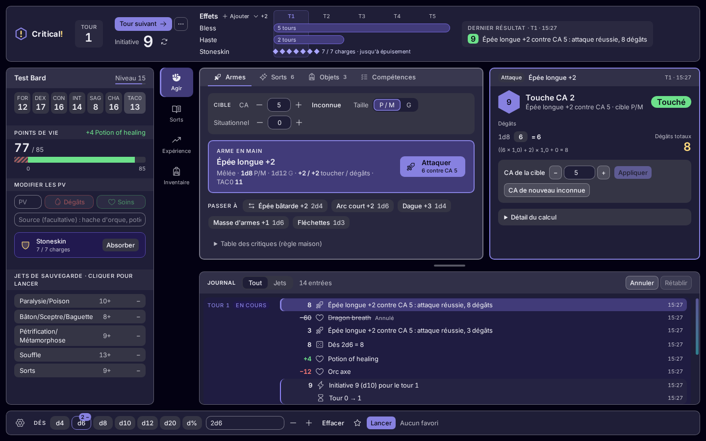 | 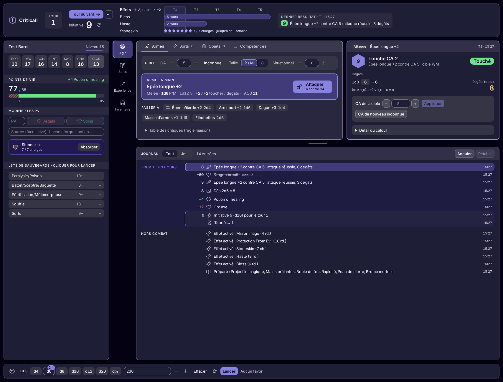 |
| C |  | 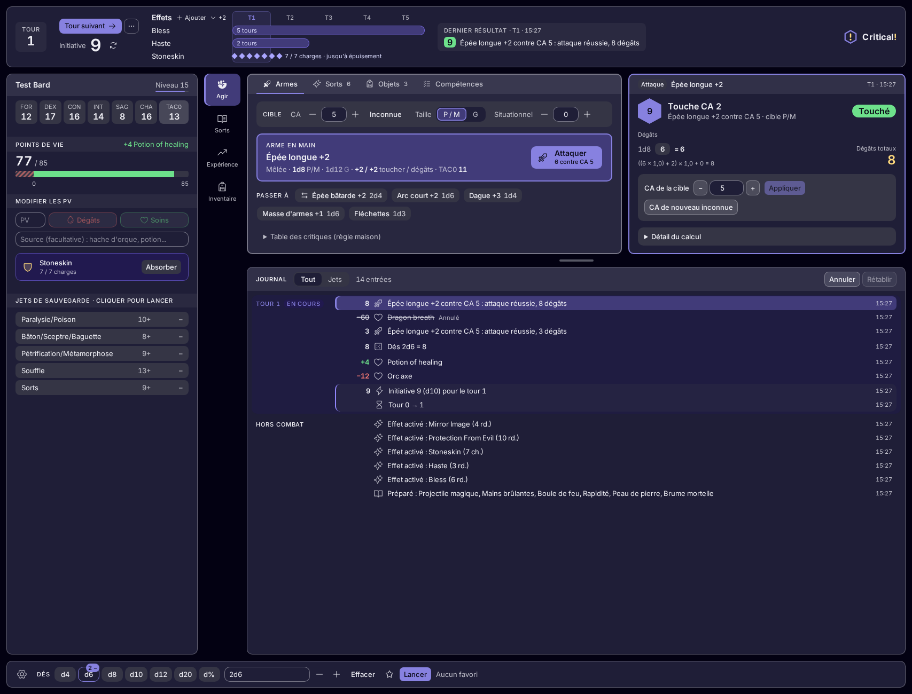 |
| C' | 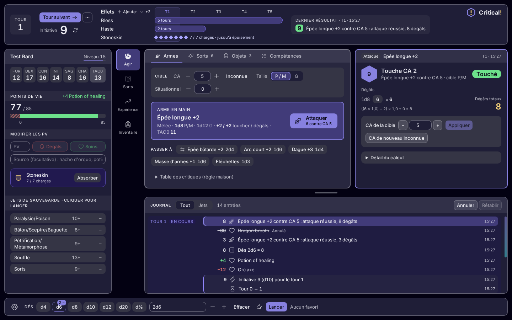 | 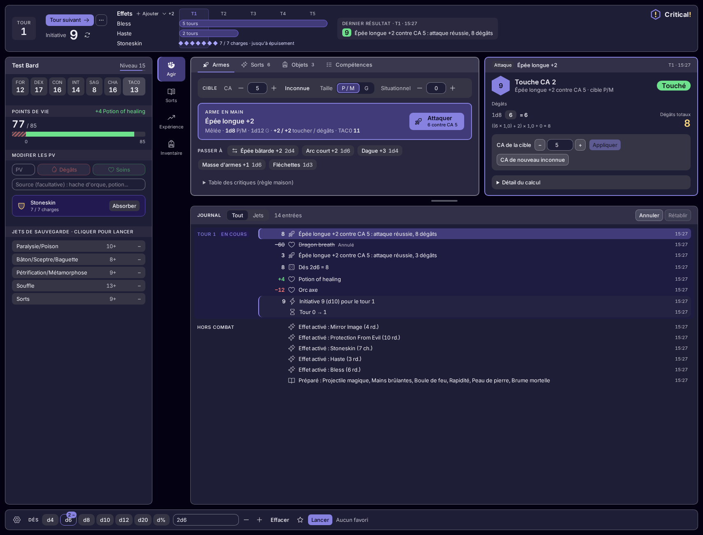 |
| D | 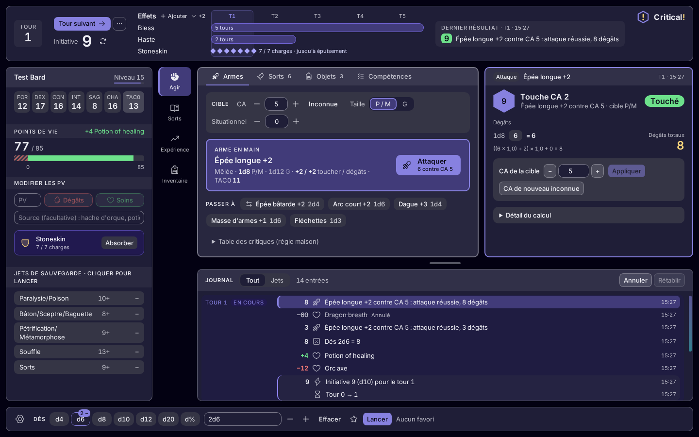 | 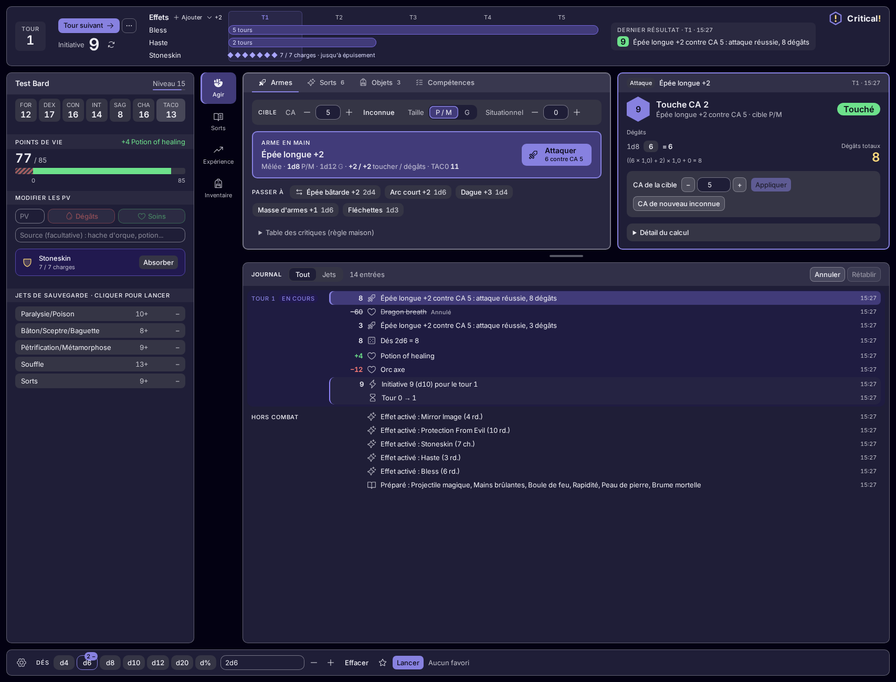 |
| D, effects expanded | 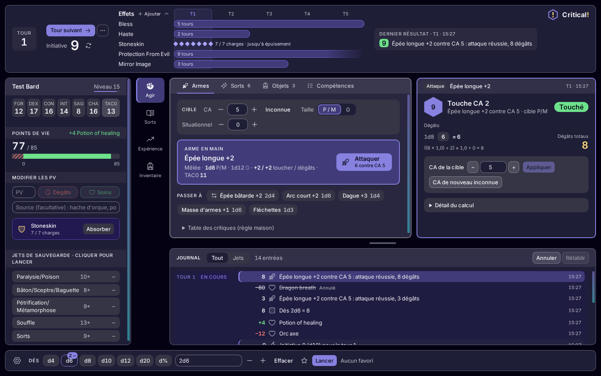 | 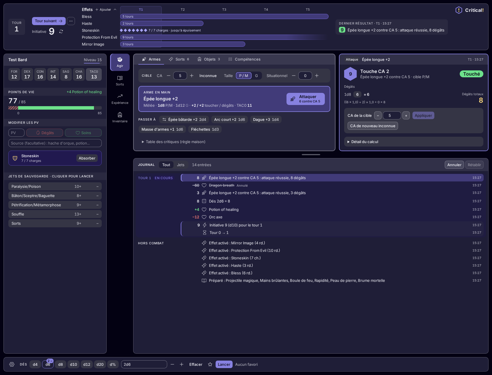 |
| E | 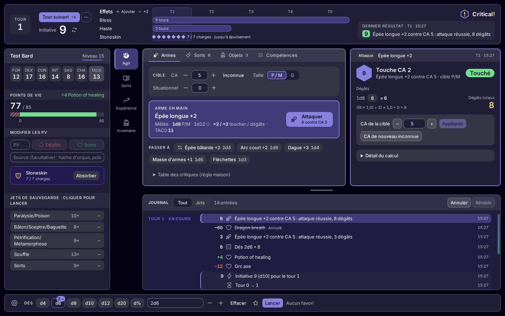 | 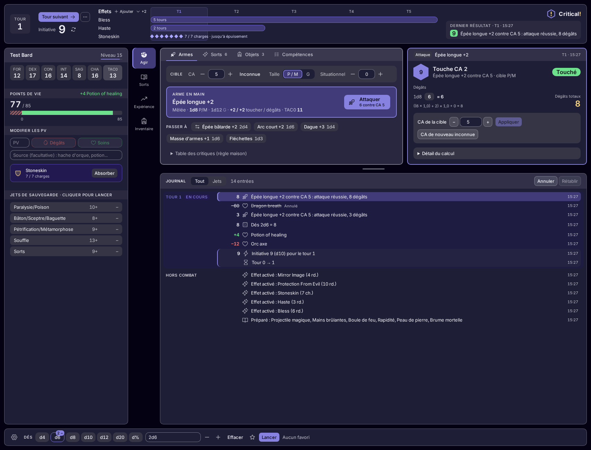 |
| E, effects expanded | 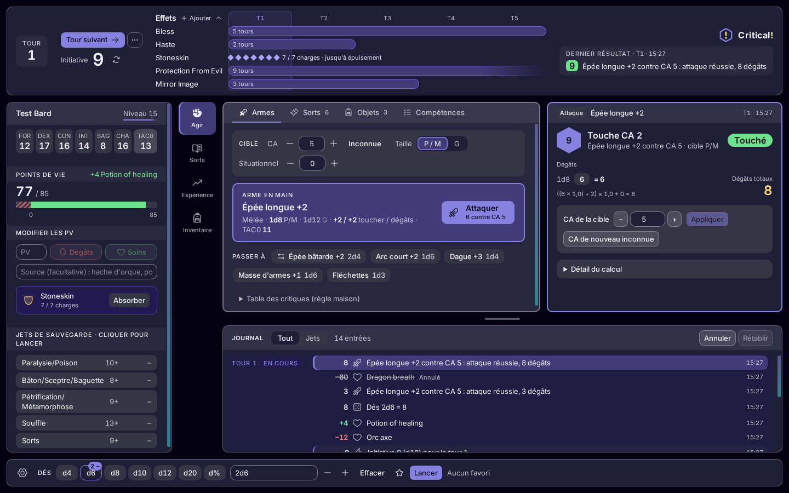 | 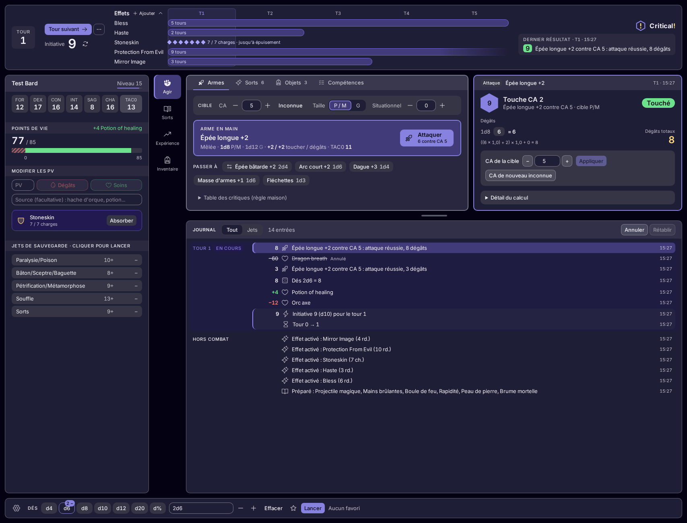 |

Light (Arcane light, 1440x900): [A](shots/a-left--arcane-light-1440x900.png),
[C](shots/c-right--arcane-light-1440x900.png), [C'](shots/c-right-top--arcane-light-1440x900.png), [D](shots/d-wide--arcane-light-1440x900.png),
[D expanded](shots/d-wide-expanded--arcane-light-1440x900.png), [E](shots/e-dock--arcane-light-1440x900.png),
[E expanded](shots/e-dock-expanded--arcane-light-1440x900.png).

**B was dropped in round 2** (not picked). Its shots are in the round 1 commit (`7473753`). Rerun,
it also failed the no-cut check at 1440x900 when the dice gave two-digit values: its wide brand cell
leaves the timeline too narrow for Stoneskin's charge line.

## How these were made

- `just ui-brand` (`web/ui-review/brand.spec.ts`) starts the app on the e2e stack with the mock-up
  round's seeded table, switches to French, paints the raised-stage colours, and opens Act · Weapons.
  It then draws the header (from [`header.css`](header.css) and the values of the real header: turn,
  initiative, effects, last result) in front of the real one, which it hides. Dice values change
  from run to run.
- The character card has ADR 0027 step 5.1's width (`clamp(280px, 21vw, 384px)`), the width it
  will have. Its saves heading and the wrapped save name at 1440 are that item's work,
  not this round's.
- Every shot is checked: no cut text (ADR 0022 step 1), no page scroll, the header at most 120 px
  (ADR 0022 step 3.1; expanded, 40 % of the viewport, ADR 0017 step 6), the wordmark shown in full. The run fails otherwise.
- App code is untouched.
