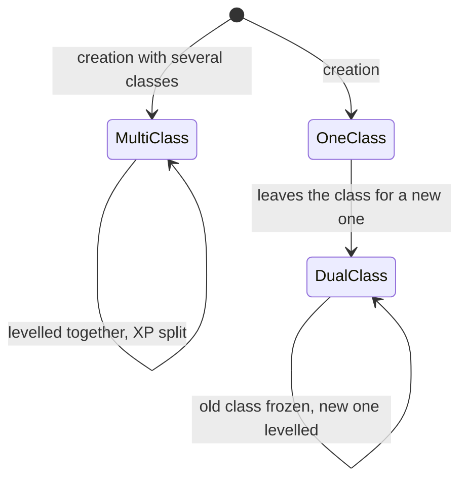
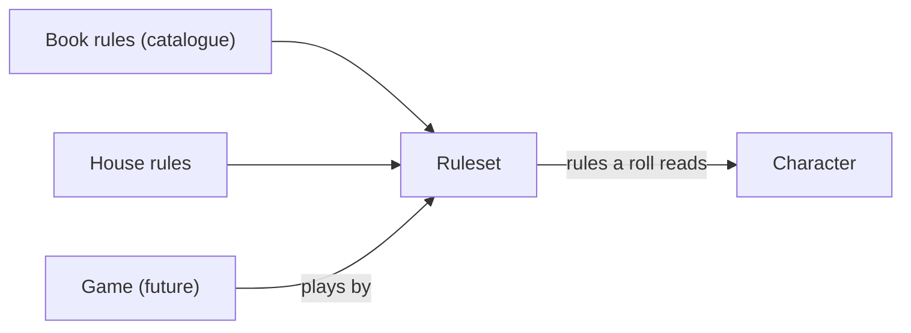
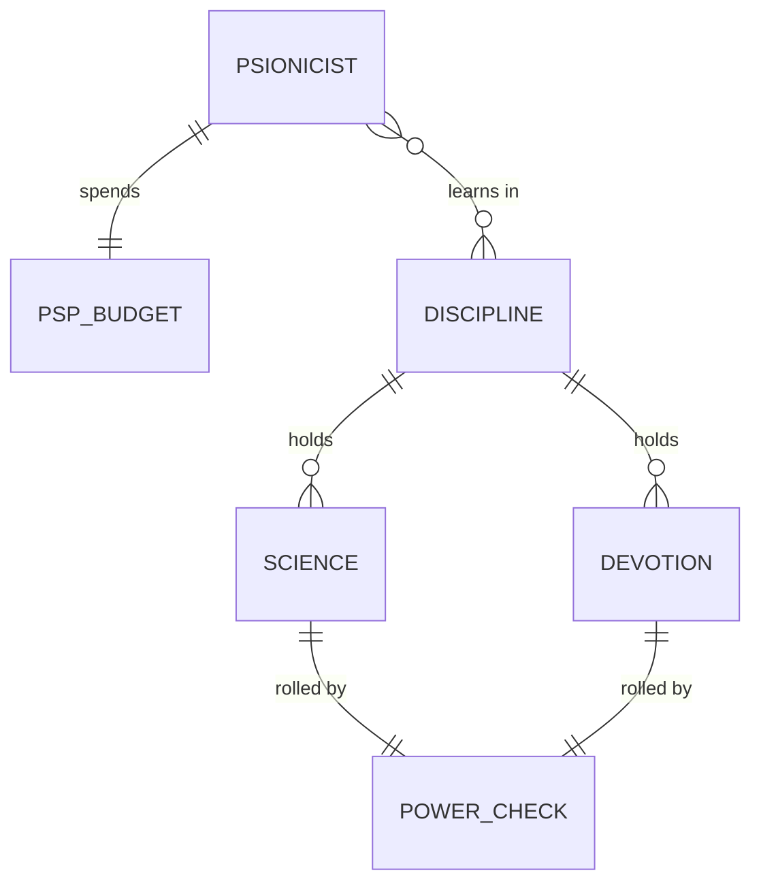

# Domain model

How the terms of [`GLOSSARY.md`](../GLOSSARY.md) relate: the entities, their relations, their
invariants and which ADR computes what. The glossary names things in one line each; this file
explains how they fit. The rules and their numbers live only in the ADRs
([index](adr/README.md)); this file points to them and never restates a figure
([ADR 0036](adr/0036-vocabulary.md) step 8). A PR that adds a concept updates this file and the
glossary together.

Marks: **built** is in the code today; **planned** is decided and scheduled; **future** is
expected but not designed. Today's code is the reference for what is built; where a planned entity
replaces a built one, the section says so.

## Overview

```mermaid
erDiagram
    USER ||--o{ CHARACTER : owns
    CHARACTER ||--|{ CLASS_ENTRY : "has (planned: one today)"
    CHARACTER }o--|| RACE : "is of"
    CHARACTER ||--|| ABILITY_SCORES : has
    CHARACTER ||--o{ LEDGER_ENTRY : "derives HP and XP from"
    CHARACTER ||--o{ BUFF : "has active"
    CHARACTER ||--o{ ITEM : carries
    CHARACTER ||--o{ SPELLBOOK_ENTRY : knows
    CHARACTER ||--o{ PICK : "has proficiencies"
    CLASS_ENTRY }o--|| CLASS : "is a"
    CLASS }o--|| CLASS_GROUP : "belongs to"
    CLASS ||--o{ CLASS_FEATURE : grants
    RACE ||--o{ RACE_TRAIT : has
    RULESET ||--o{ HOUSE_RULE : holds
    GAME }o--|| RULESET : "plays by (future)"
    GAME ||--o{ GAME_SESSION : "has (future)"
    GAME ||--|| PARTY : "has (future)"
    PARTY }o--o{ CHARACTER : "gathers (future)"
```

`RULESET`, `HOUSE_RULE`, `GAME`, `GAME_SESSION`, `PARTY`, `CLASS_FEATURE` and the plurality of
`CLASS_ENTRY` do not exist yet; the other boxes do, in some form. Each is described in its
section below.

## Character (built)

A player character, owned by one user ([ADR 0029](adr/0029-users-login-and-access.md) step 7). It
holds the inputs, and every figure is derived from them, never entered
([ADR 0030](adr/0030-classes-and-races.md)):

- **Class entries** (planned): each with a class, a realized level and its XP. Today a character
  has exactly one class, level and XP total, which is the one-entry case of the same shape.
- **Race**, with its traits.
- **Ability scores**: six stored scores; the **score in effect** adds the app's effects
  ([ADR 0004](adr/0004-buffs.md) steps 7 to 10).
- **Ledgers**: HP ([ADR 0007](adr/0007-hp-ledger.md)) and XP ([ADR 0015](adr/0015-experience.md)).
  Current HP is a sum over the action log; the XP total is the starting XP plus its entries.
- **Possessions and knowledge**: items, the spellbook, the proficiency picks, the skill points.

Invariants:

- A level is the **realized** level; the **target** level is a function of the XP, and the gap is
  the pending level-ups ([ADR 0030](adr/0030-classes-and-races.md) steps 3 and 7). Nothing derives
  from the target level.
- Nothing a rule derives (THAC0, saves, slots, skill percentages) is stored on the character.
- Every change goes through the action log, so it can be undone ([ADR 0018](adr/0018-transactions-and-undo.md)).

## Class (built as five fixed classes, planned as data)

A class belongs to one **class group** (warrior, wizard, priest, rogue); the tables are read by
group ([ADR 0030](adr/0030-classes-and-races.md) steps 1 and 21). Today the five classes are
code and tables; the plan is that a class is data in the catalogue and grants **class
features** (planned): a feature is a row with a **feature kind**, the mechanic it drives, so a
new class adds no branch to the code, as spell effects already work
([ADR 0008](adr/0008-spell-slots-and-long-rest.md) step 8). A **kit** (future) would be an
optional layer over a class.

The **prime requisite** of a class is the ability it is built on; the XP bonus it gives is read in
[ADR 0015](adr/0015-experience.md) steps 2 and 3.

## Multi-class and dual-class (planned)



- **Multi-class**: several class entries from the start, each with its own level; the XP earned is
  divided among them.
- **Dual-class**: one entry is left (frozen) and a new one begun; the old class's abilities are
  used again once the new class passes it.
- A class entry is the unit both share: a character is a list of class entries, and the two
  differ in how they are created and how their XP is spent. The decisions and the numbers are for
  the ADR that implements them; the book is PHB p.43 onwards.
- The table lifted the racial restriction on both (user, 2026-10-21), so the allowed
  combinations come from the ruleset, not from the race.

## Race (built)

One of the six PHB races. A race has **traits**: ability adjustments, level limits per class,
the languages, and the percentage adjustments of the thief skills
([ADR 0030](adr/0030-classes-and-races.md) steps 2, 17 and 22). Traits are data in the catalogue.

## Ruleset and house rules (planned)

A **ruleset** is the set of rules a game plays by: the books' rules plus the table's **house
rules**. Today a house rule is wired into the character (the crit table of
[ADR 0001](adr/0001-critical-hits.md) is the first); the plan is that it belongs to a ruleset,
and a character reads its rules through the ruleset it plays under. One default ruleset
exists until a second is needed.



A house rule overrides a book rule by name; it does not fork the catalogue. A character is
independent of a game, so one character can sit in a game later without changing.

## Game, campaign, session, party (future)

A **game** (or **campaign**; the words are not settled apart) has one ruleset, one **party**
(the characters adventuring together) and many **game sessions** (evenings of play). None exists
in the code. The login **session** ([ADR 0029](adr/0029-users-login-and-access.md) step 4) is
unrelated and keeps the word.

The action log ([ADR 0007](adr/0007-hp-ledger.md)) belongs to a character today; whether a game
log sits above it is open.

## Psionics (planned)



A **psionicist** is a class whose powers cost **PSP**. A power is a **science** or a
**devotion** within a **discipline**; using it is a **power check**, a roll with a breakdown like
any other ([ADR 0014](adr/0014-skill-checks.md) for the shape). The French words are from the
Manuel complet des psioniques, which is not in the rulebooks clone yet: the glossary marks them
_to confirm_.

## What computes what

| Figure | Inputs | Where |
|---|---|---|
| Level, target level | class entry, XP | [ADR 0015](adr/0015-experience.md), [ADR 0030](adr/0030-classes-and-races.md) steps 3 and 7 |
| THAC0, saves | class group, level | [ADR 0002](adr/0002-attack-resolution.md), [ADR 0006](adr/0006-saving-throws.md) |
| Magical defence adjustment (a mind-affecting save's `wisdom` modifier) | Wisdom, any class | [ADR 0006](adr/0006-saving-throws.md) step 9 |
| Spell slots | class, level, Wisdom or Intelligence | [ADR 0008](adr/0008-spell-slots-and-long-rest.md) |
| Proficiency budget | class group, level, Intelligence | [ADR 0037](adr/0037-proficiencies.md) |
| Rogue skill percentages | skill points, race, Dexterity, skill armour | [ADR 0014](adr/0014-skill-checks.md), [ADR 0030](adr/0030-classes-and-races.md) |
| A roll's modifiers | the aggregate of buffs and item powers | [ADR 0004](adr/0004-buffs.md) step 11 |
| Current HP | the action log | [ADR 0007](adr/0007-hp-ledger.md) |

## Ambiguities resolved

- **Multi-class vs dual-class.** The books: multi-class is several classes from the start,
  dual-class is leaving one for another (the French PHB says _multi-classé_ and _classes
  successives_). The user's words (2026-10-21) were "dual" for the first and "serial" for the
  second. Both are noted in the glossary; the project's terms are the book's. "Dual" alone and
  "serial" are avoided in anything new.
- **The thief in the table's game** is multi-class, not dual-class (user, 2026-10-21).
- **Level.** Alone it means the realized level. With several class entries it is the level of one
  entry.
- **Session.** A login session ([ADR 0029](adr/0029-users-login-and-access.md)) and a game session
  are different things; the second is always "game session".
- **Game vs campaign.** Not settled apart; both words are listed in the glossary as one term.
- **Power.** A class feature is not a power; "power" belongs to psionics, and to an item power
  in [ADR 0016](adr/0016-inventory.md), which is an effect an item carries.
- **Discipline vs school.** A discipline is psionic, a school is a wizard spell grouping.
- **Where the house rules live.** In a ruleset, not on the character (user, 2026-10-21).
