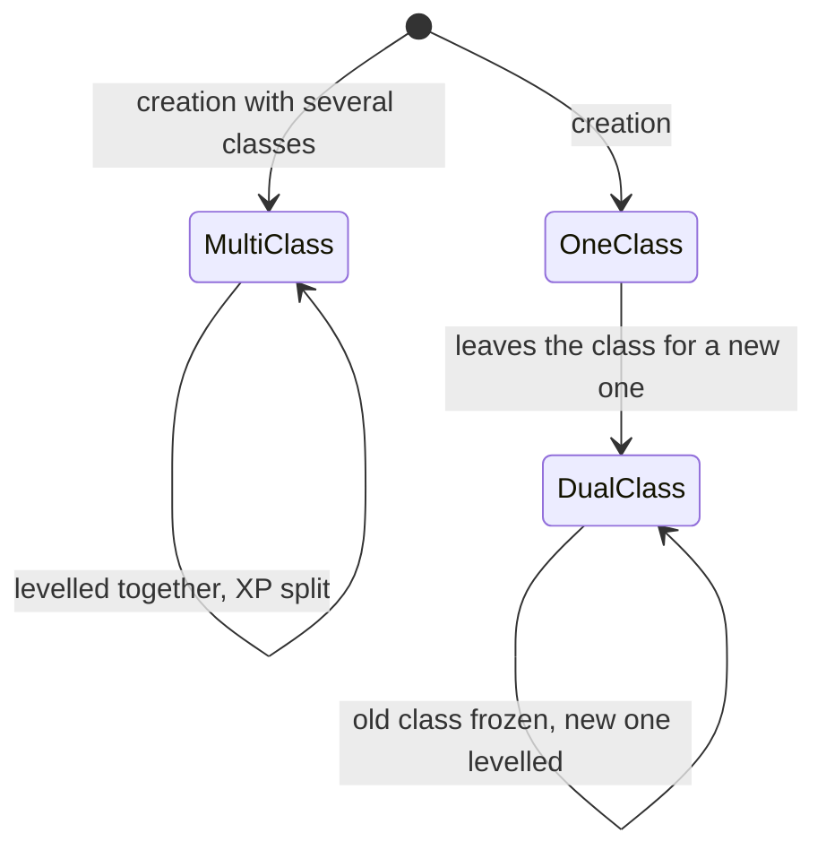
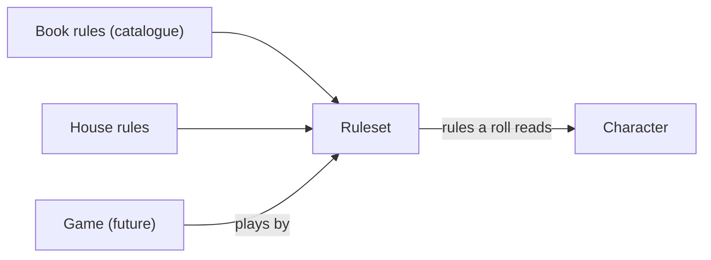
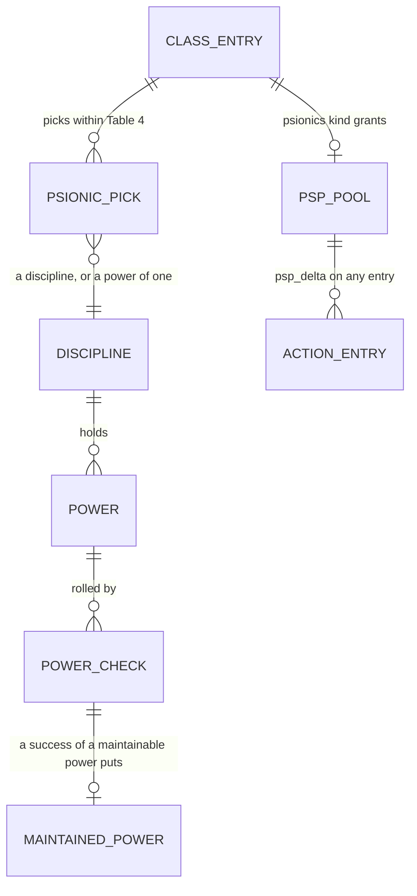

# Domain model

How the terms of [`GLOSSARY.md`](../GLOSSARY.md) relate: the entities, their relations, their
invariants and which ADR computes what. The glossary names things in one line each; this file
explains how they fit. The rules and their numbers live only in the ADRs
([index](adr/README.md)); this file points to them and never restates a figure
([ADR 0036](adr/0036-vocabulary.md) step 8). A PR that adds a concept updates this file and the
glossary together.

Marks: **built** is in the code today; **planned** is decided and scheduled; **future** is
expected but not designed. Today's code is the reference for what is built; where a planned entity
replaces a built one, the section says so.

## Overview

```mermaid
erDiagram
    USER ||--o{ CHARACTER : owns
    CHARACTER ||--|{ CLASS_ENTRY : "has (one to three; one today)"
    CHARACTER }o--|| RACE : "is of"
    CHARACTER ||--|| ABILITY_SCORES : has
    CHARACTER ||--o{ LEDGER_ENTRY : "derives HP and XP from"
    CHARACTER ||--o{ BUFF : "has active"
    CHARACTER ||--o{ ITEM : carries
    CHARACTER ||--o{ SPELLBOOK_ENTRY : knows
    CHARACTER ||--o{ PICK : "has proficiencies"
    CLASS_ENTRY }o--|| CLASS : "is a"
    CLASS }o--|| CLASS_GROUP : "belongs to"
    CLASS ||--o{ CLASS_FEATURE : grants
    RACE ||--o{ RACE_TRAIT : has
    RULESET ||--o{ HOUSE_RULE : holds
    GAME }o--|| RULESET : "plays by (future)"
    GAME ||--o{ GAME_SESSION : "has (future)"
    GAME ||--|| PARTY : "has (future)"
    PARTY }o--o{ CHARACTER : "gathers (future)"
```

`RULESET`, `HOUSE_RULE`, `GAME`, `GAME_SESSION`, `PARTY`, `CLASS_FEATURE` and the plurality of
`CLASS_ENTRY` beyond one do not exist yet; the other boxes do, in some form. Each is described in its
section below.

## Character (built)

A player character, owned by one user ([ADR 0029](adr/0029-users-login-and-access.md) step 7). It
holds the inputs, and every figure is derived from them, never entered
([ADR 0030](adr/0030-classes-and-races.md)):

- **Class entries** (built, one entry per character so far): one to three, each with a class, a
  realized level, its starting XP and a state (active, or frozen with the level it was left at;
  [ADR 0042](adr/0042-multi-class-and-dual-class.md) step 1; table `character_classes`, domain
  `classes.Entry`, wire `classes[]`). Every character today has the one active entry its class,
  level and XP total gave at migration 035; the rules read the first active entry
  (`classes.Primary`) until the multi-class math lands.
- **Race**, with its traits.
- **Ability scores**: six stored scores; the **score in effect** adds the app's effects
  ([ADR 0004](adr/0004-buffs.md) steps 7 to 10).
- **Ledgers**: HP ([ADR 0007](adr/0007-hp-ledger.md)) and XP ([ADR 0015](adr/0015-experience.md)).
  Current HP is a sum over the action log; the XP total is the starting XP plus its entries.
- **Possessions and knowledge**: items, the spellbook, the proficiency picks, the skill points (per
  skill set: one set for each `rogue_skills` feature the classes grant, each with its own budget,
  [ADR 0040](adr/0040-classes-are-data.md) step 3.5).

Invariants:

- A level is the **realized** level; the **target** level is a function of the XP, and the gap is
  the pending level-ups ([ADR 0030](adr/0030-classes-and-races.md) steps 3 and 7). Nothing derives
  from the target level.
- Nothing a rule derives (THAC0, saves, slots, skill percentages) is stored on the character.
- Every change goes through the action log, so it can be undone ([ADR 0018](adr/0018-transactions-and-undo.md)).

## Class (five classes, read from the catalogue's definitions)

A class belongs to one **class group** (warrior, wizard, priest, rogue); the THAC0, saves,
proficiency slots and by-group spell effects are read by group
([ADR 0030](adr/0030-classes-and-races.md) step 2).
[ADR 0040](adr/0040-classes-are-data.md) makes each a **class definition** in the catalogue (format 11): group, prime requisites,
ability minimums, alignments, equipment limits, XP rows, hit dice, a spell progression by
reference, and a list of **class features**. A feature is `{kind, from_level, params}`: its
**feature kind** is one of a closed list the code implements once, so a new class of known kinds
adds no code, as spell effects already work ([ADR 0008](adr/0008-spell-slots-and-long-rest.md)
step 8). A new mechanic is a new kind. A **kit** (future) would be data adding or removing
features on a class.

The **class registry** (`domain/classes`) holds the definitions, the groups and the races, checked
at start-up (ADR 0040 step 8). Every class it holds is creatable, in catalogue order. The class
list, a class's group, prime requisites (the 10% XP bonus needs 16 in every one, step 6),
ability minimums, alignments, XP rows, spell progression and class features are read from it, and
so is a group's THAC0 (Table 53). A rule asks `Class.Feature(kind, level)` (the feature at a realized
level) or, before a level is known (creation options, entry checks), whether the class lists the kind.
The spell slots come from the table the spell progression names; the derived block says which panels
apply (turning, spellbook, specialization, skills) and whether the class has **exceptional
Strength**, and the creation draft whether the form offers the 18/xx field (the class lists the kind,
the Strength entered is 18, the race rolls it). The `sphere_access` feature is parsed and checked
but not read yet: the cleric's spheres still come from the class-keyed sphere rows.
A race's **racial ability requirements** (its ability ranges) make it **restricted**: a restricted
race has rows in every per-race table (level limits, requirements, thief skill adjustments); an
unrestricted one (the human) may have none, and is then any class with no limit. A class's
**class limits** (`Class.Equipment`: armour columns, shields, weapon types and codes, blunt only) give
the class warnings of worn and wielded pieces and, with the weapon catalogue, the weapon types a
proficiency may be picked in (derived once at import). A race's **traits** (`Race.Trait(kind)`:
`con_save_bonus`, `no_exceptional_strength`) and its Tables 10 and 11 **identity** rows are read from
its definition; the hit dice are still read from the rule tables (step 11.3).
A character's class is a registry id, and so is the seed's (step 9).

```mermaid
erDiagram
    CLASS_ENTRY }o--|| CLASS : "is a"
    CLASS ||--o{ CLASS_FEATURE : lists
    CLASS_FEATURE }o--|| FEATURE_KIND : "is of"
    RACE ||--o{ RACE_TRAIT : lists
    RACE_TRAIT }o--o| TRAIT_KIND : "is of (computed traits)"
```

- A character has a feature kind when one of its class entries' classes lists it at or under that
  entry's realized level; the rule reads that entry's parameters and level ([ADR 0040](adr/0040-classes-are-data.md) step 5).
- No class, group, race or kit id appears in the code: ids live in the catalogue, seeds and tests
  ([ADR 0040](adr/0040-classes-are-data.md) step 10).

The **prime requisites** of a class are the abilities it is built on; 16 or more in every one
gives the 10% XP bonus ([ADR 0015](adr/0015-experience.md), [ADR 0040](adr/0040-classes-are-data.md) step 6).

## Multi-class and dual-class (planned)



- **Multi-class**: two or three active class entries from the start, each levelling on its own;
  each XP award is split evenly among them. One figure per character (THAC0, each save) is the
  best of the entries; hit points per level are the entry's die divided by the number of classes.
- **Dual-class**: the active entry is frozen at the level it is left at and a new one begun at
  level 1; the old class's abilities are used again without penalty, and hit points gained again,
  once the new class's level passes every frozen one (the crossover).
- A class entry is the unit both share: a character is a list of class entries, and the two
  differ in how they are created and how their XP is spent. The rules are
  [ADR 0042](adr/0042-multi-class-and-dual-class.md) (PHB p.43 onwards).
- The table lifted the racial restriction on both (user, 2026-10-21), so the allowed
  combinations come from the ruleset, not from the race.

## Race (built)

One of the six PHB races. A race has **traits**: ability adjustments, level limits per class,
the languages, and the percentage adjustments of the thief skills
([ADR 0030](adr/0030-classes-and-races.md) steps 17, 21 and 22). Traits are data in the catalogue
([ADR 0040](adr/0040-classes-are-data.md) steps 2 and 4): the computed ones are typed (`con_save_bonus`, `no_exceptional_strength`),
the others text; a human is a race with no traits. The level limits and the classes a race
admits are book data; how they apply (they warn; the racial lift for multi-class and dual-class)
is the ruleset's ([ADR 0041](adr/0041-ruleset.md) steps 2.2, 2.3 and 5).

## Ruleset and house rules

A **ruleset** is the set of rules a game plays by: the books' rules plus the table's **house
rules**. Each house rule is a typed **house rule setting** of the ruleset
([ADR 0041](adr/0041-ruleset.md) step 2): the crit table ([ADR 0001](adr/0001-critical-hits.md)),
the racial lift for multi-class and dual-class, the level limits mode (`warn`) and the success
effects of proficiencies (Tumbling). They belong to the ruleset (stored since the ruleset
backend; the Ruleset screen is built for admins; the multi-class rules that read the lift are later), and a
character reads them through a resolver (character to ruleset). One default ruleset exists, used
by every character, until a game points at its own.



An admin edits the ruleset; the edit is audited but is not a character action (no undo, not in
a journal; [ADR 0041](adr/0041-ruleset.md) step 7). A logged outcome keeps the setting it used.

A house rule overrides a book rule by name; it does not fork the catalogue. A character is
independent of a game, so one character can sit in a game later without changing.

## Game, campaign, session, party (future)

A **game** (or **campaign**; the words are not settled apart) has one ruleset, one **party**
(the characters adventuring together) and many **game sessions** (evenings of play). None exists
in the code. The login **session** ([ADR 0029](adr/0029-users-login-and-access.md) step 4) is
unrelated and keeps the word.

The action log ([ADR 0007](adr/0007-hp-ledger.md)) belongs to a character today; whether a game
log sits above it is open.

## Psionics (planned)



A **psionicist** ([ADR 0043](adr/0043-psionics.md)) is a class definition whose `psionics`
feature kind grants, on its class entry, a **PSP** pool and **picks**: disciplines (the first is
the **primary discipline**), powers (a **science** or a **devotion** of a discipline) and relearns,
within the entry's Table 4 allowance. The pool is a maximum plus the PSP deltas of the action log,
as HP is: a **power check** spends the **initial cost** (half on a failure), a maintained power is
a buff row whose **maintenance cost** Next Round and passing time charge, and recovery and the long
rest give PSPs back, capped at the maximum. A power's effect is buff data of the existing kinds or
text. The check is a roll with a breakdown like any other ([ADR 0014](adr/0014-skill-checks.md)
for the shape). Psionic combat (attack and defence modes, contact) is later.

## What computes what

| Figure | Inputs | Where |
|---|---|---|
| Level, target level | class entry, its XP share | [ADR 0015](adr/0015-experience.md), [ADR 0030](adr/0030-classes-and-races.md) steps 3 and 7, [ADR 0042](adr/0042-multi-class-and-dual-class.md) steps 5 and 7 |
| THAC0, saves | class group, level; the best of the class entries | [ADR 0002](adr/0002-attack-resolution.md), [ADR 0006](adr/0006-saving-throws.md), [ADR 0042](adr/0042-multi-class-and-dual-class.md) steps 8 and 9 |
| Magical defence adjustment (a mind-affecting save's `wisdom` modifier) | Wisdom, any class | [ADR 0006](adr/0006-saving-throws.md) step 9 |
| Spell immunities (`Derived.SpellImmunities`; a save or a spell received against one carries an `Immunity` and rolls nothing) | Wisdom, any class; the catalogue's Table 5 rows up to the score | [ADR 0006](adr/0006-saving-throws.md) step 10 |
| Spell slots | class, level, Wisdom or Intelligence | [ADR 0008](adr/0008-spell-slots-and-long-rest.md) |
| Proficiency budget | class group, level, Intelligence | [ADR 0037](adr/0037-proficiencies.md) |
| Rogue skill percentages, per skill set | the set's skill points, race, Dexterity, skill armour | [ADR 0014](adr/0014-skill-checks.md), [ADR 0030](adr/0030-classes-and-races.md), [ADR 0040](adr/0040-classes-are-data.md) step 3.5 |
| A roll's modifiers | the aggregate of buffs and item powers | [ADR 0004](adr/0004-buffs.md) step 11 |
| Current HP | the action log | [ADR 0007](adr/0007-hp-ledger.md) |
| PSP maximum, current PSPs | Wisdom, Intelligence, Constitution, the psionicist entry's level; the action log | [ADR 0043](adr/0043-psionics.md) steps 4 and 5 |
| Power score | the power's ability and modifier, relearns, adjustments | [ADR 0043](adr/0043-psionics.md) step 10 |

## Ambiguities resolved

- **Multi-class vs dual-class.** The books: multi-class is several classes from the start,
  dual-class is leaving one for another (the French PHB says _multi-classé_ and _classes
  successives_). The user's words (2026-10-21) were "dual" for the first and "serial" for the
  second. Both are noted in the glossary; the project's terms are the book's. "Dual" alone and
  "serial" are avoided in anything new.
- **The thief in the table's game** is multi-class, not dual-class (user, 2026-10-21).
- **Level.** Alone it means the realized level. With several class entries it is the level of one
  entry.
- **Session.** A login session ([ADR 0029](adr/0029-users-login-and-access.md)) and a game session
  are different things; the second is always "game session".
- **Game vs campaign.** Not settled apart; both words are listed in the glossary as one term.
- **Power.** A class feature is not a power; "power" belongs to psionics, and to an item power
  in [ADR 0016](adr/0016-inventory.md), which is an effect an item carries.
- **Discipline vs school.** A discipline is psionic, a school is a wizard spell grouping.
- **Where the house rules live.** In a ruleset, not on the character (user, 2026-10-21).
