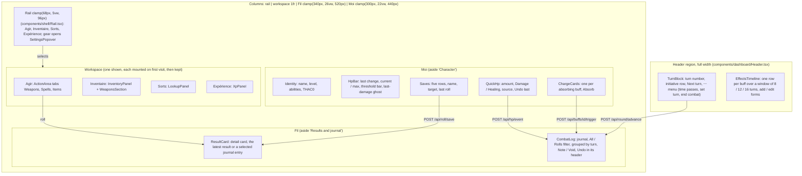

# Critical — Frontend Context (React Agents)

## Stack

- **Framework**: React 18 + Vite + TypeScript (strict mode)
- **Styling**: Tailwind CSS v4; Nocturne tokens and ambiances (ADR 0009, `lib/theme.ts`, `index.css`)
- **Type and icons**: Inter (`@fontsource-variable/inter`), Phosphor (`@phosphor-icons/react`); no other family or icon set
- **Components**: shadcn/ui (components live in `web/src/components/ui/`)
- **i18n**: i18next + react-i18next (see "Internationalisation")
- **State**: Zustand (one store per domain: hp, combat, buffs, spells)
- **API client**: native `fetch` with typed wrappers in `web/src/api/`
- **No game logic**: if you are computing anything beyond display formatting, stop and move it to Go

## Project Structure (web/)

```
web/
  src/
    api/              ← typed fetch wrappers (hp.ts, combat.ts, buffs.ts, spells.ts)
    components/
      ui/             ← shadcn/ui primitives (Button, Card, Badge, etc.)
      dashboard/      ← Header (TurnBlock, EffectsTimeline, BuffForms), HpBar, ResultCard, QuickHp, CombatLog, Notices
      actions/        ← ActionArea tabs and one panel per tab
    stores/           ← Zustand stores (hp.ts, combat.ts, buffs.ts, spells.ts)
    types/            ← TypeScript types mirroring Go response structs
    App.tsx           ← root layout (header + round screen grid)
```

## Dashboard Layout

One screen, no page scroll, organised around a combat round: see state, act, see the result, fix
mistakes, advance the round. Responsive from 1280 to 2560 CSS px at full width, no horizontal
scroll down to 1024; columns are clamped and type/spacing scale with the root size. The grid,
clamps, tokens and house rules are decided in
[ADR 0009](adr/0009-dashboard-layout-and-theme-system.md). `App.tsx` composes it.



- Each column scrolls on its own; the detail card takes at most 60% of the Fil column, the
  journal the rest.
- Fil column (`ResultCard.tsx`, `CombatLog.tsx`, logic in `lib/filCard.ts`, UI state in
  `stores/fil.ts`): the detail card shows the latest result by default: this session's last roll
  response while it is the newest attack / save / cast / item use entry (the server's
  `actionlog.RollKinds`), else that entry rendered from its payload (after a reload). A click on a
  journal row shows that entry instead, read-only, with an accent ring and "Latest" to return; a
  new roll returns to the latest too. Only the latest result offers corrections (target AC, save
  adjustment), by entry id. One layout per kind, from the payload (`cardModel`): attack (hexagon
  d20, "Hits AC X", verdict, damage dice and total, "Calculation details" closed by default),
  save (d20, "total vs target+", verdict, modifiers, adjustment), cast, item (dice chips, the
  maximum in the accent, a 1 dimmed), initiative, and info for every other kind (text, HP value
  red / green). Header: kind tag, subtitle, "T3 · 21:31". The journal: All / Rolls filter (attacks,
  saves, item uses, initiative, casts that rolled damage or a to-hit d20), turn groups newest first
  with a sticky "Turn 3" / "Out of combat" header and a "current" tag, rows icon | text | value with
  the time, Note and Void under it; the row shown in the card is highlighted. Attack damage dice
  show as "1d8 → 6": the attack payload has no per-die values.
- Settings popover (`components/shell/SettingsPopover.tsx`, `stores/settings.ts`): language
  (English / Français), appearance (Dark / Light / System, System follows the OS live), six
  ambiance swatches. Applied live, stored per device in `localStorage['critical.settings.v1']`
  (`lib/settings.ts`, which migrates the older `critical.theme` / `critical.language` keys once).
- Theme: `lib/theme.ts` `themeVars(ambiance, light)` computes the ramps and surfaces set on
  `<html>`; use the tokens (`bg-surface`, `bg-neu-900`, `text-amb-300`, `text-ink-muted`,
  `bg-danger` / `heal` / `warning`, `shadow-float` for popovers only) or the shadcn names mapped
  onto them, never raw colours.
- Plug-in slots: each Agir tab is one panel component in `components/actions/ActionArea.tsx`
  (`TABS`, the tab label shows a count where it has one: spells left, combat items); each workspace is one `Pane` in `App.tsx` (`lib/workspaces.ts`).
- Turn header (`TurnBlock.tsx`, `EffectsTimeline.tsx`, layout maths in `lib/timeline.ts`): the turn
  block shows the turn (the round counter), the initiative row ("Out of combat" at turn 0, a
  placeholder otherwise), Next turn and a ⋯ popover menu (Time passes…, Set turn number…, End combat,
  each a small form or confirm inside the popover). The effects track has a label column and N turn
  columns, N = 8 / 12 / 16, the most that stay at least 60 CSS px wide; the window starts at
  `max(1, turn − 2)` (at turn 0 it starts at 0). The current column is highlighted across every row,
  past column headers are dimmed. Per buff: a thin line from its `startRound` (server-stamped, ADR
  0004 step 15) to the previous turn, then a pill over the current turn and the `duration − 1` after
  it, labelled with the turns left (from 60 also in hours), fading out past the window and in the
  warning colour on its last turn (`duration` 1); a charge-only buff shows pips and "6 charges · until
  spent" (the server keeps no starting count, so no "6 / 9"); an untimed one "until dismissed"; a buff
  with `applies: false` is dashed with a lock and the reason. Each row has absorb (charge buffs),
  edit and remove; "Add effect" opens the add form under the track.
- Buffs: every change (add, edit rounds/charges, absorb for charge buffs, dismiss, Next
  turn) is a log entry, voidable from the CombatLog while it is the newest entry. The log is a
  stack: only the newest non-voided entry (`topId` from `GET /api/log`) shows Void; the CombatLog
  header's Undo button and Ctrl/Cmd+Z (not while typing in a field) pop it from anywhere with
  `POST /api/log/undo` and that `topId` ([ADR 0010](adr/0010-action-stack-and-undo.md)); every entry has Note
  (the only amend, shown in italics under the line); values are never edited in the log. Buff/round entries are rendered from their
  payload in the player's language (`lib/logSummary.ts`). The Moi column's STR is the effective STR
  (`GET /api/stats/str`, sheet value in brackets when buffed); a buff whose `min_str` is not met
  (`applies: false`, e.g. the Power Gem below STR 18) shows dashed with "needs STR N"; an applying buff with `weapon_buff` / `multiplier` shows its effect under its name ("weapon +5 · dice ×2"); a Strength
  bonus that an active Improved Strength replaces (`applies: false`, no `min_str`) shows dashed
  with "replaced by Improved Strength".
- Weapons tab (`components/actions/AttackPanel.tsx`, `stores/attack.ts`): the attack form's
  choices are server state (`GET` / `PATCH /api/attack/form`, ADR 0009 step 6), restored on load and
  in every tab or device. The target bar has the AC stepper, the size (S / M | L) and the
  situational stepper with its reason (shown when not 0), both bounded to ±20 like the server. The
  weapon-in-hand card shows the name, melee / missile, two-handed, Attack, and four tiles from the
  server's preview (ADR 0002 step 12): damage dice S/M and L (the current size ringed, the other
  dimmed), to-hit / damage bonus and the effective THAC0 with the roll needed against the target AC.
  A bow shows its ammunition as chips (`ammoChoices`, counts amber at 3 or less; the chosen one
  stays chosen when spent and the panel says so). "Switch to {previous}" and the "Other weapon"
  popover change the weapon in hand and never attack. Changes are sent one after the other and
  only the newest answer is shown; target and situational changes show at once. The preview is
  reloaded when buffs, effective STR, items or weapons change. An attack sends the saved choices
  (an offered first arrow becomes the choice first, so it stays chosen once spent); the result
  card labels each modifier and damage term by its `kind` (`result.mods.*`); attack log entries
  are rendered from their payload (`lib/logSummary.ts`). An attack refreshes the table state (log,
  item counts), so voiding it shows the arrow back.
- Items tab (`ItemsTab.tsx`): every item but ammunition (`lib/combatItems.ts`) on a 40px row:
  name, behaviour and count, dice, Roll (it has dice) or Use, through `stores/roll.ts`
  `spendItem`; "Manage the inventory" opens the Inventaire workspace.
- Inventaire workspace (`InventoryPanel.tsx`): the Objets card, one grid row per item: name with
  its magical bonus ("+2") and "type · behaviour" (Stock / Charges / Daily) under it | the effect
  dice as a chip that puts the formula in the dice composer (`stores/dice.ts` `setFormula`, nothing
  rolled) | the quantity stepper: − (uses one through `stores/roll.ts` `spendItem`, result card
  shows the roll), the count ("1 / 1" for daily) and + on stock items only
  (`POST /api/items/{id}/restock`, through `stores/table.ts` `run`) | ✎ / 🗑. Columns are rem
  widths beside a `1fr` name, rows are separated by a tone step. A charges item spent to 0 is gone
  from the list until its use is popped. ✎ edits a row in place and
  "Add item" opens the same form (`ItemForm.tsx`); 🗑 removes. The form only parses
  numbers (`lib/itemForm.ts`); the server validates and the message it returns for a field is shown
  under that field (`stores/table.ts` `submit`, `ApiError.field`). Edits send only the changed fields.
- The Inventaire workspace also has the Armes card (`WeaponsSection.tsx`), the same grid: name
  with "melee / missile · two-handed · ammo" | damage "1d8 · L 1d12" | to-hit / damage bonus | ✎ / 🗑 per row and an "Add weapon" form (`WeaponForm.tsx`,
  `lib/weaponForm.ts`), built like the item form (server validation under the field). A change
  refreshes the weapons store, so the Weapons tab follows.
- Spells tab (`SpellsPanel.tsx`): "Buff spells go on an ally", Prepare spells and Long rest on
  top; one group per level with a pip per slot (filled while unused) and "left / total"; 40px rows
  with the name, the damage a cast rolls at the Bard's level when the spellbook entry serves one
  (`lib/spellDice.ts` `damageText`: "10d6 fire", "5 × 1d4+1 force", "2d4 acid per round, 6
  rounds", type words in `spellDice.types`), and Cast or Used. Cast puts the `CastResult` in the result card (`CastResultView`:
  buff rolls, damage rolls, save note for the DM, effects to apply by hand, spell text); "Buff spells
  go on an ally" sends `onSelf: false`. `ReceivePanel.tsx` ("Spell cast on me") finds a spell with
  the shared name search (below) and posts `/api/spells/receive`.
- Sorts workspace, spell lookup (`LookupPanel.tsx`, state in `stores/lookup.ts` so it survives tab switches):
  a filter card (search box and school-group dropdown, spheres in Priest mode; `Mine | Wizard |
  Priest | All` segmented control, default Wizard, Mine = the Bard's spellbook; level chips 0-9,
  multi-select; the true "N spells" total and Reset), then a list beside a detail pane. The list is
  `clamp(13.75rem, 30%, 26rem)` wide (level and name, the class on All, the school as a tooltip;
  infinite scroll by 200-row pages). The detail pane: name, meta line, one row per stat (label |
  value at the Bard's level with the raw text dimmed under it), then one dice row per value the
  server computed with dice still to roll (`lib/spellValues.ts` `statDice`: "At level 15 ·
  Duration 1d8+8", the served dice then the served flat amount) with "To the dice" (fills the
  composer) and Roll (`POST /api/roll/dice` through `stores/dice.ts` `roll`), and the Description
  toggle. The spell DTO serves no damage dice, so damage has no dice row.
- Spell name search (one module for Lookup and Receive): `api/spells_db.ts` `searchSpells` sends
  `q` (the server matches English names) plus `match_exact` / `match_prefix` / `match_contains`,
  the catalogue keys whose French name matched (`lib/spellSearch.ts`); the server ORs both and
  ranks exact > prefix > contains, then level, name.
- Expérience workspace (`components/xp/XpPanel.tsx`, `stores/xp.ts`, ADR 0015): a progress card
  (total, "Before level N · X XP", a bar with 10% ticks between the server's floor and ceiling, the
  server's 8 level cells with their thresholds, current and next ringed), "Add XP" (amount, reason,
  session, +10% defaulting to the server's `bonusEligible`; the button shows the server's preview,
  `GET /api/xp/preview`; Enter submits) and the ledger (reason with date · session, base, bonus,
  total; in-row edit, Enter saves, Escape cancels; delete; entries added this session tinted; the
  sheet's starting XP as the last, read-only row). The ledger is outside the action stack: its
  writes answer with the whole ledger and refresh nothing else. The Moi column's level line opens
  it and is underlined with the server's `progress`.
- Moi column (`Identity`, `HpBar`, `ChargeCards`, `QuickHp`, `Saves` in `components/dashboard/`),
  beside every workspace: identity (name, level, abilities in seven cells, effective STR, THAC0);
  HP (the newest HP change still in force on the right, current over max, the bar coloured by
  threshold with the last damage taken as a faint segment after the fill when the newest change is
  damage, `lib/moiLog.ts`; the scale runs from the server's `floor` (-10) to max, with a flat-tinted
  dying zone below 0 filled from 0 down to current HP, and the server's `condition` labelled next
  to the value when not ok, ADR 0011); one card per applying buff with charges left (Stoneskin layers…) above
  the damage entry, Absorb = the buff trigger endpoint; damage / healing entry (amount, Damage,
  Healing, source, which the server requires): Enter in either field applies damage, Shift+Enter
  healing; the five saving throws, one button row each: name, target (the sheet's), the newest
  logged roll in that category (server verdict ✓ / ✗ and the d20), a click rolls it.
- Saves (`Saves.tsx`, Moi column): a save is logged (kind `save`, rendered from `effectivePayload` in
  `lib/logSummary.ts`). The save card (`ResultCard` `SaveResult`) has an "Adjust after the roll" form:
  − / + around a signed value (starts at the save's adjustment, ±20), optional reason, Apply →
  `POST /api/roll/save/{logEntryId}/adjust` (`stores/roll.ts` `adjustLastSave`); the server returns
  the recomputed save (same d20). Hidden once the entry is voided; a save that is no longer the latest roll is fixed by void + reroll.
- The attack card (`ResultCard` `AttackResult`) has a "Correct the target AC" form: − / + around
  the AC (starts at the attack's, ±20), Apply → `POST /api/roll/attack/{logEntryId}/adjust`
  (`stores/roll.ts` `adjustLastAttack`); the server returns the recomputed attack (same dice, no ammo
  spent). Hidden once the entry is voided. Attack log lines render `effectivePayload`, with
  "AC 5 → 7: MISS → HIT" once corrected.
- Unknown AC ([ADR 0012](adr/0012-attack-against-unknown-ac.md)): the target bar's AC is empty
  (placeholder "?") by default, Unknown sends `targetAc: null`. Until settled
  (`lib/attackAdjust.ts` `attackSettled`) the card shows `hitsAc`, the tell-the-GM line worded from
  `hitsAc` and `critsFromAc`, a "?" verdict, the damage dimmed "if it hits", the GM's Hit / Miss
  (`POST /api/roll/attack/{logEntryId}/verdict`, `verdictLastAttack`) and a "Real AC" form (the
  adjust endpoint) that replaces any verdict.
- Every mutation goes through `stores/table.ts` (`run`, `recordHp`, `amendEntry`, `voidEntry`, `undo`,
  `nextRound`): call the API, then refresh HP, log, buffs and round. Server errors
  (`{"error": …}`, parsed by `api/http.ts`) are shown verbatim in `Notices` (`role="alert"`).
- The journal groups entries by the turn the server stamped (`lib/groupByRound.ts`); the current
  turn always has a group. Display helpers live in `lib/format.ts` (no game rules).
- Native `<input>`/`<select>` use `fieldClass` (`components/dashboard/fieldStyles.ts`) and sit in
  `min-w-0` grid cells so they never overflow their card.

## API Consumption Pattern

All API calls live in `web/src/api/`. Never call `fetch` directly from a component.

```typescript
// web/src/api/hp.ts
export async function appendHpEvent(delta: number, source: string): Promise<HpEvent> {
  const res = await fetch('/api/hp/event', {
    method: 'POST',
    headers: { 'Content-Type': 'application/json' },
    body: JSON.stringify({ delta, source }),
  });
  if (!res.ok) throw new Error(await res.text());
  return res.json();
}
```

## TypeScript Types

Mirror Go response structs exactly. Keep them in `web/src/types/`.

```typescript
// types/combat.ts
export interface RollResult {
  d20Roll: number;
  d100CritRoll: number;
  isCrit: boolean;
  critMultiplier: number; // may be a decimal
  baseThac0: number;
  modifiers: Modifier[]; // { kind, detail?, value }: labelled with result.mods.<kind>
  effectiveThac0: number;
  targetACNeeded: number;
  hit: boolean;
  hitMargin: number;
  baseDamage: number;
  spellsBuff: number;
  weaponBuff: number;
  multipliers: number;
  strengthBonus: number;
  totalDamage: number;
  unroundedDamage?: number; // the formula text is built by lib/rollText.ts
  // … see web/src/types/combat.ts for the full shape (damageTerms, ammo, critPlaceholder…)
}
```

## Zustand Store Pattern

```typescript
// stores/hp.ts
import { create } from 'zustand';

interface HpStore {
  currentHp: number | null;
  maxHp: number | null;
  events: HpEvent[];
  fetchHp: () => Promise<void>;
  appendEvent: (delta: number, source: string) => Promise<void>;
}

export const useHpStore = create<HpStore>((set) => ({
  currentHp: null,
  maxHp: null,
  events: [],
  fetchHp: async () => { /* call api/hp.ts */ },
  appendEvent: async (delta, source) => { /* call api/hp.ts, then fetchHp */ },
}));
```

## shadcn/ui Usage

- Use `Card`, `CardContent`, `CardHeader` for panel sections
- Use `Badge` for buff tags and spell slot indicators
- Use `Button` with `variant="outline"` for secondary actions, default for primary
- Run `npx shadcn@latest add <component>` to install new components into `src/components/ui/`

## Display Conventions

- HP bar: accent fill > 50%, warning 25-50%, danger < 25% (display only, `lib/format.ts` `hpTone`)
- Effects timeline: from 60 turns up the pill also shows hours ("150 turns · 2 h 30",
  `lib/passTime.ts`)
- Time passes (turn menu, "Time passes…"): decimal hours ("1.5" or "1,5"); the server previews
  them (`GET /api/round/pass-time/preview`, ADR 0005 step 8): "= 90 turns" and the effects that
  would end, or its refusal message; Confirm is enabled only on a valid preview and posts
  `POST /api/round/pass-time`
- Initiative row (turn block): the server's d10 for the turn (`GET /api/round` `initiative`,
  ADR 0013), "d10" and a reroll button (`POST /api/round/initiative/reroll`), hint "1d10, the
  lowest acts first"; at turn 0 "Out of combat · initiative will be rolled"
- Roll results: show the full breakdown in a readable format — never just the final number
- Expiry alerts: use a toast notification (shadcn Toast) when a buff expires

## Internationalisation (en / fr)

Every user-visible string goes through a key; never write a literal in JSX (`web/src/i18n/catalogues.test.ts`
fails on JSX text and on `placeholder`/`title`/`aria-label`/`alt` literals in `App.tsx` and `components/`
outside `ui/`).

- Catalogues: `web/src/i18n/locales/<lng>/<namespace>.json`, languages `en` (fallback) and `fr`.
- Namespaces: `common` (all UI strings, default namespace) and `spells` (spell names only).
- `common` keys: `area.thing`, camelCase leaves, grouped by panel/feature (`hp.applyDamage`,
  `buffs.none`, `combat.weapons.longsword`). Interpolation uses `{{name}}`: `t("spellSlots.level", { level })`.
  Add the key to **both** `en` and `fr`; a test requires identical key sets.
- `spells` keys: the spell's stable id (snake_case of the English name, e.g. `magic_missile`), value is the
  name. Render with `spellName(t, id, englishName)` from `@/i18n/spellName`; a missing `fr` key falls back
  to `en`, then to the supplied English name. `spellId(name)` derives the id until the spell database
  carries an explicit one. Spell descriptions stay English.
- Use `const { t } = useTranslation()` in components. Dynamic keys are fine, e.g. a template literal per tab id.
- Language: chosen in the settings popover, switches live and persists with the other display
  preferences (`localStorage['critical.settings.v1']`, ADR 0009); presentation only, never sent to
  the API.
- Not translated: server error messages and user-entered text (buff names, HP sources).
- Exception, the character details (`PATCH /api/character/details`): the server's field-error message is
  a code (`too_long`, `out_of_range`, `too_many`, `empty`, `duplicate`) and the web words it with
  `details.errors.<code>`, falling back to the code. Free-text values (race, languages...) are shown as
  entered, except a language whose name has a `details.language.<key>` entry (key: lower case, no accents or
  spaces), which is shown translated; the class key is read-only and translated by `details.classes.<key>`.

## Testing

- **Layers:** `vitest` for units (`just test-web`, part of `just validate`); Playwright e2e against the
  real Go API + Vite (`just e2e`, local only, not part of `just validate`). No pixel-diff snapshots, no
  component-test layer. Screenshots are artifacts for visual review, not assertions.
- **First run:** `just e2e-install` once (downloads Playwright Chromium); `just e2e` says so if it's missing.
  `just e2e smoke.spec.ts` passes args through to `playwright test`.
- **Stack per test:** the `test` fixture from `web/e2e/fixtures.ts` starts the API binary (`just build-api`
  output) on a free port with a fresh temp SQLite DB and the repo's real `seeds/`, plus a Vite server on a
  free port proxying `/api` to it; both and the DB are removed afterwards. No fixed ports, `.dev/` is never
  touched, so parallel runs/worktrees don't collide. `page.goto("/")` opens that test's dashboard.
- **Selectors:** `getByRole` / `getByLabel` with the English accessible name first (give panels
  `role="group"` + `aria-label` from an i18n key if needed); `data-testid` only for non-semantic regions
  (e.g. `hp-value`).
- **Relative assertions:** never hard-code seeded character values (reseeds change them). Read the value
  before, act, assert the delta (HP drops by exactly the damage entered).
- **Shell:** switch workspaces with `openWorkspace(page, "Act" | "Inventory" | "Spells" | "Experience")` and settings
  with `chooseSetting` / `chooseLanguage` (`e2e/helpers.ts`). A visited workspace stays in the DOM
  while hidden, so scope `getByLabel` / `getByText` to the visible region (role locators skip
  hidden elements). `layout.spec.ts` covers 1024, 1280x800, 1440x900, 1920x1080 and 2560x1440;
  `theme.spec.ts` screenshots every ambiance in dark and light.
- **Languages:** flow specs run in `en`; one fr smoke spec toggles to French and asserts no raw i18n keys
  are visible. Don't add per-flow fr specs.
- **Add a spec:** create `web/e2e/<name>.spec.ts`, `import { test, expect, snap } from "./fixtures"`, one
  test per UI acceptance flow, and call `snap(page, "<name>")` at the end of each flow.
- **Artifacts** (gitignored, `web/e2e-results/`): `screens/<spec>/<name>.png` (1440x900),
  `artifacts/<test>/trace.zip` on failure (`npx playwright show-trace <zip>`), `report/` (HTML).
