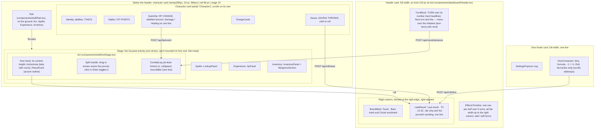

# Critical — Frontend Context (React Agents)

## Stack

- **Framework**: React 18 + Vite + TypeScript (strict mode)
- **Styling**: Tailwind CSS v4; Nocturne tokens and the four themes (ADR 0009, ADR 0026, `lib/theme.ts`, `index.css`)
- **Type and icons**: Inter (`@fontsource-variable/inter`), Phosphor (`@phosphor-icons/react`); no other family or icon set
- **Components**: shadcn/ui (components live in `web/src/components/ui/`)
- **i18n**: i18next + react-i18next (see "Internationalisation")
- **State**: Zustand (one store per domain: hp, combat, buffs, spells)
- **API client**: native `fetch` with typed wrappers in `web/src/api/`
- **No game logic**: if you are computing anything beyond display formatting, stop and move it to Go

## Project Structure (web/)

```
web/
  src/
    api/              ← typed fetch wrappers (hp.ts, combat.ts, buffs.ts, spells.ts)
    components/
      ui/             ← shadcn/ui primitives (Button, Card, Badge, etc.)
      dashboard/      ← Header (TurnBlock, EffectsTimeline, LastResult, BuffForms), HpBar, ResultCard, QuickHp, CombatLog, JournalBar, DiceComposer, Notices
      actions/        ← ActionArea tabs and one panel per tab
      shell/          ← Rail, ActStage (now band, journal split), BrandMark, SettingsPopover
    stores/           ← Zustand stores (hp.ts, combat.ts, buffs.ts, spells.ts)
    types/            ← TypeScript types mirroring Go response structs
    App.tsx           ← the shell (header card, character card | rail | stage, dice footer)
```

## Dashboard Layout

One screen, no page scroll, organised around the focused activity
([ADR 0022](adr/0022-activity-focus-layout.md), which replaced ADR 0009's four columns): the last
result, HP and the turn with its effects are always visible; the rest reshapes around what the
player is doing. Responsive from 1280 to 2560 CSS px at full width, no horizontal scroll down to
1024 (ADR 0009 step 3), fixed 16px root. On the ground, padded 12 px, every zone is a card
(`zone-card`: `bg-surface`, 1 px outline, 10 px radius) 12 px from the next; **no rule or separator
line** anywhere, inside a card grouping is by spacing, a `section-label` (11 px, uppercase,
letter-spaced, full ink) or the raised tone step (`bg-raised`). Type uses only `text-label` / `text-body` /
`text-title` / `text-key` / `text-headline` / `text-hero` (ADR 0017 step 2, `text-hero` from ADR
0022 step 3.4: the turn number, a result total, the XP total). **No cut text** (ADR 0022 step 1):
no `truncate` / `text-ellipsis` / `line-clamp` on important text; `layout.spec` checks the shell's
zones and each Act tab with `expectNoClippedText` (`e2e/noClip.ts`) at every layout viewport; the area items add
their regions as they drop their remaining `truncate`s. `App.tsx` composes it.



- Always visible (ADR 0022 step 2.1): the header card, the character card on the left edge and the
  dice footer. The last result (`LastResult.tsx`, `lib/filCard.ts` `lastResultEntry` /
  `lastResultChip`) is the newest result entry (attack, save, cast, item use, skill check,
  exposure) or free dice roll not undone, worded as its journal row: a roll made from any activity
  shows there at once. The result panel and the journal are the Act activity's.
- Activities (`lib/activities.ts`, rail order Act, Spells, Experience, Inventory): a click on the
  rail focuses one; the always-visible zones do not move. Each mounts on its first visit and stays
  mounted while hidden (ADR 0009 step 2, kept).
- Act stage (`components/shell/ActStage.tsx`): the now band (act panel | result panel,
  `minmax(28rem, 1.35fr) | minmax(24rem, 1fr)`) takes its content's height, the active tab's or
  the result panel's when that is taller (ADR 0027 step 6.1, no 60 % cap), the journal the rest (at
  least 14rem); past that the panels scroll inside. The handle between them (`role="separator"`) is
  dragged, or moved by ArrowUp / ArrowDown, to set the journal's height (`lib/journalSplit.ts`
  bounds it); a click (under 4 px of movement) or Enter / Space folds the journal into `JournalBar.tsx` (turn, value, icon, newest entry,
  time, the entry count, Undo / Redo). The height and the collapsed state are per-device display
  preferences in `critical.settings.v1` (`lib/settings.ts`), never sent to the API.
- Header card budget (ADR 0022 step 3.1): at most 120 px tall at rest, outline included, with 3
  effect rows. Layout per ADR 0027 step 4: turn | Next turn over the initiative | timeline (all the
  spare width) | brand over the last result, docked right, 6 px apart.
- Result panel and journal (`ResultCard.tsx`, `CombatLog.tsx`, logic in `lib/filCard.ts`, UI state in
  `stores/fil.ts`), in the Act activity: the result panel shows the latest result by default: this session's last roll
  response while it is the newest attack / save / cast / item use entry (the server's
  `actionlog.RollKinds`), else that entry rendered from its payload (after a reload). A click on a
  journal row shows that entry instead, read-only, with an accent ring and "Latest" to return; a
  new roll returns to the latest too. Only the latest result offers corrections (target AC, save
  adjustment), by entry id. One layout per kind, from the payload (`cardModel`): attack (hexagon
  d20, "Hits AC X" with the verdict pill beside it, the stat tiles d20 / target AC / margin, damage
  dice and total, the AC correction folded to one line, "Calculation details" closed by default),
  save (d20, "roll total vs adjusted target+" with the verdict pill, the stat tiles, the buff
  modifiers, the adjustment line on the target side), skill check (the same, its die), cast, item (dice chips, the
  maximum in the accent, a 1 dimmed), initiative, and info for every other kind (text, HP value
  red / green). Header: kind tag, subtitle, "T3 · 21:31". [ADR 0027](adr/0027-space-follows-frequency-of-use.md)
  step 8: the **verdict** is a filled pill (success / danger, `on-accent` text; "?" as a chip while
  an unknown AC is unsettled) right after the result it judges; the **stat tiles** are one grid
  of as many 5rem columns as fit (wrap, never cut); a total is in ink, gold only on a crit
  (`Total` `gold`); every **correction after the roll** (save and skill adjustment, target AC) is
  one line (`AdjustFold`, a `<details>`), closed by default and open when one is in effect
  (`lib/saveAdjust.ts` `adjustmentInEffect`, `lib/attackAdjust.ts` `acCorrectionInEffect`); the
  fold is keyed by entry, so it stays as the player left it while that entry is corrected. The journal: All / Rolls filter (attacks,
  saves, item uses, initiative, casts that rolled damage or a to-hit d20), the entry count, Undo and
  Redo in its head; turn groups newest first, touching, every other one on the sub-band tone
  (`bg-sub-band`), each **one 22 px line per entry** ([ADR 0022](adr/0022-activity-focus-layout.md)
  step 5.1, [ADR 0027](adr/0027-space-follows-frequency-of-use.md) step 9): a narrow turn marker
  ("T3", a campfire icon out of combat; the full "Turn 3 · current" in its tooltip and for screen
  readers, `turnMarker` in `lib/filCard.ts`) beside the group's first entry, the current turn's in
  the tint (its one mark); then the value right-aligned before the kind icon (a roll total in ink,
  gold only when the payload says crit, `rowValue`; ADR 0026 step 5.8), the entry text (with
  Amended / capped and a muted Undone tag inline after it; an undone row is muted and struck)
  wrapping inside its row when long, never cut, and the time right after the text. Nothing is
  drawn under an entry and there is **no Note** (step 5.2; the amend endpoint
  stays in the API, the UI neither calls it nor shows notes). Reroll, on an entry that rolled free
  dice, shows at the end of the line on hover, on keyboard focus in the row and on the selected row (step
  5.3). The row shown in the card is highlighted. Attack damage dice
  show as "1d8 → 6": the attack payload has no per-die values.
- Settings popover (`components/shell/SettingsPopover.tsx`, `stores/settings.ts`), opened from the cog at the
  left of the dice footer (ADR 0022 step 2.6): language
  (English / Français), appearance (Dark / Light / System), a dark theme (Arcane, Deep, Plain) and
  a light theme (Arcane, Parchment, Plain), each swatch in its theme's own colours (ADR 0026 step 4).
  The mode picks which theme applies; System switches between the two live with the OS. Applied
  live, stored per device in `localStorage['critical.settings.v1']` as `darkTheme` / `lightTheme`
  (`lib/settings.ts`, which maps a saved single `amb` of the six old ambiances once, step 4.3, and
  migrates the older `critical.theme` / `critical.language` keys once). `index.html`'s inline script
  paints the mode and the effective theme before the app runs, from `critical.paint.v1` (the
  chosen themes' variables, saved by `savePaint` whenever the settings apply).
- Theme (ADR 0020, amended by ADR 0026: the contrast ladder, the raised stage and four themes,
  Arcane, Deep, Parchment and Plain, with a dark and a light theme per device): `lib/theme.ts`
  `THEMES` holds one hand-tuned role table per theme and mode (Deep is dark only, Parchment light
  only); `themeVars(theme, light)` turns it into the three palette ramps (`amb-*` primary, `sec-*`,
  `ter-*`), the neutrals (`neu-900` the raised step, `neu-800` its hover, `amb-800` the selected
  tone), the role colours and the translucent mixes (`--ink-muted`, `--border`, `--input`) set on
  `<html>`. A new theme is a role table, its modes, an en and a fr name (`settings.themes.<id>`)
  and the rules below. Use the
  roles (`tint` for primary accents, `text-highlight` / `bg-highlight-fill text-on-highlight` for
  the secondary, `text-magic` for spells, `danger` / `success` / `warning`, `on-accent` as text on
  any fill, `bg-surface`, `bg-raised`, `text-ink-muted`, `shadow-float` for popovers only) or the
  shadcn names mapped onto them, never raw colours and never a ramp step for meaningful text. The
  unit test (`lib/theme.test.ts`, arithmetic in `lib/wcag.ts`) holds every theme in each of its
  modes to ADR 0026 steps 1-3: WCAG AA text on page, card and raised, card on page ΔL ≥ .10, raised
  on card ΔL ≥ .07, field edge and ring 3:1, the dark accent ladder, the hue distance and the
  near-neutral rule.
- Brand (ADR 0022 step 7): `components/shell/BrandMark.tsx`, the Facet · Bare mark (hexagon outline
  in `tint`, the "!" in `highlight`) + the Cinzel wordmark (`font-display`) at the top right of the
  header card, over the last result (ADR 0027 step 4.6); `public/favicon.svg` is the same drawing in static Arcane colours.
- Plug-in slots: each Act tab is one panel component in `components/actions/ActionArea.tsx`
  (`TABS` with its Phosphor icon, the tab label shows a count where it has one: spells left, combat
  items); each activity is one `Pane` in `App.tsx` (`lib/activities.ts`); the Act stage's two
  panels and journal are slots in `ActStage.tsx`.
- Turn header (`TurnBlock.tsx`, `EffectsTimeline.tsx`, layout maths in `lib/timeline.ts`): turn row
  plus up to 3 effect rows, the card at most 120px at rest (ADR 0022 step 3.1); with more effects an expander
  next to "Effects" ("+N", `aria-expanded`) grows the track in place. The turn
  block shows the turn (the round counter, its label stacked over it), Next turn and a ⋯ popover
  menu over the initiative row ("Out of combat" at turn 0, the d10 in `text-hero` with its die in
  the tooltip and a reroll otherwise); the menu holds Time passes…, Set turn number… and End combat
  (each a small form or confirm inside the popover). The effects track has a name column (as wide as
  the longest effect name, hidden rows included, through zero-high hidden copies of the labels;
  capped, past it a name wraps) and 5 turn columns sharing the rest (`TRACK_COLUMNS`); the window starts at
  `max(1, turn − 2)` (at turn 0 it starts at 0). The current column is highlighted across every row,
  past column headers are dimmed. Per buff: a thin line from its `startRound` (server-stamped, ADR
  0004 step 15) to the previous turn, then a pill over the current turn and the `duration − 1` after
  it, labelled with the turns left (from 60 also in hours), fading out past the window and in the
  warning colour on its last turn (`duration` 1); a charge-only buff shows pips and "6 charges · until
  spent" (the server keeps no starting count, so no "6 / 9"); an untimed one "until dismissed"; a buff
  with `applies: false` is dashed with a lock and the reason. Each row has absorb (charge buffs),
  edit and remove, shown on the row's hover and on keyboard focus only, over the end of the name
  cell (ADR 0027 step 4.4); "Add effect" opens the add form under the track.
- Buffs: every change (add, edit rounds/charges, absorb for charge buffs, dismiss, Next
  turn) is a log entry, voidable from the CombatLog while it is the newest entry. The log is a
  stack: only the newest non-voided entry (`topId` from `GET /api/log`) shows Void; the CombatLog
  header's Undo button and Ctrl/Cmd+Z (not while typing in a field) pop it from anywhere with
  `POST /api/log/undo` and that `topId` ([ADR 0010](adr/0010-action-stack-and-undo.md)); the Redo button next to it
  and Ctrl/Cmd+Shift+Z replay the `redo` target of `GET /api/log` with `POST /api/log/redo`
  ([ADR 0019](adr/0019-redo.md)); values are never edited in the log. Buff/round entries are rendered from their
  payload in the player's language (`lib/logSummary.ts`). The character card's STR is the effective STR
  (`GET /api/stats/str`; when buffed only that value, in the success colour, the sheet value in a
  tooltip on hover and keyboard focus); a buff whose `min_str` is not met
  (`applies: false`, e.g. the Power Gem below STR 18) shows dashed with "needs STR N"; an applying buff with `weapon_buff` / `multiplier` shows its effect under its name ("weapon +5 · dice ×2"); a Strength
  bonus that an active Improved Strength replaces (`applies: false`, no `min_str`) shows dashed
  with "replaced by Improved Strength".
- Weapons tab (`components/actions/AttackPanel.tsx`, `stores/attack.ts`): the attack form's
  choices are server state (`GET` / `PATCH /api/attack/form`, ADR 0009 step 6), restored on load and
  in every tab or device. The target bar is one line on the raised tone ([ADR 0027](adr/0027-space-follows-frequency-of-use.md)
  step 7.2): the TARGET section label, AC (the stepper's accessible name stays "Target AC") with
  Unknown, the set modifiers as chips ("Size L", "Situational +2" with the reason as its tooltip;
  `lib/weaponSwitch.ts` `setModifiers`) and a small toggle ("Size and situational modifier",
  `SlidersHorizontal`, this screen's state only) that shows under it the size (S / M | L) and the
  situational stepper with its reason (shown when not 0), both bounded to ±20 like the server. The weapon in hand is **one row** ([ADR 0022](adr/0022-activity-focus-layout.md)
  step 2.5), on a tint with the accent outline: the WEAPON IN HAND label, the name (wrapping, never
  cut), its stats as one line of text from the server's preview (ADR 0002 step 12, `StatsLine`:
  "Missile · two-handed · 1d6 S/M · 1d6 L · +5 / +3 to hit / dmg · THAC0 8", the size not in use
  dimmed, breaking only between segments), and **Attack**, the only control in the row: 44 px, two
  lines ("Attack" / "needs 6 vs AC 5" or "AC unknown"), the Phosphor `Sword` centred in its own
  44 x 44 cell (step 3.3; the accessible name stays "Attack", the second line describes it). Under
  the row: a bow's AMMUNITION chips (`ammoChoices`, counts amber at 3 or less; the chosen one stays
  chosen when spent and the panel says so), then (step 7.1, `lib/weaponSwitch.ts` `weaponSwitch`) one quiet
  button with the swap icon and the previous weapon's name ("Switch to {name}" its tooltip and
  accessible name) and a native drop-down "Other weapon…" listing every other weapon in full; either
  puts the weapon in hand and never attacks. The "needs 6 vs AC 5" line is in full ink. Then the crit table (house rule), a closed `details` line. Changes are
  sent one after the other and
  only the newest answer is shown; target and situational changes show at once. The preview is
  reloaded when buffs, effective STR, items or weapons change. An attack sends the saved choices
  (an offered first arrow becomes the choice first, so it stays chosen once spent); the result
  card labels each modifier and damage term by its `kind` (`result.mods.*`); attack log entries
  are rendered from their payload (`lib/logSummary.ts`). An attack refreshes the table state (log,
  item counts), so voiding it shows the arrow back.
- Items tab (`ItemsTab.tsx`): every item but ammunition (`lib/combatItems.ts`) on a grid row: the
  name (wrapping, never cut), behaviour and count, dice, Roll (it has dice) or Use, through
  `stores/roll.ts` `spendItem`; "Manage" (tooltip "Manage the inventory") focuses the Inventory activity.
- Skills tab (`SkillsTab.tsx`): PROFICIENCIES and BARD SKILLS with their column headers as section
  labels (ADR 0022 step 4.2); one row-button per skill, the name wrapping, never cut.
- Inventaire workspace (`InventoryPanel.tsx`, ADR 0027 step 14): the Objets and Armes cards
  (`InventoryCard.tsx`: section-label title, the quiet one-word "Add" with "Add item" / "Add weapon"
  in its tooltip and `aria-label`, a body that scrolls inside the card), side by side once the stage
  (a container query) is 1200 px wide, stacked below that; each card is as tall as its rows and the
  page never scrolls. Objets: one grid row per item (the header and the rows share the columns
  through `subgrid`): name with its magical bonus ("+2") and the behaviour under it (Stock / Charges
  / Daily, in the UI language; the free-text type is only in the edit form) | the effect dice right
  after the name column, as a chip that puts the formula in the dice composer (`stores/dice.ts`
  `setFormula`, nothing rolled) | the quantity stepper: − (uses one through `stores/roll.ts`
  `spendItem`, result card shows the roll), the count ("1 / 1" for daily) and + on stock items only
  (`POST /api/items/{id}/restock`, through `stores/table.ts` `run`) | spare width | ✎ / 🗑, shown on
  the row's hover and keyboard focus (`ROW_ACTIONS`, always shown without hover). The name column is
  as wide as the longest name and wraps past the room it has; rows are separated by a tone step. A
  charges item spent to 0 is gone from the list until its use is popped. ✎ edits a row in place and
  "Add" opens the same form (`ItemForm.tsx`); 🗑 removes. The form only parses
  numbers (`lib/itemForm.ts`); the server validates and the message it returns for a field is shown
  under that field (`stores/table.ts` `submit`, `ApiError.field`). Edits send only the changed fields.
- The Armes card (`WeaponsSection.tsx`) is the same grid: name with "melee / missile · two-handed ·
  ammo" | damage "1d8 · L 1d12" | to-hit / damage bonus | spare width | ✎ / 🗑 on hover and focus,
  and an "Add" form (`WeaponForm.tsx`, `lib/weaponForm.ts`), built like the item form (server
  validation under the field). A change refreshes the weapons store, so the Weapons tab follows.
- Spells tab (`SpellsPanel.tsx`, ADR 0027 step 10): Prepare and Long rest (crescent-moon icon) on
  top, right; one group per level that has a slot (no group for an empty level), the LEVEL N
  section label and the level's slot dots (`lib/slotDots.ts`, from the server's slots and limits:
  available in `magic`, used in muted ink, an outline for each slot the level allows with nothing
  prepared in it; the extra slots Rary's Mnemonic Enhancer grants are dots of their own; the count
  in the dots' `aria-label` and tooltip). The groups flow in two text columns 24 px apart once the
  panel is 32rem wide (a group never splits; no card or rule around a group, ADR 0022 steps 3.2 and
  4.1). A row is the spell's name (wrapping, never cut; "×N" for copies left) and its split Cast
  button, or "Used"; a blank extra slot's spell picker stands in for its name; the cast inputs a
  spell needs (target AC, item spent, cast-time mode, split of the extra slots) sit with the Cast
  button and wrap under the name together when narrow. Cast (`variant="main"`, `lg`) casts with the
  server's default target (no `onSelf`); its arrow (`ui/dropdown-menu`) offers "On me" and "On an
  ally" (`onSelf: true` / `false`): the spellbook does not say which target the server defaults to
  for a spell, so both are offered. The name opens the details popup (`SpellDetailsDialog.tsx`,
  `ui/dialog`, Escape closes it): the lookup's detail view (`components/dashboard/SpellDetail.tsx`,
  shared with the lookup), the spell fetched by its name at its level and picked by id
  (`api/spells_db.ts` `findSpell`). Cast puts the `CastResult` in the result card (`CastResultView`:
  buff rolls, damage rolls, save note for the DM, effects to apply by hand, spell text; for a spell
  with an exposure, the exposure block `ExposureControls.tsx`: its dice, the mode, the round of
  exposure, "I am exposed" and Roll exposure, which posts `/api/spells/exposure` through
  `stores/roll.ts` `rollExposure`; the result is an exposure card, `ExposureResultView`, with the
  dice, the total, "Taken off your HP" or "For the DM", and the same block set to the next round). `ReceivePanel.tsx` ("Spell cast on me") finds a spell with
  the shared name search (below) and posts `/api/spells/receive`.
- Spell preparation (`PrepareEditor.tsx`, ADR 0027 step 11): Prepare turns the Spells tab into the
  editor in the same space (no popup; the daily list and its buttons are hidden). Top row: the level
  filter (one chip per level the server gives a limit above 0, multi-select, none = all; it filters
  both columns), then Cancel and Save (`main`). Two columns from 32rem: TODAY'S PREPARATION, starting
  from today's slots (ids no longer in the spellbook listed as removed, never sent), one group per
  level with the dots of `lib/slotDots.ts` `preparedDots` (prepared in `magic`, an outline per slot
  left, a `danger` dot per spell beyond the limit) and per spell its name (opening the details popup)
  and − count + (the last − removes it); the GRIMOIRE, search box and spells grouped by level with a
  quiet Add, as tall as the preparation with its list scrolling inside. The draft's counts and the gate
  are `lib/prepareDraft.ts` (`levelBudgets`, `overBudget`): Save is disabled, with "Too many spells at
  level N", while a level holds more than the server's count; the server still refuses such a save.
- Spells activity, spell lookup (`LookupPanel.tsx`, state in `stores/lookup.ts` so it survives
  switching activities), A2's pane per [ADR 0022](adr/0022-activity-focus-layout.md) step 2.5: two
  cards, `minmax(18rem, 22rem) | 1fr`. The left card holds the filters, always in view but the
  school ([ADR 0027](adr/0027-space-follows-frequency-of-use.md) step 13): search box;
  `Mine | Wizard | Priest | All` segmented control, default Wizard, Mine = the Bard's spellbook;
  level chips, multi-select, wrapping when narrow, one per level the catalogue holds
  (`GET /api/spells/filters` `levels`, no level 0); then a line with the quiet "Filters" button (a
  menu of the school groups, spheres in Priest mode), the set school or sphere as a tag with its ×,
  the true "N spells" total and Reset) over the list, which scrolls on its own (level and name, the class on
  All, the school as a tooltip; infinite scroll by 200-row pages; the selected row tinted with a
  tint bar on its left). The right card is the detail, scrolling on its own when too short: the name
  (`text-headline`, wrapping, never cut) and meta line; the stats as tiles on the raised tone
  (`bg-raised`, as many per row as fit at 7.5rem: section label, value at the Bard's level, the raw
  text dimmed under it); the cast box ("AT LEVEL 15", then one row per dice: the damage a cast rolls
  when the spell DTO serves one (`damage`, "Damage 5 × 1d4+1 force", one instance goes to the
  composer), its exposure (`exposure`, one row per exposure mode: "Exposure (Within 10 ft) 2d4
  fire"; rolled as an exposure from a cast or received spell's card, here only to the composer),
  then one per value the server computed with dice still to roll (`lib/spellValues.ts` `statDice`:
  "Duration 1d8+8", the served dice then the served flat amount), each with "To the dice" (fills the
  composer) and Roll (`POST /api/roll/dice` through `stores/dice.ts` `roll`), and "Add" for a spell
  that adds an effect; no cast box when the spell has neither); then the description, which takes the rest of the height, scrolls inside its own box
  and flows in two text columns (24 px apart) once the card is wide enough for two of 16rem
  (`SpellDescription` `columns`; a table spans both). Inside the cards grouping is by spacing,
  section labels and the raised tone, never a rule (step 4.1). `layout.spec` runs
  `expectNoClippedText` on the list and the detail at every layout viewport with a long spell name
  and long stat text selected.
- Spell name search (one module for Lookup and Receive): `api/spells_db.ts` `searchSpells` sends
  `q`; the server matches it against the catalogue names in every language (case, accents and
  ligatures ignored) and ranks exact > prefix > contains over the best of them, then level, name.
- Spell names and descriptions (ADR 0021, ADR 0023): the catalogue is the only source. Every text of a
  spell DTO (`name`, `description`, `school`, `sphere`, the six stat texts) is a language map
  (`LocalizedText`, `types/localized.ts`); `localized(lang, text)` (`i18n/localized.ts`) picks the UI
  language and falls back to English per field, and `spellTexts` / `spellName` (`i18n/spellName.ts`)
  and `statText` use it. No type has a property per language. A spell
  known only by id (spellbook, slots, journal, cast and exposure cards, the add-effect form, HP bar) is named by
  `useSpellName()`, over every spell's names loaded once at start (`GET /api/spells/names`,
  `stores/spellNames.ts`); lib functions that word spells (`entryText`, `cardModel`, `cardHeader`,
  the undo/redo labels) take that namer as a parameter (English names by default). The lookup shows
  a spell's name in the UI language only. Descriptions are the catalogue's Markdown
  subset, parsed by `lib/spellMarkdown.ts` and rendered as React text by
  `components/dashboard/SpellDescription.tsx` (paragraphs, bullet lists, tables with role-token
  borders and a muted header, a wide table scrolling sideways in its own box) in the lookup and the
  cast result. No Markdown library: the subset is fixed by the format, and plain React text cannot
  carry HTML.
- Experience activity (`components/xp/XpPanel.tsx`, `stores/xp.ts`, ADR 0015; layout
  [ADR 0022](adr/0022-activity-focus-layout.md) step 2.5): one card with the progress beside "Add
  XP" (`minmax(0, 1fr) | 24rem`, 24 px apart, step 3.2), the ledger card below as tall as its rows,
  bounded by the rest of the stage's height, its list scrolling on its own past that (ADR 0027 step
  14.4). Progress: section label "Experience · level N", the
  total in `text-hero` (step 3.4), "Before level N · X XP", a bar with 10% ticks between the
  server's floor and ceiling, the server's 8 level cells with their thresholds (current and next
  ringed; at least 3.5rem each, wrapping to a second row rather than cutting). "Add XP": amount and
  reason on one line, then session, +10% (defaulting to the server's `bonusEligible`) and the
  quiet "Add" button carrying the server's preview ("Add 2,750", `GET /api/xp/preview`; disabled,
  and looking it, only while there is no amount); Enter submits; the bonus rule shown
  under it in full. The ledger (section-label head and column headers): reason wrapping between
  words with date · session under it, base, bonus, total; in-row edit, Enter saves, Escape cancels;
  delete; entries added this session tinted; the sheet's starting XP as the last, read-only row. Each write is a transaction on the action
  stack (ADR 0015 step 4): it answers with the whole ledger, then refreshes the table state so the
  journal shows the entry; the table refresh re-reads the ledger, so the journal's Undo shows the
  total back. The character card's level line opens
  it and is underlined with the server's `progress`.
- Character card (`Identity`, `HpBar`, `QuickHp`, `ChargeCards`, `Saves` in `components/dashboard/`,
  ADR 0022 step 2.3, ADR 0027 step 5), `clamp(280px, 21vw, 384px)` wide, beside every activity, in this order, grouped by spacing and section labels
  (no rules): identity (name, level, abilities in seven cells, effective STR with the sheet value
  in a tooltip when buffed, THAC0); "HIT POINTS"
  with the newest HP change still in force on the right (a long one drops under the label and
  wraps, never cut), current over max, and the bar (`lib/hpBar.ts` `hpBarModel`): the scale runs
  from the server's `floor` (-10) to max, a hatched dying zone (`hatch-danger`) below 0 filled from
  0 down to current HP, the fill from 0 coloured by threshold band, the last damage taken as a
  faint segment after the fill when the newest change is damage (`lib/moiLog.ts`), and the server's
  `condition` labelled next to the value when not ok (ADR 0011); "HP CHANGE": the amount labelled
  "Amount" above its field, Damage (`Drop`), Healing (`Heart`) on its line, the source under it,
  smaller (`text-label`), its placeholder never cut (Enter in either field applies damage,
  Shift+Enter healing); one card per applying buff with charges left (Stoneskin layers…), outlined
  in the accent, Absorb = the buff trigger endpoint; "SAVING THROWS" ("click to roll" is the rows'
  tooltip), one button row each, on one line from 1440 px in French: name (wraps after a slash
  at 1280), target (the sheet's), the newest logged roll in that category
  (server verdict ✓ / ✗ and the d20), a click rolls it. The card has the full height (ADR 0022
  step 2.3), so on a tall screen the space under the saves stays empty.
- Saves (`Saves.tsx`, character card): a save is logged (kind `save`, rendered from `effectivePayload` in
  `lib/logSummary.ts`). The save card (`ResultCard` `SaveResult`) has an "Adjust after the roll" fold
  (shared with the skill check, `AdjustCheck`): − / + around a signed value (starts at the save's adjustment, ±20), optional reason, Apply →
  `POST /api/roll/save/{logEntryId}/adjust` (`stores/roll.ts` `adjustLastSave`); the server returns
  the recomputed save (same d20 and roll total, the target moved: ADR 0006 step 5). Hidden once the entry is voided; a save that is no longer the latest roll is fixed by void + reroll.
- The attack card (`ResultCard` `AttackResult`) has a "Correct the target AC" fold: − / + around
  the AC (starts at the attack's, ±20), Apply → `POST /api/roll/attack/{logEntryId}/adjust`
  (`stores/roll.ts` `adjustLastAttack`); the server returns the recomputed attack (same dice, no ammo
  spent). Hidden once the entry is voided. Attack log lines render `effectivePayload`, with
  "AC 5 → 7: MISS → HIT" once corrected.
- Unknown AC ([ADR 0012](adr/0012-attack-against-unknown-ac.md)): the target bar's AC is empty
  (placeholder "?") by default, Unknown sends `targetAc: null`. Until settled
  (`lib/attackAdjust.ts` `attackSettled`) the card shows `hitsAc`, the tell-the-GM line worded from
  `hitsAc` and `critsFromAc`, a "?" verdict, the damage dimmed "if it hits", the GM's Hit / Miss
  (`POST /api/roll/attack/{logEntryId}/verdict`, `verdictLastAttack`) and a "Real AC" form (the
  adjust endpoint) that replaces any verdict.
- Every mutation goes through `stores/table.ts` (`run`, `recordHp`, `undo`,
  `nextRound`; the journal's Undo button and Ctrl+Z are the one global undo, ADR 0018 step 3): call the API, then refresh HP, log, buffs and round. Server errors
  (`{"error": …, "code": …}`, parsed by `api/http.ts`) are shown in `Notices` (`role="alert"`): a known code in the
  player's language (`apiError.*`), else the server text verbatim.
- The journal groups entries by the turn the server stamped (`lib/groupByRound.ts`); the current
  turn always has a group. Display helpers live in `lib/format.ts` (no game rules).
- Native `<input>`/`<select>` use `fieldClass` (`components/dashboard/fieldStyles.ts`, on the card with the field edge) and sit in
  `min-w-0` grid cells so they never overflow their card.

## API Consumption Pattern

All API calls live in `web/src/api/`. Never call `fetch` directly from a component.

```typescript
// web/src/api/hp.ts
export async function appendHpEvent(delta: number, source: string): Promise<HpEvent> {
  const res = await fetch('/api/hp/event', {
    method: 'POST',
    headers: { 'Content-Type': 'application/json' },
    body: JSON.stringify({ delta, source }),
  });
  if (!res.ok) throw new Error(await res.text());
  return res.json();
}
```

## TypeScript Types

Mirror Go response structs exactly. Keep them in `web/src/types/`.

```typescript
// types/combat.ts
export interface RollResult {
  d20Roll: number;
  d100CritRoll: number;
  isCrit: boolean;
  critMultiplier: number; // may be a decimal
  baseThac0: number;
  modifiers: Modifier[]; // { kind, detail?, value }: labelled with result.mods.<kind>
  effectiveThac0: number;
  targetACNeeded: number;
  hit: boolean;
  hitMargin: number;
  baseDamage: number;
  spellsBuff: number;
  weaponBuff: number;
  multipliers: number;
  strengthBonus: number;
  totalDamage: number;
  unroundedDamage?: number; // the formula text is built by lib/rollText.ts
  // … see web/src/types/combat.ts for the full shape (damageTerms, ammo, critPlaceholder…)
}
```

## Zustand Store Pattern

```typescript
// stores/hp.ts
import { create } from 'zustand';

interface HpStore {
  currentHp: number | null;
  maxHp: number | null;
  events: HpEvent[];
  fetchHp: () => Promise<void>;
  appendEvent: (delta: number, source: string) => Promise<void>;
}

export const useHpStore = create<HpStore>((set) => ({
  currentHp: null,
  maxHp: null,
  events: [],
  fetchHp: async () => { /* call api/hp.ts */ },
  appendEvent: async (delta, source) => { /* call api/hp.ts, then fetchHp */ },
}));
```

## shadcn/ui Usage

- Use `Card`, `CardContent`, `CardHeader` for panel sections
- Use `Badge` for buff tags and spell slot indicators (it is the chip family below)
- `Button` has two looks (ADR 0027 step 3.4): `variant="main"`, filled with the tint, for the one
  every-turn action of a zone (Attack, Next turn), and **quiet** (the default): no fill, the field
  edge (`--input`, 3:1 on the card, so it reads on the card, the raised step and the selected tone
  alike), the hover tone on hover; a pressed toggle (`aria-pressed`) is the chosen chip. `ghost` is
  for icon-only buttons in a row or toolbar, `destructive` a quiet button in danger ink. A button
  with nothing to submit is disabled and looks it, the same in every look: no fill, muted ink, a
  dashed edge (none on `ghost`); never a faded main button.
- **One action word per caption** (ADR 0027 step 3): the detail goes in `title` and `aria-label`
  (`spellSlots.prepare` "Prepare spells" there, `spellSlots.prepareShort` "Prepare" on the button).
  "Next turn" and "Long rest" are the fixed terms of step 3.2. Enforced by
  `components/sharedPieces.test.ts` (both languages, buttons without a `role`).
- Run `npx shadcn@latest add <component>` to install new components into `src/components/ui/`

## Shared pieces

One of each, used everywhere ([ADR 0026](adr/0026-contrast-ladder-raised-stage-four-themes.md)
step 5); the utilities live in `index.css`, the colour tokens in its `@theme inline` block:

- **Raised step**: `bg-raised` (`neu-900`) for tiles, blocks, row stripes, forms and tracks;
  `bg-raised-hover` (`neu-800`) only as the hover of a row or chip. No opacity variants.
- **Sub-band** (step 6.3): `bg-sub-band`, ink at 4 % (light) / 5.5 % (dark) over the card, for a
  group inside a card (the journal's every other turn).
- **Small marks** that must be seen on a card (an empty slot dot, the timeline's past line, the
  journal's drag handle, a level progress underline): `bg-input`, the field edge (3:1).
- **Chip** (step 5.3): `chip` (raised fill, no outline; one tone further, `neu-800`, when it sits
  on a raised tile or row), `chip-chosen` (a segmented thumb, the chosen die, a chosen option: the
  selected tone with a tint outline) and `chip-max` (gold fill, only for a crit or a maximum).
  Bonus and dice chips are neutral.
- **Selection mark** (step 5.1): `selected`, the selected tone, ink text and a 3 px tint bar on
  the left: the rail's current activity, the journal's selected entry, the lookup's selected spell.
  `bg-selected` is the bare tone (the weapon in hand, with a 2 px tint border; a just-added row).
- **Latest mark** (step 5.2): `latest`, a 2 px tint outline on the result card while it shows the
  latest result (not on an older entry picked in the journal).
- **Fields** (step 5.7): on the card (`bg-surface`) with the field edge (`border-input`): `ui/input`,
  `ui/select` and `fieldClass` for native inputs and selects.
- **Tooltip** (`ui/tooltip`, Base UI): a short hint on hover and keyboard focus, for what a
  native `title` cannot show to the keyboard (a stat's sheet value under its effect).
- **Menu and modal**: `ui/dropdown-menu` (a button's drop-down: the Spells tab's cast targets) and
  `ui/dialog` (a modal: the spell details popup), on Base UI with the popover surface
  (`bg-popover`, `shadow-float`); written by hand, as `npx shadcn add` brings a bogus `cn` package
  and the retired `text-xs` / `shadow-md`.
- **Headings** (step 5.6): card and section titles are `section-label`; `text-title` is for names
  (the character, a spell, a buff).
- The pieces set their own fill, radius and (but `chip`) ink: never add a `bg-*`, `rounded-*` or
  text colour class to one, pick one piece per state (`on ? "chip-chosen" : "chip"`).
  `components/sharedPieces.test.ts` fails when a component brings back a retired variant
  (`bg-neu-*`, `bg-amb-800/900`, `bg-muted`, `bg-background`, `ring-amb-*`, `border-amb-*`,
  `disabled:opacity-*`, the `outline` / `secondary` / `default` button variants) or a heading in
  `text-title`.
- Run `npx shadcn@latest add <component>` to install new components into `src/components/ui/`

## Display Conventions

- HP bar: accent fill > 50%, warning 25-50%, danger < 25% of max (display only on the served
  current / max, `lib/format.ts` `hpTone`, through `lib/hpBar.ts`); the dying zone floor..0 is
  hatched in danger
- Effects timeline: from 60 turns up the pill also shows hours ("150 turns · 2 h 30",
  `lib/passTime.ts`)
- Time passes (turn menu, "Time passes…"): decimal hours ("1.5" or "1,5"); the server previews
  them (`GET /api/round/pass-time/preview`, ADR 0005 step 8): "= 90 turns" and the effects that
  would end, or its refusal message; Confirm is enabled only on a valid preview and posts
  `POST /api/round/pass-time`
- Initiative row (turn block): the server's d10 for the turn (`GET /api/round` `initiative`,
  ADR 0013), "d10" and a reroll button (`POST /api/round/initiative/reroll`), hint "1d10, the
  lowest acts first"; at turn 0 "Out of combat · initiative will be rolled"
- Roll results: show the full breakdown in a readable format — never just the final number
- Expiry alerts: use a toast notification (shadcn Toast) when a buff expires

## Internationalisation (en / fr)

Every user-visible string goes through a key; never write a literal in JSX (`web/src/i18n/catalogues.test.ts`
fails on JSX text and on `placeholder`/`title`/`aria-label`/`alt` literals in `App.tsx` and `components/`
outside `ui/`).

- Catalogues: `web/src/i18n/locales/<lng>/<namespace>.json`, languages `en` (fallback) and `fr`.
- Namespace: `common` (all UI strings, the default namespace). Spell names and descriptions are not
  UI strings: they come from the catalogue (see "Spell names and descriptions" above).
- `common` keys: `area.thing`, camelCase leaves, grouped by panel/feature (`hp.applyDamage`,
  `buffs.none`, `combat.weapons.longsword`). Interpolation uses `{{name}}`: `t("spellSlots.level", { level })`.
  Add the key to **both** `en` and `fr`; a test requires identical key sets.
- Use `const { t } = useTranslation()` in components. Dynamic keys are fine, e.g. a template literal per tab id.
- Language: chosen in the settings popover, switches live and persists with the other display
  preferences (`localStorage['critical.settings.v1']`, ADR 0009); presentation only, never sent to
  the API.
- Not translated: server error messages and user-entered text (buff names, HP sources).
- Exception, the character details (`PATCH /api/character/details`): the server's field-error message is
  a code (`too_long`, `out_of_range`, `too_many`, `empty`, `duplicate`) and the web words it with
  `details.errors.<code>`, falling back to the code. Free-text values (race, languages...) are shown as
  entered, except a language whose name has a `details.language.<key>` entry (key: lower case, no accents or
  spaces), which is shown translated; the class key is read-only and translated by `details.classes.<key>`.

## Testing

- **Layers:** `vitest` for units (`just test-web`, part of `just validate`); Playwright e2e against the
  real Go API + Vite (`just e2e`, local only, not part of `just validate`). No pixel-diff snapshots, no
  component-test layer. Screenshots are artifacts for visual review, not assertions.
- **First run:** `just e2e-install` once (downloads Playwright Chromium); `just e2e` says so if it's missing.
  `just e2e smoke.spec.ts` passes args through to `playwright test`.
- **Stack per test:** the `test` fixture from `web/e2e/fixtures.ts` starts the API binary (`just build-api`
  output) on a free port in its in-memory storage mode (`CRITICAL_STORAGE=memory`: no database, file or
  server, [ADR 0025](adr/0025-postgresql-storage.md) step 8) with the `api/testdata` fixture (seeds and the
  spell catalogue `catalogue.json`; extra spells via `extraSpells` + `catalogueSpell`), plus a Vite server on a
  free port proxying `/api` to it; both are stopped afterwards. A test cannot plant rows behind the API:
  an old stored shape is served by intercepting the response (`page.route`). No fixed ports, `.dev/` is never
  touched, so parallel runs/worktrees don't collide. `page.goto("/")` opens that test's dashboard.
- **Selectors:** `getByRole` / `getByLabel` with the English accessible name first (give panels
  `role="group"` + `aria-label` from an i18n key if needed); `data-testid` only for non-semantic regions
  (e.g. `hp-value`).
- **Relative assertions:** never hard-code seeded character values (reseeds change them). Read the value
  before, act, assert the delta (HP drops by exactly the damage entered).
- **Shell:** focus an activity with `openWorkspace(page, "Act" | "Inventory" | "Spells" | "Experience")` and settings
  with `chooseSetting` / `chooseLanguage` (`e2e/helpers.ts`). A visited activity stays in the DOM
  while hidden, so scope `getByLabel` / `getByText` to the visible region (role locators skip
  hidden elements). The journal and the result panel are the Act activity's: focus Act before
  reading them (the header's `last-result` shows the newest roll from anywhere). `layout.spec.ts`
  covers 1024, 1280x800, 1440x900, 1707x1300, 1920x1080 and 2560x1440 and runs
  `expectNoClippedText` (`e2e/noClip.ts`) on the shell's zones and, in its "act panel" test, on each
  Act tab with long weapon, item and spell names (`act-<tab>-<size>.png`), and on the Experience
  activity with a long ledger reason, where `expectWholeWords` (same file) also fails on a word
  broken mid-word (in French too, in the "no cut text in French" test, with the ledger card's
  height following its rows and, at 1707x1300, the inventory cards side by side); its "theme" test screenshots the
  main screens in dark and light, then every theme in each of its modes in French
  (`fr-<mode>-<theme>.png`, no-cut audit on the whole page).
- **Languages:** flow specs run in `en`; one fr smoke spec toggles to French and asserts no raw i18n keys
  are visible. Don't add per-flow fr specs.
- **Add a spec:** create `web/e2e/<name>.spec.ts`, `import { test, expect, snap } from "./fixtures"`, one
  test per UI acceptance flow, and call `snap(page, "<name>")` at the end of each flow.
- **Artifacts** (gitignored, `web/e2e-results/`): `screens/<spec>/<name>.png` (1440x900),
  `artifacts/<test>/trace.zip` on failure (`npx playwright show-trace <zip>`), `report/` (HTML).

## Formatting

`web/` is prettier-clean: `just lint-web` (so `just validate`) runs `prettier --check .`; fix with `just fmt-web`. The one-off reformat commit is listed in `.git-blame-ignore-revs`.
