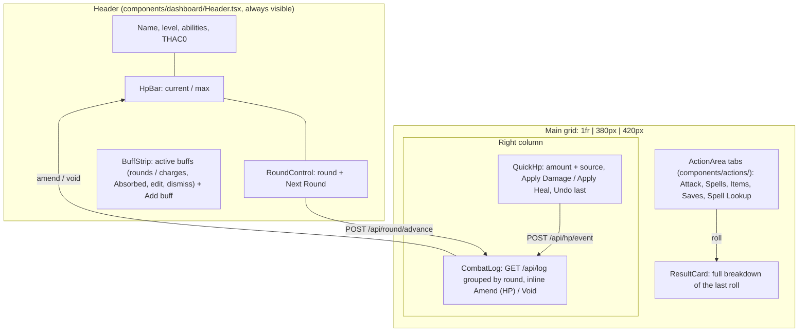

# Critical — Frontend Context (React Agents)

## Stack

- **Framework**: React 18 + Vite + TypeScript (strict mode)
- **Styling**: Tailwind CSS v3
- **Components**: shadcn/ui (components live in `web/src/components/ui/`)
- **i18n**: i18next + react-i18next (see "Internationalisation")
- **State**: Zustand (one store per domain: hp, combat, buffs, spells)
- **API client**: native `fetch` with typed wrappers in `web/src/api/`
- **No game logic**: if you are computing anything beyond display formatting, stop and move it to Go

## Project Structure (web/)

```
web/
  src/
    api/              ← typed fetch wrappers (hp.ts, combat.ts, buffs.ts, spells.ts)
    components/
      ui/             ← shadcn/ui primitives (Button, Card, Badge, etc.)
      dashboard/      ← Header, HpBar, RoundControl, BuffStrip, ResultCard, QuickHp, CombatLog, Notices
      actions/        ← ActionArea tabs and one panel per tab
    stores/           ← Zustand stores (hp.ts, combat.ts, buffs.ts, spells.ts)
    types/            ← TypeScript types mirroring Go response structs
    App.tsx           ← root layout (header + round screen grid)
```

## Dashboard Layout

One screen organised around a combat round (laptop, 1440x900): see state, act, see the result,
fix mistakes, advance the round. `App.tsx` composes it; nothing is behind a modal.



- Plug-in slots: each action tab is one panel component in `components/actions/ActionArea.tsx`
  (`TABS`). Attack → critical-qki.7, Spells → qki.9/qki.10, Items → qki.11 (placeholder today),
  buff editing → qki.8 (`BuffStrip`).
- Buffs: every change (add, edit rounds/charges, "Absorbed" for charge buffs, dismiss, Next
  Round) is a log entry, voidable from the CombatLog. Buff/round entries are rendered from their
  payload in the player's language (`lib/logSummary.ts`). The header's STR is the effective STR
  (`GET /api/stats/str`, sheet value in brackets when buffed); a buff whose `min_str` is not met
  (`applies: false`, e.g. the Power Gem below STR 18) shows dashed with "needs STR N".
- Attack tab (`components/actions/AttackPanel.tsx`): weapon (`GET /api/weapons`), ammunition for
  weapons with an `ammo_kind` (`GET /api/items`, count shown, `stores/items.ts`), target AC and size,
  situational modifier. The result card labels each modifier and damage term by its `kind`
  (`result.mods.*`); attack log entries are rendered from their payload (`lib/logSummary.ts`).
  An attack refreshes the table state (log, item counts), so voiding it shows the arrow back.
- Spells tab (`SpellsPanel.tsx`): Cast puts the `CastResult` in the result card (`CastResultView`:
  buff rolls, damage rolls, save note for the DM, effects to apply by hand, spell text); "Buff spells
  go on an ally" sends `onSelf: false`. `ReceivePanel.tsx` ("Spell cast on me") finds a spell with
  the shared name search (below) and posts `/api/spells/receive`.
- Spell Lookup tab (`LookupPanel.tsx`, state in `stores/lookup.ts` so it survives tab switches):
  search box, `Mine | Wizard | Priest | All` toggle (default Wizard; Mine = the Bard's spellbook),
  level chips 0-9 (multi-select), a school-group dropdown (spheres in Priest mode); a list (45% of
  the tab, one line per spell, infinite scroll by 200-row pages under a true "N spells" total) and a
  detail pane (values at the Bard's level next to the raw text, description collapsed).
- Spell name search (one module for Lookup and Receive): `api/spells_db.ts` `searchSpells` sends
  `q` (the server matches English names) plus `match_exact` / `match_prefix` / `match_contains`,
  the catalogue keys whose French name matched (`lib/spellSearch.ts`); the server ORs both and
  ranks exact > prefix > contains, then level, name.
- Every mutation goes through `stores/table.ts` (`run`, `recordHp`, `amendEntry`, `voidEntry`,
  `nextRound`): call the API, then refresh HP, log, buffs and round. Server errors
  (`{"error": …}`, parsed by `api/http.ts`) are shown verbatim in `Notices` (`role="alert"`).
- The log groups entries by the round the server stamped (`lib/groupByRound.ts`); the current round
  always has a group. Display helpers live in `lib/format.ts` (no game rules).
- Native `<input>`/`<select>` use `fieldClass` (`components/dashboard/fieldStyles.ts`) and sit in
  `min-w-0` grid cells so they never overflow their card.

## API Consumption Pattern

All API calls live in `web/src/api/`. Never call `fetch` directly from a component.

```typescript
// web/src/api/hp.ts
export async function appendHpEvent(delta: number, source: string): Promise<HpEvent> {
  const res = await fetch('/api/hp/event', {
    method: 'POST',
    headers: { 'Content-Type': 'application/json' },
    body: JSON.stringify({ delta, source }),
  });
  if (!res.ok) throw new Error(await res.text());
  return res.json();
}
```

## TypeScript Types

Mirror Go response structs exactly. Keep them in `web/src/types/`.

```typescript
// types/combat.ts
export interface RollResult {
  d20Roll: number;
  d100CritRoll: number;
  isCrit: boolean;
  critMultiplier: number;
  baseThac0: number;
  modifiers: Modifier[]; // { kind, source, detail?, value }
  effectiveThac0: number;
  targetACNeeded: number;
  hit: boolean;
  hitMargin: number;
  baseDamage: number;
  spellsBuff: number;
  weaponBuff: number;
  multipliers: number;
  strengthBonus: number;
  totalDamage: number;
  damageBreakdown: string;
  // … see web/src/types/combat.ts for the full shape (damageTerms, ammo, critPlaceholder…)
}
```

## Zustand Store Pattern

```typescript
// stores/hp.ts
import { create } from 'zustand';

interface HpStore {
  currentHp: number | null;
  maxHp: number | null;
  events: HpEvent[];
  fetchHp: () => Promise<void>;
  appendEvent: (delta: number, source: string) => Promise<void>;
}

export const useHpStore = create<HpStore>((set) => ({
  currentHp: null,
  maxHp: null,
  events: [],
  fetchHp: async () => { /* call api/hp.ts */ },
  appendEvent: async (delta, source) => { /* call api/hp.ts, then fetchHp */ },
}));
```

## shadcn/ui Usage

- Use `Card`, `CardContent`, `CardHeader` for panel sections
- Use `Badge` for buff tags and spell slot indicators
- Use `Button` with `variant="outline"` for secondary actions, default for primary
- Run `npx shadcn@latest add <component>` to install new components into `src/components/ui/`

## Display Conventions

- HP bar: colored progress bar (green > 50%, yellow 25-50%, red < 25%)
- Buff list: each buff shows name + remaining charges/rounds as a Badge
- Roll results: show the full breakdown in a readable format — never just the final number
- Expiry alerts: use a toast notification (shadcn Toast) when a buff expires

## Internationalisation (en / fr)

Every user-visible string goes through a key; never write a literal in JSX (`web/src/i18n/catalogues.test.ts`
fails on JSX text and on `placeholder`/`title`/`aria-label`/`alt` literals in `App.tsx` and `components/`
outside `ui/`).

- Catalogues: `web/src/i18n/locales/<lng>/<namespace>.json`, languages `en` (fallback) and `fr`.
- Namespaces: `common` (all UI strings, default namespace) and `spells` (spell names only).
- `common` keys: `area.thing`, camelCase leaves, grouped by panel/feature (`hp.applyDamage`,
  `buffs.none`, `combat.weapons.longsword`). Interpolation uses `{{name}}`: `t("spellSlots.level", { level })`.
  Add the key to **both** `en` and `fr`; a test requires identical key sets.
- `spells` keys: the spell's stable id (snake_case of the English name, e.g. `magic_missile`), value is the
  name. Render with `spellName(t, id, englishName)` from `@/i18n/spellName`; a missing `fr` key falls back
  to `en`, then to the supplied English name. `spellId(name)` derives the id until the spell database
  carries an explicit one. Spell descriptions stay English.
- Use `const { t } = useTranslation()` in components. Dynamic keys are fine, e.g. a template literal per tab id.
- Language toggle (`components/LanguageToggle.tsx`) switches live and persists to `localStorage`
  (`critical.language`); presentation only, never sent to the API.
- Not translated: server error messages and user-entered text (buff names, HP sources).

## Testing

- **Layers:** `vitest` for units (`just test-web`, part of `just validate`); Playwright e2e against the
  real Go API + Vite (`just e2e`, local only, not part of `just validate`). No pixel-diff snapshots, no
  component-test layer. Screenshots are artifacts for visual review, not assertions.
- **First run:** `just e2e-install` once (downloads Playwright Chromium); `just e2e` says so if it's missing.
  `just e2e smoke.spec.ts` passes args through to `playwright test`.
- **Stack per test:** the `test` fixture from `web/e2e/fixtures.ts` starts the API binary (`just build-api`
  output) on a free port with a fresh temp SQLite DB and the repo's real `seeds/`, plus a Vite server on a
  free port proxying `/api` to it; both and the DB are removed afterwards. No fixed ports, `.dev/` is never
  touched, so parallel runs/worktrees don't collide. `page.goto("/")` opens that test's dashboard.
- **Selectors:** `getByRole` / `getByLabel` with the English accessible name first (give panels
  `role="group"` + `aria-label` from an i18n key if needed); `data-testid` only for non-semantic regions
  (e.g. `hp-value`).
- **Relative assertions:** never hard-code seeded character values (reseeds change them). Read the value
  before, act, assert the delta (HP drops by exactly the damage entered).
- **Languages:** flow specs run in `en`; one fr smoke spec toggles to French and asserts no raw i18n keys
  are visible. Don't add per-flow fr specs.
- **Add a spec:** create `web/e2e/<name>.spec.ts`, `import { test, expect, snap } from "./fixtures"`, one
  test per UI acceptance flow, and call `snap(page, "<name>")` at the end of each flow.
- **Artifacts** (gitignored, `web/e2e-results/`): `screens/<spec>/<name>.png` (1440x900),
  `artifacts/<test>/trace.zip` on failure (`npx playwright show-trace <zip>`), `report/` (HTML).
