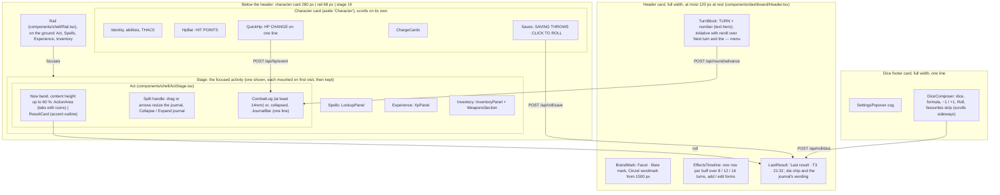

# Critical — Frontend Context (React Agents)

## Stack

- **Framework**: React 18 + Vite + TypeScript (strict mode)
- **Styling**: Tailwind CSS v4; Nocturne tokens and ambiances (ADR 0009, `lib/theme.ts`, `index.css`)
- **Type and icons**: Inter (`@fontsource-variable/inter`), Phosphor (`@phosphor-icons/react`); no other family or icon set
- **Components**: shadcn/ui (components live in `web/src/components/ui/`)
- **i18n**: i18next + react-i18next (see "Internationalisation")
- **State**: Zustand (one store per domain: hp, combat, buffs, spells)
- **API client**: native `fetch` with typed wrappers in `web/src/api/`
- **No game logic**: if you are computing anything beyond display formatting, stop and move it to Go

## Project Structure (web/)

```
web/
  src/
    api/              ← typed fetch wrappers (hp.ts, combat.ts, buffs.ts, spells.ts)
    components/
      ui/             ← shadcn/ui primitives (Button, Card, Badge, etc.)
      dashboard/      ← Header (TurnBlock, EffectsTimeline, LastResult, BuffForms), HpBar, ResultCard, QuickHp, CombatLog, JournalBar, DiceComposer, Notices
      actions/        ← ActionArea tabs and one panel per tab
      shell/          ← Rail, ActStage (now band, journal split), BrandMark, SettingsPopover
    stores/           ← Zustand stores (hp.ts, combat.ts, buffs.ts, spells.ts)
    types/            ← TypeScript types mirroring Go response structs
    App.tsx           ← the shell (header card, character card | rail | stage, dice footer)
```

## Dashboard Layout

One screen, no page scroll, organised around the focused activity
([ADR 0022](adr/0022-activity-focus-layout.md), which replaced ADR 0009's four columns): the last
result, HP and the turn with its effects are always visible; the rest reshapes around what the
player is doing. Responsive from 1280 to 2560 CSS px at full width, no horizontal scroll down to
1024 (ADR 0009 step 3), fixed 16px root. On the ground, padded 12 px, every zone is a card
(`zone-card`: `bg-surface`, 1 px outline, 10 px radius) 12 px from the next; **no rule or separator
line** anywhere, inside a card grouping is by spacing, a `section-label` (11 px, uppercase,
letter-spaced, muted) or a `bg-neu-900` tone step. Type uses only `text-label` / `text-body` /
`text-title` / `text-key` / `text-headline` / `text-hero` (ADR 0017 step 2, `text-hero` from ADR
0022 step 3.4: the turn number, a result total, the XP total). **No cut text** (ADR 0022 step 1):
no `truncate` / `text-ellipsis` / `line-clamp` on important text; `layout.spec` checks the shell's
zones and each Act tab with `expectNoClippedText` (`e2e/noClip.ts`) at every layout viewport; the area items add
their regions as they drop their remaining `truncate`s. `App.tsx` composes it.



- Always visible (ADR 0022 step 2.1): the header card, the character card on the left edge and the
  dice footer. The last result (`LastResult.tsx`, `lib/filCard.ts` `lastResultEntry` /
  `lastResultChip`) is the newest result entry (attack, save, cast, item use, skill check,
  exposure) or free dice roll not undone, worded as its journal row: a roll made from any activity
  shows there at once. The result panel and the journal are the Act activity's.
- Activities (`lib/activities.ts`, rail order Act, Spells, Experience, Inventory): a click on the
  rail focuses one; the always-visible zones do not move. Each mounts on its first visit and stays
  mounted while hidden (ADR 0009 step 2, kept).
- Act stage (`components/shell/ActStage.tsx`): the now band (act panel | result panel,
  `minmax(28rem, 1.35fr) | minmax(24rem, 1fr)`) takes its content's height up to 60 % of the
  stage, the journal the rest (at least 14rem). The handle between them (`role="separator"`) is
  dragged, or moved by ArrowUp / ArrowDown, to set the journal's height (`lib/journalSplit.ts`
  bounds it); Collapse folds the journal into `JournalBar.tsx` (turn, value, icon, newest entry,
  time, the entry count, Undo / Redo). The height and the collapsed state are per-device display
  preferences in `critical.settings.v1` (`lib/settings.ts`), never sent to the API.
- Header card budget (ADR 0022 step 3.1): at most 120 px tall at rest, outline included, with 3
  effect rows; below 1500 px wide the mark shows without the wordmark.
- Result panel and journal (`ResultCard.tsx`, `CombatLog.tsx`, logic in `lib/filCard.ts`, UI state in
  `stores/fil.ts`), in the Act activity: the result panel shows the latest result by default: this session's last roll
  response while it is the newest attack / save / cast / item use entry (the server's
  `actionlog.RollKinds`), else that entry rendered from its payload (after a reload). A click on a
  journal row shows that entry instead, read-only, with an accent ring and "Latest" to return; a
  new roll returns to the latest too. Only the latest result offers corrections (target AC, save
  adjustment), by entry id. One layout per kind, from the payload (`cardModel`): attack (hexagon
  d20, "Hits AC X", verdict, damage dice and total, "Calculation details" closed by default),
  save (d20, "total vs target+", verdict, modifiers, adjustment), cast, item (dice chips, the
  maximum in the accent, a 1 dimmed), initiative, and info for every other kind (text, HP value
  red / green). Header: kind tag, subtitle, "T3 · 21:31". The journal: All / Rolls filter (attacks,
  saves, item uses, initiative, casts that rolled damage or a to-hit d20), the entry count, Undo and
  Redo in its head; turn groups newest first, each **one line per entry** in the columns
  turn · value · icon · entry · time ([ADR 0022](adr/0022-activity-focus-layout.md) step 5.1): the
  section label "TURN 3" / "OUT OF COMBAT" beside the group's first entry, a "current" tag and a
  tint on the current turn, the value right-aligned before the kind icon, the entry text (with
  Amended / capped / Undone inline after it) wrapping inside its row when long, never cut, and the
  time last. Nothing is drawn under an entry and there is **no Note** (step 5.2; the amend endpoint
  stays in the API, the UI neither calls it nor shows notes). Reroll, on an entry that rolled free
  dice, shows in the line on hover, on keyboard focus in the row and on the selected row (step
  5.3). The row shown in the card is highlighted. Attack damage dice
  show as "1d8 → 6": the attack payload has no per-die values.
- Settings popover (`components/shell/SettingsPopover.tsx`, `stores/settings.ts`), opened from the cog at the
  left of the dice footer (ADR 0022 step 2.6): language
  (English / Français), appearance (Dark / Light / System, System follows the OS live), six
  ambiance swatches. Applied live, stored per device in `localStorage['critical.settings.v1']`
  (`lib/settings.ts`, which migrates the older `critical.theme` / `critical.language` keys once).
- Theme (ADR 0020): `lib/theme.ts` `themeVars(ambiance, light)` computes the three palette ramps
  (`amb-*` primary, `sec-*`, `ter-*`), the neutrals and the role colours set on `<html>`; use the
  roles (`tint` for primary accents, `text-highlight` / `bg-highlight-fill text-on-highlight` for
  the secondary, `text-magic` for spells, `danger` / `success` / `warning`, `on-accent` as text on
  any fill, `bg-surface`, `bg-neu-900`, `text-ink-muted`, `shadow-float` for popovers only) or the
  shadcn names mapped onto them, never raw colours and never a ramp step for meaningful text. The
  contrast unit test (`lib/theme.test.ts`) keeps every ambiance at WCAG AA in both modes.
- Brand (ADR 0022 step 7): `components/shell/BrandMark.tsx`, the Facet · Bare mark (hexagon outline
  in `tint`, the "!" in `highlight`) + the Cinzel wordmark (`font-display`) at the left of the header
  card; `public/favicon.svg` is the same drawing in static Arcane colours.
- Plug-in slots: each Act tab is one panel component in `components/actions/ActionArea.tsx`
  (`TABS` with its Phosphor icon, the tab label shows a count where it has one: spells left, combat
  items); each activity is one `Pane` in `App.tsx` (`lib/activities.ts`); the Act stage's two
  panels and journal are slots in `ActStage.tsx`.
- Turn header (`TurnBlock.tsx`, `EffectsTimeline.tsx`, layout maths in `lib/timeline.ts`): turn row
  plus up to 3 effect rows, the card at most 120px at rest (ADR 0022 step 3.1); with more effects an expander
  next to "Effects" ("+N", `aria-expanded`) grows the track in place. The turn
  block shows the turn (the round counter), the initiative row ("Out of combat" at turn 0, a
  placeholder otherwise), Next turn and a ⋯ popover menu (Time passes…, Set turn number…, End combat,
  each a small form or confirm inside the popover). The effects track has a label column and N turn
  columns, N = 8 / 12 / 16, the most that stay at least 60 CSS px wide; the window starts at
  `max(1, turn − 2)` (at turn 0 it starts at 0). The current column is highlighted across every row,
  past column headers are dimmed. Per buff: a thin line from its `startRound` (server-stamped, ADR
  0004 step 15) to the previous turn, then a pill over the current turn and the `duration − 1` after
  it, labelled with the turns left (from 60 also in hours), fading out past the window and in the
  warning colour on its last turn (`duration` 1); a charge-only buff shows pips and "6 charges · until
  spent" (the server keeps no starting count, so no "6 / 9"); an untimed one "until dismissed"; a buff
  with `applies: false` is dashed with a lock and the reason. Each row has absorb (charge buffs),
  edit and remove; "Add effect" opens the add form under the track.
- Buffs: every change (add, edit rounds/charges, absorb for charge buffs, dismiss, Next
  turn) is a log entry, voidable from the CombatLog while it is the newest entry. The log is a
  stack: only the newest non-voided entry (`topId` from `GET /api/log`) shows Void; the CombatLog
  header's Undo button and Ctrl/Cmd+Z (not while typing in a field) pop it from anywhere with
  `POST /api/log/undo` and that `topId` ([ADR 0010](adr/0010-action-stack-and-undo.md)); the Redo button next to it
  and Ctrl/Cmd+Shift+Z replay the `redo` target of `GET /api/log` with `POST /api/log/redo`
  ([ADR 0019](adr/0019-redo.md)); values are never edited in the log. Buff/round entries are rendered from their
  payload in the player's language (`lib/logSummary.ts`). The character card's STR is the effective STR
  (`GET /api/stats/str`, sheet value in brackets when buffed); a buff whose `min_str` is not met
  (`applies: false`, e.g. the Power Gem below STR 18) shows dashed with "needs STR N"; an applying buff with `weapon_buff` / `multiplier` shows its effect under its name ("weapon +5 · dice ×2"); a Strength
  bonus that an active Improved Strength replaces (`applies: false`, no `min_str`) shows dashed
  with "replaced by Improved Strength".
- Weapons tab (`components/actions/AttackPanel.tsx`, `stores/attack.ts`): the attack form's
  choices are server state (`GET` / `PATCH /api/attack/form`, ADR 0009 step 6), restored on load and
  in every tab or device. The target bar is one line on the raised tone (it wraps when narrow): the
  TARGET section label, AC (the stepper's accessible name stays "Target AC") with Unknown, the size
  (S / M | L) and the situational stepper with its reason (shown when not 0), both bounded to ±20
  like the server. The weapon in hand is **one row** ([ADR 0022](adr/0022-activity-focus-layout.md)
  step 2.5), on a tint with the accent outline: the WEAPON IN HAND label, the name (wrapping, never
  cut), its stats as one line of text from the server's preview (ADR 0002 step 12, `StatsLine`:
  "Missile · two-handed · 1d6 S/M · 1d6 L · +5 / +3 to hit / dmg · THAC0 8", the size not in use
  dimmed, breaking only between segments), and **Attack**, the only control in the row: 44 px, two
  lines ("Attack" / "needs 6 vs AC 5" or "AC unknown"), the Phosphor `Sword` centred in its own
  44 x 44 cell (step 3.3; the accessible name stays "Attack", the second line describes it). Under
  the row: a bow's AMMUNITION chips (`ammoChoices`, counts amber at 3 or less; the chosen one stays
  chosen when spent and the panel says so), then SWITCH TO, every other weapon as a chip with its
  S/M dice, the previous weapon first with the swap icon ("Switch to {name}"); one click puts it in
  hand and never attacks. Then the crit table (house rule), a closed `details` line. Changes are
  sent one after the other and
  only the newest answer is shown; target and situational changes show at once. The preview is
  reloaded when buffs, effective STR, items or weapons change. An attack sends the saved choices
  (an offered first arrow becomes the choice first, so it stays chosen once spent); the result
  card labels each modifier and damage term by its `kind` (`result.mods.*`); attack log entries
  are rendered from their payload (`lib/logSummary.ts`). An attack refreshes the table state (log,
  item counts), so voiding it shows the arrow back.
- Items tab (`ItemsTab.tsx`): every item but ammunition (`lib/combatItems.ts`) on a grid row: the
  name (wrapping, never cut), behaviour and count, dice, Roll (it has dice) or Use, through
  `stores/roll.ts` `spendItem`; "Manage the inventory" focuses the Inventory activity.
- Skills tab (`SkillsTab.tsx`): PROFICIENCIES and BARD SKILLS with their column headers as section
  labels (ADR 0022 step 4.2); one row-button per skill, the name wrapping, never cut.
- Inventaire workspace (`InventoryPanel.tsx`): the Objets card, one grid row per item: name with
  its magical bonus ("+2") and "type · behaviour" (Stock / Charges / Daily) under it | the effect
  dice as a chip that puts the formula in the dice composer (`stores/dice.ts` `setFormula`, nothing
  rolled) | the quantity stepper: − (uses one through `stores/roll.ts` `spendItem`, result card
  shows the roll), the count ("1 / 1" for daily) and + on stock items only
  (`POST /api/items/{id}/restock`, through `stores/table.ts` `run`) | ✎ / 🗑. Columns are rem
  widths beside a `1fr` name, rows are separated by a tone step. A charges item spent to 0 is gone
  from the list until its use is popped. ✎ edits a row in place and
  "Add item" opens the same form (`ItemForm.tsx`); 🗑 removes. The form only parses
  numbers (`lib/itemForm.ts`); the server validates and the message it returns for a field is shown
  under that field (`stores/table.ts` `submit`, `ApiError.field`). Edits send only the changed fields.
- The Inventaire workspace also has the Armes card (`WeaponsSection.tsx`), the same grid: name
  with "melee / missile · two-handed · ammo" | damage "1d8 · L 1d12" | to-hit / damage bonus | ✎ / 🗑 per row and an "Add weapon" form (`WeaponForm.tsx`,
  `lib/weaponForm.ts`), built like the item form (server validation under the field). A change
  refreshes the weapons store, so the Weapons tab follows.
- Spells tab (`SpellsPanel.tsx`): "Buff spells go on an ally", Prepare spells and Long rest on
  top; one group per level (the LEVEL N section label, a pip per slot, filled while unused, and
  "left / total"), the groups flowing in two text columns 24 px apart once the panel is 32rem wide
  (a group never splits; no card or rule around a group, ADR 0022 steps 3.2 and 4.1); rows with the
  name (wrapping, never cut; a row's pickers wrap under it when narrow), under it the damage a cast rolls at the Bard's level when the spellbook entry serves one
  (`lib/spellDice.ts` `damageText`: "10d6 fire", "5 × 1d4+1 force", "2d4 acid per round, 6
  rounds", type words in `spellDice.types`) and, for a spell that leaves a damaging area, its
  exposure dice (`lib/spellMode.ts` `exposureText`: "1d10 poison per round of exposure", ADR 0008
  step 16), and Cast or Used. Cast puts the `CastResult` in the result card (`CastResultView`:
  buff rolls, damage rolls, save note for the DM, effects to apply by hand, spell text; for a spell
  with an exposure, the exposure block `ExposureControls.tsx`: its dice, the mode, the round of
  exposure, "I am exposed" and Roll exposure, which posts `/api/spells/exposure` through
  `stores/roll.ts` `rollExposure`; the result is an exposure card, `ExposureResultView`, with the
  dice, the total, "Taken off your HP" or "For the DM", and the same block set to the next round); "Buff spells
  go on an ally" sends `onSelf: false`. `ReceivePanel.tsx` ("Spell cast on me") finds a spell with
  the shared name search (below) and posts `/api/spells/receive`.
- Spells activity, spell lookup (`LookupPanel.tsx`, state in `stores/lookup.ts` so it survives
  switching activities), A2's pane per [ADR 0022](adr/0022-activity-focus-layout.md) step 2.5: two
  cards, `minmax(18rem, 22rem) | 1fr`. The left card holds the filters (search box; school-group
  dropdown, spheres in Priest mode; `Mine | Wizard | Priest | All` segmented control, default
  Wizard, Mine = the Bard's spellbook; level chips 0-9, multi-select, wrapping when narrow; the true
  "N spells" total and Reset) over the list, which scrolls on its own (level and name, the class on
  All, the school as a tooltip; infinite scroll by 200-row pages; the selected row tinted with a
  tint bar on its left). The right card is the detail, scrolling on its own when too short: the name
  (`text-headline`, wrapping, never cut) and meta line; the stats as tiles on the raised tone
  (`bg-neu-900`, as many per row as fit at 7.5rem: section label, value at the Bard's level, the raw
  text dimmed under it); the cast box ("AT LEVEL 15", then one row per dice: the damage a cast rolls
  when the spell DTO serves one (`damage`, "Damage 5 × 1d4+1 force", one instance goes to the
  composer), its exposure (`exposure`, one row per exposure mode: "Exposure (Within 10 ft) 2d4
  fire"; rolled as an exposure from a cast or received spell's card, here only to the composer),
  then one per value the server computed with dice still to roll (`lib/spellValues.ts` `statDice`:
  "Duration 1d8+8", the served dice then the served flat amount), each with "To the dice" (fills the
  composer) and Roll (`POST /api/roll/dice` through `stores/dice.ts` `roll`); "No dice to roll"
  when none); then the description, which takes the rest of the height, scrolls inside its own box
  and flows in two text columns (24 px apart) once the card is wide enough for two of 16rem
  (`SpellDescription` `columns`; a table spans both). Inside the cards grouping is by spacing,
  section labels and the raised tone, never a rule (step 4.1). `layout.spec` runs
  `expectNoClippedText` on the list and the detail at every layout viewport with a long spell name
  and long stat text selected.
- Spell name search (one module for Lookup and Receive): `api/spells_db.ts` `searchSpells` sends
  `q`; the server matches it against the catalogue names in every language (case, accents and
  ligatures ignored) and ranks exact > prefix > contains over the best of them, then level, name.
- Spell names and descriptions (ADR 0021, ADR 0023): the catalogue is the only source. Every text of a
  spell DTO (`name`, `description`, `school`, `sphere`, the six stat texts) is a language map
  (`LocalizedText`, `types/localized.ts`); `localized(lang, text)` (`i18n/localized.ts`) picks the UI
  language and falls back to English per field, and `spellTexts` / `spellName` (`i18n/spellName.ts`)
  and `statText` use it. No type has a property per language. A spell
  known only by id (spellbook, slots, journal, cast and exposure cards, the add-effect form, HP bar) is named by
  `useSpellName()`, over every spell's names loaded once at start (`GET /api/spells/names`,
  `stores/spellNames.ts`); lib functions that word spells (`entryText`, `cardModel`, `cardHeader`,
  the undo/redo labels) take that namer as a parameter (English names by default). The lookup shows
  a spell's name in the UI language only. Descriptions are the catalogue's Markdown
  subset, parsed by `lib/spellMarkdown.ts` and rendered as React text by
  `components/dashboard/SpellDescription.tsx` (paragraphs, bullet lists, tables with role-token
  borders and a muted header, a wide table scrolling sideways in its own box) in the lookup and the
  cast result. No Markdown library: the subset is fixed by the format, and plain React text cannot
  carry HTML.
- Expérience workspace (`components/xp/XpPanel.tsx`, `stores/xp.ts`, ADR 0015): a progress card
  (total, "Before level N · X XP", a bar with 10% ticks between the server's floor and ceiling, the
  server's 8 level cells with their thresholds, current and next ringed), "Add XP" (amount, reason,
  session, +10% defaulting to the server's `bonusEligible`; the button shows the server's preview,
  `GET /api/xp/preview`; Enter submits) and the ledger (reason with date · session, base, bonus,
  total; in-row edit, Enter saves, Escape cancels; delete; entries added this session tinted; the
  sheet's starting XP as the last, read-only row). Each write is a transaction on the action
  stack (ADR 0015 step 4): it answers with the whole ledger, then refreshes the table state so the
  journal shows the entry; the table refresh re-reads the ledger, so the journal's Undo shows the
  total back. The character card's level line opens
  it and is underlined with the server's `progress`.
- Character card (`Identity`, `HpBar`, `QuickHp`, `ChargeCards`, `Saves` in `components/dashboard/`,
  ADR 0022 step 2.3), beside every activity, in this order, grouped by spacing and section labels
  (no rules): identity (name, level, abilities in seven cells, effective STR, THAC0); "HIT POINTS"
  with the newest HP change still in force on the right (a long one drops under the label and
  wraps, never cut), current over max, and the bar (`lib/hpBar.ts` `hpBarModel`): the scale runs
  from the server's `floor` (-10) to max, a hatched dying zone (`hatch-danger`) below 0 filled from
  0 down to current HP, the fill from 0 coloured by threshold band, the last damage taken as a
  faint segment after the fill when the newest change is damage (`lib/moiLog.ts`), and the server's
  `condition` labelled next to the value when not ok (ADR 0011); "HP CHANGE" on one line: amount,
  Damage (`Drop`), Healing (`Heart`), the source under it (Enter in either field applies damage,
  Shift+Enter healing); one card per applying buff with charges left (Stoneskin layers…), outlined
  in the accent, Absorb = the buff trigger endpoint; "SAVING THROWS · CLICK TO ROLL", one outlined
  button row each: name (wraps), target (the sheet's), the newest logged roll in that category
  (server verdict ✓ / ✗ and the d20), a click rolls it. The card has the full height (ADR 0022
  step 2.3), so on a tall screen the space under the saves stays empty.
- Saves (`Saves.tsx`, character card): a save is logged (kind `save`, rendered from `effectivePayload` in
  `lib/logSummary.ts`). The save card (`ResultCard` `SaveResult`) has an "Adjust after the roll" form:
  − / + around a signed value (starts at the save's adjustment, ±20), optional reason, Apply →
  `POST /api/roll/save/{logEntryId}/adjust` (`stores/roll.ts` `adjustLastSave`); the server returns
  the recomputed save (same d20). Hidden once the entry is voided; a save that is no longer the latest roll is fixed by void + reroll.
- The attack card (`ResultCard` `AttackResult`) has a "Correct the target AC" form: − / + around
  the AC (starts at the attack's, ±20), Apply → `POST /api/roll/attack/{logEntryId}/adjust`
  (`stores/roll.ts` `adjustLastAttack`); the server returns the recomputed attack (same dice, no ammo
  spent). Hidden once the entry is voided. Attack log lines render `effectivePayload`, with
  "AC 5 → 7: MISS → HIT" once corrected.
- Unknown AC ([ADR 0012](adr/0012-attack-against-unknown-ac.md)): the target bar's AC is empty
  (placeholder "?") by default, Unknown sends `targetAc: null`. Until settled
  (`lib/attackAdjust.ts` `attackSettled`) the card shows `hitsAc`, the tell-the-GM line worded from
  `hitsAc` and `critsFromAc`, a "?" verdict, the damage dimmed "if it hits", the GM's Hit / Miss
  (`POST /api/roll/attack/{logEntryId}/verdict`, `verdictLastAttack`) and a "Real AC" form (the
  adjust endpoint) that replaces any verdict.
- Every mutation goes through `stores/table.ts` (`run`, `recordHp`, `undo`,
  `nextRound`; the journal's Undo button and Ctrl+Z are the one global undo, ADR 0018 step 3): call the API, then refresh HP, log, buffs and round. Server errors
  (`{"error": …, "code": …}`, parsed by `api/http.ts`) are shown in `Notices` (`role="alert"`): a known code in the
  player's language (`apiError.*`), else the server text verbatim.
- The journal groups entries by the turn the server stamped (`lib/groupByRound.ts`); the current
  turn always has a group. Display helpers live in `lib/format.ts` (no game rules).
- Native `<input>`/`<select>` use `fieldClass` (`components/dashboard/fieldStyles.ts`) and sit in
  `min-w-0` grid cells so they never overflow their card.

## API Consumption Pattern

All API calls live in `web/src/api/`. Never call `fetch` directly from a component.

```typescript
// web/src/api/hp.ts
export async function appendHpEvent(delta: number, source: string): Promise<HpEvent> {
  const res = await fetch('/api/hp/event', {
    method: 'POST',
    headers: { 'Content-Type': 'application/json' },
    body: JSON.stringify({ delta, source }),
  });
  if (!res.ok) throw new Error(await res.text());
  return res.json();
}
```

## TypeScript Types

Mirror Go response structs exactly. Keep them in `web/src/types/`.

```typescript
// types/combat.ts
export interface RollResult {
  d20Roll: number;
  d100CritRoll: number;
  isCrit: boolean;
  critMultiplier: number; // may be a decimal
  baseThac0: number;
  modifiers: Modifier[]; // { kind, detail?, value }: labelled with result.mods.<kind>
  effectiveThac0: number;
  targetACNeeded: number;
  hit: boolean;
  hitMargin: number;
  baseDamage: number;
  spellsBuff: number;
  weaponBuff: number;
  multipliers: number;
  strengthBonus: number;
  totalDamage: number;
  unroundedDamage?: number; // the formula text is built by lib/rollText.ts
  // … see web/src/types/combat.ts for the full shape (damageTerms, ammo, critPlaceholder…)
}
```

## Zustand Store Pattern

```typescript
// stores/hp.ts
import { create } from 'zustand';

interface HpStore {
  currentHp: number | null;
  maxHp: number | null;
  events: HpEvent[];
  fetchHp: () => Promise<void>;
  appendEvent: (delta: number, source: string) => Promise<void>;
}

export const useHpStore = create<HpStore>((set) => ({
  currentHp: null,
  maxHp: null,
  events: [],
  fetchHp: async () => { /* call api/hp.ts */ },
  appendEvent: async (delta, source) => { /* call api/hp.ts, then fetchHp */ },
}));
```

## shadcn/ui Usage

- Use `Card`, `CardContent`, `CardHeader` for panel sections
- Use `Badge` for buff tags and spell slot indicators
- Use `Button` with `variant="outline"` for secondary actions, default for primary
- Run `npx shadcn@latest add <component>` to install new components into `src/components/ui/`

## Display Conventions

- HP bar: accent fill > 50%, warning 25-50%, danger < 25% of max (display only on the served
  current / max, `lib/format.ts` `hpTone`, through `lib/hpBar.ts`); the dying zone floor..0 is
  hatched in danger
- Effects timeline: from 60 turns up the pill also shows hours ("150 turns · 2 h 30",
  `lib/passTime.ts`)
- Time passes (turn menu, "Time passes…"): decimal hours ("1.5" or "1,5"); the server previews
  them (`GET /api/round/pass-time/preview`, ADR 0005 step 8): "= 90 turns" and the effects that
  would end, or its refusal message; Confirm is enabled only on a valid preview and posts
  `POST /api/round/pass-time`
- Initiative row (turn block): the server's d10 for the turn (`GET /api/round` `initiative`,
  ADR 0013), "d10" and a reroll button (`POST /api/round/initiative/reroll`), hint "1d10, the
  lowest acts first"; at turn 0 "Out of combat · initiative will be rolled"
- Roll results: show the full breakdown in a readable format — never just the final number
- Expiry alerts: use a toast notification (shadcn Toast) when a buff expires

## Internationalisation (en / fr)

Every user-visible string goes through a key; never write a literal in JSX (`web/src/i18n/catalogues.test.ts`
fails on JSX text and on `placeholder`/`title`/`aria-label`/`alt` literals in `App.tsx` and `components/`
outside `ui/`).

- Catalogues: `web/src/i18n/locales/<lng>/<namespace>.json`, languages `en` (fallback) and `fr`.
- Namespace: `common` (all UI strings, the default namespace). Spell names and descriptions are not
  UI strings: they come from the catalogue (see "Spell names and descriptions" above).
- `common` keys: `area.thing`, camelCase leaves, grouped by panel/feature (`hp.applyDamage`,
  `buffs.none`, `combat.weapons.longsword`). Interpolation uses `{{name}}`: `t("spellSlots.level", { level })`.
  Add the key to **both** `en` and `fr`; a test requires identical key sets.
- Use `const { t } = useTranslation()` in components. Dynamic keys are fine, e.g. a template literal per tab id.
- Language: chosen in the settings popover, switches live and persists with the other display
  preferences (`localStorage['critical.settings.v1']`, ADR 0009); presentation only, never sent to
  the API.
- Not translated: server error messages and user-entered text (buff names, HP sources).
- Exception, the character details (`PATCH /api/character/details`): the server's field-error message is
  a code (`too_long`, `out_of_range`, `too_many`, `empty`, `duplicate`) and the web words it with
  `details.errors.<code>`, falling back to the code. Free-text values (race, languages...) are shown as
  entered, except a language whose name has a `details.language.<key>` entry (key: lower case, no accents or
  spaces), which is shown translated; the class key is read-only and translated by `details.classes.<key>`.

## Testing

- **Layers:** `vitest` for units (`just test-web`, part of `just validate`); Playwright e2e against the
  real Go API + Vite (`just e2e`, local only, not part of `just validate`). No pixel-diff snapshots, no
  component-test layer. Screenshots are artifacts for visual review, not assertions.
- **First run:** `just e2e-install` once (downloads Playwright Chromium); `just e2e` says so if it's missing.
  `just e2e smoke.spec.ts` passes args through to `playwright test`.
- **Stack per test:** the `test` fixture from `web/e2e/fixtures.ts` starts the API binary (`just build-api`
  output) on a free port with a fresh temp SQLite DB and the `api/testdata` fixture (seeds and the spell
  catalogue `catalogue.json`; extra spells via `extraSpells` + `catalogueSpell`), plus a Vite server on a
  free port proxying `/api` to it; both and the DB are removed afterwards. No fixed ports, `.dev/` is never
  touched, so parallel runs/worktrees don't collide. `page.goto("/")` opens that test's dashboard.
- **Selectors:** `getByRole` / `getByLabel` with the English accessible name first (give panels
  `role="group"` + `aria-label` from an i18n key if needed); `data-testid` only for non-semantic regions
  (e.g. `hp-value`).
- **Relative assertions:** never hard-code seeded character values (reseeds change them). Read the value
  before, act, assert the delta (HP drops by exactly the damage entered).
- **Shell:** focus an activity with `openWorkspace(page, "Act" | "Inventory" | "Spells" | "Experience")` and settings
  with `chooseSetting` / `chooseLanguage` (`e2e/helpers.ts`). A visited activity stays in the DOM
  while hidden, so scope `getByLabel` / `getByText` to the visible region (role locators skip
  hidden elements). The journal and the result panel are the Act activity's: focus Act before
  reading them (the header's `last-result` shows the newest roll from anywhere). `layout.spec.ts`
  covers 1024, 1280x800, 1440x900, 1707x1300, 1920x1080 and 2560x1440 and runs
  `expectNoClippedText` (`e2e/noClip.ts`) on the shell's zones and, in its "act panel" test, on each
  Act tab with long weapon, item and spell names (`act-<tab>-<size>.png`); its "theme" test screenshots the
  main screens in dark and light, then every ambiance.
- **Languages:** flow specs run in `en`; one fr smoke spec toggles to French and asserts no raw i18n keys
  are visible. Don't add per-flow fr specs.
- **Add a spec:** create `web/e2e/<name>.spec.ts`, `import { test, expect, snap } from "./fixtures"`, one
  test per UI acceptance flow, and call `snap(page, "<name>")` at the end of each flow.
- **Artifacts** (gitignored, `web/e2e-results/`): `screens/<spec>/<name>.png` (1440x900),
  `artifacts/<test>/trace.zip` on failure (`npx playwright show-trace <zip>`), `report/` (HTML).

## Formatting

`web/` is prettier-clean: `just lint-web` (so `just validate`) runs `prettier --check .`; fix with `just fmt-web`. The one-off reformat commit is listed in `.git-blame-ignore-revs`.
